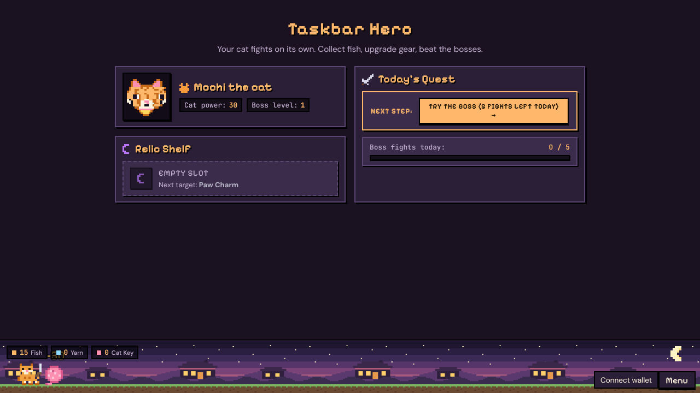
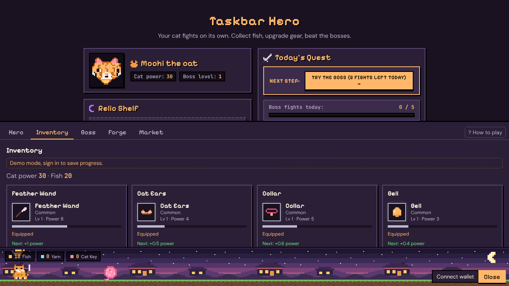
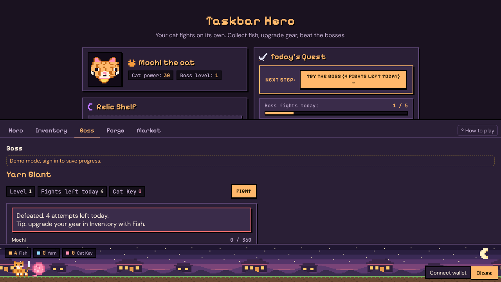
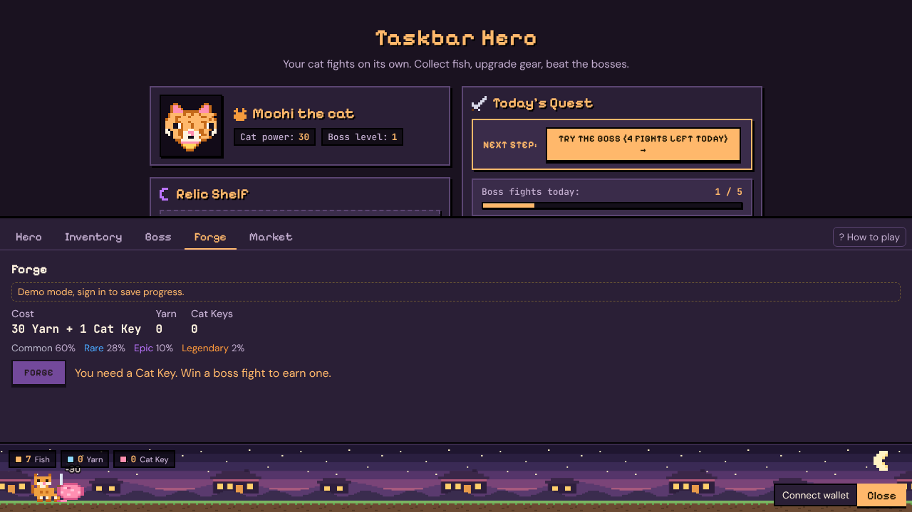
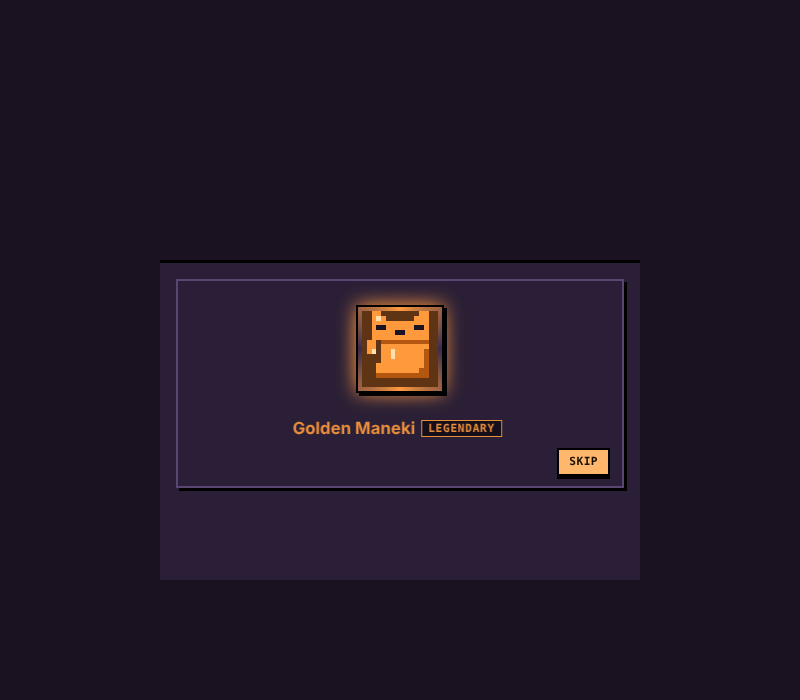
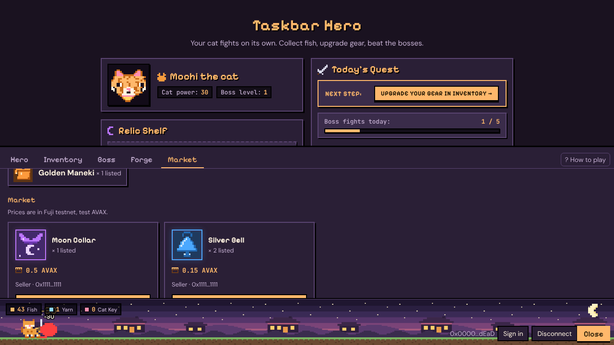
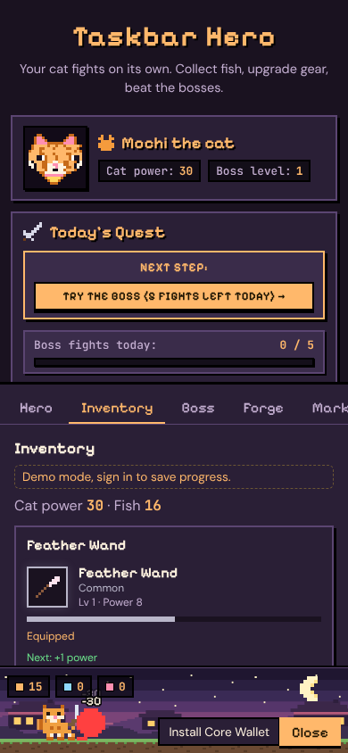
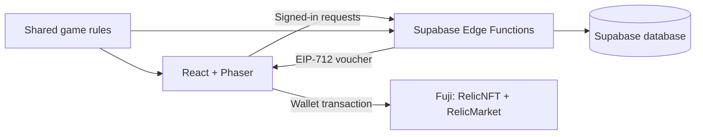

# Taskbar Hero

Taskbar Hero is an idle RPG in a thin strip at the bottom of a web page: let your hero fight, claim loot, upgrade gear, beat bosses, and forge collectible Relics. Everyday progression stays off-chain, while ERC-1155 Relic NFTs can be minted and traded on Avalanche Fuji testnet. There is no fungible token. **[Play the live demo](https://web-zeta-tan-13.vercel.app)**.

## How to play

1. Open the live demo above to see your hero in the bottom strip.
2. Connect an injected wallet such as Core or MetaMask in **Chrome, Brave, or Edge**, switch to Avalanche Fuji, and sign in. **Wallets do not work in Safari.**
3. Let your hero idle, then claim gold, shards, and gear drops.
4. Equip better gear, spend gold on upgrades, and beat the boss to earn a Boss Key.
5. In the Forge, spend 30 shards and 1 Boss Key to forge a Relic, then approve its mint transaction in your wallet. You need test AVAX for gas; forging is limited to one Relic per account per day.

## Screenshots

Captured from a local demo-mode build; the Market and the Forge reveal use sample data because they need a wallet and the Fuji contracts.


*Idle strip: Mochi the cat trots along the bottom of the page while fish, yarn and Cat Keys tick up.*


*Inventory: equip gear and spend fish on upgrades.*


*Boss: the server runs the fight, the client replays it.*


*Forge: the cost, the odds and why forging is blocked right now.*


*Forge reveal: the Relic rises with its rarity banner (sample Legendary).*


*Market: your Relics and fixed-price listings in test AVAX (sample listings).*



*Phone view at 390 px wide.*

## On-chain

Network: **Avalanche Fuji testnet — chain ID 43113**. The market uses test AVAX.

| Contract | Address on Snowtrace |
| --- | --- |
| RelicNFT (ERC-1155) | [0xB1a1edb7A75Db6e7067E747ddee32B39c2296f2D](https://testnet.snowtrace.io/address/0xB1a1edb7A75Db6e7067E747ddee32B39c2296f2D) |
| RelicMarket | [0x10fcC46e439d3E31Fb1720B337C45CadB9b2ff93](https://testnet.snowtrace.io/address/0x10fcC46e439d3E31Fb1720B337C45CadB9b2ff93) |

The server signs an EIP-712 voucher binding the player, Relic ID, rarity, nonce, and expiry to this chain and contract; the player's wallet submits it, and RelicNFT checks the signer, caller, expiry, unused nonce, and rarity consistency before minting one copy.

See [contract details](docs/contracts.md) for voucher validation and the fixed-price escrow market.

## Architecture



- **Client:** `apps/web` uses Vite, React, TypeScript, and Phaser for the UI and bottom game strip.
- **Game rules:** `packages/game-rules` shares deterministic progression and combat rules between client and server.
- **Backend:** `supabase` holds migrations and Edge Functions; the server decides gold, gear, shards, and Boss Key outcomes.
- **Wallet and auth:** `packages/auth` supplies wallet sign-in logic; the client uses wagmi and viem with injected wallets.
- **Blockchain:** `packages/chain` holds chain configuration and contract interfaces; `contracts` contains the Foundry NFT and market projects.

More detail: [architecture](docs/architecture.md). To add an endpoint, gear slot, rarity, boss or tab, follow the checklists in [extending](docs/extending.md).

## Run locally

Prerequisites: Node.js compatible with Vite 8, pnpm (the root package declares 10.28.0), and Git. Foundry is needed for contract tests. Run these commands from the repository root:

```sh
pnpm install
pnpm --filter @taskbar-hero/web dev
```

Open the local URL printed by Vite. Without Supabase configuration, the client uses mock game and auth APIs; this demo mode does not mint real Relics. See [backend setup](docs/go-live.md) for connected play.

Run all workspace unit tests, or either requested suite individually:

```sh
pnpm test
pnpm --filter @taskbar-hero/web test
pnpm --filter @taskbar-hero/game-rules test
```

For Solidity tests, initialize the pinned dependencies, then run Foundry:

```sh
git submodule update --init --recursive
cd contracts
forge test -vv
```

Dependency installation needs network access unless cached. Unit and contract tests run locally without a live Supabase service, wallet, or Fuji RPC once dependencies and the Solidity compiler are available.

## Credits and licenses

Built for **Avalanche Team1 Vietnam UniHack 2026**. Project code is licensed under the [MIT License](LICENSE); third-party dependencies retain their own licenses.

The placeholder hero, enemy, and ground are drawn at runtime with Phaser Graphics. Credit to [Kenney](https://kenney.nl) for CC0 asset packs considered for future art; those packs require no attribution.
