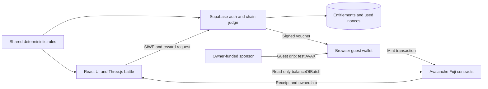

# Taskbar Hero — Lantern Cat Café

<!-- X3 prep: insert the delivered AGV hero GIF and trailer link here before the release PR. -->
**Recording media:** awaiting the AGV delivery. This branch is the release README draft.

The Lantern Cat Café is the last lit shop on a street tangled by abandoned tasks. Lead Mochi, Clover and Soot through a street patrol and face the Yarn Giant in a cosy browser card RPG. In the configured Avalanche mode, café memories become Relics that players can own on Fuji.

**Current integrated build:** [v5-m2.1](https://github.com/ntbaoheyhey/taskbar-hero/tree/v5-m2.1). The recording build will use `v5-m2.2` after the remaining V9 deliveries pass the integration gate.

## Play in three steps

Use Node 24 and pnpm 10.28.0. The local demo needs no account, wallet setup or test tokens.

1. Clone the integrated build and install its dependencies:

   ```sh
   git clone --branch v5-m2.1 https://github.com/ntbaoheyhey/taskbar-hero.git
   cd taskbar-hero
   pnpm install --frozen-lockfile
   ```

2. Build and launch the local preview:

   ```sh
   node tools/v5int/run-chain-mode.mjs --fixture
   ```

3. Open [Lantern Cat Café on port 6301](http://127.0.0.1:6301/?demo=1&squad=1&cardrpg2=1&a6=1&ui=v3). Choose **Play free → Guard the café → Face the Yarn Giant**. Keep the complete URL: the bare URL opens an older shell.

The three cats fight automatically at 1× speed. Mochi protects the team, Clover heals, and Soot delivers the final boss ultimate. The seeded journey has one street wave followed by the Yarn Giant; all twelve cats appear in Collection, while only the three demo cats enter these battles. **Play again** repeats the journey, and `&legacy=1` keeps the earlier game available.

The `--fixture` launch shows an explicitly labelled receipt preview after victory: no transaction or ownership is claimed. Collection can still read real Fuji balances for a public wallet address. For the owner-configured backend, sponsored guest funding and a real mint, follow [RUN-CHAIN-MODE.md](docs/RUN-CHAIN-MODE.md) and launch the same command without `--fixture`.

## How Avalanche is used

Combat runs off-chain using shared deterministic TypeScript rules. The server independently runs the fixed trial and controls reward entitlement; an editable browser save is never mint authority.

- **Guest sign-in:** a browser wallet signs a SIWE message, and Supabase validates the session.
- **Sponsored entry:** an owner-funded sponsor sends test AVAX through `guest-drip`. The guest wallet pays its own mint gas using those funds; this is a funded-EOA flow.
- **Boss reward:** after victory, the configured UI requests the existing finale voucher for **Relic #3, Moon Collar**, then submits `RelicNFT.mint`. The EIP-712 voucher binds the recipient, chain, contract, nonce and expiry, and the nonce prevents reuse.
- **Visible proof:** a successful receipt shows the full transaction hash, **Avalanche Fuji**, actual fee payer, AVAX fee and Snowtrace link.
- **Independent Collection:** the browser calls ERC-1155 `balanceOfBatch` directly on Fuji at one block. No backend or sign-in is required for this read; **Owned on Avalanche Fuji** appears only after a successful response.
- **Wider contract system:** ERC-20 YARN, markets and seasonal claims support the larger game. They are separate from the short three-cat judge journey and require their matching configured services.

All addresses below are on **Avalanche Fuji, chain ID 43113**, from the [versioned deployment registry](packages/chain/deployments/43113.json). Source verification was confirmed on 19 November 2026 using Foundry and Routescan, without an API key or a new deployment.

| Contract | Purpose | Verified source |
| --- | --- | --- |
| RelicNFT | ERC-1155 Relics and signed-voucher minting | [0xB1a1edb7A75Db6e7067E747ddee32B39c2296f2D](https://testnet.snowtrace.io/address/0xB1a1edb7A75Db6e7067E747ddee32B39c2296f2D/contract/43113/code) |
| RelicMarket | Legacy AVAX escrow market | [0x10fcC46e439d3E31Fb1720B337C45CadB9b2ff93](https://testnet.snowtrace.io/address/0x10fcC46e439d3E31Fb1720B337C45CadB9b2ff93/contract/43113/code) |
| YarnToken | ERC-20 YARN | [0x3ae1b898c1Ded263b30D968D26Fe65211f102d6b](https://testnet.snowtrace.io/address/0x3ae1b898c1Ded263b30D968D26Fe65211f102d6b/contract/43113/code) |
| RelicMarketV2 | AVAX/YARN trading and seller proceeds | [0x6Fe415494D791E63d87613B8FBCdbb24743C7eb4](https://testnet.snowtrace.io/address/0x6Fe415494D791E63d87613B8FBCdbb24743C7eb4/contract/43113/code) |
| SeasonRewards | Signed seasonal reward claims | [0x29d4F1b9d4577BF2bA5c6bdB849CA5fdc9bd6c11](https://testnet.snowtrace.io/address/0x29d4F1b9d4577BF2bA5c6bdB849CA5fdc9bd6c11/contract/43113/code) |

### Three real Fuji transactions

These successful **deployment transactions** were read back from Fuji RPC on 19 November 2026 and matched to the registry addresses. They establish deployment history; the fresh sponsored reward-mint recording remains owner-dependent.

| Transaction | Receipt | Block |
| --- | --- | ---: |
| Deploy YarnToken | [0x42cdaae9…c3a049](https://testnet.snowtrace.io/tx/0x42cdaae9a91984232225e6b9a57ce22447cae526703ad17eadc6e0ce8bc3a049) | 60,931,271 |
| Deploy RelicMarketV2 | [0x71467887…7207ef](https://testnet.snowtrace.io/tx/0x71467887c6e95a167e1a3cf4bf6f56c82eb3e4c7e69f5ded4e1aa49bcb7207ef) | 60,931,272 |
| Deploy SeasonRewards | [0x341ca448…167d9](https://testnet.snowtrace.io/tx/0x341ca4480e2e0bb39386d0eac3426c49a44c34d8144332dbdc4c14af569167d9) | 60,931,272 |

## Architecture



The browser owns presentation and wallet interaction, Supabase owns authenticated issuance decisions, and Fuji owns token settlement. Collection reads the chain directly. See [ARCHITECTURE.md](docs/ARCHITECTURE.md) and the [chain-mode run guide](docs/RUN-CHAIN-MODE.md) for service boundaries and configuration.

## Stack and repository map

The judge experience uses **Vite, React, TypeScript and Three.js**, with Spine/native rigs and video-texture idles. Shared game rules drive the seeded combat. **Supabase Edge Functions and Postgres**, SIWE, viem and Solidity contracts built with Foundry support the optional Avalanche mode. Phaser remains in legacy code; it does not draw the V9 judge battle.

| Path | Contents |
| --- | --- |
| `apps/web/` | Game UI, Three.js presentation, audio, wallet flow and public media |
| `packages/game-rules/` | Shared deterministic battle rules and V9 demo setup |
| `packages/chain/` | ABIs, Fuji addresses and chain helpers |
| `packages/auth/` | Authentication/session contracts |
| `supabase/` | Edge Functions and database migrations |
| `contracts/` | Solidity contracts, deployment scripts and Foundry tests |
| `tools/v5int/` | Local launch, verification and integration smoke tools |
| `tools/v9/` | Designer-idle conversion and original Blender VFX generation |
| `docs/` | Architecture, run guides, submission material and credits |

## Validation and current limits

The integration gate is a production build, TypeScript check, focused tests for changed code and a real browser demo run on port 6301. The `v5-m2.1` run completed the boss in 20.6 seconds at normal speed with Mochi, Clover and Soot's ultimates, then checked Collection, the labelled receipt fixture and the legacy route. This is a local playback observation, not a general hardware benchmark.

```sh
pnpm --filter @taskbar-hero/web typecheck
pnpm --filter @taskbar-hero/web build
node tools/v5int/v9-demo-smoke.mjs --chain-ui --v9-deliveries
```

Build the fixture mode with the launch command above before using the `--chain-ui` smoke option. Run contract tests separately with Foundry after initializing the repository submodules.

Recording media, final designer exports and remaining ultimate/SFX integration are still being assembled for the recording tag. A configured/deployed Supabase backend, funded sponsor and fresh real-mint screenshot remain owner work. The boss music's delivered licence is listed below and needs the owner decision recorded for the release.

## Credits

- **Character art and idle animation:** original project art and commissioned designer work for Mochi, Clover and Soot. Temporary Mochi/Clover conversions remain labelled as stand-ins until the final exports arrive.
- **V9 effects:** original Blender geometry, shaders and animation authored for the project; no OMG 3Q art or sound is included.
- **Battle music:** “RPG - To Arms! Battle Music 1” by HitCtrl, [source](https://opengameart.org/content/rpg-to-arms-battle-music-1), CC-BY 3.0; transcoded for browser playback.
- **Boss music:** “Boss Battle - Emotional Uplifting Metal Rock” by ISAo, [source](https://opengameart.org/content/boss-battle-emotional-uplifting-metal-rock), credited by the delivered manifest as OGA-BY 3.0; owner licence decision or an allowed replacement is pending.
- **Music and sound attribution:** [submission credits](docs/submission/CREDITS.md), [V9 music licences](apps/web/public/audio/v9/LICENSES.json), [existing audio provenance](apps/web/public/audio/LICENSES.json) and [project credits](docs/credits-v4.md). Final S2 sound attribution will follow the delivered files.
- **Art provenance:** [project asset record](docs/art/PROVENANCE.md). Project code is [MIT licensed](LICENSE); media and dependencies retain their stated licences.
