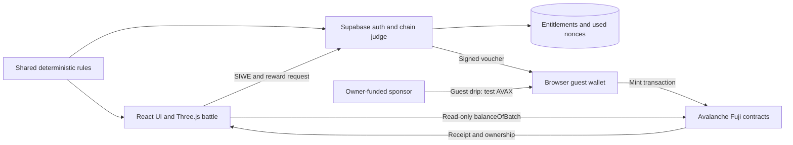

# Taskbar Hero — Lantern Cat Café


[Watch the 58-second v5-m2.16 run](docs/demo-v5-m2.16/demo.mp4) · [Step-by-step walkthrough](docs/demo-v5-m2.16/index.html) · [v5-m2.14 run](docs/demo-v5-m2.14/index.html) · [Earlier 51-second recording with music](art/trailer/v9/battle_v5-m2.5.mp4) · [Six-frame contact sheet](art/trailer/v9/contact_sheet_v5-m2.5.png)

The v5-m2.14 run and walkthrough show the current build: all three designer idles, battle VFX v10, the Yarn Giant, the receipt fixture and a live Fuji read. It is silent and recorded frame by frame at true game speed. The GIF and the 51-second recording with licensed wave and boss music were captured from `v5-m2.5`. The planned three-minute trailer remains separate.

The Lantern Cat Café is the last lit shop on a street tangled by abandoned tasks. Lead Mochi, Clover and Soot through a street patrol and face the Yarn Giant in a cosy browser card RPG. In the configured Avalanche mode, café memories become Relics that players can own on Fuji.

**Latest integrated build:** [v5-m2.14](https://github.com/ntbaoheyhey/taskbar-hero/tree/v5-m2.14), the recording build: designer idles for Mochi, Clover and Soot, battle VFX v10, the fixed-supply YARN economy and its 52-week simulation ([ECONOMY.md](docs/ECONOMY.md)), and the live Fuji end-to-end proof. The [v5-m2.2 recording baseline](https://github.com/ntbaoheyhey/taskbar-hero/tree/v5-m2.2) remains published before the recording deadline.

## Play in three steps

Use Node 24 and pnpm 10.28.0. The local demo needs no account, wallet setup or test tokens.

1. Clone the release branch and install its dependencies:

   ```sh
   git clone --depth 1 --branch release/2026-11-21 https://github.com/ntbaoheyhey/taskbar-hero.git
   cd taskbar-hero
   pnpm install --frozen-lockfile
   ```

2. Build and launch the local preview:

   ```sh
   node tools/v5int/run-chain-mode.mjs --fixture
   ```

3. Open [Lantern Cat Café on port 6301](http://127.0.0.1:6301/) and choose **Play free**. The bare address opens the full campaign.

A short story opens the café. Your crew walks three chapters (Tangled Café, Rooftop Orchard, Midnight Pantry), each a seven-stop route of battles, an event, an elite, treasure, a shop, a campfire and a guardian: the Yarn Giant, the Rain Spool and the Pantry Crown. Battles run on their own, but you time the ultimates: when a cat's rage is full its portrait glows, and a tap casts it on that cat's next turn (**Auto** casts them for you). Drops, levels and the Forge make the crew strong enough for the next chapter. Clearing chapter three plays the epilogue. Progress saves in the browser.

The 58-second judge recording remains at [`?demo=1&squad=1&cardrpg2=1&a6=1&ui=v3`](http://127.0.0.1:6301/?demo=1&squad=1&cardrpg2=1&a6=1&ui=v3) (**Guard the café → Face the Yarn Giant**), and `&legacy=1` keeps the earlier game available.

The `--fixture` launch shows an explicitly labelled receipt preview after victory: no transaction or ownership is claimed. Collection can still read real Fuji balances for a public wallet address. For the owner-configured backend, sponsored guest funding and a real mint, follow [RUN-CHAIN-MODE.md](docs/RUN-CHAIN-MODE.md) and launch the same command without `--fixture`.

## How Avalanche is used

Combat runs off-chain using shared deterministic TypeScript rules. The server independently runs the fixed trial and controls reward entitlement; an editable browser save is never mint authority.

- **Guest sign-in:** a browser wallet signs a SIWE message, and Supabase validates the session.
- **Sponsored entry:** an owner-funded sponsor sends test AVAX through `guest-drip`. The guest wallet pays its own mint gas using those funds; this is a funded-EOA flow.
- **Boss reward:** after victory, the configured UI requests the existing finale voucher for **Relic #3, Moon Collar**, then submits `RelicNFT.mint`. The EIP-712 voucher binds the recipient, chain, contract, nonce and expiry, and the nonce prevents reuse.
- **Visible proof:** a successful receipt shows the full transaction hash, **Avalanche Fuji**, actual fee payer, AVAX fee and Snowtrace link.
- **Independent Collection:** the browser calls ERC-1155 `balanceOfBatch` directly on Fuji at one block. No backend or sign-in is required for this read; **Owned on Avalanche Fuji** appears only after a successful response.
- **Wider contract system:** ERC-20 YARN, markets and seasonal claims support the larger game. They are separate from the short three-cat judge journey and require their matching configured services.

All addresses below are on **Avalanche Fuji, chain ID 43113**, from the [versioned deployment registry](packages/chain/deployments/43113.json). Source verification was confirmed on 19 November 2026 using Foundry and Routescan, without an API key or a new deployment.

| Contract | Purpose | Verified source |
| --- | --- | --- |
| RelicNFT | ERC-1155 Relics and signed-voucher minting | [0xB1a1edb7A75Db6e7067E747ddee32B39c2296f2D](https://testnet.snowtrace.io/address/0xB1a1edb7A75Db6e7067E747ddee32B39c2296f2D/contract/43113/code) |
| RelicMarket | Legacy AVAX escrow market | [0x10fcC46e439d3E31Fb1720B337C45CadB9b2ff93](https://testnet.snowtrace.io/address/0x10fcC46e439d3E31Fb1720B337C45CadB9b2ff93/contract/43113/code) |
| YarnToken | ERC-20 YARN | [0x3ae1b898c1Ded263b30D968D26Fe65211f102d6b](https://testnet.snowtrace.io/address/0x3ae1b898c1Ded263b30D968D26Fe65211f102d6b/contract/43113/code) |
| RelicMarketV2 | AVAX/YARN trading and seller proceeds | [0x6Fe415494D791E63d87613B8FBCdbb24743C7eb4](https://testnet.snowtrace.io/address/0x6Fe415494D791E63d87613B8FBCdbb24743C7eb4/contract/43113/code) |
| SeasonRewards | Signed seasonal reward claims | [0x29d4F1b9d4577BF2bA5c6bdB849CA5fdc9bd6c11](https://testnet.snowtrace.io/address/0x29d4F1b9d4577BF2bA5c6bdB849CA5fdc9bd6c11/contract/43113/code) |

### Three real Fuji transactions

These successful **historical gameplay transactions from 12 November 2026** were read back from Fuji RPC on 19 November. The destination contracts, decoded methods and receipt events confirm minting, listing and buying Relic #3. They show the existing on-chain flow; the fresh V9 sponsored reward-mint recording remains owner-dependent.

| Transaction | Receipt | Block |
| --- | --- | ---: |
| Mint Moon Collar, Relic #3 | [0x1cd4a1fb…261b8](https://testnet.snowtrace.io/tx/0x1cd4a1fb0fbe78a95893608b0435b9b720e9191c5287137f64696a519c9261b8) | 60,934,447 |
| List Relic #3 for 0.001 AVAX | [0x899ed5c5…83636](https://testnet.snowtrace.io/tx/0x899ed5c516b2909764f34143b6568711a8f94e61cccd1b6b551e0878e3b83636) | 60,934,457 |
| Buy that listing | [0x9662228f…7fddd](https://testnet.snowtrace.io/tx/0x9662228f168bd5080907f49bd3a01d735f91b620d5468c7778a362b74ec7fddd) | 60,934,461 |

## Game economy and YARN

Play earns bound rewards; power never needs the token. **YARN** (fixed 1B ERC-20 on Fuji, no mint) buys ownership: sealing gear into tradable NFTs, fusing three Epics into a Legendary NFT, café cosmetics and market trades, and each of those burns YARN on-chain. Weekly rewards leave the game as YARN only while season emission stays within a small launch allowance plus 90% of public burns, checked against Fuji before every claim is signed.

| | |
| --- | --- |
| Drop, gacha, fusion and enhancement odds | published in [docs/ECONOMY.md](docs/ECONOMY.md), generated from the live rule table |
| Fees | seal 13% of reference (burned); market 5% = 2% burned + 3% treasury |
| Allocation | players 35%, team 15%, treasury 12%, investors 12%, ecosystem 10%, early testers 6%, liquidity 5%, advisors 3%, partners 2% |
| 52-week simulation | burned / claimed **2.85×** balanced, **1.14×** at half demand; inflation capped if demand collapses ([report](docs/economy/SIM-REPORT.md)) |
| Studio revenue | 3% of every market sale plus capped treasury YARN sales; no paid randomness, no sold power |

Re-run the model with `node tools/economy/sim.mjs`.

## Architecture



The browser owns presentation and wallet interaction, Supabase owns authenticated issuance decisions, and Fuji owns token settlement. Collection reads the chain directly. See [ARCHITECTURE.md](docs/ARCHITECTURE.md) and the [chain-mode run guide](docs/RUN-CHAIN-MODE.md) for service boundaries and configuration.

## Stack and repository map

The judge experience uses **Vite, React, TypeScript and Three.js**, with Spine/native rigs and video-texture idles. Shared game rules drive the seeded combat. **Supabase Edge Functions and Postgres**, SIWE, viem and Solidity contracts built with Foundry support the optional Avalanche mode. Phaser remains in legacy code; it does not draw the V9 judge battle.

| Path | Contents |
| --- | --- |
| `apps/web/` | Game UI, Three.js presentation, audio, wallet flow and public media |
| `packages/game-rules/` | Shared deterministic battle rules and V9 demo setup |
| `packages/chain/` | ABIs, Fuji addresses and chain helpers |
| `packages/auth/` | Authentication/session contracts |
| `supabase/` | Edge Functions and database migrations |
| `contracts/` | Solidity contracts, deployment scripts and Foundry tests |
| `tools/v5int/` | Local launch, verification and integration smoke tools |
| `tools/v9/` | Designer-idle conversion and original Blender VFX generation |
| `docs/` | Architecture, run guides, submission material and credits |

## Validation and current limits

The integration gate is a production build, TypeScript check, focused tests for changed code and a muted browser demo run on port 6301. The v5-m2.13 changes passed 40 focused web unit tests, 19 server budget tests, the 33-screen word-budget audit, keyboard access, three independent viewport checks, three effect/contact checks and all four isolated chain browser scenarios. The real Anvil seal-price and tester-budget proofs pass, including a deliberately advanced chain clock; production freshness, finite-budget and replay guards remain enabled.

The browser gate exercises the street wave and boss at normal speed, all three ultimates, twelve sound layers, eight base Blender flipbooks, all three enemy HUD portraits, live Fuji Collection, the labelled receipt fixture and the legacy route. Chromium output is muted while audio playback diagnostics remain active. [PR #446](https://github.com/ntbaoheyhey/taskbar-hero/pull/446) reports the current remote CI results. These local checks do not establish a fresh public Fuji mint or Safari device playback.

```sh
pnpm --filter @taskbar-hero/web typecheck
pnpm --filter @taskbar-hero/web build
node tools/v5int/v9-demo-smoke.mjs --chain-ui --v9-deliveries --v9-recording
```

Build the fixture mode with the launch command above before using the `--chain-ui` smoke option. Run contract tests separately with Foundry after initializing the repository submodules.

The three ultimates and their sound layers are integrated. The hero GIF, a demo recording with music and six 1920×1080 screenshots are available. Mochi/Clover now use final designer PNG-sequence conversions at a shared source scale; Claude reported clean edges in the delivered judge run. Safari HEVC-alpha MOVs are included alongside the WebMs; the automated browser gate runs Chromium. Soot now uses its designer WebM idle; it has no HEVC-alpha export yet, so Safari plays the WebM. The final three-minute trailer remains a separate follow-up. A configured/deployed Supabase backend, funded sponsor and fresh real-mint screenshot remain owner work.

## Submission screenshots

[Title](docs/submission/media/title.png) · [Three-cat squad](docs/submission/media/squad.png) · [Mochi cut-in](docs/submission/media/cutin.png) · [Impact](docs/submission/media/impact.png) · [Receipt fixture](docs/submission/media/mint-toast.png) · [Fuji Collection read](docs/submission/media/collection.png)

These stills were captured from `v5-m2.5`, before the final Mochi/Clover idles. The receipt screenshot is explicitly a **fixture**, with no submitted transaction or explorer link. The Collection screenshot shows a successful Fuji read for an empty wallet. Neither screenshot is proof of a new mint.

## Credits

- **Character art and idle animation:** original project art and commissioned designer work for Mochi, Clover and Soot. Final Mochi/Clover WebMs and HEVC-alpha MOVs are converted from the designer’s transparent PNG sequences; Soot designer files remain pending.
- **V9 effects:** original Blender geometry, shaders and animation authored for the project; no OMG 3Q art or sound is included.
- **Battle music:** “RPG - To Arms! Battle Music 1” by HitCtrl, [source](https://opengameart.org/content/rpg-to-arms-battle-music-1), CC-BY 3.0; transcoded for browser playback.
- **Boss music:** “Volatile Reaction” by Kevin MacLeod (incompetech.com), [source](https://incompetech.com/music/royalty-free/index.html?isrc=USUAN1400039), licensed under [Creative Commons Attribution 4.0](https://creativecommons.org/licenses/by/4.0/). Cropped and transcoded for browser playback.
- **Music and sound attribution:** [submission credits](docs/submission/CREDITS.md), [V9 music licences](apps/web/public/audio/v9/LICENSES.json), [existing audio provenance](apps/web/public/audio/LICENSES.json) and [project credits](docs/credits-v4.md). The twelve S2 ultimate layers and three shared sounds derive from Kenney Impact Sounds and RPG Audio under CC0; per-cue sources are listed in the submission credits.
- **Art provenance:** [project asset record](docs/art/PROVENANCE.md). Project code is [MIT licensed](LICENSE); media and dependencies retain their stated licences.
