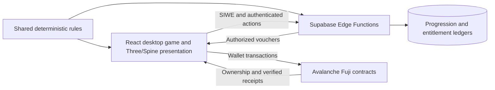

# Taskbar Hero — Lantern Cat Café

A cosy desktop card RPG: arrange a four-cat crew, defend a lantern-lit café, collect gear and improve your team. Mochi and Panko guard the front, Soot attacks from range, and Clover heals. Optional Avalanche Fuji services add collectible ownership, trading and verifiable transaction receipts.

**Current integration:** `codex/v5-int-2026-11-17`. [Current green tag and work state](reports/v5/CXI/HANDOFF.md) · [Desktop evidence](reports/v5/CXI/I-C.md) · [Local review footage](reports/v5/CXI/REVIEW-VI.md) · [Architecture](docs/ARCHITECTURE.md) · [Owner deployment and Fuji proof](reports/v5/CXI/NEEDS-USER-VI.md).

**Judge URL:** [Open the desktop production preview](http://127.0.0.1:6301/?demo=1&squad=1&cardrpg2=1&a6=1&ui=v3). This URL works on the preview host after the steps below. A public deployment of the current green tag has not yet been verified; the owner runbook describes how to publish it.

## Three-step quick start

Use Node 24 (see `.nvmrc`) and pnpm 10.28.0. The frontend demo needs no wallet, account or test tokens.

1. Get the integration branch and install dependencies:

   ```sh
   git clone --branch codex/v5-int-2026-11-17 https://github.com/ntbaoheyhey/taskbar-hero.git
   cd taskbar-hero
   pnpm install --frozen-lockfile
   ```

2. Build and keep the production preview running:

   ```sh
   pnpm --filter @taskbar-hero/web build
   pnpm --filter @taskbar-hero/web exec vite preview --host 127.0.0.1 --port 6301 --strictPort
   ```

3. Open the judge URL above on desktop. Choose **Play free → Fight → Fight**, finish the short battle guide, then welcome your free cat. Follow the guide to level up a cat and start a patrol. The result shows your route points and gear. The visible speed button cycles 1×, 2× and 3×.

Use the complete judge URL above for review. `?legacy=1` explicitly opens the older shell. The demo stores campaign progress in the browser; the URL does not enable chain services. To develop locally, use `pnpm --filter @taskbar-hero/web dev --host 127.0.0.1 --port 6300 --strictPort`.

## Where Avalanche is used

Combat is a deterministic TypeScript simulation. In the configured chain mode, Supabase authenticates SIWE sessions and authorizes eligible rewards; Fuji contracts settle mints, ownership, trades and token claims. Browser campaign saves are not issuance authority.

- **Guest entry:** an ordinary browser EOA signs SIWE. The guest-drip service supplies test AVAX from a sponsor. This implementation uses funded EOAs, with no ERC-4337 EntryPoint/paymaster flow.
- **Items and trading:** RelicNFT uses ERC-1155 signed vouchers. RelicMarketV2 supports AVAX/YARN trades; YarnToken is ERC-20; SeasonRewards settles signed claims. Features require their matching deployed services and build switches.
- **Receipts:** a confirmed action displays its transaction hash, network, actual fee payer, AVAX fee, known confirmation duration and explorer link. Local receipts have a local label and no public explorer link. Synthetic UI captures are labelled separately. Offline battle results link the deployed Fuji items contract and explicitly state that no transaction was sent.

The [public read-only check](reports/v5/CXI/PUBLIC-FUJI.json) found bytecode at all five registry addresses on Fuji block **61,234,900**, 17 November 2026. This establishes code presence; public guest funding and the complete hosted chain journey still need the owner-run proof. The proof kit verifies the receipt, sender, recipient, exact funding amount and actual gas fee. Unknown confirmation timing stays unknown.

| Contract | Role | Fuji explorer |
| --- | --- | --- |
| RelicNFT | ERC-1155 items and signed-voucher minting | [0xB1a1edb7A75Db6e7067E747ddee32B39c2296f2D](https://testnet.snowtrace.io/address/0xB1a1edb7A75Db6e7067E747ddee32B39c2296f2D) |
| RelicMarket | Legacy AVAX escrow market | [0x10fcC46e439d3E31Fb1720B337C45CadB9b2ff93](https://testnet.snowtrace.io/address/0x10fcC46e439d3E31Fb1720B337C45CadB9b2ff93) |
| YarnToken | ERC-20 YARN | [0x3ae1b898c1Ded263b30D968D26Fe65211f102d6b](https://testnet.snowtrace.io/address/0x3ae1b898c1Ded263b30D968D26Fe65211f102d6b) |
| RelicMarketV2 | AVAX/YARN market and seller proceeds | [0x6Fe415494D791E63d87613B8FBCdbb24743C7eb4](https://testnet.snowtrace.io/address/0x6Fe415494D791E63d87613B8FBCdbb24743C7eb4) |
| SeasonRewards | Signed reward claims | [0x29d4F1b9d4577BF2bA5c6bdB849CA5fdc9bd6c11](https://testnet.snowtrace.io/address/0x29d4F1b9d4577BF2bA5c6bdB849CA5fdc9bd6c11) |

Addresses come from the [versioned Fuji registry](packages/chain/deployments/43113.json). All are testnet, chain ID 43113; test tokens have no real value. Optional RelicForge has no public address in that registry.

## Architecture



`apps/web` owns presentation, audio and wallet interaction. `packages/game-rules` supplies shared rules; `packages/auth` verifies sessions; `packages/chain` contains ABIs and addresses. Supabase owns connected progression and issuance decisions; contracts own token settlement. The [architecture page](docs/ARCHITECTURE.md) explains those boundaries, loading and recovery.

## Run checks and inspect evidence

```sh
pnpm typecheck
pnpm --filter @taskbar-hero/web test
pnpm test
pnpm --filter @taskbar-hero/web build
node --test tools/v5int/fuji-proof-kit.test.mjs
```

Root `pnpm test` includes the workspace web tests. Contract tests are a separate read-only check: after installing Foundry and initializing submodules with `git submodule update --init --recursive`, run `forge test --root contracts`.

The [desktop evidence record](reports/v5/CXI/I-C.md) separates passing checks, fixture review and ordinary guest play. On **v5-m1.7**, the first visible enemy HP decrease occurs in **20.882 seconds**, including 17.7 seconds to read all eight tutorial cards; no saved progress, tutorial skipping or speed change was used. This passes the 30-second first-hit target. Cold combat entries are **7,909,547 / 8,469,958 / 7,984,401 bytes** for wave1/wave3/boss: wave3 still exceeds 8 MB, and boss has only 15,599 bytes of headroom. Three local 30-second films show real 1× gameplay with browser audio using labelled fixtures. These local results establish neither public network performance nor a real Fuji transaction.

The [owner runbook](reports/v5/CXI/NEEDS-USER-VI.md) contains the isolated Anvil dry-run and explicit, environment-gated Fuji funding command. It also pins the green release for deployment. No private key is an input to that proof kit.

## Credits

Project code is [MIT licensed](LICENSE). Dependencies and media retain their own terms: [credits](docs/credits-v4.md), [audio provenance](apps/web/public/audio/LICENSES.json), and [art provenance](docs/art/PROVENANCE.md). Earlier [submission material](docs/submission.md) describes historical builds; current acceptance evidence lives under `reports/v5/CXI`.
