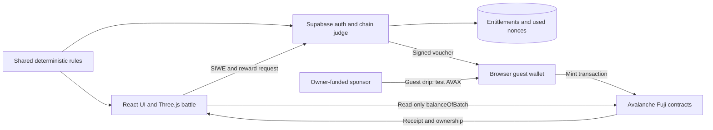

# Lantern Cat Café

Lead Mochi, Clover and Soot through a three-chapter browser RPG to save their café. Time the cats’ ultimates, defeat the Yarn Giant and turn the memory of that battle into a Moon Collar Relic on Avalanche Fuji.

**[Play Lantern Cat Café](https://taskbarhero-eight.vercel.app/)** · [Chapter 1 mint on Snowtrace](https://testnet.snowtrace.io/tx/0x566fe1355cad0c4b71dcab6daa8c0f23fe94282e7f601d2f16700800ddf47c56) · [Mint, listing and sale receipts](docs/avalanche/LIVE-E2E.md) · [Contest game release v5-m2.18](https://github.com/ntbaoheyhey/lantern-cat-cafe/tree/v5-m2.18)


## Play online

1. Open the game in **desktop Google Chrome** and choose **Play free**. Safari can show a black rectangle behind some animated cats during battles.
2. Finish the first chapter and defeat its guardian, the Yarn Giant. Ordinary battles and their gear rewards resolve in the browser.
3. Choose **Keep as Relic**, sign in with your wallet when prompted and confirm the mint on Avalanche Fuji. Open the Snowtrace link on the receipt to inspect the transaction.

[Watch the 58-second recording](docs/demo-v5-m2.16/demo.mp4) · [Recording walkthrough](docs/demo-v5-m2.16/index.html). This earlier run shows the battle and a labelled fixture receipt. The production mint and market receipts are linked above.

## Run locally

For the local demo, use Node 24 and pnpm 10.28.0. The local demo needs no account, wallet setup or test tokens.

1. Clone the repository and install its dependencies.

   ```sh
   git clone --depth 1 --branch main https://github.com/ntbaoheyhey/lantern-cat-cafe.git
   cd lantern-cat-cafe
   pnpm install --frozen-lockfile
   ```

2. Build and launch the local preview.

   ```sh
   node tools/v5int/run-chain-mode.mjs --fixture
   ```

3. Open [Lantern Cat Café on port 6301](http://127.0.0.1:6301/) and choose **Play free**. The bare address opens the full campaign.

A short story opens the café. Your crew walks three chapters (Tangled Café, Rooftop Orchard, Midnight Pantry), each a seven-stop route of battles, an event, an elite, treasure, a shop, a campfire and a guardian: the Yarn Giant, the Rain Spool and the Pantry Crown. Battles run on their own, but you time the ultimates: when a cat's rage is full its portrait glows, and a tap casts it on that cat's next turn (**Auto** casts them for you). Drops, levels and the Forge make the crew strong enough for the next chapter. Clearing chapter three plays the epilogue. Progress saves in the browser.

The route used for the 58-second recording is available at [`?demo=1&squad=1&cardrpg2=1&a6=1&ui=v3`](http://127.0.0.1:6301/?demo=1&squad=1&cardrpg2=1&a6=1&ui=v3) (**Guard the café → Face the Yarn Giant**), and `&legacy=1` keeps the earlier game available.

The `--fixture` launch shows an explicitly labelled receipt preview after victory: no transaction or ownership is claimed. Collection can still read real Fuji balances for a public wallet address. For a local run against the configured Fuji backend with sponsored guest gas, follow [RUN-CHAIN-MODE.md](docs/RUN-CHAIN-MODE.md) and launch the same command without `--fixture`.

## How Avalanche is used

Combat runs off-chain using shared deterministic TypeScript rules. The server independently runs the fixed trial and controls reward entitlement; an editable browser save is never mint authority.

- **Guest sign-in:** a browser wallet signs a SIWE message, and Supabase validates the session.
- **Sponsored entry:** an owner-funded sponsor sends test AVAX through `guest-drip`. The guest wallet pays its own mint gas using those funds; this is a funded-EOA flow.
- **Boss reward:** after victory, the configured UI requests the existing finale voucher for **Relic #3, Moon Collar**, then submits `RelicNFT.mint`. The EIP-712 voucher binds the recipient, chain, contract, nonce and expiry, and the nonce prevents reuse.
- **Visible proof:** a successful receipt shows the full transaction hash, **Avalanche Fuji**, actual fee payer, AVAX fee and Snowtrace link.
- **Independent Collection:** the browser calls ERC-1155 `balanceOfBatch` directly on Fuji at one block. No backend or sign-in is required for this read; **Owned on Avalanche Fuji** appears only after a successful response.
- **Wider contract system:** ERC-20 YARN, markets and seasonal claims support the larger game. They are separate from the short three-cat judge journey and require their matching configured services.

All addresses below are on **Avalanche Fuji, chain ID 43113**, from the [versioned deployment registry](packages/chain/deployments/43113.json). On 21 November 2026, all five returned deployed bytecode at block 61,427,562 and named, verified Solidity source on Routescan. Both markets point to this RelicNFT. RelicMarketV2 and SeasonRewards both point to this YarnToken.

| Contract | Purpose | Verified source |
| --- | --- | --- |
| RelicNFT | ERC-1155 Relics and signed-voucher minting | [0xB1a1edb7A75Db6e7067E747ddee32B39c2296f2D](https://testnet.snowtrace.io/address/0xB1a1edb7A75Db6e7067E747ddee32B39c2296f2D/contract/43113/code) |
| RelicMarket | Legacy AVAX escrow market | [0x10fcC46e439d3E31Fb1720B337C45CadB9b2ff93](https://testnet.snowtrace.io/address/0x10fcC46e439d3E31Fb1720B337C45CadB9b2ff93/contract/43113/code) |
| YarnToken | ERC-20 YARN | [0x3ae1b898c1Ded263b30D968D26Fe65211f102d6b](https://testnet.snowtrace.io/address/0x3ae1b898c1Ded263b30D968D26Fe65211f102d6b/contract/43113/code) |
| RelicMarketV2 | AVAX/YARN trading and seller proceeds | [0x6Fe415494D791E63d87613B8FBCdbb24743C7eb4](https://testnet.snowtrace.io/address/0x6Fe415494D791E63d87613B8FBCdbb24743C7eb4/contract/43113/code) |
| SeasonRewards | Signed seasonal reward claims | [0x29d4F1b9d4577BF2bA5c6bdB849CA5fdc9bd6c11](https://testnet.snowtrace.io/address/0x29d4F1b9d4577BF2bA5c6bdB849CA5fdc9bd6c11/contract/43113/code) |

### Confirmed Fuji transactions

The hosted Chrome campaign minted Moon Collar (Relic #3) in block 61,409,492. A separate guest-to-guest sale on RelicMarketV2 traded one Moon Collar for 0.001 test AVAX. The buyer held the Relic after settlement, and the seller withdrew 0.00095 test AVAX. [Full sale and funding receipts](docs/avalanche/LIVE-E2E.md)

| Transaction | Block | Snowtrace receipt |
| --- | ---: | --- |
| Chapter 1 mint on the live site | 61,409,492 | [Mint Moon Collar](https://testnet.snowtrace.io/tx/0x566fe1355cad0c4b71dcab6daa8c0f23fe94282e7f601d2f16700800ddf47c56) |
| List Moon Collar (listing #6) | 61,406,027 | [List](https://testnet.snowtrace.io/tx/0xf29d14fa20b80ed2a7bd0675d398b7f96ce89a33d28637a537ca109863815396) |
| Buy listing #6 | 61,406,035 | [Buy](https://testnet.snowtrace.io/tx/0x119b1df911379c7cf3dda5029c4a8158c25cc22d22d8fca647bb404533a6a455) |
| Withdraw proceeds | 61,406,037 | [Withdraw](https://testnet.snowtrace.io/tx/0xa92dc46a1f353db779de9b5080f6dc4b18cdf17c3965b26866be1952d28dcf0c) |

## Game economy and YARN

Combat and gear progression use bound rewards. **Spool** is a balance on the café’s server ledger. Sign in to see it. Eligible players can spend Spool in game or withdraw it as **YARN**, the Fuji ERC-20. The demo has a shared withdrawal ceiling of 600 test YARN. The token launched with a fixed one-billion-token allocation and supports burning. Market sales settle in test AVAX or YARN. The 5% market fee is paid in the sale currency.

| | |
| --- | --- |
| Drop, gacha, fusion and enhancement odds | published in [docs/ECONOMY.md](docs/ECONOMY.md), generated from the live rule table |
| Fees | seal 13% of reference (burned); market 5% = 2% burned + 3% treasury |
| Allocation | players 35%, team 15%, treasury 12%, investors 12%, ecosystem 10%, early testers 6%, liquidity 5%, advisors 3%, partners 2% |
| 52-week simulation | burned / claimed **2.85×** balanced, **1.14×** at half demand; inflation capped if demand collapses ([report](docs/economy/SIM-REPORT.md)) |
| Treasury | 3% of each RelicMarketV2 sale goes to treasury proceeds in the sale currency |

Re-run the model with `node tools/economy/sim.mjs`.

## Architecture



The browser owns presentation and wallet interaction, Supabase owns authenticated issuance decisions, and Fuji owns token settlement. Collection reads the chain directly. See [ARCHITECTURE.md](docs/ARCHITECTURE.md) and the [chain-mode run guide](docs/RUN-CHAIN-MODE.md) for service boundaries and configuration.

## Stack and repository map

The judge experience uses **Vite, React, TypeScript and Three.js**, with Spine/native rigs and video-texture idles. Shared game rules drive the seeded combat. **Supabase Edge Functions and Postgres**, SIWE, viem and Solidity contracts built with Foundry support the optional Avalanche mode. Phaser remains in legacy code; it does not draw the V9 judge battle.

| Path | Contents |
| --- | --- |
| `apps/web/` | Game UI, Three.js presentation, audio, wallet flow and public media |
| `packages/game-rules/` | Shared deterministic battle rules and V9 demo setup |
| `packages/chain/` | ABIs, Fuji addresses and chain helpers |
| `packages/auth/` | Authentication/session contracts |
| `supabase/` | Edge Functions and database migrations |
| `contracts/` | Solidity contracts, deployment scripts and Foundry tests |
| `tools/v5int/` | Local launch, verification and integration smoke tools |
| `tools/v9/` | Designer-idle conversion and original Blender VFX generation |
| `docs/` | Architecture, run guides, submission material and credits |

## Validation

Run the workspace checks from the repository root with Node 24 and pnpm 10.28.0.

```sh
pnpm install && pnpm test
pnpm typecheck && pnpm lint && pnpm build
```

For the local judge-route smoke test, start the fixture preview and run `node tools/v5int/v9-demo-smoke.mjs --chain-ui --v9-deliveries --v9-recording` from a second terminal. Contract tests use Foundry and the Git submodules. The [Fuji proof](docs/avalanche/LIVE-E2E.md) records the live mint and sale.

## Submission screenshots

[Title](docs/submission/media/title.png) · [Three-cat squad](docs/submission/media/squad.png) · [Mochi cut-in](docs/submission/media/cutin.png) · [Impact](docs/submission/media/impact.png) · [Receipt fixture](docs/submission/media/mint-toast.png) · [Fuji Collection read](docs/submission/media/collection.png)

These stills were captured from `v5-m2.5`, before the final Mochi/Clover idles. The receipt screenshot is explicitly a **fixture**, with no submitted transaction or explorer link. The Collection screenshot shows a successful Fuji read for an empty wallet. Neither screenshot is proof of a new mint.

## Credits

- **Character art and idle animation:** original project art and commissioned designer work for Mochi, Clover and Soot. Final Mochi/Clover WebMs and HEVC-alpha MOVs are converted from the designer’s transparent PNG sequences; Soot uses a designer WebM idle. Safari may render its transparent background as black.
- **V9 effects:** original Blender geometry, shaders and animation authored for the project; no OMG 3Q art or sound is included.
- **Battle music:** “RPG - To Arms! Battle Music 1” by HitCtrl, [source](https://opengameart.org/content/rpg-to-arms-battle-music-1), CC-BY 3.0; transcoded for browser playback.
- **Boss music:** “Volatile Reaction” by Kevin MacLeod (incompetech.com), [source](https://incompetech.com/music/royalty-free/index.html?isrc=USUAN1400039), licensed under [Creative Commons Attribution 4.0](https://creativecommons.org/licenses/by/4.0/). Cropped and transcoded for browser playback.
- **Music and sound attribution:** [submission credits](docs/submission/CREDITS.md), [V9 music licences](apps/web/public/audio/v9/LICENSES.json), [existing audio provenance](apps/web/public/audio/LICENSES.json) and [project credits](docs/credits-v4.md). The twelve S2 ultimate layers and three shared sounds derive from Kenney Impact Sounds and RPG Audio under CC0; per-cue sources are listed in the submission credits.
- **Art provenance:** [project asset record](docs/art/PROVENANCE.md). Project code is [MIT licensed](LICENSE); media and dependencies retain their stated licences.
