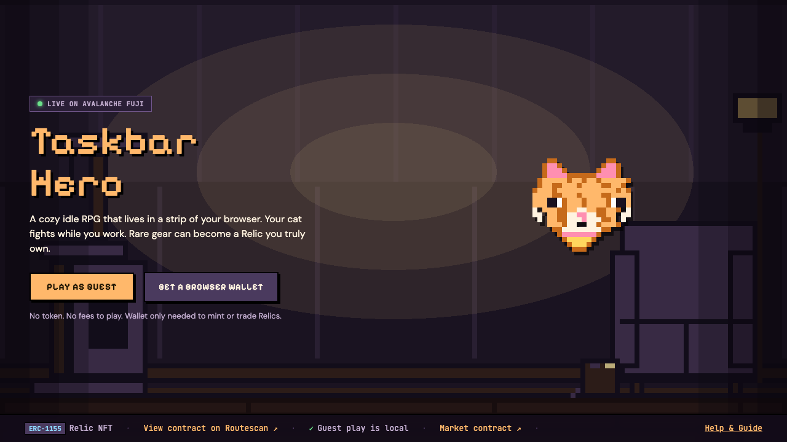
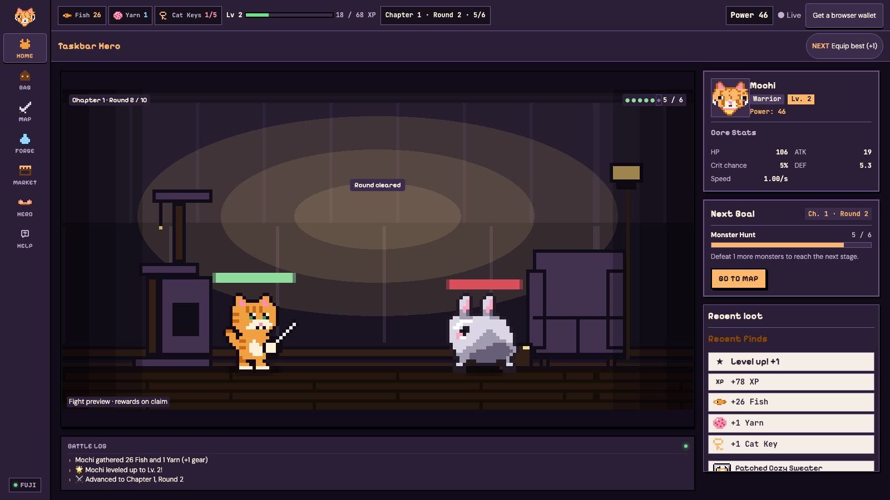
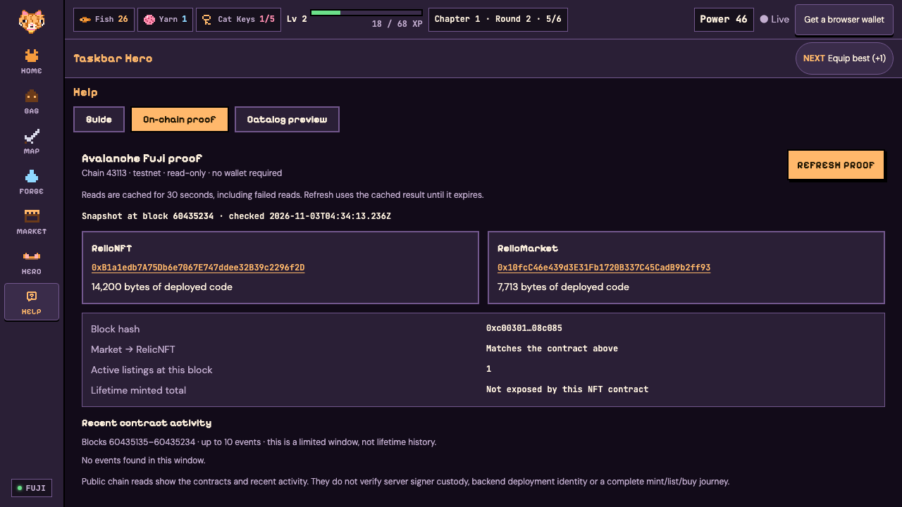
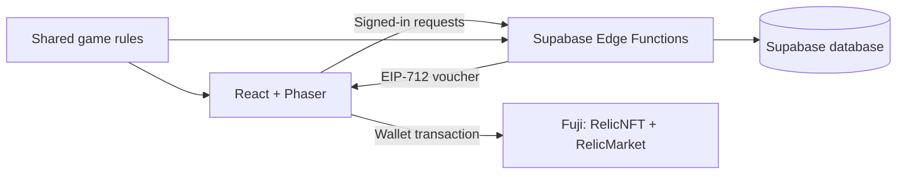

# Taskbar Hero

## For judges — draft review entry

[Play Taskbar Hero](https://taskbarhero-eight.vercel.app). The repository remains **private**; this task does not submit the project or change access. [Submission pack DRAFT](docs/submission.md) · [Nine-slide outline](docs/pitch-slides.md) · [Video script DRAFT](docs/video-script.md) · [Security overview](docs/security-overview.md).

Taskbar Hero is a desktop idle RPG with a cat adventurer. Guest progress lives locally in the browser. Authenticated play uses server-owned state and shared rules; collectible Relics use wallet transactions on Avalanche Fuji. No separate ERC-20 game currency or mainnet deployment is claimed.

| Fuji 43113 contract | Address / public explorer |
|---|---|
| RelicNFT (ERC-1155) | [0xB1a1edb7A75Db6e7067E747ddee32B39c2296f2D](https://testnet.routescan.io/address/0xB1a1edb7A75Db6e7067E747ddee32B39c2296f2D/contract) |
| RelicMarket (escrow) | [0x10fcC46e439d3E31Fb1720B337C45CadB9b2ff93](https://testnet.routescan.io/address/0x10fcC46e439d3E31Fb1720B337C45CadB9b2ff93/contract) |

Help→On-chain proof reads code, linkage and recent events. Read-only evidence is not a mint/list/buy receipt, lifetime supply count or independent audit. Fresh funded wallet proof is pending. PR #244 also remains blocked by the missing complete deployed function backup and tested restore path; see [security evidence](docs/security-overview.md).

## How to inspect the current v2 guest loop

1. Open the live site, dismiss initial Help if shown, and choose one of three starter classes. The broader registry contains seven classes.
2. Watch real idle claims, then use Bag to compare/equip gear. The bag holds 200 items; Hero shows nine slots.
3. Map shows five chapters and boss requirements. A daily first claim grants a Cat Key; a boss win spends one and a loss keeps it.
4. Forge crafts gear from game materials. The v2 daily Relic recipe is 30 Yarn plus 1 Moon Pearl; minting requires wallet/sign-in and free Fuji test AVAX.
5. Open Help→On-chain proof, then Market. Guest mode honestly shows the wallet requirement; ordinary gear is not tradable there.

The optional catalog starts OFF and previews 12 stats, 15 items, 5 qualities and 7 skills. It does not activate the shared original economy, change saves or grant ownership. Timed live demo refresh waits for the UI session's readiness log. See the [judge guide](docs/judge-walkthrough.md) and distinguish its dated historical sections from current evidence.

## Versioned live screenshots

These are unchanged guest/read-only captures of 6144d42 on 3 November 2026, before the current UI refresh. [Media hashes and scope](reports/submission/evidence/media-manifest.json) · [Exact release receipt](reports/submission/evidence/6144d42-acceptance.json). That receipt records 2,490 core cases, 323 browser cases per desktop size and 35 matching live assets; these are historical, version-specific numbers.







Other baseline captures in the manifest show a locked Map gate and an opt-in local catalog. They are not victory, wallet ownership or transaction evidence. Existing older local/sample screenshots remain in docs/screenshots and are not relabelled as live.

## On-chain

Network: **Avalanche Fuji testnet — chain ID 43113**. The market uses test AVAX.

| Contract | Address on Snowtrace |
| --- | --- |
| RelicNFT (ERC-1155) | [0xB1a1edb7A75Db6e7067E747ddee32B39c2296f2D](https://testnet.snowtrace.io/address/0xB1a1edb7A75Db6e7067E747ddee32B39c2296f2D) |
| RelicMarket | [0x10fcC46e439d3E31Fb1720B337C45CadB9b2ff93](https://testnet.snowtrace.io/address/0x10fcC46e439d3E31Fb1720B337C45CadB9b2ff93) |

The server signs an EIP-712 voucher binding the player, Relic ID, rarity, nonce, and expiry to this chain and contract; the player's wallet submits it, and RelicNFT checks the signer, caller, expiry, unused nonce, and rarity consistency before minting one copy.

See [contract details](docs/contracts.md) for voucher validation and the fixed-price escrow market.

## Architecture



- **Client:** `apps/web` uses Vite, React, TypeScript, and Phaser for the UI and bottom game strip.
- **Game rules:** `packages/game-rules` shares deterministic progression and combat rules between client and server.
- **Backend:** `supabase` holds migrations and Edge Functions; the server decides gold, gear, shards, and Boss Key outcomes.
- **Wallet and auth:** `packages/auth` supplies wallet sign-in logic; the client uses wagmi and viem with injected wallets.
- **Blockchain:** `packages/chain` holds chain configuration and contract interfaces; `contracts` contains the Foundry NFT and market projects.

More detail: [architecture](docs/architecture.md). To add an endpoint, gear slot, rarity, boss or tab, follow the checklists in [extending](docs/extending.md).

## Run locally

Prerequisites: Node.js compatible with Vite 8, pnpm (the root package declares 10.28.0), and Git. Foundry is needed for contract tests. Run these commands from the repository root:

```sh
pnpm install
pnpm --filter @taskbar-hero/web dev
```

Open the local URL printed by Vite. Without Supabase configuration, the client uses mock game and auth APIs; this demo mode does not mint real Relics. See [backend setup](docs/go-live.md) for connected play.

Run all workspace unit tests, or either requested suite individually:

```sh
pnpm test
pnpm --filter @taskbar-hero/web test
pnpm --filter @taskbar-hero/game-rules test
pnpm --filter @taskbar-hero/supabase-tests test   # Edge Function tests (also run by pnpm test)
```

Browser tests (Playwright) need a one-time browser download and a production build first:

```sh
pnpm --filter @taskbar-hero/web exec playwright install chromium
pnpm --filter @taskbar-hero/web build
pnpm --filter @taskbar-hero/web test:e2e
```

For Solidity tests, initialize the pinned dependencies, then run Foundry:

```sh
git submodule update --init --recursive
cd contracts
forge test -vv
```

Dependency installation needs network access unless cached. Unit and contract tests run locally without a live Supabase service, wallet, or Fuji RPC once dependencies and the Solidity compiler are available.

## Credits and licenses

Built for **Avalanche Team1 Vietnam UniHack 2026**. Project code is licensed under the [MIT License](LICENSE); third-party dependencies retain their own licenses.

New catalog icons have [concrete source/tool/date/hash provenance](reports/asset-provenance.md). [Canonical historical provenance](docs/art/PROVENANCE.md) distinguishes existing project-original claims from independent chain-of-title proof; unknown historical prompts/model details remain unknown. The older [licence inventory](docs/licenses-v2.md) declares the fonts as SIL OFL1.1. This draft does not certify every historical asset licence or add third-party artwork.
