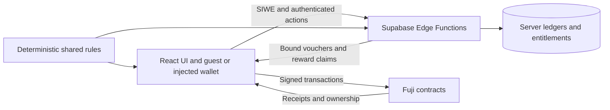

# Taskbar Hero — Lantern Cat Café

A desktop cat RPG on Avalanche Fuji. Lead Mochi and Panko in melee, Soot at range and Clover as a healer; defend the café, mint a trial relic, craft and trade, then inspect the wallet receipts. Healers deal zero damage.

**V4 is an integration build on `codex/v4-ship-2026-11-16`.** The [live site](https://taskbarhero-eight.vercel.app) still serves an older release. The local V4 journey, public read-only Fuji evidence and production acceptance are recorded separately. [Current work queue](reports/v4-ship/HANDOFF-SHIP.md) · [Architecture](docs/architecture.md) · [Avalanche integration](docs/avalanche-integration.md) · [Credits and licences](docs/credits-v4.md).

## Run the complete local journey

Use Node 24 (`.nvmrc`), pnpm 10.28.0 (`packageManager`), Git, and Foundry. The development host used Node 24.22.2 and Forge 1.8.6; clean-clone results are recorded under [S6](reports/v4-ship/S6/). Install dependencies and the pinned contract submodules:

```sh
git clone --branch codex/v4-ship-2026-11-16 --recurse-submodules https://github.com/ntbaoheyhey/taskbar-hero.git
cd taskbar-hero
pnpm install --frozen-lockfile
pnpm --filter @taskbar-hero/web exec playwright install chromium
node scripts/v4ship/start-local.mjs
```

Open `http://127.0.0.1:5994/?demo=1&squad=1&cardrpg2=1&a6=1&dev=1`. Keep the supervisor running; Ctrl-C stops its own Vite, backend and Anvil children. It reserves web 5994, API 5997 and RPC 8546, creates a disposable database/chain and enables the local journey. It does not submit public transactions. The local Anvil chain uses Fuji's chain ID 43113; that ID alone does not make a receipt public.

1. **Landing:** choose **Play free** to create a browser guest wallet.
2. **Guest:** choose **Start trial**. No injected-wallet popup is needed.
3. **Battle and reward:** watch the server-issued replay and choose **Mint trial reward**.
4. **Receipt:** inspect confirmation time, AVAX fee, payer and the transaction link.
5. **Café:** fund the workshop, seal an Epic, forge a Legendary, list it, buy with the demo wallet and withdraw Spool.
6. **Boss:** choose **Face the boss** and finish the encounter.
7. **Wallet proof:** inspect owned items, YARN and the transaction history.

Local receipts are labelled local. Their Snowtrace URLs demonstrate link formatting; their hashes are not public Fuji transactions. The workshop includes bounded demo entitlements, not unlimited production rewards. Browser guest keys belong only to disposable test wallets.

For a frontend-only development server, use `pnpm --filter @taskbar-hero/web dev --host 127.0.0.1 --port 5996 --strictPort`. Without configured services, mock APIs and browser saves demonstrate UI behavior only. The full journey requires the supervisor above.

## Fuji contracts

The [versioned deployment registry](packages/chain/deployments/43113.json) contains these five public addresses. All are Fuji testnet, chain 43113. Source and ABI references live in [contracts](contracts/src/) and [packages/chain](packages/chain/).

| Contract | Role | Fuji explorer |
| --- | --- | --- |
| RelicNFT | ERC-1155 items and signed-voucher minting | [0xB1a1edb7A75Db6e7067E747ddee32B39c2296f2D](https://testnet.snowtrace.io/address/0xB1a1edb7A75Db6e7067E747ddee32B39c2296f2D) |
| RelicMarket | Legacy AVAX escrow market | [0x10fcC46e439d3E31Fb1720B337C45CadB9b2ff93](https://testnet.snowtrace.io/address/0x10fcC46e439d3E31Fb1720B337C45CadB9b2ff93) |
| YarnToken | ERC-20 YARN and recorded burns | [0x3ae1b898c1Ded263b30D968D26Fe65211f102d6b](https://testnet.snowtrace.io/address/0x3ae1b898c1Ded263b30D968D26Fe65211f102d6b) |
| RelicMarketV2 | AVAX/YARN market with sale fee and seller proceeds | [0x6Fe415494D791E63d87613B8FBCdbb24743C7eb4](https://testnet.snowtrace.io/address/0x6Fe415494D791E63d87613B8FBCdbb24743C7eb4) |
| SeasonRewards | Signed, bounded reward claims | [0x29d4F1b9d4577BF2bA5c6bdB849CA5fdc9bd6c11](https://testnet.snowtrace.io/address/0x29d4F1b9d4577BF2bA5c6bdB849CA5fdc9bd6c11) |

RelicForge is optional local code and has no public address in this registry. ERC-20 YARN is distinct from older off-chain resources also named yarn. Spool withdrawal retains 25% (2,500 basis points); retained value is not a token burn. The class attack/Power multiplier remains 1.15.

## Architecture and authority



`apps/web` contains the React interface, Three/Spine battle presentation and audio, with legacy Phaser paths retained. `packages/game-rules` holds deterministic rules. `packages/auth` verifies SIWE sessions; `packages/api-contract` holds API types. Supabase owns connected progression, entitlements and issuance. Browser campaign saves are not mint authority. Contracts own tokens, escrow, nonce consumption and claim settlement. See [architecture](docs/architecture.md) for the trust boundaries and recovery behavior.

## Verification

Run from a fresh checkout after dependency installation:

```sh
pnpm typecheck
pnpm test
pnpm --filter @taskbar-hero/supabase-tests test
pnpm build
forge test --root contracts -vv
node --test tools/v4ship-lab/proof/receipt-check.test.mjs
```

With the local supervisor running, record three rules/presentation fixtures without creating a baseline:

```sh
V4_PARITY_MODE=probe V4_BASE_URL=http://127.0.0.1:5994 V4_PARITY_OUTPUT=work/local-parity.json node scripts/v4ship/parity.mjs
```

Create `work/` first if it is absent. A passing probe proves agreement for those fixtures; the class release gate also needs valid economy evidence and an approved baseline. Do not run `old` or `new` modes as a way to dismiss a mismatch.

The twenty-journey acceptance harness requires its own fresh disposable ledgers and records ten runs at each desktop size, 1280×720 and 1440×900:

```sh
V4_ITEM=S4-review-new V4_RECOVERY=1 V4_STABLE=1 V4_AUDIO_TRACE=1 V4_FAIL_FAST=1 node scripts/v4ship/journey-run.mjs
node tools/v4ship-lab/proof/finalize.mjs S4-review-new review-new.json
```

Choose unused output names. The harness checks receipts against the local RPC before rolling back, preserves failures, verifies reload recovery and rejects runtime drift. This development run does not certify production-preview behavior or public sponsored latency.

Latest complete regression at this documentation update: server/rules/typecheck/three-fixture probe/build passed; web had 2,663 passing tests and seven failures in ART-owned presentation tests. [Exact result](reports/v4-ship/S4/regression-final-1/check.json). G-CLASS remains open at E3 16/18 with no new baseline; [S2b evidence](reports/v4-ship/S2b/hold-verification-1.json). Audio measurements and remaining gates are in [AUDIO-REVIEW](reports/v4-ship/AUDIO-REVIEW.md). Production rehearsal and final submission film remain pending.

## Credits and historical evidence

Project code is [MIT licensed](LICENSE). Dependencies, fonts, audio and artwork retain their own terms; see [V4 credits](docs/credits-v4.md), [audio provenance](apps/web/public/audio/LICENSES.json), and [ART provenance](docs/art/PROVENANCE.md). A manifest match is not an independent ownership audit.

The [older submission pack](docs/submission.md), [older slide outline](docs/pitch-slides.md) and [November 3 media manifest](reports/submission/evidence/media-manifest.json) describe historical builds. Their screenshots and test counts are not V4 acceptance evidence. Current submission work is tracked in the V4 queue.
