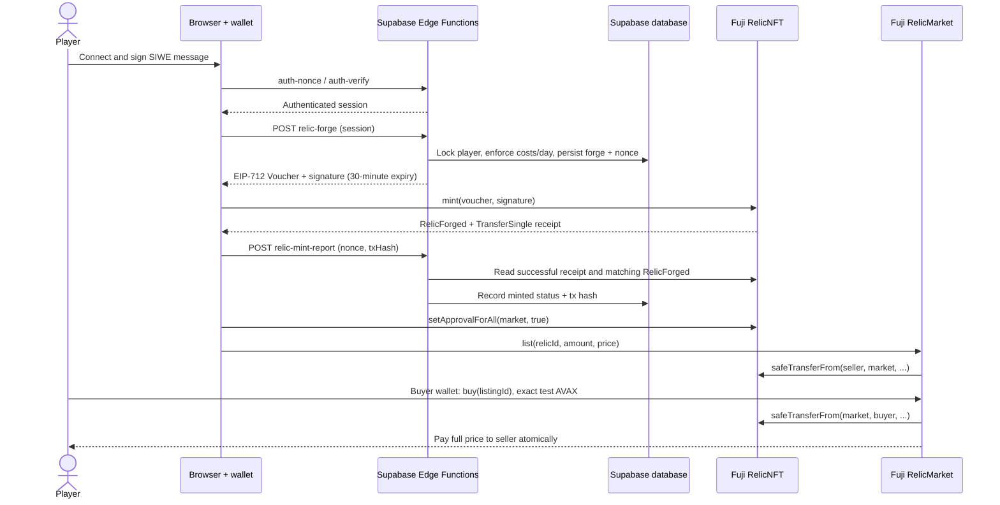

# Architecture

Current desktop integration: `codex/v5-int-2026-11-17`, 17 November 2026. [Run the game](../README.md) · [Validation and limits](../reports/v5/CXI/I-C.md) · [Owner deployment and Fuji proof](../reports/v5/CXI/NEEDS-USER-VI.md).

## Runtime map

| Area | Responsibility | Source |
| --- | --- | --- |
| React desktop shell | Entrance, café, formation, battle HUD and rewards | `apps/web/src/game/cardrpg/ui-v3` and `shell` |
| Game model | Deterministic battle state, campaign and browser save | `apps/web/src/game/cardrpg/depth` |
| Presentation | Three/Spine actors, authored pose drawings, secondary motion and VFX | `apps/web/src/game/rig`, `cardrpg/spine`, `battle-v3`, `vfx-craft` |
| Shared rules | Pure TypeScript rules used by client and connected services | `packages/game-rules` |
| Auth and API contracts | SIWE verification, session and request/response schemas | `packages/auth`, `packages/api-contract` |
| Chain runtime | Contract calls, chain/account checks, receipt reconciliation | `apps/web/src/game/cardrpg/chain`, `packages/chain` |
| Connected services | Entitlements, progression, vouchers, gas grants and reconciliation | `supabase/functions`, `supabase/migrations` |
| Settlement | ERC-1155 items, ERC-20 YARN, escrow markets and claims | `contracts/src` |

Vite builds the frontend. React owns UI; the current battle renderer uses Three/Spine and authored cat artwork. Older Phaser and v2 game paths remain available through explicit selectors; `?legacy=1` is the legacy shell entry. The bare host defaults to the full desktop game flags.

## The desktop journey and its boundaries

The regular route is `/?demo=1&squad=1&cardrpg2=1&a6=1&ui=v3`. Without chain build switches, Play free enters the browser campaign: practice, free invitation, team improvements, patrol and local rewards. A practice receipt describes the available invitation; it does not claim a token mint. Campaign points and equipment remain local until a separately authorized service flow exists.

With configured services, `Entrance` supports a guest EOA or an injected wallet, followed by SIWE authentication. `chain/flags.ts` reads build-time switches; query parameters cannot turn on chain features. `VITE_SHIP_JOURNEY=1` additionally selects the separate `DemoJourney` flow when guest, chain-loop and economy flags are enabled. That flow uses server-issued battles and bounded entitlements; it is distinct from the ordinary browser patrol captured in the current desktop evidence.

`ReceiptToast` is mounted in both journeys, including while battle hides the café shell. Only a published receipt proof opens it. It shows action, hash, actual fee payer, network, known duration and AVAX fee. Public Fuji proofs link to the explorer; local proofs have no public explorer link. Displaying a victory screen does not create blockchain evidence.

## Loading and motion

The entry loader defaults absent or malformed selectors to the desktop Depth game. Battle, preview and evidence runtimes load at their existing visibility boundaries. Late async loads retain cancellation/disposal guards so closing a screen cannot resurrect its renderer.

Delivered AVIF and Opus variants substitute through manifest/load helpers; original WebP or audio sources remain fallback paths. Dimensions, source rectangles, blend mode, loop points and gains remain part of the delivery contract. Cold transfer is measured from a new browser context with cache disabled against the production build, counting complete encoded responses for requests started before battle readiness. Wave1/wave3/boss fixtures exercise assets; they do not establish guest authentication or public transaction success.

Motion uses seeded, seekable sampling, with per-hero breathing/gestures and planted feet. Contact holds and reduced-motion behavior are preserved. Visual comparison uses the current production capture; an old development screenshot is not evidence for a new tag.

## Authentication, funding and recovery

The guest is an ordinary EOA. Its key stays in browser storage; SIWE sends only the signed message/signature to the server. Session metadata is mirrored to sessionStorage and expires with the token. The implementation does not contain an ERC-4337 EntryPoint/UserOperation/paymaster path.

`guest-drip` funds the guest with 0.05 test AVAX. The sponsor pays for that transfer; the funded guest pays gas for subsequent transactions it signs. The receipt's actual `from` remains the payer shown, while the gas-funding label records the café source separately. A repeated grant request may return a previously confirmed hash.

The chain runtime checks chain/account before writes, simulates calls and waits for successful receipts. The receipt verifier checks transaction identity and action-specific events. The proof kit independently verifies guest funding sender, recipient, amount and fee. `feeWei = gasUsed × effectiveGasPrice`; script observation time is separate from transaction confirmation duration, and missing duration stays null.

Missing wallets offer Core/MetaMask or free play. Sign-in connection failures offer retry/offline play instead of asking for a network switch. A real chain mismatch asks for Fuji. Low sponsor funds remain visible; an existing positive wallet balance stays usable. RPC failure clears stale balance display, and background balance polling never requests repeated grants.

## Public deployment evidence

The [Fuji registry](../packages/chain/deployments/43113.json) lists RelicNFT, RelicMarket, YarnToken, RelicMarketV2 and SeasonRewards. [PUBLIC-FUJI.json](../reports/v5/CXI/PUBLIC-FUJI.json) records nonempty bytecode for those addresses at block 61,234,900. Bytecode presence, verified source, a successful guest transfer and a complete hosted game journey are separate claims. Only the first is established by that read-only check. The isolated Anvil proof is labelled local, even though its chain ID is also 43113.

## Server-authoritative boundary and Avalanche flow

SIWE is an off-chain EIP-4361 wallet signature: `auth-nonce` issues a single-use challenge and
`auth-verify` verifies it before issuing a session. Connecting a wallet alone does not authenticate
API calls. The signature costs no gas and does not mint or transfer anything.

In connected play, Edge Functions authenticate the player and the database serializes progression
writes. The server chooses rewards/rarity and enforces resource costs and the daily forge limit;
the client displays results and replays combat. Browser state and request-supplied rewards are not
authoritative. The shared rules module is computation, not a security boundary by itself.
Without Supabase configuration, mock APIs and browser-local demo saves prove UI behavior only.
The v2 workshop's gear crafting is off-chain; it is separate from the daily ERC-1155 Relic flow.

The flag-gated CHAIN room adds browser-only guest wallets, ordinary SIWE sessions,
sponsored test gas, judge vouchers, on-chain inventory and V2 trading. The server
owns the judge entitlements and seal ledger. Campaign Epic+ classification and C2
source simulations do not authorize minting from a Depth save. The disabled
`chain-source` adapter requires a server-owned source/consumption receipt; ordinary
campaign integration remains open. See [trade rules](design/chain/TRADE-RULES.md).

Optional finite styles burn YARN using a wallet/token/order-bound intent and keep
ownership in the database. The optional ownerless RelicForge permanently holds two
canonical Epic units and burns3 YARN per distinct bound design; it has no combat
effect or withdrawal path. These local additions have separate default-off flags.
Neither feature's functional tests establish voluntary demand or public deployment.
Disabled routine-budget registration and tester admission use one transaction lock
and protected pool snapshot; a budget does not itself authorize a reward claim.

The EIP-712 domain binds chain 43113 and the NFT address. `RelicNFT.mint` checks the caller,
signature, expiry, unused nonce and consistent rarity, then mints one copy. It does **not** enforce
game resource costs or a daily cap; those depend on the trusted server signer. The owner can rotate
the signer, invalidate a nonce and change metadata. Chain state is authoritative for NFT ownership.
Receipt reconciliation verifies the event rather than trusting the browser's claimed mint.

Legacy trading goes directly from wallets to the seller-priced escrow contract: `list` requires approval,
`buy` requires exact payment and atomically transfers the lot and pays the seller, and `cancel`
returns escrow to the seller. V1 has no platform fee. V2 accepts AVAX or YARN and
charges the deployed5% sale fee:40% of the fee is burned/sunk and60% accrues to the
treasury; seller proceeds use pull payments. AVAX sinks are never counted as YARN
burns. Both markets permit seller-chosen prices without a floor or ceiling. Gas
applies to chain transactions; ordinary game actions stay gas-free.

See the [judge integration page](avalanche-integration.md) for deployed addresses, live evidence
and reproduction, and the [contract](security-contracts.md) / [web](security-web.md) security reviews
for findings and limits. Repository behavior and mock tests do not establish live backend health.
