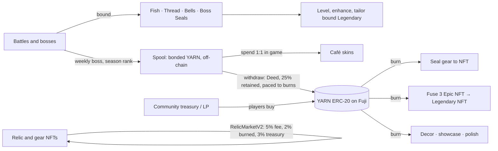

# Taskbar Hero economy and YARN tokenomics

**Testnet only: YARN on Avalanche Fuji has no real value.** Every number below is read from code, not retyped:
game rules from [`economy-v3.ts`](../packages/game-rules/src/cardrpg/economy-v3.ts) and
[`economy-sinks-v3.ts`](../packages/game-rules/src/cardrpg/economy-sinks-v3.ts), contract values from the
[verified Fuji contracts](../packages/chain/deployments/43113.json) (read on 19 Nov 2026), and the verdict from a
seeded 52-week simulation: [`tools/economy/sim.mjs`](../tools/economy/sim.mjs) → [SIM-REPORT.md](economy/SIM-REPORT.md).

## The idea in one paragraph

Playing earns **bound** rewards (Fish, Thread, Bells, Spool). Power is always earnable without the token: a bound
Legendary can be tailored from play alone. **YARN**, a fixed-supply ERC-20, buys *ownership*, not power: turning a
gear piece into a tradable ERC-1155 NFT (seal), fusing three Epics into a tradable Legendary, café cosmetics, and
market trades. Every one of those spends **burns** YARN on-chain. Rewards that leave the game as YARN are paced to
what was burned, so the token cannot inflate faster than players use it.

## 1. Currencies

| Layer | Name | Where | Earn | Spend | Transfer |
|---|---|---|---|---|---|
| Soft | Fish | off-chain | battles, idle, dailies (cap 420/day) | levels, tailoring | bound |
| Soft | Thread / essence / materials | off-chain | runs, salvage (Thread cap 90/day, essence 12/day, materials 30/day) | crafting, tailoring | bound |
| Soft | Bells (stamps) | off-chain | dailies, wins (cap 480/day) | gacha pulls and enhancement **only** | bound |
| Proof | Boss Seal | off-chain | 1 per rewarded boss win | sealing, tailoring | bound |
| Bonded | **Spool** | server ledger, signed | weekly boss **1.05**, season rank ≤ **2**, craft rebate | in-game 1:1 (skin **11**); withdraw to YARN | bound |
| Token | **YARN** | ERC-20, Fuji | Spool withdrawal, tester grant, treasury/LP | seal, fusion, crafts, market | free |
| NFT | Relics, sealed gear, Star Thread, Café Deed | ERC-1155, Fuji | boss reward voucher, seal, fusion, quest | fusion inputs (burned), trade | free |

Random outcomes are paid with bound Bells only, and gacha outputs are soulbound. No token ever buys a random result.

## 2. Drop rates (canonical table `ECONOMY_V3.drops`)

Chance that a won encounter drops gear, then the rarity split (basis points / 100 = %).
The demo enables these rules (`chainFlags().economyV3`). `ECONOMY_C2` and `LEGACY_DROP_ODDS` are older-mode fallbacks only.

| Encounter | Drop chance | Common | Rare | Epic | Legendary | Effective Epic per win | Effective Legendary per win |
|---|---:|---:|---:|---:|---:|---:|---:|
| Battle | 30% | 65% | 30% | 5% | 0% | 1.5% | 0% |
| Elite | 60% | 0% | 72% | 27.9% | 0.1% | 16.7% | 0.06% |
| Boss | 100% | 0% | 30% | 69.7% | 0.3% | 69.7% | 0.3% |
| First boss clear | 100% | 0% | 0% | 97% | 3% | 97% | 3% |
| Tower | 100% | 0% | 0% | 91.5% | 8.5% | 91.5% | 8.5% |

Daily pacing: the first **6** eligible wins roll at full chance, wins 7 to **18** at half chance, then no gear.
That keeps a 3-hour player at about 2× a 30-minute player's gear, not 6×. Gear spans 8 sets × 4 slots × 4 rarities (chapters 1–3).

## 3. Crafting, fusion and enhancement odds

| Recipe | Inputs | Output | Success |
|---|---|---|---:|
| Fuse Rare | 4 Common | Rare (bound) | 100% |
| Fuse Epic | 3 Rare | Epic (bound) | 100% |
| **Fuse Legendary NFT** | 3 Epic of one set + 1 Star Thread + **18 YARN burned**; sealed Epic inputs sent to `0x…dEaD` | tradable Legendary NFT | 100% |
| Tailor Legendary | 100 Fish, 300 Thread, 45 essence, 160 materials, 7 Boss Seals | chosen bound Legendary | 100% |
| Quality polish | 3 YARN + 1 Star Thread | Worn → Fine → Perfect | 100% |
| Season decor | 2 YARN + 1 Star Thread | café scene for this season | 100% |
| Café showcase | 2 / 4 / 6 YARN + 1 Star Thread | +2 display slots per level | 100% |

Star Thread: 1 per weekly boss, bank cap 1, so tradable fusion is at most one per week per player.
Studio crafts return up to 95% of their YARN as Spool, capped at 5 Spool per week (the burn is on-chain; the rebate is
a future claim that still passes the withdrawal fee and the emission guard).

Enhancement +0 → +10 (bound Bells): 100% up to +5, then 80 / 70 / 60 / 50 / 40%. A failure never drops a level and adds
+10% Blessing to the next try. Quality buckets: Worn < 40%, Fine 40–85%, Perfect ≥ 85% of the stat roll.

## 4. Gacha (Bells only, all odds published, outputs soulbound)

| Banner | Common | Rare | Epic | Legendary | Soft pity | Hard pity | Effective Legendary |
|---|---:|---:|---:|---:|---:|---:|---:|
| Cats | 55% | 33% | 11% | 1% | from pull 50, +6%/pull | 70 | **2.40%** (1 per 41.7 pulls) |
| Gear | 50% | 35% | 14.2% | 0.8% | from pull 40, +6%/pull | 60 | **2.70%** (1 per 37.0 pulls) |

Featured cat: 50/50, and a missed 50/50 guarantees the featured cat on the next Legendary.
A capped daily player earns 480 Bells ≈ 3.2 pulls/day, so a featured Legendary arrives in about 2–4 weeks of play.

## 5. Sealing and trading

| Rule | Value |
|---|---|
| Sealable | Epic and Legendary gear, Star Thread. Relics and Café Deeds are NFTs from the start |
| Requirements | level 15, 1 Boss Seal, at most 3 seals/day (+1 with a Café Deed) |
| Seal fee (burned) | 13% of reference: Epic 13 YARN, Legendary 39, Star Thread 2.6 |
| Market | RelicMarketV2, prices in AVAX or YARN, no floor or ceiling |
| Market fee | 5% of the sale (`feeBps` 500 on-chain): 40% of the fee burned (2% of price), 60% to treasury (3%) |
| Anti-flip | 10-minute relist delay per buyer and item |

## 6. YARN supply and allocation

Fixed genesis supply **1,000,000,000 YARN**, no owner and no mint function (on-chain now: 999,999,997.98 after burns).

| Bucket | Share | YARN | Release |
|---|---:|---:|---|
| Player rewards (SeasonRewards pool) | 35% | 350m | five yearly envelopes, each 80% of the last (year 1 ≈ 104.1m) — ceilings, not promises |
| Team | 15% | 150m | 12-month cliff, then 36 months linear |
| Community treasury | 12% | 120m | at most 2% of the bucket per quarter |
| Investors | 12% | 120m | 12-month cliff, then 24 months linear |
| Ecosystem, tournaments, artists | 10% | 100m | 48 months linear, grants paid on delivery |
| Early testers | 6% | 60m | 25% at launch, 75% over six months (on Fuji: one 20 YARN grant per tester) |
| Liquidity | 5% | 50m | reserved at launch (no real-money pool in the demo) |
| Advisors | 3% | 30m | 12-month cliff, then 24 months linear |
| Partner reserve | 2% | 20m | six-month lock |

Fuji note: the genesis supply sits with a distributor wallet; vesting is a published policy, not yet an on-chain vesting contract.

## 7. How emission is held below burn (three locks)

| Lock | Where | Rule |
|---|---|---|
| Per-wallet cap | `SeasonRewards` (deployed) | ≤ 12 YARN routine + one 20 YARN tester grant per wallet per week; Spool net ≤ 6/week, one withdrawal per 7 days, Deed + level 15 + 7-day account age |
| Auto-cut controller | `SeasonRewards` (deployed) | if burn / emission < 0.8 in a 13-week season, next season's cap × min(0.8, ratio / 0.8) — no keeper, no admin |
| **Burn-backed guard** (new) | server, before signing a claim | `emittedInSeason + amount ≤ 2,000 + 90% × burnedInSeason`, both public reads on Fuji ([`EMISSION_GUARD`](../packages/chain/src/economy-guard.ts), [`capacity()`](../supabase/functions/_shared/economy-v3-chain.ts)) |

The withdrawal fee (25%) is never paid out: it stays in the reward pool. Spool that is waiting on the guard stays
spendable 1:1 in game, so no player loses earned value. Anyone can audit the guard from Snowtrace reads.

## 8. Simulation verdict (52 weeks, seeded)

1,000 starting accounts, +150 per week, three player mixes and three stress cases. Full tables, assumptions and the
chart: [economy/SIM-REPORT.md](economy/SIM-REPORT.md). Re-run: `node tools/economy/sim.mjs` (Node 22.18+).

| Scenario (burn-backed guard on) | YARN burned / claimed | Withdrawals paid | Bot share of withdrawals | Gates |
|---|---:|---:|---:|---|
| Balanced (35% casual, 45% regular, 15% heavy, 5% bots) | **2.85×** | 93% | 15% | pass |
| Casual-heavy | 2.29× | 87% | 14% | pass |
| Farmer-heavy (20% bots) | 2.39× | 93% | 44% | pass |
| Half demand | 1.14× | 52% | 23% | pass |
| Low demand (10% of normal uptake) | 0.38× | 13% | 30% | **fail**: tester grants + launch allowance exceed burns |
| Half bots | 1.31× | 59% | 77% | pass on flow, bots dominate withdrawals |

What the model says, plainly:
- With normal or half demand, players burn more YARN than the game emits, so circulating supply shrinks.
- The burn comes mostly from **fusion and sealing**, things players choose for ownership, and from a minority of payers
  who buy YARN from the treasury. If demand collapses (low-demand row) the guard caps emission at the launch allowance;
  the ratio fails but inflation stays bounded to 2,000 YARN per 13-week season (0.0002% of supply).
- Power never depends on YARN: every simulated player type tailors a bound Legendary by day 7–11.
- Weekly Spool: heavy players earn about 2.1× a casual player per week and 5× less per hour played.
- Bots are the open risk. Mitigations in place: Deed required to withdraw (3,000 genesis supply), level 15, 7-day age,
  weekly caps. Next: Deed price for post-genesis accounts and a reputation-based withdrawal fee.

## 9. How the studio earns (and what it never sells)

**One line:** the studio earns 3% of every marketplace sale and sells YARN from its capped treasury to players who
want to craft faster; it never sells power, random outcomes, or promised returns.

| Line | Status | How it works |
|---|---|---|
| Market fee share | live on Fuji | 3% of every RelicMarketV2 sale to treasury (AVAX or YARN) |
| Treasury YARN sales | policy | ≤ 2% of the 120m treasury bucket per quarter; players buy for seal, fusion, cosmetics |
| Café cosmetics and Season Pass | roadmap | skins, decor and pass cosmetics; YARN prices are 50% burned |
| Post-genesis Café Deeds | roadmap | after the 3,000 free genesis Deeds, Deeds are bought, which also raises the cost of bot farms |
| Cost: sponsored gas | live on Fuji | 0.05 test AVAX per guest wallet; mainnet target ≤ 0.005 AVAX, granted only after a first win |

Sim illustration (base case, $0.05 per YARN reference, $20 per AVAX): treasury YARN sales ≈ $6.6k per year on about
2,300 weekly actives; at today's 0.05 AVAX drip, sponsored gas would cost more than that, which is why the mainnet drip
must shrink. These are model outputs from stated assumptions, not forecasts.

## 10. Risks and compliance (not legal advice)

- Fuji testnet only; YARN is labelled "no real value" in the UI and contracts refuse other chains.
- Vietnam Decree 147/2024/ND-CP Art. 57 bars converting game items to money and player-to-player item sales in
  Vietnam-licensed games. A real launch with trading needs counsel (non-VN publisher, geo-fencing, or the pilot framework).
- Gacha: all odds and pity published here and in-game; Bells only; no paid random result.
- No yield, staking return or "earn" promise. YARN's utility is in-game spending.
