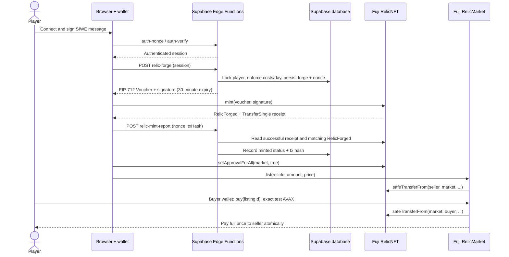

# Architecture

V4 integration state, 16 November 2026. The public site remains an older build; this document describes source behavior and the isolated local journey.

## Layout
- `apps/web`: Vite, React and TypeScript; V4 uses the A6/Depth rules model with Three/Spine battle presentation and the SHIP café journey. Classic Phaser and v2 paths remain in the repository.
- `packages/game-rules`: pure TS game rules shared by client and server (both v1 and v2 engines).
- `packages/api-contract`: the client/server API types, error codes, HTTP statuses and endpoint names; see `docs/api.md` and `docs/api-v2.md`.
- `packages/chain`: chain constants and contract addresses (Fuji, 43113).
- `packages/auth`: wallet sign-in (SIWE) logic used by the auth Edge Functions; see `docs/auth.md`.
- `contracts`: Foundry project (RelicNFT, legacy RelicMarket, YarnToken, RelicMarketV2, SeasonRewards and optional local RelicForge).
- `supabase`: migrations and Edge Functions.

See [extending](extending.md) and [extending-v2](extending-v2.md) for step-by-step checklists to add content, endpoints, or features.

## V4 journey and recovery

`DemoJourney` presents intro battle, reward, café workshop, finale battle and wallet proof. Its build-time switch requires guest wallet, chain loop and economy services; a URL alone cannot enable them. `scripts/v4ship/start-local.mjs` configures an isolated local backend and Anvil on SHIP ports. The acceptance URL includes development switches, so its success cannot substitute for a production-preview rehearsal.

The browser guest wallet signs ordinary chain transactions. SIWE authenticates the guest session, while `chain-judge` supplies a server-generated battle replay and bounded vouchers. `guest-drip` supplies test gas. Workshop actions use the existing chain/economy handlers. A browser campaign save never becomes issuance authority.

The UI stores only resumable phases and receipt metadata. After reload, wallet proof obtains holdings and indexed history from chain data. Funding history is admitted only after checking the successful receipt and its destination. Before every write, the runtime checks chain and account, simulates the call, checks the wallet again, waits for a successful receipt and rejects replacements that represent another action.

Every receipt includes hash, action, confirmation duration, fee in AVAX, actual payer, block and local/public label. Fees come from gas used multiplied by effective gas price. Café-funded gas is displayed separately from the transaction sender. Unknown timing remains unknown. Wallet history and four public counters have separate recovery evidence; local receipt timing does not establish public Fuji latency.

Shared class rules assign melee, ranged or healer to every actor. Healers cannot damage opponents; Mochi/Panko are melee, Soot ranged and Clover healer. Attack/Power remains 1.15 and Spool retention 25%. The E3 boundary and official class baseline are still open, as recorded in [S2b](../reports/v4-ship/S2b/hold-verification-1.json).

Audio is owned by `apps/web/src/audio` plus the battle audio/timeline bridge. Playback uses a bounded source-start budget, per-source duck ownership and persisted mixer settings. Runtime measurement, human intelligibility and physical onset are distinct checks; see [audio evidence](../reports/v4-ship/AUDIO-REVIEW.md).

## On-chain vs off-chain
- Off-chain: legacy v1/v2 connected progression is decided by Supabase. The newer Depth/A6 campaign remains a browser save; it is not mint authority. Soft currencies, including older resources named yarn, are distinct from ERC-20 YARN.
- On-chain (Avalanche Fuji C-Chain, 43113): RelicNFT voucher minting, the legacy AVAX market, fixed-supply YARN, the AVAX/YARN V2 market and SeasonRewards. Existing public deployments are listed in [contracts](contracts.md). Testnet — no real value.

## Wallet

`apps/web/src/wallet/` holds wallet connect and sign-in. It uses wagmi v2 with viem and TanStack Query, with only the injected connector (Core Wallet or MetaMask), on Avalanche Fuji (`avalancheFuji` from `viem/chains`, chain id 43113). The RPC comes from `VITE_FUJI_RPC_URL` and falls back to the public one. `WalletProvider` wraps the app and `WalletButton` sits on the strip: "Connect wallet", then short address + "Sign in", then a signed-in badge. On the wrong network it shows a message and a "Switch to Fuji" button. With no injected wallet it links to https://core.app.

Sign-in goes through the `AuthApi` interface (`getNonce`, `verify`). `createHttpAuthApi` calls `{VITE_SUPABASE_URL}/functions/v1/auth-nonce` and `auth-verify`; `createMockAuthApi` works offline and is used when `VITE_SUPABASE_URL` is unset. The client builds an EIP-4361 message (`siwe.ts`: domain = `window.location.host`, uri = origin, chain 43113, 10 minute expiry), signs it with the wallet and sends `{message, signature}` to verify. The returned `{token, playerId, wallet}` becomes the session (`session.ts`), kept in memory and mirrored to `sessionStorage` (storage errors are ignored). Expiry is read from the JWT `exp` claim, or defaults to 1 hour. Disconnecting, or switching to a different account, clears the session.

## Server-authoritative boundary and Avalanche flow

SIWE is an off-chain EIP-4361 wallet signature: `auth-nonce` issues a single-use challenge and
`auth-verify` verifies it before issuing a session. Connecting a wallet alone does not authenticate
API calls. The signature costs no gas and does not mint or transfer anything.

In connected play, Edge Functions authenticate the player and the database serializes progression
writes. The server chooses rewards/rarity and enforces resource costs and the daily forge limit;
the client displays results and replays combat. Browser state and request-supplied rewards are not
authoritative. The shared rules module is computation, not a security boundary by itself.
Without Supabase configuration, mock APIs and browser-local demo saves prove UI behavior only.
The v2 workshop's gear crafting is off-chain; it is separate from the daily ERC-1155 Relic flow.

The flag-gated CHAIN room adds browser-only guest wallets, ordinary SIWE sessions,
sponsored test gas, judge vouchers, on-chain inventory and V2 trading. The server
owns the judge entitlements and seal ledger. Campaign Epic+ classification and C2
source simulations do not authorize minting from a Depth save. The disabled
`chain-source` adapter requires a server-owned source/consumption receipt; ordinary
campaign integration remains open. See [trade rules](design/chain/TRADE-RULES.md).

Optional finite styles burn YARN using a wallet/token/order-bound intent and keep
ownership in the database. The optional ownerless RelicForge permanently holds two
canonical Epic units and burns3 YARN per distinct bound design; it has no combat
effect or withdrawal path. These local additions have separate default-off flags.
Neither feature's functional tests establish voluntary demand or public deployment.
Disabled routine-budget registration and tester admission use one transaction lock
and protected pool snapshot; a budget does not itself authorize a reward claim.

The EIP-712 domain binds chain 43113 and the NFT address. `RelicNFT.mint` checks the caller,
signature, expiry, unused nonce and consistent rarity, then mints one copy. It does **not** enforce
game resource costs or a daily cap; those depend on the trusted server signer. The owner can rotate
the signer, invalidate a nonce and change metadata. Chain state is authoritative for NFT ownership.
Receipt reconciliation verifies the event rather than trusting the browser's claimed mint.

Legacy trading goes directly from wallets to the seller-priced escrow contract: `list` requires approval,
`buy` requires exact payment and atomically transfers the lot and pays the seller, and `cancel`
returns escrow to the seller. V1 has no platform fee. V2 accepts AVAX or YARN and
charges the deployed5% sale fee:40% of the fee is burned/sunk and60% accrues to the
treasury; seller proceeds use pull payments. AVAX sinks are never counted as YARN
burns. Both markets permit seller-chosen prices without a floor or ceiling. Gas
applies to chain transactions; ordinary game actions stay gas-free.

See the [judge integration page](avalanche-integration.md) for deployed addresses, live evidence
and reproduction, and the [contract](security-contracts.md) / [web](security-web.md) security reviews
for findings and limits. Repository behavior and mock tests do not establish live backend health.
