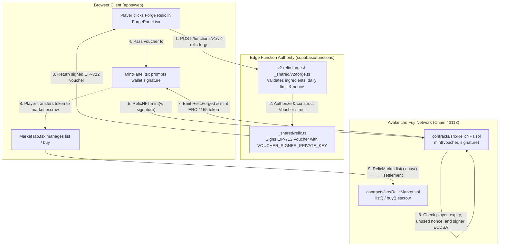

# Avalanche integration — judge quick check

**Network: Avalanche Fuji, chain 43113.** [Live demo](https://taskbarhero-eight.vercel.app)
[Architecture](architecture.md) · [contract security](security-contracts.md) · [web security](security-web.md).

## Verify it yourself in 3 minutes

Contest judges can verify that Relics are authentic ERC-1155 tokens on Avalanche Fuji, minted via server-authorized EIP-712 vouchers, and traded on our custom market contract with verified source code — without connecting a wallet, installing browser extensions, or requesting faucet funds.

### 1. Instant verification command

Run the read-only inspection script using the project's existing `viem` dependency and the public Fuji RPC:

```bash
node scripts/fuji-proof.mjs
```

### 2. Sample output

```text
================================================================
       Taskbar Hero — Avalanche Fuji On-Chain Proof
================================================================

• Network:    Avalanche Fuji Testnet
• Chain ID:   43113
• RPC URL:    https://api.avax-test.network/ext/bc/C/rpc
• Block:      #60262351
• Timestamp:  2026-10-30T15:55:09.719Z

----------------------------------------------------------------
1. CONTRACT ADDRESSES & ROUTESCAN VERIFICATION
----------------------------------------------------------------
RelicNFT Contract:
  Address:    0xB1a1edb7A75Db6e7067E747ddee32B39c2296f2D
  Routescan:  https://testnet.routescan.io/address/0xB1a1edb7A75Db6e7067E747ddee32B39c2296f2D/contract
  Bytecode:   14200 bytes (Active)
  Owner:      0x2Bba9a48F7F79d99154108A28d32f1a21d17055c
  Signer:     0x5eC838ECcc4eC6B6707b6479394E9E6CEEA0B000
  uri(1):     https://taskbarhero-eight.vercel.app/relics/{id}.json

RelicMarket Contract:
  Address:    0x10fcC46e439d3E31Fb1720B337C45CadB9b2ff93
  Routescan:  https://testnet.routescan.io/address/0x10fcC46e439d3E31Fb1720B337C45CadB9b2ff93/contract
  Bytecode:   7713 bytes (Active)
  Active:     1 listing(s)
  Lifetime:   2 listing(s) total

----------------------------------------------------------------
2. RELIC TOKEN STATUS & TOTAL MINTED PER ID
----------------------------------------------------------------
Note: RelicNFT implements standard ERC-1155 (no ERC1155Supply extension).
Existence is verified via on-chain relicExists(id); minted amounts verified via logs.

• Token #1: Paw Charm
    Exists on-chain:  true
    Total minted:     1 (from verified RelicForged events)
    Rarity:           0 (Common) [Metadata: Common]
    Token URI:        https://taskbarhero-eight.vercel.app/relics/{id}.json
• Token #2: Silver Bell
    Exists on-chain:  true
    Total minted:     1 (from verified RelicForged events)
    Rarity:           1 (Rare) [Metadata: Rare]
    Token URI:        https://taskbarhero-eight.vercel.app/relics/{id}.json
• Token #3: Moon Collar
    Exists on-chain:  false
    Total minted:     0 (from verified RelicForged events)
    Rarity:           N/A [Metadata: Epic]
    Token URI:        https://taskbarhero-eight.vercel.app/relics/{id}.json
• Token #4: Golden Maneki
    Exists on-chain:  false
    Total minted:     0 (from verified RelicForged events)
    Rarity:           N/A [Metadata: Legendary]
    Token URI:        https://taskbarhero-eight.vercel.app/relics/{id}.json

----------------------------------------------------------------
3. LAST ON-CHAIN EVENTS (RelicForged / Listed / Bought)
----------------------------------------------------------------

[Event 1/5] Listed @ Block #60128729
  Tx Hash:    0x991bdc7bd1ac2f60464f1d81552dc8b31b469f4d8837b0e2dc3cf216ae88f578
  Routescan:  https://testnet.routescan.io/tx/0x991bdc7bd1ac2f60464f1d81552dc8b31b469f4d8837b0e2dc3cf216ae88f578
  Listing ID: #2
  Seller:     0x91D3fbE33D83BfC4104405ed0AfC243a3ef7D203
  Relic ID:   #2
  Amount:     1
  Price:      0.1 AVAX (100000000000000000 wei)

[Event 2/5] RelicForged @ Block #60109542
  Tx Hash:    0xa82ab23e5fbab111676a735ec42832e98d4312ce106d6847e3963949b102c4f7
  Routescan:  https://testnet.routescan.io/tx/0xa82ab23e5fbab111676a735ec42832e98d4312ce106d6847e3963949b102c4f7
  Player:     0x91D3fbE33D83BfC4104405ed0AfC243a3ef7D203
  Relic ID:   #2
  Rarity:     1 (Rare)
  Nonce:      3

[Event 3/5] Bought @ Block #59916267
  Tx Hash:    0x8cdd589e027673e3cbc0c83305e8104f4ce427dc9caeca05dd07146bf82a348d
  Routescan:  https://testnet.routescan.io/tx/0x8cdd589e027673e3cbc0c83305e8104f4ce427dc9caeca05dd07146bf82a348d
  Listing ID: #1
  Buyer:      0x2Bba9a48F7F79d99154108A28d32f1a21d17055c
  Seller:     0x91D3fbE33D83BfC4104405ed0AfC243a3ef7D203
  Relic ID:   #1
  Amount:     1
  Price:      0.05 AVAX (50000000000000000 wei)

[Event 4/5] Listed @ Block #59916033
  Tx Hash:    0xfcbbe9c52a094b14dc51052efeb14b672c05eae2923a4f393c491e602c5808d7
  Routescan:  https://testnet.routescan.io/tx/0xfcbbe9c52a094b14dc51052efeb14b672c05eae2923a4f393c491e602c5808d7
  Listing ID: #1
  Seller:     0x91D3fbE33D83BfC4104405ed0AfC243a3ef7D203
  Relic ID:   #1
  Amount:     1
  Price:      0.05 AVAX (50000000000000000 wei)

[Event 5/5] RelicForged @ Block #59915957
  Tx Hash:    0x0ef1db1e37b6297779edddbd69be29191ac3e3ecea837b9b432dc3f6a0e44fec
  Routescan:  https://testnet.routescan.io/tx/0x0ef1db1e37b6297779edddbd69be29191ac3e3ecea837b9b432dc3f6a0e44fec
  Player:     0x91D3fbE33D83BfC4104405ed0AfC243a3ef7D203
  Relic ID:   #1
  Rarity:     0 (Common)
  Nonce:      1

================================================================
✓ On-chain proof verification complete. All data fetched from Fuji RPC.
================================================================
```

### 3. Verified Contracts on Routescan

| Contract | Address | Source Code Verification | Compiler & Settings |
| --- | --- | --- | --- |
| **RelicNFT** | [`0xB1a1edb7A75Db6e7067E747ddee32B39c2296f2D`](https://testnet.routescan.io/address/0xB1a1edb7A75Db6e7067E747ddee32B39c2296f2D/contract) | Exact Match (verified) | Solidity `v0.8.24`, EVM `cancun`, no optimization |
| **RelicMarket** | [`0x10fcC46e439d3E31Fb1720B337C45CadB9b2ff93`](https://testnet.routescan.io/address/0x10fcC46e439d3E31Fb1720B337C45CadB9b2ff93/contract) | Exact Match (verified) | Solidity `v0.8.24`, EVM `cancun`, no optimization |

Both contracts are verified with exact source match on Routescan and Snowtrace.

### 4. Voucher Architecture & Flow Diagram

The off-chain gameplay progression controls item requirements (materials, daily quotas), while minting and secondary trading are strictly settled and enforced on-chain via EIP-712 vouchers and smart contract guards:



### 5. Implementation File Mapping (Who Does What)

| Step | Component | Responsible File | Key Logic / Invariant |
| --- | --- | --- | --- |
| **1. Validation** | Edge Function | `supabase/functions/v2-relic-forge/index.ts` & `supabase/functions/_shared/v2/forge.ts` | Validates player materials (Yarn, Moon Pearl) and daily cooldown. Assigns an unforgeable nonce and 30-minute expiry (`VOUCHER_TTL_SECONDS = 1800`). |
| **2. EIP-712 Signing** | Edge Function | `supabase/functions/_shared/relic.ts` | Builds EIP-712 domain separator (Chain `43113`, contract `RelicNFT`) and signs `Voucher(address player,uint256 relicId,uint8 rarity,uint256 nonce,uint256 expiry)` using `account.signTypedData`. |
| **3. Client Submission** | Web App | `apps/web/src/forge/MintPanel.tsx` | Verifies connected wallet address matches voucher player, checks expiry safety margin, and prompts `writeContractAsync` to `RelicNFT.mint`. |
| **4. On-chain Verification & Mint** | Smart Contract | `contracts/src/RelicNFT.sol` | **Enforces security invariants:**<br>• `msg.sender == v.player` (reverts `NotVoucherPlayer`)<br>• `block.timestamp <= v.expiry` (reverts `VoucherExpired`)<br>• `!usedNonces[v.nonce]` (reverts `NonceAlreadyUsed`, prevents replay)<br>• `ECDSA.tryRecover(hashVoucher(v), signature) == signer` (reverts `InvalidSignature`)<br>• `rarityOf[v.relicId] == v.rarity` (reverts `RarityMismatch`)<br>Marks `usedNonces[v.nonce] = true`, records `relicExists[v.relicId] = true`, emits `RelicForged`, and calls `_mint(v.player, v.relicId, 1, "")`. |
| **5. Marketplace Escrow & Trading** | Web App & Contract | `apps/web/src/market/MarketTab.tsx` & `contracts/src/RelicMarket.sol` | `list(relicId, amount, price)` moves token from seller to autonomous contract escrow and emits `Listed`. `buy(listingId)` verifies exact AVAX payment, forwards 100% of payment directly to seller, and delivers ERC-1155 token to buyer (0% platform fees) emitting `Bought`. |

---

## What Avalanche does

**On-chain:** Relic ERC-1155 ownership, `RelicNFT.mint(voucher, signature)` authorized by a server
EIP-712 voucher, and a fixed-price escrow market settled in native test AVAX. **Wallet integration:**
SIWE (EIP-4361) proves wallet control through an off-chain signature before server API access; it is
not an on-chain transaction. **Off-chain:** gold/fish, gear, shards/yarn, keys, materials and combat;
the connected server/database decides outcomes and costs. Local demo saves and v2 workshop gear
crafting are not blockchain evidence. There is no fungible token. This split reserves Avalanche's
fast, low-cost finality for collectible ownership/trades while keeping routine play gas-free;
no latency or gas-cost benchmark is claimed here. Minting and trading still require network gas.

## Contracts and source verification

Addresses come from [committed deployments](../packages/chain/deployments/43113.json).

| Contract | Address | Chain ID | Explorers | Source status |
| --- | --- | --- | --- | --- |
| RelicNFT | `0xB1a1edb7A75Db6e7067E747ddee32B39c2296f2D` | 43113 | [Routescan Contract](https://testnet.routescan.io/address/0xB1a1edb7A75Db6e7067E747ddee32B39c2296f2D/contract) · [Snowtrace](https://testnet.snowtrace.io/address/0xB1a1edb7A75Db6e7067E747ddee32B39c2296f2D) | Owner-confirmed Exact Match; API source re-checked |
| RelicMarket | `0x10fcC46e439d3E31Fb1720B337C45CadB9b2ff93` | 43113 | [Routescan Contract](https://testnet.routescan.io/address/0x10fcC46e439d3E31Fb1720B337C45CadB9b2ff93/contract) · [Snowtrace](https://testnet.snowtrace.io/address/0x10fcC46e439d3E31Fb1720B337C45CadB9b2ff93) | Owner-confirmed Exact Match; API source re-checked |

**Owner-confirmed, 2026-10-26:** both Contract tabs displayed “Contract Source Code Verified (Exact Match)”,
compiler `v0.8.24+commit.e11b9ed9`, optimization off, EVM `cancun`; creation 23 Oct 2026 16:44:54 GMT
by `0x2Bba…7055c`. Creation time and that UI label remain owner-confirmed, not independently verified.
**Independent read-only re-check, 2026-10-27:** Routescan's
[NFT API](https://api.routescan.io/v2/network/testnet/evm/43113/etherscan?module=contract&action=getsourcecode&address=0xB1a1edb7A75Db6e7067E747ddee32B39c2296f2D)
and [Market API](https://api.routescan.io/v2/network/testnet/evm/43113/etherscan?module=contract&action=getsourcecode&address=0x10fcC46e439d3E31Fb1720B337C45CadB9b2ff93)
returned source with those settings. Both main Solidity files matched the repository byte for byte;
this is not a new independent runtime-bytecode verification. Reference-only `forge verify-contract`
commands are in [deploy](deploy.md#existing-fuji-source-verification-reference-only).

## Player → forge → voucher → mint → list → buy

```mermaid
flowchart LR
  P[Player signs SIWE] --> F[POST relic-forge]
  F --> V[Server validates costs/day and signs EIP-712 Voucher]
  V --> N["Wallet: RelicNFT.mint(voucher, signature)"]
  N --> A["RelicNFT.setApprovalForAll(market, true)"]
  A --> L["RelicMarket.list(relicId, amount, price)"]
  L --> E["RelicNFT.safeTransferFrom: seller to escrow"]
  E --> B["Buyer: RelicMarket.buy(listingId), exact value"]
  B --> T["RelicNFT.safeTransferFrom: escrow to buyer; AVAX to seller"]
```



`RelicNFT` checks caller, signature, nonce, expiry and rarity consistency; game costs/day depend on
the trusted server. `relic-mint-report` verifies the successful receipt's matching `RelicForged`
event before recording mint status. Seller-only `RelicMarket.cancel(listingId)` returns escrow.
The market has no admin or platform fees. See [function/security details](contracts.md).

## Reproduce in 5 minutes

**Prerequisites:** a working connected deployment, desktop injected Core/MetaMask wallet A,
a second wallet B, and A already eligible to forge (or with a pending voucher). A fresh player's
progression and faucet availability are not promised within five minutes. This wallet walkthrough
is **NOT VERIFIED** in this run; the current documented live URL must first be restored.

1. Switch both wallets to Fuji (43113); request test AVAX from the [Fuji faucet](https://core.app/tools/testnet-faucet/?subnet=c&token=c). **Expect:** test AVAX balances for gas and B's purchase.
2. Open the connected game, connect A and sign in with SIWE. **Expect:** signed-in status; signing sends no transaction. In local demo mode stop: mock auth is not proof.
3. Open the daily Relic Forge (classic Forge; v2 gear recipes are separate), meet the displayed requirements and forge/resume. **Expect:** one server voucher with A, token ID, rarity, nonce and expiry; no transaction yet.
4. Choose **Mint to wallet**, confirm the Fuji transaction. **Expect:** successful receipt at RelicNFT, `RelicForged` + `TransferSingle`, one copy in A's `balanceOf`; save the hash below.
5. In Market select that Relic, amount 1, and a positive test-AVAX price. Approve then list. **Expect:** `Listed` and escrow transfer; `activeListingCount()` increases. Save the listing transaction (approval is a different hash).
6. Switch/sign in as B, read the listing price and buy. **Expect:** `Bought`, B receives the lot, A receives the exact price, listing becomes inactive. Gas is additional. Save the purchase hash below.

## Transaction evidence on Fuji

The following on-chain transactions were executed on Avalanche Fuji and verified via public RPC logs and Routescan:

| Evidence | Hash / Routescan Link | Block | Notes |
| --- | --- | --- | --- |
| RelicNFT deployment | [`0x824aed1ba58194ceb58d307eb6ba6377ba5237368072b3360956cfed52c6965d`](https://testnet.routescan.io/tx/0x824aed1ba58194ceb58d307eb6ba6377ba5237368072b3360956cfed52c6965d) | 59914099 | Deployer `0x2Bba…7055c` |
| RelicMarket deployment | [`0x4f18d3695cf4b0ff3f826790637af2da8f6628417c60ce17f9d330d98119be15`](https://testnet.routescan.io/tx/0x4f18d3695cf4b0ff3f826790637af2da8f6628417c60ce17f9d330d98119be15) | 59914099 | Linked to deployed RelicNFT |
| Mint (Relic #1) | [`0x0ef1db1e37b6297779edddbd69be29191ac3e3ecea837b9b432dc3f6a0e44fec`](https://testnet.routescan.io/tx/0x0ef1db1e37b6297779edddbd69be29191ac3e3ecea837b9b432dc3f6a0e44fec) | 59915957 | `RelicForged` relicId 1 (Common, nonce 1) to `0x91D3…D203` |
| Mint (Relic #2) | [`0xa82ab23e5fbab111676a735ec42832e98d4312ce106d6847e3963949b102c4f7`](https://testnet.routescan.io/tx/0xa82ab23e5fbab111676a735ec42832e98d4312ce106d6847e3963949b102c4f7) | 60109542 | `RelicForged` relicId 2 (Rare, nonce 3) to `0x91D3…D203` |
| Listing (Listing #1) | [`0xfcbbe9c52a094b14dc51052efeb14b672c05eae2923a4f393c491e602c5808d7`](https://testnet.routescan.io/tx/0xfcbbe9c52a094b14dc51052efeb14b672c05eae2923a4f393c491e602c5808d7) | 59916033 | `Listed` listingId 1, relicId 1, price 0.05 AVAX |
| Listing (Listing #2) | [`0x991bdc7bd1ac2f60464f1d81552dc8b31b469f4d8837b0e2dc3cf216ae88f578`](https://testnet.routescan.io/tx/0x991bdc7bd1ac2f60464f1d81552dc8b31b469f4d8837b0e2dc3cf216ae88f578) | 60128729 | `Listed` listingId 2, relicId 2, price 0.1 AVAX (currently active) |
| Purchase (Listing #1) | [`0x8cdd589e027673e3cbc0c83305e8104f4ce427dc9caeca05dd07146bf82a348d`](https://testnet.routescan.io/tx/0x8cdd589e027673e3cbc0c83305e8104f4ce427dc9caeca05dd07146bf82a348d) | 59916267 | `Bought` listingId 1 by `0x2Bba…7055c`, 0.05 AVAX forwarded to seller |

## Re-run the evidence

With Node 20+ and pnpm **10.28.0**: `CI=true pnpm install --frozen-lockfile`, then
`node scripts/fuji-proof.mjs` (read-only, no keys, signatures or writes).
It uses existing deployment/ABI files and viem's Fuji public RPC, as the web config does;
optional `VITE_FUJI_RPC_URL` overrides it. Missing code or a failed supported read exits non-zero.
At block **60097612** on **2026-10-27**, code was present at both addresses; NFT owner was
`0x2Bba9a48F7F79d99154108A28d32f1a21d17055c`, URI was
`https://web-zeta-tan-13.vercel.app/relics/{id}.json`, token ID 1 existed and IDs 2–4 did not;
market active listings = **0**, lifetime listings = **1**. Counts alone do not prove a purchase.
IDs are discovered from committed metadata, not all chain history. **Supply NOT VERIFIED:** this
contract has no `totalSupply(uint256)` getter; the script labels it per ID, without guessing from
one wallet's balance. Full history reconstruction was not performed (public RPC limits logs to
100 blocks/request). There are no market fee getters; zero platform fees is a source-code fact.

**Tests actually run, 2026-10-27:** `cd contracts && forge test`: **89 passed, 0 failed, 0 skipped,
7 suites**. Unit: [RelicNFT.t.sol](../contracts/test/RelicNFT.t.sol),
[RelicMarket.t.sol](../contracts/test/RelicMarket.t.sol), [Deploy.t.sol](../contracts/test/Deploy.t.sol);
fuzz: [Fuzz.t.sol](../contracts/test/Fuzz.t.sol), [RelicMarketFuzz.t.sol](../contracts/test/RelicMarketFuzz.t.sol);
invariants: [Invariants.t.sol](../contracts/test/Invariants.t.sol); edges: [RelicEdges.t.sol](../contracts/test/RelicEdges.t.sol).
`pnpm test`: **1,968 passed, 2 expected failures, 11 pre-existing skipped** across the six workspaces
(chain 7, auth 24, game rules 339 + 2 expected failures + 11 skipped, API contract 16, backend 442,
web 1,140). No tests changed. Full outputs, limitations and checks: [T5 report](../reports/t5-judge-pack.md).
