# Avalanche integration — judge quick check

**Network: Avalanche Fuji, chain 43113.** [Live demo](https://web-zeta-tan-13.vercel.app)
**NOT VERIFIED:** that URL returned HTTP 404 on 2026-10-27; owner must restore/check the deployment.
[Architecture](architecture.md) · [contract security](security-contracts.md) · [web security](security-web.md).

## What Avalanche does

**On-chain:** Relic ERC-1155 ownership, `RelicNFT.mint(voucher, signature)` authorized by a server
EIP-712 voucher, and a fixed-price escrow market settled in native test AVAX. **Wallet integration:**
SIWE (EIP-4361) proves wallet control through an off-chain signature before server API access; it is
not an on-chain transaction. **Off-chain:** gold/fish, gear, shards/yarn, keys, materials and combat;
the connected server/database decides outcomes and costs. Local demo saves and v2 workshop gear
crafting are not blockchain evidence. There is no fungible token. This split reserves Avalanche's
fast, low-cost finality for collectible ownership/trades while keeping routine play gas-free;
no latency or gas-cost benchmark is claimed here. Minting and trading still require network gas.

## Contracts and source verification

Addresses come from [committed deployments](../packages/chain/deployments/43113.json).

| Contract | Address | Chain ID | Explorers | Source status |
| --- | --- | --- | --- | --- |
| RelicNFT | `0xB1a1edb7A75Db6e7067E747ddee32B39c2296f2D` | 43113 | [Routescan Contract](https://testnet.routescan.io/address/0xB1a1edb7A75Db6e7067E747ddee32B39c2296f2D/contract) · [Snowtrace](https://testnet.snowtrace.io/address/0xB1a1edb7A75Db6e7067E747ddee32B39c2296f2D) | Owner-confirmed Exact Match; API source re-checked |
| RelicMarket | `0x10fcC46e439d3E31Fb1720B337C45CadB9b2ff93` | 43113 | [Routescan Contract](https://testnet.routescan.io/address/0x10fcC46e439d3E31Fb1720B337C45CadB9b2ff93/contract) · [Snowtrace](https://testnet.snowtrace.io/address/0x10fcC46e439d3E31Fb1720B337C45CadB9b2ff93) | Owner-confirmed Exact Match; API source re-checked |

**Owner-confirmed, 2026-10-26:** both Contract tabs displayed “Contract Source Code Verified (Exact Match)”,
compiler `v0.8.24+commit.e11b9ed9`, optimization off, EVM `cancun`; creation 23 Oct 2026 16:44:54 GMT
by `0x2Bba…7055c`. Creation time and that UI label remain owner-confirmed, not independently verified.
**Independent read-only re-check, 2026-10-27:** Routescan's
[NFT API](https://api.routescan.io/v2/network/testnet/evm/43113/etherscan?module=contract&action=getsourcecode&address=0xB1a1edb7A75Db6e7067E747ddee32B39c2296f2D)
and [Market API](https://api.routescan.io/v2/network/testnet/evm/43113/etherscan?module=contract&action=getsourcecode&address=0x10fcC46e439d3E31Fb1720B337C45CadB9b2ff93)
returned source with those settings. Both main Solidity files matched the repository byte for byte;
this is not a new independent runtime-bytecode verification. Reference-only `forge verify-contract`
commands are in [deploy](deploy.md#existing-fuji-source-verification-reference-only).

## Player → forge → voucher → mint → list → buy

```mermaid
flowchart LR
  P[Player signs SIWE] --> F[POST relic-forge]
  F --> V[Server validates costs/day and signs EIP-712 Voucher]
  V --> N["Wallet: RelicNFT.mint(voucher, signature)"]
  N --> A["RelicNFT.setApprovalForAll(market, true)"]
  A --> L["RelicMarket.list(relicId, amount, price)"]
  L --> E["RelicNFT.safeTransferFrom: seller to escrow"]
  E --> B["Buyer: RelicMarket.buy(listingId), exact value"]
  B --> T["RelicNFT.safeTransferFrom: escrow to buyer; AVAX to seller"]
```

`RelicNFT` checks caller, signature, nonce, expiry and rarity consistency; game costs/day depend on
the trusted server. `relic-mint-report` verifies the successful receipt's matching `RelicForged`
event before recording mint status. Seller-only `RelicMarket.cancel(listingId)` returns escrow.
The market has no admin or platform fees. See [function/security details](contracts.md).

## Reproduce in 5 minutes

**Prerequisites:** a working connected deployment, desktop injected Core/MetaMask wallet A,
a second wallet B, and A already eligible to forge (or with a pending voucher). A fresh player's
progression and faucet availability are not promised within five minutes. This wallet walkthrough
is **NOT VERIFIED** in this run; the current documented live URL must first be restored.

1. Switch both wallets to Fuji (43113); request test AVAX from the [Fuji faucet](https://core.app/tools/testnet-faucet/?subnet=c&token=c). **Expect:** test AVAX balances for gas and B's purchase.
2. Open the connected game, connect A and sign in with SIWE. **Expect:** signed-in status; signing sends no transaction. In local demo mode stop: mock auth is not proof.
3. Open the daily Relic Forge (classic Forge; v2 gear recipes are separate), meet the displayed requirements and forge/resume. **Expect:** one server voucher with A, token ID, rarity, nonce and expiry; no transaction yet.
4. Choose **Mint to wallet**, confirm the Fuji transaction. **Expect:** successful receipt at RelicNFT, `RelicForged` + `TransferSingle`, one copy in A's `balanceOf`; save the hash below.
5. In Market select that Relic, amount 1, and a positive test-AVAX price. Approve then list. **Expect:** `Listed` and escrow transfer; `activeListingCount()` increases. Save the listing transaction (approval is a different hash).
6. Switch/sign in as B, read the listing price and buy. **Expect:** `Bought`, B receives the lot, A receives the exact price, listing becomes inactive. Gas is additional. Save the purchase hash below.

## Transaction evidence — owner action required

No real transaction hashes were recorded in the searched docs and reports Markdown files;
the only 64-hex matches were the documented public Anvil example key, not transaction evidence.
Do not redeploy merely to fill this table. Replace each slot **in this section** with a successful
Fuji hash and links `https://testnet.routescan.io/tx/<hash>` / `https://testnet.snowtrace.io/tx/<hash>`.

| Evidence | Hash / next owner action |
| --- | --- |
| RelicNFT deployment | **TODO-OWNER — NOT VERIFIED:** retrieve its existing creation receipt from explorer/deployer history and paste hash here. |
| RelicMarket deployment | **TODO-OWNER — NOT VERIFIED:** retrieve its existing creation receipt and paste hash here. |
| Mint | **TODO-OWNER — NOT VERIFIED:** A calls `RelicNFT.mint` using a valid server voucher; paste successful `RelicForged` receipt hash here. |
| Listing | **TODO-OWNER — NOT VERIFIED:** A approves market, then calls `RelicMarket.list`; paste the `Listed` transaction hash here. |
| Purchase | **TODO-OWNER — NOT VERIFIED:** B calls `RelicMarket.buy` with exact price; paste the `Bought` transaction hash here. |

## Re-run the evidence

With Node 20+ and pnpm **10.28.0**: `CI=true pnpm install --frozen-lockfile`, then
`pnpm onchain-proof` ([script](../scripts/onchain-proof.mjs), no keys, signatures or writes).
It uses existing deployment/ABI files and viem's Fuji public RPC, as the web config does;
optional `VITE_FUJI_RPC_URL` overrides it. Missing code or a failed supported read exits non-zero.
At block **60097612** on **2026-10-27**, code was present at both addresses; NFT owner was
`0x2Bba9a48F7F79d99154108A28d32f1a21d17055c`, URI was
`https://web-zeta-tan-13.vercel.app/relics/{id}.json`, token ID 1 existed and IDs 2–4 did not;
market active listings = **0**, lifetime listings = **1**. Counts alone do not prove a purchase.
IDs are discovered from committed metadata, not all chain history. **Supply NOT VERIFIED:** this
contract has no `totalSupply(uint256)` getter; the script labels it per ID, without guessing from
one wallet's balance. Full history reconstruction was not performed (public RPC limits logs to
100 blocks/request). There are no market fee getters; zero platform fees is a source-code fact.

**Tests actually run, 2026-10-27:** `cd contracts && forge test`: **89 passed, 0 failed, 0 skipped,
7 suites**. Unit: [RelicNFT.t.sol](../contracts/test/RelicNFT.t.sol),
[RelicMarket.t.sol](../contracts/test/RelicMarket.t.sol), [Deploy.t.sol](../contracts/test/Deploy.t.sol);
fuzz: [Fuzz.t.sol](../contracts/test/Fuzz.t.sol), [RelicMarketFuzz.t.sol](../contracts/test/RelicMarketFuzz.t.sol);
invariants: [Invariants.t.sol](../contracts/test/Invariants.t.sol); edges: [RelicEdges.t.sol](../contracts/test/RelicEdges.t.sol).
`pnpm test`: **1,968 passed, 2 expected failures, 11 pre-existing skipped** across the six workspaces
(chain 7, auth 24, game rules 339 + 2 expected failures + 11 skipped, API contract 16, backend 442,
web 1,140). No tests changed. Full outputs, limitations and checks: [T5 report](../reports/t5-judge-pack.md).
