# Cat RPG v2 Class Looks Fallback Sheet

> [!IMPORTANT]
> **PROPOSAL for decision D5**: The user approves or replaces each look. Previews and final pixel art are still the user's call.
> If the user submits custom reference pictures or descriptions by the 5 Nov 2026 cutoff (Decision D3), the custom references take priority. This document serves as the approved written-look fallback (Decision D5) so artists and builders have precise, unambiguous specifications for all 7 classes.

---

## 1. Design Rules & Pixel Art Constraints

All proposed looks strictly follow the sprite rig constraints (`apps/web/src/game/rig/compose.ts`, `apps/web/src/game/rig/palettes.ts`, `apps/web/src/game/rig/types.ts`) and the Cat Café Quest design tokens (`docs/ui-guide.md`, `apps/web/src/theme.css`):

1. **Dimensions**: Every cat body fits within a **32 × 32 pixel cell**, with paws planted on row 31. Total animation frame canvas is **56 × 48 pixels** (cell origin `x: 12, y: 14`), providing clearance for wide weapon swings.
2. **Palette Structure**: 6 colors per class using the standard `BodyPalette`:
   - `k`: Shared ink outline and pupil (`#140a12`)
   - `o`: Primary coat color
   - `d`: Dark coat accent (stripes, patches, points, far-limb shadows)
   - `w`: Light coat accent (muzzle, chest bib, belly, paws)
   - `n`: Inner ear and nose tip (`#ff8fb1` or custom pink/mauve)
   - `e`: Eye iris color
3. **Contrast & Readability**: Colors are chosen to maintain a minimum 4.5:1 contrast against the `#2a1f36` (`--surface`) stage background, and every silhouette is distinct and readable at **390 px mobile width** (2x viewport scale).
4. **Anchor Points & Modular Armor**: All gear slots (helmet, armor, boots, gloves) attach to standard skeleton anchors (`head`, `body`, `pawFront`, `pawBack`, `footFront`, `footBack`). Looks modify fur, ears, tails, and markings without obstructing gear anchors or weapon grips.

---

## 2. The 7 Class Looks

Classes are listed in registry order from `packages/game-rules/src/v2/content/classes.ts`.

---

### 1. Warrior (`warrior`)

- **Role & Weapon**: Melee striker; Sword (`sword`). Passive: **Cleave** (3rd hit splashes 50% damage).
- **Screenshots**:
  - Current Idle: 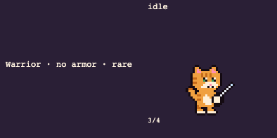
  - Attack Animation: 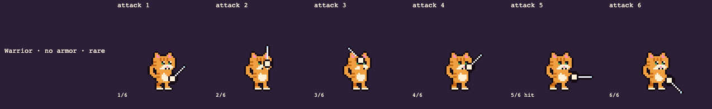
- **Silhouette**: Athletic, upright, confident stance with forward-planted paws, proud upright triangular ears, and a long upward-curving tail.
- **Palette Hex**:
  - `o` Primary fur: `#f0a040` (bright ginger, harmonizing with `--gold` / `--accent` `#ffb86b`)
  - `d` Dark stripes: `#c66a1a` (deep ginger mackerel tabby bands across forehead and back)
  - `w` Light fur: `#fff0d8` (warm cream bib, muzzle, and front paws, matching `--text` `#fff3e0`)
  - `e` Eyes: `#3f9e5a` (emerald green, matching `--good` `#6be08a`)
  - `k` Outline: `#140a12` (dark ink)
- **Signature Weapon & Pose**: One-handed iron twig sword gripped forward; attack animation swings downward in a wide arc.
- **Readability at 390 px**: Warm ginger body immediately contrasts against dark backgrounds; white bib highlights the head; clean stripes add texture without visual noise.
- **What to Avoid**: Avoid muddy brown or tan tones that blur into Hunter, and avoid orange patches that mimic Alchemist's calico.

---

### 2. Guardian (`guardian`)

- **Role & Weapon**: Melee tank; Hammer (`hammer`). Passive: **Bonk** (delays target attack by 500 ms).
- **Screenshots**:
  - Current Idle: 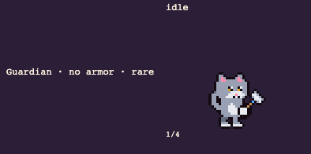
  - Attack Animation: 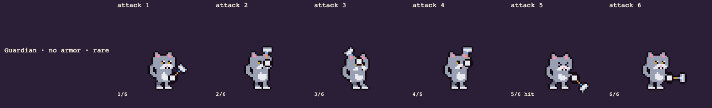
- **Silhouette**: Heavyweight, stocky, broad-shouldered build with wide rounded head, stout forearms, short rounded ears, and a thick sturdy tail.
- **Palette Hex**:
  - `o` Primary fur: `#9aa0b4` (slate blue-grey Russian Blue coat, harmonizing with `--border` `#5b4572`)
  - `d` Dark fur: `#666c80` (deep charcoal shading on far legs, flanks, and spine)
  - `w` Light fur: `#e8eaf0` (cool silvery chest flash and chin)
  - `e` Eyes: `#ffd75e` (steady radiant amber gold, matching `--focus` `#ffd75e`)
  - `k` Outline: `#140a12` (dark ink)
- **Signature Weapon & Pose**: Heavy two-handed wooden mallet raised high over the shoulder; attack animation delivers a grounded overhead crushing slam.
- **Readability at 390 px**: Bulky, solid square silhouette with oversized hammer head visible above the shoulder; amber eyes pop vividly against slate grey.
- **What to Avoid**: Avoid dark purple/shadow tones confusable with Rogue, and avoid tabby stripes.

---

### 3. Rogue (`rogue`)

- **Role & Weapon**: Crit striker; Daggers (`daggers`). Passive: **Twin Strike** (2 hits per attack; 25% crit, 10% dodge).
- **Screenshots**:
  - Current Idle: 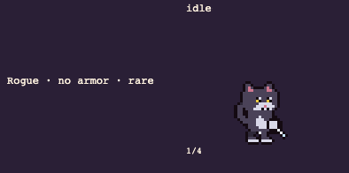
  - Attack Animation: 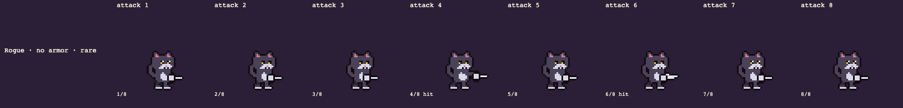
- **Silhouette**: Sleek, low-slung, agile crouching silhouette with sharp angled ears pinned slightly back, slender limbs, and a flicking tapered tail.
- **Palette Hex**:
  - `o` Primary fur: `#4a4258` (deep dusk violet-black Bombay coat, blending with `--surface` `#2a1f36`)
  - `d` Dark fur: `#2e2838` (midnight shadow shading on spine and hindquarters)
  - `w` Light fur: `#d8d8e8` (pale lavender-white claw highlights and whisker pad)
  - `n` Nose & inner ear: `#d07890` (dusky mauve pink)
  - `e` Eyes: `#ffd75e` (sharp luminous amber-yellow eyes)
  - `k` Outline: `#140a12` (dark ink)
- **Signature Weapon & Pose**: Dual reverse-grip daggers; attack animation executes a rapid double cross-slash.
- **Readability at 390 px**: Intense luminous eyes gleaming against dark silhouette; sharp twin dagger glints in front paws; predatory low crouch.
- **What to Avoid**: Avoid flat pitch-black without shading (must retain 3-value readability), and avoid light stripes.

---

### 4. Hunter (`hunter`)

- **Role & Weapon**: Reach tracker; Spear (`spear`). Passive: **Mark Prey** (+20% target damage, +10% find).
- **Screenshots**:
  - Current Idle: 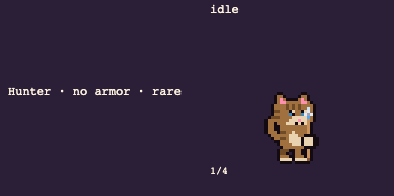
  - Attack Animation: 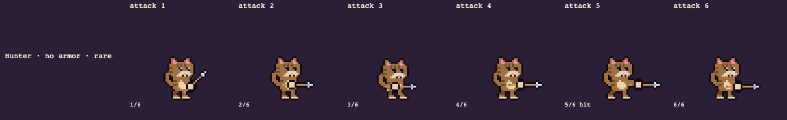
- **Silhouette**: Lean, tall, wiry wildcat/savannah build with large upright pointed ears, long legs, and a banded ringed tail held poised.
- **Palette Hex**:
  - `o` Primary fur: `#a0703f` (rich earthy tawny brown / cougar coat)
  - `d` Dark fur: `#6e4a26` (dark espresso spotted-tabby markings along spine and tail rings)
  - `w` Light fur: `#e8d2b0` (warm sand-buff underbelly, throat, and eye rings)
  - `e` Eyes: `#4aa8ff` (piercing crystal blue, matching `--rarity-rare` `#4aa8ff`)
  - `k` Outline: `#140a12` (dark ink)
- **Signature Weapon & Pose**: Long two-handed wooden spear with flint tip; attack animation thrusts forward in a straight line with extended reach.
- **Readability at 390 px**: Long spear diagonal extending past the 32px cell; distinct warm earthy coat clearly distinguishable from orange Warrior.
- **What to Avoid**: Avoid bright orange mackerel stripes (confusable with Warrior) and dark grey tones (confusable with Guardian).

---

### 5. Archer (`archer`)

- **Role & Weapon**: Ranged sniper; Bow (`bow`). Passive: **Volley** (every 5th shot fires 3 arrows).
- **Screenshots**:
  - Current Idle: 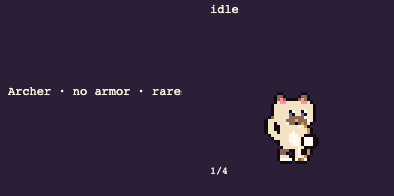
  - Attack Animation: 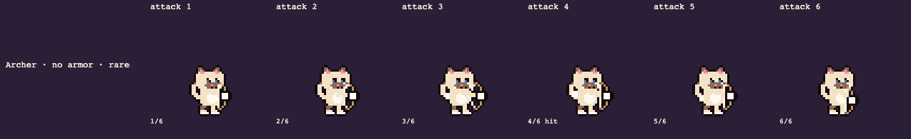
- **Silhouette**: Elegant, delicate, slender Siamese/colourpoint build with large alert triangular ears, poised upright posture, and long graceful tail.
- **Palette Hex**:
  - `o` Primary fur: `#f3e2c4` (creamy fawn / pale vanilla body coat)
  - `d` Dark points: `#8a6a52` (seal-point dark mocha on face mask, ear tips, paws, and tail)
  - `w` Light fur: `#fffaf0` (porcelain white chest and whisker pads)
  - `e` Eyes: `#3a7ad0` (deep sapphire blue eyes)
  - `k` Outline: `#140a12` (dark ink)
- **Signature Weapon & Pose**: Recurve wooden shortbow held vertically with drawn bowstring; attack animation pulls back and looses arrows forward.
- **Readability at 390 px**: High-contrast dark seal face mask and dark ear tips against pale cream body; upright arched bow silhouette.
- **What to Avoid**: Avoid dark full-body coats (like Rogue), and avoid calico patches (like Alchemist).

---

### 6. Witch (`witch`)

- **Role & Weapon**: Area burner; Staff (`staff`). Passive: **Burn** (40% splash, burns 30% over 3s).
- **Screenshots**:
  - Current Idle: 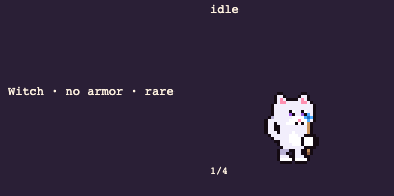
  - Attack Animation: 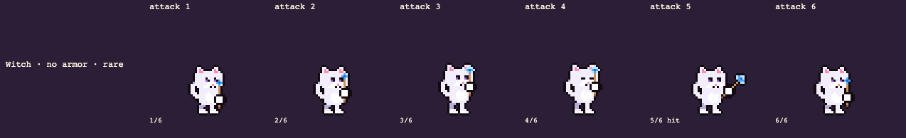
- **Silhouette**: Fluffy, mystical, long-haired Turkish Angora silhouette with tufted ear tips, billowing chest ruff, and a lavish plume tail.
- **Palette Hex**:
  - `o` Primary fur: `#f2eefc` (luminous ethereal lilac-white coat, echoing dusk theme `--text` `#fff3e0`)
  - `d` Dark shading: `#b8b0d4` (soft mist-purple shading under ruff and flanks)
  - `w` Light fur: `#ffffff` (pure sparkling white highlights on ear tufts and chest plume)
  - `e` Eyes: `#bb74ff` (radiant arcane amethyst violet eyes, matching `--rarity-epic` `#bb74ff`)
  - `k` Outline: `#140a12` (dark ink)
- **Signature Weapon & Pose**: Tall wooden magic staff topped with a glowing crystal shard; attack animation channels and casts a burst forward.
- **Readability at 390 px**: Glowing purple orb atop staff; lavish plume tail; soft lilac-white silhouette glowing against dark background.
- **What to Avoid**: Avoid solid flat white without purple shading; avoid dark brown or tabby markings.

---

### 7. Alchemist (`alchemist`)

- **Role & Weapon**: Poisoner; Flasks (`flasks`). Passive: **Poison** (50% poison over 4s; heals 3% on kill).
- **Screenshots**:
  - Current Idle: 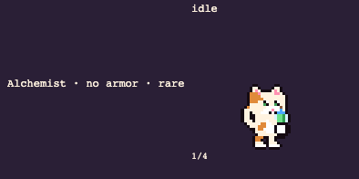
  - Attack Animation: 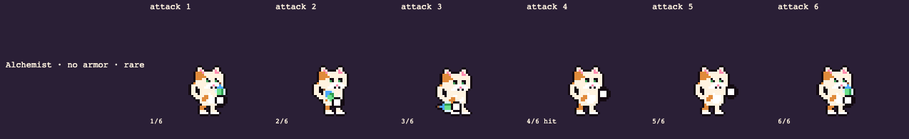
- **Silhouette**: Playful, eccentric, medium-compact Japanese Bobtail silhouette with asymmetric patches, alert cocked ears, and a distinct pom-pom bobtail.
- **Palette Hex**:
  - `o` Primary fur: `#fff3e0` (warm milk-white calico ground, matching `--text` `#fff3e0`)
  - `d` Dark patch: `#e08a3a` (vivid marmalade ginger patch over one eye and shoulder, matching `--accent` `#ffb86b`)
  - `w` Light fur: `#ffffff` (crisp white belly and paws)
  - `e` Eyes: `#6be08a` (bright poison bottle jade green, matching `--good` `#6be08a`)
  - `k` Outline: `#140a12` (dark ink)
- **Signature Weapon & Pose**: Raised glass potion vial with bubbling green liquid in front paw; attack animation hurls flask forward.
- **Readability at 390 px**: Asymmetrical tri-color calico pattern; vibrant green glass vial held in paw; short fluffy bobtail.
- **What to Avoid**: Avoid uniform stripes (confusable with Warrior); ensure playful cozy aesthetic rather than grim tropes.

---

## 3. Summary Comparison Matrix

| Class | Fur Base (`o`) | Accent/Marking (`d`) | Eye Color (`e`) | Markings Pattern | Silhouette Distinguisher |
| :--- | :--- | :--- | :--- | :--- | :--- |
| **Warrior** | `#f0a040` (Ginger) | `#c66a1a` (Mackerel stripes) | `#3f9e5a` (Emerald) | Tabby | Upright athletic cat, sword swing |
| **Guardian** | `#9aa0b4` (Slate grey) | `#666c80` (Deep charcoal) | `#ffd75e` (Amber gold) | Plain | Broad heavyweight build, raised hammer |
| **Rogue** | `#4a4258` (Dusk violet) | `#2e2838` (Midnight shadow) | `#ffd75e` (Luminous amber) | Plain | Low predatory crouch, twin daggers |
| **Hunter** | `#a0703f` (Tawny brown) | `#6e4a26` (Spotted tail rings) | `#4aa8ff` (Crystal blue) | Tabby / Spotted | Lean tall wildcat, long spear thrust |
| **Archer** | `#f3e2c4` (Fawn cream) | `#8a6a52` (Seal points) | `#3a7ad0` (Sapphire blue) | Points (Siamese) | Elegant slender posture, drawn bow |
| **Witch** | `#f2eefc` (Lilac white) | `#b8b0d4` (Mist purple) | `#bb74ff` (Arcane violet) | Plain / Fluffy | Billowing plume tail, crystal staff |
| **Alchemist** | `#fff3e0` (Milky cream) | `#e08a3a` (Marmalade patch) | `#6be08a` (Jade green) | Patches (Calico) | Pom-pom bobtail, bubbling green vial |
