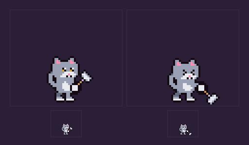
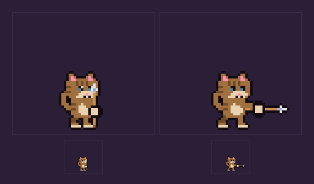
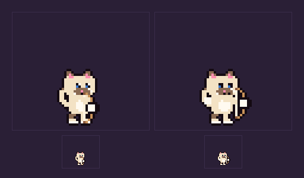

# Cat RPG v2 Class Art Previews (CL7 Prep)

> [!IMPORTANT]
> **PROPOSAL, needs the user's OK (D3/D5)**.
> These static pixel-art preview sheets are placeholders prepared for card CL7 (V22). They visually demonstrate the written-look fallbacks proposed in `docs/class-looks-fallback.md` (Decision D5). Real class art awaits the user's reference submissions or explicit sign-off on these proposals (Decisions D3 / D5).
>
> **NOT wired**: None of these preview sheets edit or modify the files under `apps/web/src/game/rig/`, `apps/web/src/art/`, or any runtime game code.

---

## 1. Preview Sheet Structure

Each preview sheet (such as `warrior.png`) displays the class rendered at the rig's native frame size (`FRAME = { w: 56, h: 48 }`):
- **4x Enlarged View (top)**: Idle frame (left) and signature attack hit frame (right), each scaled to `224 × 192` pixels with crisp nearest-neighbor sampling.
- **1x Native View (bottom)**: Idle frame and attack hit frame at native `56 × 48` pixels as rendered in the ambient game strip.
- **Background**: Rendered over the Cat Café dusk surface tone (`#2a1f36`, `--surface`).

---

## 2. Class Preview Sheets & Rig Wiring Map

---

### 1. Warrior (`warrior`)

*PROPOSAL, needs the user's OK (D3/D5)*

- **Role & Weapon**: Melee striker; Twig Sword (`sword`)
- **Passive**: Cleave (every 3rd attack splashes 50% damage)
- **Palette Hex**:
  - `o` Primary coat: `#f0a040` (bright ginger tabby)
  - `d` Dark stripes: `#c66a1a` (deep ginger mackerel bands)
  - `w` Light bib & paws: `#fff0d8` (warm cream)
  - `e` Eyes: `#3f9e5a` (emerald green)
  - `n` Nose & inner ear: `#ff8fb1` (soft pink)
  - `k` Shared ink outline: `#140a12`
- **Rig Parts Changed When Wired in CL7 (Read-Only references)**:
  - `apps/web/src/game/rig/palettes.ts`: Update `CLASS_LOOKS.warrior.fur` with approved palette hex; confirm `markings: 'tabby'`.
  - `apps/web/src/game/rig/parts.ts`: Reference `MARKINGS.tabby`, `HEAD.tabby`, and upright ears in `HEAD_TOP`.
  - `apps/web/src/game/rig/poses.ts`: Preserves `ATTACKS.sword` 6-frame arc with strike on frame 4.

---

### 2. Guardian (`guardian`)

*PROPOSAL, needs the user's OK (D3/D5)*

- **Role & Weapon**: Melee tank; Wooden Mallet (`hammer`)
- **Passive**: Bonk (hit delays target attack by 500 ms)
- **Palette Hex**:
  - `o` Primary coat: `#9aa0b4` (slate blue-grey Russian Blue)
  - `d` Dark shading: `#666c80` (deep charcoal on flanks/limbs)
  - `w` Light chest: `#e8eaf0` (cool silver flash)
  - `e` Eyes: `#ffd75e` (steady amber gold)
  - `n` Nose & inner ear: `#ff8fb1` (soft pink)
  - `k` Shared ink outline: `#140a12`
- **Rig Parts Changed When Wired in CL7 (Read-Only references)**:
  - `apps/web/src/game/rig/palettes.ts`: Update `CLASS_LOOKS.guardian.fur` with approved palette hex; confirm `markings: 'plain'`.
  - `apps/web/src/game/rig/parts.ts`: Reference broad rounded head in `HEAD.plain` and thick tail in `TAILS.thick`.
  - `apps/web/src/game/rig/poses.ts`: Preserves `ATTACKS.hammer` 6-frame heavy overhead smash with impact on frame 4.

---

### 3. Rogue (`rogue`)

*PROPOSAL, needs the user's OK (D3/D5)*

- **Role & Weapon**: Crit striker; Twin Daggers (`daggers`)
- **Passive**: Twin Strike (2 hits per attack; 25% crit, 10% dodge)
- **Palette Hex**:
  - `o` Primary coat: `#4a4258` (deep dusk violet-black Bombay)
  - `d` Dark shading: `#2e2838` (midnight shadow)
  - `w` Light highlights: `#d8d8e8` (pale lavender-white claw accents)
  - `e` Eyes: `#ffd75e` (sharp luminous amber gold)
  - `n` Nose & inner ear: `#d07890` (dusky mauve pink)
  - `k` Shared ink outline: `#140a12`
- **Rig Parts Changed When Wired in CL7 (Read-Only references)**:
  - `apps/web/src/game/rig/palettes.ts`: Update `CLASS_LOOKS.rogue.fur` with approved palette hex; confirm `markings: 'plain'`.
  - `apps/web/src/game/rig/parts.ts`: Reference sleek predatory head in `HEAD.plain` and tapered tail in `TAILS.slender`.
  - `apps/web/src/game/rig/poses.ts`: Preserves `ATTACKS.daggers` 8-frame twin cross-slash with hits on frames 3 and 5.

---

### 4. Hunter (`hunter`)

*PROPOSAL, needs the user's OK (D3/D5)*

- **Role & Weapon**: Reach tracker; Spear (`spear`)
- **Passive**: Mark Prey (+20% target damage, +10% find)
- **Palette Hex**:
  - `o` Primary coat: `#a0703f` (rich earthy tawny brown)
  - `d` Dark markings: `#6e4a26` (espresso spotted-tabby markings & tail rings)
  - `w` Light underbelly: `#e8d2b0` (warm sand-buff throat & belly)
  - `e` Eyes: `#4aa8ff` (piercing crystal blue)
  - `n` Nose & inner ear: `#ff8fb1` (soft pink)
  - `k` Shared ink outline: `#140a12`
- **Rig Parts Changed When Wired in CL7 (Read-Only references)**:
  - `apps/web/src/game/rig/palettes.ts`: Update `CLASS_LOOKS.hunter.fur` with approved palette hex; confirm `markings: 'tabby'`.
  - `apps/web/src/game/rig/parts.ts`: Reference spotted wildcat markings in `MARKINGS.tabby` and ringed tail in `TAILS.ringed`.
  - `apps/web/src/game/rig/poses.ts`: Preserves `ATTACKS.spear` 6-frame extended horizontal reach thrust with hit on frame 4.

---

### 5. Archer (`archer`)

*PROPOSAL, needs the user's OK (D3/D5)*

- **Role & Weapon**: Ranged sniper; Recurve Bow (`bow`)
- **Passive**: Volley (every 5th shot fires 3 arrows)
- **Palette Hex**:
  - `o` Primary coat: `#f3e2c4` (creamy vanilla fawn)
  - `d` Dark points: `#8a6a52` (dark mocha face mask, ears, paws, and tail)
  - `w` Light muzzle: `#fffaf0` (porcelain white chin & bib)
  - `e` Eyes: `#3a7ad0` (deep sapphire blue)
  - `n` Nose & inner ear: `#ff8fb1` (soft pink)
  - `k` Shared ink outline: `#140a12`
- **Rig Parts Changed When Wired in CL7 (Read-Only references)**:
  - `apps/web/src/game/rig/palettes.ts`: Update `CLASS_LOOKS.archer.fur` with approved palette hex; confirm `markings: 'points'`.
  - `apps/web/src/game/rig/parts.ts`: Reference seal-point face mask in `EYE_SPOTS.mask` and slender pointed tail in `TAILS.pointed`.
  - `apps/web/src/game/rig/poses.ts`: Preserves `ATTACKS.bow` 6-frame draw and arrow release with release on frame 3.

---

### 6. Witch (`witch`)

*PROPOSAL, needs the user's OK (D3/D5)*

- **Role & Weapon**: Area burner; Crystal Staff (`staff`)
- **Passive**: Burn (40% splash, burns 30% over 3s)
- **Palette Hex**:
  - `o` Primary coat: `#f2eefc` (ethereal lilac-white)
  - `d` Dark shading: `#b8b0d4` (mist purple ruff & flank shadow)
  - `w` Light highlights: `#ffffff` (pure white chest plume & ear tufts)
  - `e` Eyes: `#bb74ff` (radiant arcane violet)
  - `n` Nose & inner ear: `#ff8fb1` (soft pink)
  - `k` Shared ink outline: `#140a12`
- **Rig Parts Changed When Wired in CL7 (Read-Only references)**:
  - `apps/web/src/game/rig/palettes.ts`: Update `CLASS_LOOKS.witch.fur` with approved palette hex; confirm `markings: 'plain'`.
  - `apps/web/src/game/rig/parts.ts`: Reference tufted ears in `HEAD_TOP.tufted` and fluffy plume tail in `TAILS.plume`.
  - `apps/web/src/game/rig/poses.ts`: Preserves `ATTACKS.staff` 6-frame channel and glowing crystal blast with hit on frame 4.

---

### 7. Alchemist (`alchemist`)

*PROPOSAL, needs the user's OK (D3/D5)*

- **Role & Weapon**: Poisoner; Throwing Flasks (`flasks`)
- **Passive**: Poison (50% poison over 4s; heals 3% HP on kill)
- **Palette Hex**:
  - `o` Primary coat: `#fff3e0` (milky cream calico base)
  - `d` Dark patch: `#e08a3a` (marmalade ginger patch over eye & shoulder)
  - `w` Light paws: `#ffffff` (crisp white belly & paws)
  - `e` Eyes: `#6be08a` (poison jade green)
  - `n` Nose & inner ear: `#ff8fb1` (soft pink)
  - `k` Shared ink outline: `#140a12`
- **Rig Parts Changed When Wired in CL7 (Read-Only references)**:
  - `apps/web/src/game/rig/palettes.ts`: Update `CLASS_LOOKS.alchemist.fur` with approved palette hex; confirm `markings: 'patches'`.
  - `apps/web/src/game/rig/parts.ts`: Reference asymmetric eye patch in `EYE_SPOTS.patch` and short pom-pom tail in `TAILS.bobtail`.
  - `apps/web/src/game/rig/poses.ts`: Preserves `ATTACKS.flasks` 6-frame windup and flask toss with release on frame 3.

---

## 3. Summary of Affected Rig Files for CL7

When the user gives final approval (Decisions D3 / D5), card CL7 will implement the art by updating:
1. `apps/web/src/game/rig/palettes.ts`: Sets exact `fur` palette entries (`o`, `d`, `w`, `e`, `n`) and `markings` selector for each class.
2. `apps/web/src/game/rig/parts.ts`: Refines pixel maps for distinctive ear tufts, tail types, and body patterns where needed.
3. `apps/web/src/game/rig/poses.ts`: Verifies clearance and anchor coordinates for weapon grips and special attack frames.
