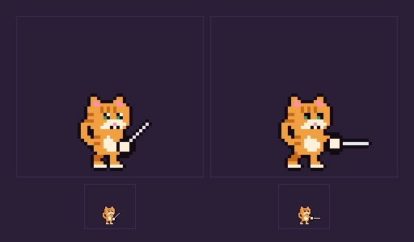
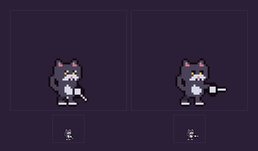
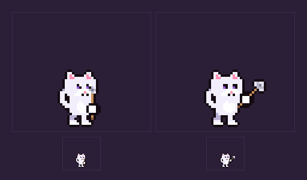
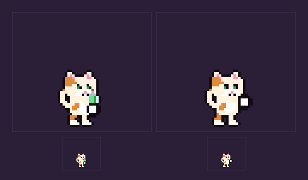

# Cat RPG v2 Class Art Previews & Mechanical Rig Wiring Guide (CL7)

> [!IMPORTANT]
> **PROPOSAL for Decision D5 (CL7 Prep)**.
> This document specifies the agreed visual looks, color palettes, and mechanical code modifications required to wire the 7 playable classes into the Cat RPG v2 procedural sprite rig (`apps/web/src/game/rig/`).
>
> **Status: Ready for Implementation**. All previews and specifications strictly adhere to the rig coordinate system (`56 × 48` frame canvas, `32 × 32` chibi cat cell, row 31 ground plane) and design system tokens (`apps/web/src/theme.css`).

---

## 1. Rig Architecture & Sprite Constraints

The cat sprite rig renders procedural 2D chibi cats assembled from modular parts and color palettes:
1. **Frame Dimensions**: Each animation frame canvas is **56 × 48 pixels** (`FRAME = { w: 56, h: 48 }`). The cat body occupies a **32 × 32 pixel cell** (`CELL = 32`) positioned at canvas offset `(12, 14)`, with paws grounded on row 31 (`STAND.footFront.y = 30`, `STAND.footBack.y = 30`).
2. **Palette Structure**: Defined by `BodyPalette` in [`apps/web/src/game/rig/types.ts`](../../apps/web/src/game/rig/types.ts):
   - `k`: Ink outline & pupil (`#140a12`, shared across all classes).
   - `o`: Primary coat color.
   - `d`: Dark accent (shading, stripes, spots, points).
   - `w`: Light accent (muzzle, chest bib, paws, claws).
   - `n`: Inner ear & nose tip (default `#ff8fb1` or class variant).
   - `e`: Eye iris color.
3. **Attack Poses**: Registered in `ATTACKS` inside [`apps/web/src/game/rig/poses.ts`](../../apps/web/src/game/rig/poses.ts). Frame timings match the combat simulation plan: hit/release frames align with attack windup constants.

---

## 2. Class Specifications & Wiring Directives

---

### 1. Warrior (`warrior`)



#### A. Agreed Look in Words
- **Breed / Archetype**: Athletic ginger mackerel tabby farm cat. Confident, upright stance with proud alert ears and an upright curved tail.
- **Silhouette & Markings**: Sturdy medium build. Distinct mackerel tabby bands across the forehead and back; clean cream bib on the chest and white front paws.
- **Signature Weapon & Pose**: One-handed wooden/iron twig sword gripped forward; 6-frame sweeping overhead slash with strike landing on frame 4 (240 ms).
- **Readability at 390px Mobile**: Bright orange-gold fur pops cleanly against the dark `--surface` (`#2a1f36`) backdrop; cream chest provides clear head separation.
- **What to Avoid**: Avoid muddy brown tones (which blur into Hunter) and blotchy patches (which mimic Alchemist's calico).

#### B. Palette
| Key | Role | Hex Value | Name / Reference |
| :--- | :--- | :--- | :--- |
| `k` | Outline & Pupil | `#140a12` | Dark ink |
| `o` | Primary Fur | `#f0a040` | Bright ginger (matches `--accent` / `--gold`) |
| `d` | Dark Stripes | `#c66a1a` | Deep ginger mackerel tabby bands |
| `w` | Light Fur | `#fff0d8` | Warm cream bib and paws |
| `n` | Inner Ear / Nose | `#ff8fb1` | Soft pink |
| `e` | Eyes | `#3f9e5a` | Emerald green (matches `--good`) |

#### C. Exact Rig Wiring Directives
- **`apps/web/src/game/rig/palettes.ts`**:
  - Update entry `CLASS_LOOKS.warrior`:
    ```ts
    warrior: {
      id: 'warrior',
      name: 'Warrior',
      weaponType: 'sword',
      markings: 'tabby',
      starterWeapon: 'sword.basic',
      fur: fur(0xf0a040, 0xc66a1a, 0xfff0d8, 0x3f9e5a, 0xff8fb1),
    },
    ```
- **`apps/web/src/game/rig/parts.ts`**:
  - Uses `MARKINGS.tabby` (head stripes at `{ x: 4, y: 3 }` and `{ x: 0, y: 5 }`; torso stripes at `{ x: 0, y: 2 }`).
  - Uses default `HEAD` sprite and `TAILS.up`.
- **`apps/web/src/game/rig/poses.ts`**:
  - Uses `ATTACKS.sword`: 6-frame animation with hit at frame 4 (`hitAtMs: 240`).

---

### 2. Guardian (`guardian`)


#### A. Agreed Look in Words
- **Breed / Archetype**: Heavyweight Russian Blue / Chartreux cat. Solid, broad-shouldered, immovable tank with a wide rounded head, stout forearms, and a sturdy thick tail.
- **Silhouette & Markings**: Broad solid silhouette without stripes. Slate blue-grey coat with subtle charcoal shadow along far limbs and flanks; silvery chest flash.
- **Signature Weapon & Pose**: Heavy two-handed wooden mallet raised high over the shoulder; 6-frame heavy downward crush with impact on frame 4 (520 ms).
- **Readability at 390px Mobile**: Wide square silhouette clearly distinct from leaner classes; radiant amber eyes flash against dark slate fur.
- **What to Avoid**: Avoid deep violet tones (which blur into Rogue) and any striped or spotted patterns.

#### B. Palette
| Key | Role | Hex Value | Name / Reference |
| :--- | :--- | :--- | :--- |
| `k` | Outline & Pupil | `#140a12` | Dark ink |
| `o` | Primary Fur | `#9aa0b4` | Slate blue-grey Russian Blue |
| `d` | Dark Shading | `#666c80` | Deep charcoal limb & flank shading |
| `w` | Light Fur | `#e8eaf0` | Cool silvery chest flash and chin |
| `n` | Inner Ear / Nose | `#ff8fb1` | Soft pink |
| `e` | Eyes | `#ffd75e` | Radiant amber gold (updated from `#d9a520`) |

#### C. Exact Rig Wiring Directives
- **`apps/web/src/game/rig/palettes.ts`**:
  - Update entry `CLASS_LOOKS.guardian`:
    ```ts
    guardian: {
      id: 'guardian',
      name: 'Guardian',
      weaponType: 'hammer',
      markings: 'plain',
      starterWeapon: 'hammer.basic',
      fur: fur(0x9aa0b4, 0x666c80, 0xe8eaf0, 0xffd75e, 0xff8fb1),
    },
    ```
- **`apps/web/src/game/rig/parts.ts`**:
  - Uses `MARKINGS.plain` (empty arrays for head and torso).
  - Uses `HEAD` sprite and `TAILS.mid` or `TAILS.down`.
- **`apps/web/src/game/rig/poses.ts`**:
  - Uses `ATTACKS.hammer`: 6-frame animation with hit at frame 4 (`hitAtMs: 520`).

---

### 3. Rogue (`rogue`)



#### A. Agreed Look in Words
- **Breed / Archetype**: Sleek midnight Bombay cat. Low predatory crouch with keen swept-back ears, narrow tapered tail, and stealthy stance.
- **Silhouette & Markings**: Compact, aerodynamic build. Rich dusky violet-black body with deep midnight shading on flanks and subtle pale lavender claw highlights.
- **Signature Weapon & Pose**: Dual-wielded iron carving daggers held in reverse grip; 8-frame twin cross-slash with double hits on frames 3 (140 ms) and 5 (300 ms).
- **Readability at 390px Mobile**: Sharp glowing amber-gold eyes pop against deep violet fur; twin dagger silhouettes frame the front paws.
- **What to Avoid**: Avoid pure flat black (`#000000`) which causes the dark outline (`#140a12`) to vanish; keep the dusky violet tint.

#### B. Palette
| Key | Role | Hex Value | Name / Reference |
| :--- | :--- | :--- | :--- |
| `k` | Outline & Pupil | `#140a12` | Dark ink |
| `o` | Primary Fur | `#4a4258` | Deep dusk violet-black Bombay |
| `d` | Dark Shading | `#2e2838` | Midnight shadow |
| `w` | Light Highlights | `#d8d8e8` | Pale lavender-white claw accents |
| `n` | Inner Ear / Nose | `#d07890` | Dusky mauve pink |
| `e` | Eyes | `#ffd75e` | Luminous amber gold (updated from `#e8c840`) |

#### C. Exact Rig Wiring Directives
- **`apps/web/src/game/rig/palettes.ts`**:
  - Update entry `CLASS_LOOKS.rogue`:
    ```ts
    rogue: {
      id: 'rogue',
      name: 'Rogue',
      weaponType: 'daggers',
      markings: 'plain',
      starterWeapon: 'daggers.basic',
      fur: fur(0x4a4258, 0x2e2838, 0xd8d8e8, 0xffd75e, 0xd07890),
    },
    ```
- **`apps/web/src/game/rig/parts.ts`**:
  - Uses `MARKINGS.plain`.
  - Uses `HEAD` sprite and `TAILS.flat` or `TAILS.down`.
- **`apps/web/src/game/rig/poses.ts`**:
  - Uses `ATTACKS.daggers`: 8-frame animation with twin strikes at frame 3 (`hitAtMs: 140`) and frame 5 (`hitAtMs: 300`).

---

### 4. Hunter (`hunter`)


#### A. Agreed Look in Words
- **Breed / Archetype**: Lean, rangy wildcat / Abyssinian / Bengal tracker. Tall upright posture, keen forward gaze, ringed tail, and athletic stance.
- **Silhouette & Markings**: Warm tawny brown coat with dark espresso spotted tabby rosettes along flanks and ringed dark bands on the tail; warm sand-buff belly.
- **Signature Weapon & Pose**: Long bamboo spear with obsidian tip gripped two-handed; 6-frame extended horizontal reach thrust with strike landing on frame 4 (300 ms).
- **Readability at 390px Mobile**: Distinctive long weapon reach extending beyond normal melee range; piercing sky-blue eyes create an immediate facial focal point.
- **What to Avoid**: Avoid orange tones that look like Warrior or flat grey tones that resemble Guardian.

#### B. Palette
| Key | Role | Hex Value | Name / Reference |
| :--- | :--- | :--- | :--- |
| `k` | Outline & Pupil | `#140a12` | Dark ink |
| `o` | Primary Fur | `#a0703f` | Rich earthy tawny brown |
| `d` | Dark Markings | `#6e4a26` | Espresso spotted markings & tail rings |
| `w` | Light Underbelly | `#e8d2b0` | Warm sand-buff throat and belly |
| `n` | Inner Ear / Nose | `#ff8fb1` | Soft pink |
| `e` | Eyes | `#4aa8ff` | Piercing crystal blue (updated from `#3a8ac0`, matches `--rarity-rare`) |

#### C. Exact Rig Wiring Directives
- **`apps/web/src/game/rig/palettes.ts`**:
  - Update entry `CLASS_LOOKS.hunter`:
    ```ts
    hunter: {
      id: 'hunter',
      name: 'Hunter',
      weaponType: 'spear',
      markings: 'tabby',
      starterWeapon: 'spear.basic',
      fur: fur(0xa0703f, 0x6e4a26, 0xe8d2b0, 0x4aa8ff, 0xff8fb1),
    },
    ```
- **`apps/web/src/game/rig/parts.ts`**:
  - Uses `MARKINGS.tabby`.
  - Uses `HEAD` sprite and `TAILS.up`.
- **`apps/web/src/game/rig/poses.ts`**:
  - Uses `ATTACKS.spear`: 6-frame animation with extended paw reaches and thrust hit at frame 4 (`hitAtMs: 300`).

---

### 5. Archer (`archer`)


#### A. Agreed Look in Words
- **Breed / Archetype**: Elegant, slender Siamese / colourpoint cat. Poised upright stance with tall triangular ears, refined posture, and graceful slender tail.
- **Silhouette & Markings**: Pale vanilla fawn body with dramatic dark mocha colourpoint shading on face mask, ear tips, all four paws, and tail; crisp white chin.
- **Signature Weapon & Pose**: Recurve shortbow held vertically in the front paw with drawn bowstring; 6-frame draw and release with arrow flight starting on frame 3 (300 ms).
- **Readability at 390px Mobile**: High-contrast dark facial mask against pale cream body immediately identifies the archer; tall vertical bow arc is unmistakable.
- **What to Avoid**: Avoid dark whole-body coats or calico blotches.

#### B. Palette
| Key | Role | Hex Value | Name / Reference |
| :--- | :--- | :--- | :--- |
| `k` | Outline & Pupil | `#140a12` | Dark ink |
| `o` | Primary Fur | `#f3e2c4` | Creamy vanilla fawn |
| `d` | Dark Points | `#8a6a52` | Dark mocha face mask, ears, paws, and tail |
| `w` | Light Muzzle | `#fffaf0` | Porcelain white chin and chest bib |
| `n` | Inner Ear / Nose | `#ff8fb1` | Soft pink |
| `e` | Eyes | `#3a7ad0` | Deep sapphire blue |

#### C. Exact Rig Wiring Directives
- **`apps/web/src/game/rig/palettes.ts`**:
  - Update entry `CLASS_LOOKS.archer`:
    ```ts
    archer: {
      id: 'archer',
      name: 'Archer',
      weaponType: 'bow',
      markings: 'points',
      starterWeapon: 'bow.basic',
      fur: fur(0xf3e2c4, 0x8a6a52, 0xfffaf0, 0x3a7ad0, 0xff8fb1),
    },
    ```
- **`apps/web/src/game/rig/parts.ts`**:
  - Uses `MARKINGS.points` (ear point tips at `{ x: 1, y: 0 }` and mask at `{ x: 4, y: 7 }`).
  - Uses `HEAD` sprite and `TAILS.mid`.
- **`apps/web/src/game/rig/poses.ts`**:
  - Uses `ATTACKS.bow`: 6-frame draw animation with arrow release at frame 3 (`releaseAtMs: 300`).

---

### 6. Witch (`witch`)



#### A. Agreed Look in Words
- **Breed / Archetype**: Fluffy, mystical Turkish Angora / Persian mage cat. Billowing chest ruff, tufted ear tips, lavish plume tail, and enchanted arcane aura.
- **Silhouette & Markings**: Voluminous long-haired silhouette with ethereal lilac-white coat, soft lavender-purple shadow under ruff and flanks, and sparkling white highlights.
- **Signature Weapon & Pose**: Tall wooden magic staff topped with a glowing crystal shard held upright; 6-frame channel animation releasing an arcane crystal blast on frame 4 (500 ms).
- **Readability at 390px Mobile**: Glowing arcane crystal staff head and luminous violet eyes stand out brilliantly against the dark café palette.
- **What to Avoid**: Avoid flat unshaded white coats or dark earthy tabby stripes.

#### B. Palette
| Key | Role | Hex Value | Name / Reference |
| :--- | :--- | :--- | :--- |
| `k` | Outline & Pupil | `#140a12` | Dark ink |
| `o` | Primary Fur | `#f2eefc` | Ethereal lilac-white |
| `d` | Dark Shading | `#b8b0d4` | Soft mist-purple ruff & flank shadow |
| `w` | Light Highlights | `#ffffff` | Pure white chest plume and ear tufts |
| `n` | Inner Ear / Nose | `#ff8fb1` | Soft pink |
| `e` | Eyes | `#bb74ff` | Radiant arcane violet (updated from `#9a5ae0`, matches `--rarity-epic`) |

#### C. Exact Rig Wiring Directives
- **`apps/web/src/game/rig/palettes.ts`**:
  - Update entry `CLASS_LOOKS.witch`:
    ```ts
    witch: {
      id: 'witch',
      name: 'Witch',
      weaponType: 'staff',
      markings: 'plain',
      starterWeapon: 'staff.basic',
      fur: fur(0xf2eefc, 0xb8b0d4, 0xffffff, 0xbb74ff, 0xff8fb1),
    },
    ```
- **`apps/web/src/game/rig/parts.ts`**:
  - Uses `MARKINGS.plain`.
  - Uses `HEAD` sprite and `TAILS.up`.
- **`apps/web/src/game/rig/poses.ts`**:
  - Uses `ATTACKS.staff`: 6-frame animation with channel windup and blast release at frame 4 (`hitAtMs: 500`).

---

### 7. Alchemist (`alchemist`)



#### A. Agreed Look in Words
- **Breed / Archetype**: Playful, eccentric Japanese Bobtail calico cat. Asymmetric markings, alert cocked ears, and a cute pom-pom bobtail.
- **Silhouette & Markings**: Warm milky cream base coat with a vivid ginger marmalade patch over one eye and shoulder; crisp clean white underbelly and paws.
- **Signature Weapon & Pose**: Raised glass potion vial with bubbling jade liquid held in front paw; 6-frame windup and lob toss with flask flight starting on frame 3 (260 ms).
- **Readability at 390px Mobile**: Asymmetric calico eye patch and glowing emerald green potion flask make the alchemist instantly recognizable.
- **What to Avoid**: Avoid uniform tabby stripes or symmetrical markings.

#### B. Palette
| Key | Role | Hex Value | Name / Reference |
| :--- | :--- | :--- | :--- |
| `k` | Outline & Pupil | `#140a12` | Dark ink |
| `o` | Primary Fur | `#fff3e0` | Warm milky cream calico base (matches `--text`) |
| `d` | Dark Patch | `#e08a3a` | Marmalade ginger patch over eye and shoulder |
| `w` | Light Fur | `#ffffff` | Crisp white belly and paws |
| `n` | Inner Ear / Nose | `#ff8fb1` | Soft pink |
| `e` | Eyes | `#6be08a` | Poison jade green (updated from `#3f9e5a`, matches `--good`) |

#### C. Exact Rig Wiring Directives
- **`apps/web/src/game/rig/palettes.ts`**:
  - Update entry `CLASS_LOOKS.alchemist`:
    ```ts
    alchemist: {
      id: 'alchemist',
      name: 'Alchemist',
      weaponType: 'flasks',
      markings: 'patches',
      starterWeapon: 'flasks.basic',
      fur: fur(0xfff3e0, 0xe08a3a, 0xffffff, 0x6be08a, 0xff8fb1),
    },
    ```
- **`apps/web/src/game/rig/parts.ts`**:
  - Uses `MARKINGS.patches` (asymmetric head patch at `{ x: 0, y: 2 }` and flank patch at `{ x: 1, y: 3 }`).
  - Uses `HEAD` sprite and `TAILS.mid` or `TAILS.flat`.
- **`apps/web/src/game/rig/poses.ts`**:
  - Uses `ATTACKS.flasks`: 6-frame animation with toss release at frame 3 (`releaseAtMs: 260`).

---

## 3. Summary of Exact File Modifications for CL7 Wiring Card

When executing the mechanical wiring card, the engineer only needs to make the following edits:

1. **`apps/web/src/game/rig/palettes.ts`**:
   - Apply the updated hex values to `CLASS_LOOKS` for:
     - `guardian.fur.e`: `0xd9a520` -> `0xffd75e`
     - `rogue.fur.e`: `0xe8c840` -> `0xffd75e`
     - `hunter.fur.e`: `0x3a8ac0` -> `0x4aa8ff`
     - `witch.fur.e`: `0x9a5ae0` -> `0xbb74ff`
     - `alchemist.fur.e`: `0x3f9e5a` -> `0x6be08a`
2. **`apps/web/src/game/rig/parts.ts`**:
   - Verify that `MARKINGS.plain`, `MARKINGS.tabby`, `MARKINGS.patches`, and `MARKINGS.points` remain mapped to their respective classes.
3. **`apps/web/src/game/rig/poses.ts`**:
   - Confirm weapon attack entries in `ATTACKS` match each class's `starterWeapon` and animation timing.
