# Cat Class Reference Request Sheet

> [!NOTE]
> Preparation sheet for class art card CL7 (V22). Use this document to submit reference images or written descriptions for each of the 7 playable cat classes before custom pixel art creation begins.

---

## 1. Why

The 7 cat classes in Taskbar Hero currently use temporary placeholder looks; please send one reference picture OR a few written words per class.
The deadline (Decision D3) for submissions is 2 Nov 2026, with the final cutoff on 5 Nov 2026.
Without a submission (Decision D5), the look will be drawn from the written descriptions below and still shown to you for OK, or the current placeholder look will be kept.

---

## 2. How to Send

1. **Where to post:** Post directly in the project thread, one message per class, starting with the class name (e.g. `Warrior: ...`).
2. **What to include:** Either a picture (photo of a real cat, a sketch, or any image you own) OR answers to the short fill-in questions provided in each class section below.
3. **Keep current look:** Replying `skip` for any class confirms you wish to keep the current placeholder look.

---

## 3. Class Reference Sections

Classes are listed in registry order from `packages/game-rules/src/v2/content/classes.ts`.

```
1. Warrior
2. Guardian
3. Rogue
4. Hunter
5. Archer
6. Witch
7. Alchemist
```

---

### 1. Warrior

#### Current Placeholder Look

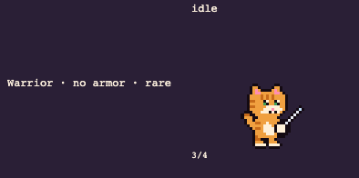

*Idle pose at 3x zoom (dark background `#2a1f36`).*

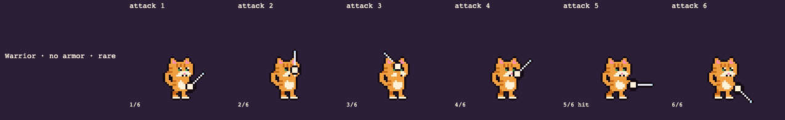

*Attack animation strip (6 frames).*

#### Code Facts

| Fact | Value from Code | Source File |
| :--- | :--- | :--- |
| **Role** | Melee striker (range: `melee`) | `packages/game-rules/src/v2/content/classes.ts`, `docs/play-v2.md` |
| **Weapon** | Sword (`sword`) | `packages/game-rules/src/v2/content/classes.ts` |
| **Passive** | Cleave (`cleave`): Every 3rd attack splashes 50% damage to next monster | `packages/game-rules/src/v2/content/classes.ts`, `docs/play-v2.md` |
| **Starter Weapon** | Twig Sword (`wpn.sword.twig`, rig visual `sword.basic`) | `packages/game-rules/src/v2/content/classes.ts`, `apps/web/src/game/rig/palettes.ts` |
| **Markings** | Tabby (`tabby`) | `apps/web/src/game/rig/palettes.ts` |
| **Current Fur Colours** | `o` Main fur: `#f0a040` (bright ginger/orange)<br>`d` Dark fur: `#c66a1a` (deep ginger tabby stripes)<br>`w` Light fur: `#fff0d8` (warm cream muzzle & belly)<br>`n` Nose / ears: `#ff8fb1` (soft pink)<br>`e` Eyes: `#3f9e5a` (vivid emerald green)<br>`k` Outline: `#140a12` (dark ink) | `apps/web/src/game/rig/palettes.ts` |

#### Fill-in Questions

- fur colour(s) ____
- pattern (plain / tabby / points / patches / other) ____
- eyes ____
- one accessory or clothing idea ____ *(must not cover the weapon hand)*
- ears / tail shape ____
- personality in 3 words ____
- anything to avoid ____

#### Generic Examples

> **Example A:**
> - fur colour(s): Orange tabby with white bib and white front paws
> - pattern: Classic mackerel tabby stripes
> - eyes: Forest green
> - one accessory or clothing idea: Red cloth bandana tied loosely around the collar
> - ears / tail shape: Broad upright ears, thick bushy tail held high
> - personality in 3 words: Brave, cheerful, earnest
> - anything to avoid: Heavy helmets or dark sinister colors

> **Example B:**
> - fur colour(s): Golden ginger with cream underbelly
> - pattern: Soft striped patches along back and forehead
> - eyes: Bright copper amber
> - one accessory or clothing idea: Stitched leather shoulder strap over chest
> - ears / tail shape: Left ear tip notched, medium fluffy tail
> - personality in 3 words: Resolute, energetic, loyal
> - anything to avoid: Floppy ears or long drooping whiskers

---

### 2. Guardian

#### Current Placeholder Look

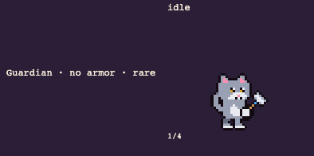

*Idle pose at 3x zoom (dark background `#2a1f36`).*

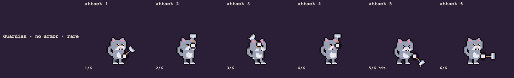

*Attack animation strip (6 frames).*

#### Code Facts

| Fact | Value from Code | Source File |
| :--- | :--- | :--- |
| **Role** | Melee tank (range: `melee`) | `packages/game-rules/src/v2/content/classes.ts`, `docs/play-v2.md` |
| **Weapon** | Hammer (`hammer`) | `packages/game-rules/src/v2/content/classes.ts` |
| **Passive** | Bonk (`bonk`): Each hit delays target attack by 500 ms | `packages/game-rules/src/v2/content/classes.ts`, `docs/play-v2.md` |
| **Starter Weapon** | Wooden Mallet (`wpn.hammer.mallet`, rig visual `hammer.basic`) | `packages/game-rules/src/v2/content/classes.ts`, `apps/web/src/game/rig/palettes.ts` |
| **Markings** | Plain (`plain`) | `apps/web/src/game/rig/palettes.ts` |
| **Current Fur Colours** | `o` Main fur: `#9aa0b4` (slate blue-grey)<br>`d` Dark fur: `#666c80` (deep charcoal blue-grey shadows)<br>`w` Light fur: `#e8eaf0` (light silver-white muzzle)<br>`n` Nose / ears: `#ff8fb1` (soft pink)<br>`e` Eyes: `#d9a520` (warm golden amber)<br>`k` Outline: `#140a12` (dark ink) | `apps/web/src/game/rig/palettes.ts` |

#### Fill-in Questions

- fur colour(s) ____
- pattern (plain / tabby / points / patches / other) ____
- eyes ____
- one accessory or clothing idea ____ *(must not cover the weapon hand)*
- ears / tail shape ____
- personality in 3 words ____
- anything to avoid ____

#### Generic Examples

> **Example A:**
> - fur colour(s): Solid Russian blue slate-grey with pale silver chest tuft
> - pattern: Plain (solid self-colored coat)
> - eyes: Deep warm amber
> - one accessory or clothing idea: Sturdy brass collar with a heavy round bell
> - ears / tail shape: Wide rounded ears, thick club-like tail
> - personality in 3 words: Stolid, protective, patient
> - anything to avoid: Thin frail limbs or slender tails

> **Example B:**
> - fur colour(s): Silver chinchilla smoke grey with charcoal muzzle
> - pattern: Plain with subtle dark paws
> - eyes: Pale topaz gold
> - one accessory or clothing idea: Padded knit neck gaiter in olive wool
> - ears / tail shape: Small rounded ears, short bobtail
> - personality in 3 words: Unshakable, calm, stubborn
> - anything to avoid: Sharp feline predator markings or sleek athletic styling

---

### 3. Rogue

#### Current Placeholder Look

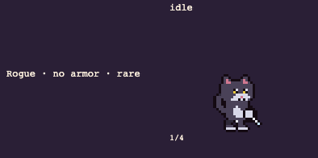

*Idle pose at 3x zoom (dark background `#2a1f36`).*

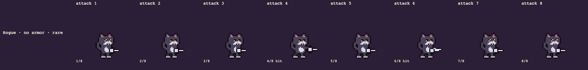

*Attack animation strip (8 frames).*

#### Code Facts

| Fact | Value from Code | Source File |
| :--- | :--- | :--- |
| **Role** | Crit striker (range: `melee`) | `packages/game-rules/src/v2/content/classes.ts`, `docs/play-v2.md` |
| **Weapon** | Daggers (`daggers`, dual-wielding) | `packages/game-rules/src/v2/content/classes.ts` |
| **Passive** | Twin Strike (`twinStrike`): 2 hits per attack; 25% crit, 10% dodge | `packages/game-rules/src/v2/content/classes.ts`, `docs/play-v2.md` |
| **Starter Weapon** | Bone Claws (`wpn.daggers.claws`, rig visual `daggers.basic`) | `packages/game-rules/src/v2/content/classes.ts`, `apps/web/src/game/rig/palettes.ts` |
| **Markings** | Plain (`plain`) | `apps/web/src/game/rig/palettes.ts` |
| **Current Fur Colours** | `o` Main fur: `#4a4258` (shadow dark purple-grey)<br>`d` Dark fur: `#2e2838` (deep obsidian charcoal)<br>`w` Light fur: `#d8d8e8` (pale lavender-grey belly)<br>`n` Nose / ears: `#d07890` (muted mauve rose)<br>`e` Eyes: `#e8c840` (piercing lemon yellow)<br>`k` Outline: `#140a12` (dark ink) | `apps/web/src/game/rig/palettes.ts` |

#### Fill-in Questions

- fur colour(s) ____
- pattern (plain / tabby / points / patches / other) ____
- eyes ____
- one accessory or clothing idea ____ *(must not cover the weapon hand)*
- ears / tail shape ____
- personality in 3 words ____
- anything to avoid ____

#### Generic Examples

> **Example A:**
> - fur colour(s): Midnight black coat with small white chest star
> - pattern: Plain (solid black Bombay style)
> - eyes: Luminous glowing chartreuse yellow
> - one accessory or clothing idea: Dark violet silken neck scarf tucked tight
> - ears / tail shape: Sleek pointed tall ears, thin whip tail with sharp tip
> - personality in 3 words: Cunning, quiet, agile
> - anything to avoid: Bright neon gear or fluffy oversized tails

> **Example B:**
> - fur colour(s): Dark charcoal smoke with silver undercoat
> - pattern: Plain with subtle darker shadow mask
> - eyes: Sharp gold-green slit pupils
> - one accessory or clothing idea: Weathered dark leather belt with twin dagger sheaths at hip
> - ears / tail shape: Forward-angled tufted ears, sleek long tail held low
> - personality in 3 words: Sly, observant, swift
> - anything to avoid: Clunky armor or bulky capes that hide dagger strikes

---

### 4. Hunter

#### Current Placeholder Look

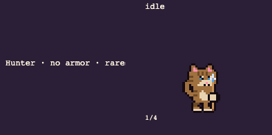

*Idle pose at 3x zoom (dark background `#2a1f36`).*

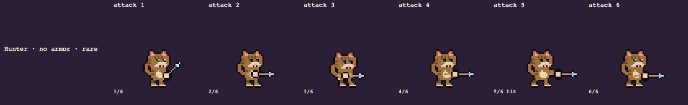

*Attack animation strip (6 frames).*

#### Code Facts

| Fact | Value from Code | Source File |
| :--- | :--- | :--- |
| **Role** | Reach tracker (range: `reach`) | `packages/game-rules/src/v2/content/classes.ts`, `docs/play-v2.md` |
| **Weapon** | Spear (`spear`) | `packages/game-rules/src/v2/content/classes.ts` |
| **Passive** | Mark Prey (`markPrey`): Target takes +20% damage; +10% material find | `packages/game-rules/src/v2/content/classes.ts`, `docs/play-v2.md` |
| **Starter Weapon** | Reed Spear (`wpn.spear.reed`, rig visual `spear.basic`) | `packages/game-rules/src/v2/content/classes.ts`, `apps/web/src/game/rig/palettes.ts` |
| **Markings** | Tabby (`tabby`) | `apps/web/src/game/rig/palettes.ts` |
| **Current Fur Colours** | `o` Main fur: `#a0703f` (woodland warm brown)<br>`d` Dark fur: `#6e4a26` (dark chocolate brown stripes)<br>`w` Light fur: `#e8d2b0` (soft biscuit tan muzzle & chest)<br>`n` Nose / ears: `#ff8fb1` (soft pink)<br>`e` Eyes: `#3a8ac0` (steel sky blue)<br>`k` Outline: `#140a12` (dark ink) | `apps/web/src/game/rig/palettes.ts` |

#### Fill-in Questions

- fur colour(s) ____
- pattern (plain / tabby / points / patches / other) ____
- eyes ____
- one accessory or clothing idea ____ *(must not cover the weapon hand)*
- ears / tail shape ____
- personality in 3 words ____
- anything to avoid ____

#### Generic Examples

> **Example A:**
> - fur colour(s): Brown Bengal / wild leopard rosette coat with cream throat
> - pattern: Tabby (spotted / marbled wilderness pattern)
> - eyes: Clear icy aqua blue
> - one accessory or clothing idea: Braided twine necklace with a small polished river pebble
> - ears / tail shape: Lynx-tipped tufted ears, ringed sturdy tail
> - personality in 3 words: Focused, patient, instinctual
> - anything to avoid: Domestic indoor collar bells or soft plush accessories

> **Example B:**
> - fur colour(s): Tawny warm sand with dark cedar wood stripes
> - pattern: Tabby (rugged mackerel stripes)
> - eyes: Piercing pale teal
> - one accessory or clothing idea: Rolled forest-green survival poncho over back
> - ears / tail shape: Alert notched ears, bushy ringed tail
> - personality in 3 words: Resourceful, vigilant, rugged
> - anything to avoid: Dainty grooming or bright polished metal

---

### 5. Archer

#### Current Placeholder Look

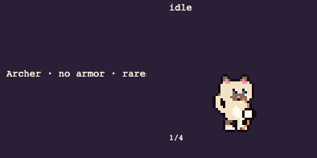

*Idle pose at 3x zoom (dark background `#2a1f36`).*

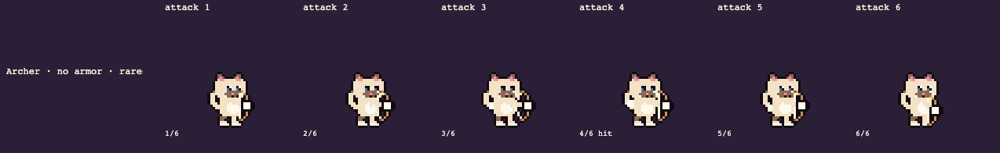

*Attack animation strip (6 frames).*

#### Code Facts

| Fact | Value from Code | Source File |
| :--- | :--- | :--- |
| **Role** | Ranged sniper (range: `ranged`) | `packages/game-rules/src/v2/content/classes.ts`, `docs/play-v2.md` |
| **Weapon** | Bow (`bow`) | `packages/game-rules/src/v2/content/classes.ts` |
| **Passive** | Volley (`volley`): Every 5th shot fires 3 arrows (extra arrows deal 50% damage) | `packages/game-rules/src/v2/content/classes.ts`, `docs/play-v2.md` |
| **Starter Weapon** | Willow Bow (`wpn.bow.willow`, rig visual `bow.basic`) | `packages/game-rules/src/v2/content/classes.ts`, `apps/web/src/game/rig/palettes.ts` |
| **Markings** | Points (`points`) | `apps/web/src/game/rig/palettes.ts` |
| **Current Fur Colours** | `o` Main fur: `#f3e2c4` (pale fawn cream body)<br>`d` Dark fur: `#8a6a52` (warm seal brown colorpoint mask & ears)<br>`w` Light fur: `#fffaf0` (warm ivory chest)<br>`n` Nose / ears: `#ff8fb1` (soft pink)<br>`e` Eyes: `#3a7ad0` (brilliant sapphire blue)<br>`k` Outline: `#140a12` (dark ink) | `apps/web/src/game/rig/palettes.ts` |

#### Fill-in Questions

- fur colour(s) ____
- pattern (plain / tabby / points / patches / other) ____
- eyes ____
- one accessory or clothing idea ____ *(must not cover the weapon hand)*
- ears / tail shape ____
- personality in 3 words ____
- anything to avoid ____

#### Generic Examples

> **Example A:**
> - fur colour(s): Cream Siamese coat with dark chocolate mask, ears, and stockings
> - pattern: Points (classic seal point coloration)
> - eyes: Deep sapphire blue
> - one accessory or clothing idea: Slender leather quiver sling worn across the chest
> - ears / tail shape: Large slender pointed ears, long tapering tail
> - personality in 3 words: Sharp, disciplined, poised
> - anything to avoid: Heavy robes or loose cloth that could snag the bowstring

> **Example B:**
> - fur colour(s): Ivory white body with pale blue-grey lynx points
> - pattern: Points (tabby lynx point markings on face mask and tail)
> - eyes: Striking periwinkle blue
> - one accessory or clothing idea: Single leather bracer on the bow-holding paw
> - ears / tail shape: High delicate ears, elegant curved tail
> - personality in 3 words: Quiet, precise, graceful
> - anything to avoid: Bulky headpieces that obscure eye line

---

### 6. Witch

#### Current Placeholder Look

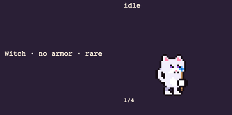

*Idle pose at 3x zoom (dark background `#2a1f36`).*

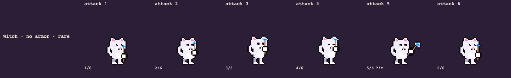

*Attack animation strip (6 frames).*

#### Code Facts

| Fact | Value from Code | Source File |
| :--- | :--- | :--- |
| **Role** | Area burner (range: `ranged`) | `packages/game-rules/src/v2/content/classes.ts`, `docs/play-v2.md` |
| **Weapon** | Staff (`staff`) | `packages/game-rules/src/v2/content/classes.ts` |
| **Passive** | Burn (`burn`): Splash 40%; burns 30% damage over 3000 ms (ticks every 1000 ms) | `packages/game-rules/src/v2/content/classes.ts`, `docs/play-v2.md` |
| **Starter Weapon** | Branch Staff (`wpn.staff.branch`, rig visual `staff.basic`) | `packages/game-rules/src/v2/content/classes.ts`, `apps/web/src/game/rig/palettes.ts` |
| **Markings** | Plain (`plain`) | `apps/web/src/game/rig/palettes.ts` |
| **Current Fur Colours** | `o` Main fur: `#f2eefc` (ethereal pale lavender-white)<br>`d` Dark fur: `#b8b0d4` (soft misty lilac shadows)<br>`w` Light fur: `#ffffff` (pure snow white highlights)<br>`n` Nose / ears: `#ff8fb1` (soft pink)<br>`e` Eyes: `#9a5ae0` (arcane amethyst violet)<br>`k` Outline: `#140a12` (dark ink) | `apps/web/src/game/rig/palettes.ts` |

#### Fill-in Questions

- fur colour(s) ____
- pattern (plain / tabby / points / patches / other) ____
- eyes ____
- one accessory or clothing idea ____ *(must not cover the weapon hand)*
- ears / tail shape ____
- personality in 3 words ____
- anything to avoid ____

#### Generic Examples

> **Example A:**
> - fur colour(s): Silvery lavender-white Angora coat with soft lilac shading
> - pattern: Plain (soft mystical cloud fur)
> - eyes: Arcane deep violet with bright specks
> - one accessory or clothing idea: Small pointed cloth hat tipped behind the ears or star-gem collar
> - ears / tail shape: Long tufted ears with wispy hair, long feathery plume tail
> - personality in 3 words: Mystical, curious, whimsical
> - anything to avoid: Bulky melee plate armor or muddy earth tones

> **Example B:**
> - fur colour(s): Inky obsidian black with smoky purple sheen under light
> - pattern: Plain (traditional familiar style)
> - eyes: Glowing magical lavender
> - one accessory or clothing idea: Crimson silk ribbon with a crescent moon charm
> - ears / tail shape: Tall arched ears, sinuous tail that curls at the tip
> - personality in 3 words: Enigmatic, studious, proud
> - anything to avoid: Bright neon circus colors or technological gadgets

---

### 7. Alchemist

#### Current Placeholder Look

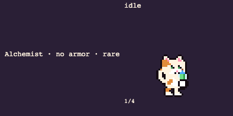

*Idle pose at 3x zoom (dark background `#2a1f36`).*

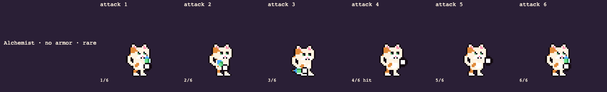

*Attack animation strip (6 frames).*

#### Code Facts

| Fact | Value from Code | Source File |
| :--- | :--- | :--- |
| **Role** | Poisoner (range: `ranged`) | `packages/game-rules/src/v2/content/classes.ts`, `docs/play-v2.md` |
| **Weapon** | Flasks (`flasks`, throwing potion bottles) | `packages/game-rules/src/v2/content/classes.ts` |
| **Passive** | Poison (`poison`): 50% poison damage over 4000 ms (ticks every 1000 ms); heals 3% max HP on kill | `packages/game-rules/src/v2/content/classes.ts`, `docs/play-v2.md` |
| **Starter Weapon** | Basic Vial (`wpn.flasks.vial`, rig visual `flasks.basic`) | `packages/game-rules/src/v2/content/classes.ts`, `apps/web/src/game/rig/palettes.ts` |
| **Markings** | Patches (`patches`) | `apps/web/src/game/rig/palettes.ts` |
| **Current Fur Colours** | `o` Main fur: `#fff3e0` (warm milky cream calico base)<br>`d` Dark fur: `#e08a3a` (bright ginger/orange calico patch)<br>`w` Light fur: `#ffffff` (crisp white belly & paws)<br>`n` Nose / ears: `#ff8fb1` (soft pink)<br>`e` Eyes: `#3f9e5a` (bright emerald green)<br>`k` Outline: `#140a12` (dark ink) | `apps/web/src/game/rig/palettes.ts` |

#### Fill-in Questions

- fur colour(s) ____
- pattern (plain / tabby / points / patches / other) ____
- eyes ____
- one accessory or clothing idea ____ *(must not cover the weapon hand)*
- ears / tail shape ____
- personality in 3 words ____
- anything to avoid ____

#### Generic Examples

> **Example A:**
> - fur colour(s): Tri-color calico (white base with ginger orange and chocolate black patches)
> - pattern: Patches (asymmetric blotches over face and body)
> - eyes: Bright poison bottle green
> - one accessory or clothing idea: Bandolier strap with tiny corked glass potion vials
> - ears / tail shape: Rounded ears (one orange, one black), fluffy bent kinked tail
> - personality in 3 words: Eccentric, cheerful, inquisitive
> - anything to avoid: Grim or morbid poison tropes; keep it charming and cozy

> **Example B:**
> - fur colour(s): Van pattern white coat with amber-ginger patches on ears and tail
> - pattern: Patches (clean Japanese Bobtail aesthetic)
> - eyes: Mismatched odd eyes (one emerald green, one amber gold)
> - one accessory or clothing idea: Tiny leather tool pouch clipped at the hip
> - ears / tail shape: Neat triangular ears, short pom-pom bobtail
> - personality in 3 words: Inventive, meticulous, cheeky
> - anything to avoid: Covering paws with full gloves (needs dexterity to brew)

---

## 4. Constraints for the Artist

From the sprite rig code (`apps/web/src/game/rig/compose.ts`, `apps/web/src/game/rig/poses.ts`, and `apps/web/src/game/rig/types.ts`):

1. **Pixel Size and Cell Dimensions:**
   - Every cat body fits within a **32 × 32 pixel cell** (`CELL = 32`), with feet planted on row 31.
   - The animation frame canvas is **56 × 48 pixels** (`FRAME = { w: 56, h: 48, cellX: 12, cellY: 14 }`), providing headroom and swing clearance for large weapons (hammers, spears, staves).
2. **Palette Limits (6 Colours per Class):**
   - Each cat body is rendered strictly using the 6-character `BodyPalette` defined in `apps/web/src/game/rig/types.ts`:
     - `k`: Shared outline and eye pupils (`0x140a12`, dark ink)
     - `o`: Primary fur colour
     - `d`: Dark fur accent (markings, shadow, far limbs)
     - `w`: Light fur accent (muzzle, belly, paws, chest bib)
     - `n`: Inner ear and nose tip (`0xff8fb1` default, or custom rose/mauve)
     - `e`: Eye iris colour
3. **What is Fixed (Do Not Change):**
   - **Gear Set Artwork:** Armor sets (helmets, chest armor, gloves, boots) are drawn separately on fixed anchor points (`head`, `body`, `pawFront`, `pawBack`, `footFront`, `footBack`).
   - **Weapon Shapes and Grip:** Weapon sprites attach to the `grip` anchor in the front paw. The weapon silhouettes for the 7 types (`sword`, `hammer`, `daggers`, `spear`, `bow`, `staff`, `flasks`) follow fixed combat profiles.
   - **Skeletal Rigs and Animations:** Limb lines (2px shoulders to paws, hips to feet) and the 6 animation sequences (`idle`, `walk`, `attack`, `hurt`, `defeat`, `victory`) are driven by shared poses in `apps/web/src/game/rig/poses.ts`.
   - **Monsters & Stage Assets:** Monolithic chapter bosses and monsters are completely separate from cat rigs.
4. **Visual Readability & Silhouette Separation:**
   - Every class must read cleanly at **2x zoom** (standard gameplay scale on desktop and mobile strips) and **3x zoom** (preview scale).
   - Each class must be immediately recognizable and distinct from the other 6 classes by either silhouette (ears, tail, markings) or dominant fur colour, even when basic armor is equipped.

---

## 5. Orchestrator Checklist

| Class | Reference Received (Date) | Preview Posted | User OK | Merged PR |
| :--- | :--- | :--- | :--- | :--- |
| **Warrior** | | | | |
| **Guardian** | | | | |
| **Rogue** | | | | |
| **Hunter** | | | | |
| **Archer** | | | | |
| **Witch** | | | | |
| **Alchemist** | | | | |
