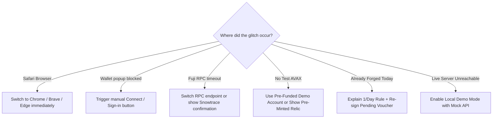

# Taskbar Hero — Demo Script & Judge Walkthrough

A comprehensive presentation guide for the **Avalanche Team1 Vietnam UniHack 2026** judges. This document provides:
1. A **30-second elevator pitch** for instant clarity.
2. A **3-minute demo video script** with second-by-second audio/video timing.
3. A **5-minute interactive live walkthrough** with step-by-step presentation actions.
4. An analysis of **what each step proves about Avalanche**.
5. A rock-solid **contingency fallback plan** for wallet, network, or testnet edge cases.
6. A **judge Q&A defense cheat sheet** covering architecture and smart contract design.

---

## 1. Quick Reference & Setup

### Verified Deployments on Avalanche Fuji (Chain ID: 43113)

| Resource | Value / Link | Notes |
| :--- | :--- | :--- |
| **Live Game Site** | [https://web-zeta-tan-13.vercel.app](https://web-zeta-tan-13.vercel.app) | Production build on Vercel |
| **RelicNFT (ERC-1155)** | [`0xB1a1edb7A75Db6e7067E747ddee32B39c2296f2D`](https://testnet.snowtrace.io/address/0xB1a1edb7A75Db6e7067E747ddee32B39c2296f2D) | EIP-712 voucher-gated mint, fixed rarity per ID |
| **RelicMarket** | [`0x10fcC46e439d3E31Fb1720B337C45CadB9b2ff93`](https://testnet.snowtrace.io/address/0x10fcC46e439d3E31Fb1720B337C45CadB9b2ff93) | Zero-fee autonomous escrow, test-AVAX settlement |
| **Alternative Explorer** | [Routescan Fuji](https://testnet.routescan.io/address/0xB1a1edb7A75Db6e7067E747ddee32B39c2296f2D) | Backup explorer if Snowtrace is unreachable |
| **Network RPC** | `https://api.avax-test.network/ext/bc/C/rpc` | Public Avalanche Fuji testnet RPC |
| **Currency** | Fuji test AVAX | Gas and marketplace payments |

### Display Names vs. Technical Identifiers

The Cat Café Quest UI uses cozy, thematic names for player-facing elements while keeping robust, immutable technical identifiers under the hood:

| Internal / Technical ID | Player-Facing Display Name | Notes |
| :--- | :--- | :--- |
| `hero` | **Mochi** | The cat adventurer running in the bottom strip |
| `gold` | **Fish** | Everyday currency earned passively, spent on gear upgrades |
| `shards` | **Yarn** | Crafting resource dropped from idle kills (30 needed for Forge) |
| `bossKey` | **Cat Key** | Earned by defeating the daily boss (1 needed for Forge) |
| `relicId: 1` (Common) | **Paw Charm** | ERC-1155 token, 60% forge odds |
| `relicId: 2` (Rare) | **Silver Bell** | ERC-1155 token, 28% forge odds |
| `relicId: 3` (Epic) | **Moon Collar** | ERC-1155 token, 10% forge odds |
| `relicId: 4` (Legendary) | **Golden Maneki** | ERC-1155 token, 2% forge odds |
| `bossLevel: 1` | **Yarn Giant** | Daily boss; scales in level and difficulty |
| Gear Slots | **Feather Wand**, **Cat Ears**, **Collar**, **Bell** | Weapon, Helm, Armor, Ring |

### Presenter Pre-Flight Checklist (Do 5 Minutes Before Demo)
1. **Browser**: Use desktop **Chrome**, **Brave**, or **Edge** with **Core Wallet** or **MetaMask** installed. *(Do not use Safari; extensions do not inject).*
2. **Network**: Ensure the wallet is connected to **Avalanche Fuji Testnet** (`43113`) with at least **0.2 test AVAX** for gas and market tests.
3. **Session Check**:
   - Open [https://web-zeta-tan-13.vercel.app](https://web-zeta-tan-13.vercel.app).
   - If signed in, verify the strip shows Mochi trotting and HUD counters ticking up.
   - If preparing a fresh demo, verify that the wallet can sign in smoothly via SIWE.
4. **Tabs Pre-opened**:
   - Tab 1: Live site at [https://web-zeta-tan-13.vercel.app](https://web-zeta-tan-13.vercel.app).
   - Tab 2: [Snowtrace RelicNFT](https://testnet.snowtrace.io/address/0xB1a1edb7A75Db6e7067E747ddee32B39c2296f2D).
   - Tab 3: [Snowtrace RelicMarket](https://testnet.snowtrace.io/address/0x10fcC46e439d3E31Fb1720B337C45CadB9b2ff93).

---

## 2. The 30-Second Elevator Pitch

> *"Most Web3 games push every single micro-action onto the blockchain or distract players with speculative token dumps, creating high gas friction and ruined game loops. **Taskbar Hero** reimagines Web3 gaming as an ambient idle RPG that lives in a thin strip at the bottom of your screen.*
>
> *Your cat hero, Mochi, fights quietly in the background while you work, gathering Fish and Yarn with zero gas and zero popups. When you beat the daily boss and forge a rare Relic, that milestone is verified off-chain by server-signed EIP-712 vouchers and minted as a true ERC-1155 NFT on Avalanche Fuji.*
>
> *Players trade these Relics in a zero-fee escrow marketplace settled in native AVAX. There is no inflationary token and no gas friction during casual play—only genuine digital collectibles powered by the speed and low cost of Avalanche."*

---

## 3. The 3-Minute Demo Video Script

*Target duration: Exactly 3:00 (180 seconds).*  
*Format: Voiceover narration synced to screen recordings or live capture.*

```
TIMECODE SUMMARY:
0:00 - 0:30 (30s) : Scene 1 — The Hook & The Ambient Idle Strip
0:30 - 1:05 (35s) : Scene 2 — Inventory Progression & Boss Combat
1:05 - 1:55 (50s) : Scene 3 — The Forge, EIP-712 Voucher & Fuji Minting
1:55 - 2:35 (40s) : Scene 4 — RelicMarket Escrow Trading & Peer-to-Peer Settlement
2:35 - 3:00 (25s) : Scene 5 — Architectural Summary & Avalanche Value Proposition
```

### Detailed Video Script Table

| Timecode | Visual / On-Screen Action | Spoken Voiceover Narration | Production Notes |
| :--- | :--- | :--- | :--- |
| **0:00 - 0:12** | Full desktop screen showing a productivity app or web article, with the Taskbar Hero bottom strip quietly running. Mochi trots across the screen fighting yarn balls. | *"Welcome to Taskbar Hero. Right now, on the bottom strip of my web browser, my cat hero Mochi is fighting enemies and collecting loot while I do my normal work."* | Show full 1280px screen to highlight the ambient nature of the game strip. |
| **0:12 - 0:30** | Zoom in to the bottom strip. Point mouse to the HUD: Fish (gold), Yarn (shards), and Cat Keys incrementing. Click **WalletButton** ("Connect wallet" -> "Sign in" via SIWE). | *"Unlike traditional Web3 games that bombard you with wallet signatures every time you kill a mob, Taskbar Hero runs everyday progression off-chain with zero gas fees. Our wallet connects seamlessly using SIWE on Avalanche Fuji."* | Smooth zoom to the strip. Show Core / MetaMask SIWE signature taking < 2 seconds. |
| **0:30 - 0:48** | Click the **Menu** button. The game panel slides open showing the **Café Board** and tabs. Switch to **Inventory**. Click **Upgrade** on the Feather Wand using accumulated Fish. Power stat increases. | *"Opening the game panel reveals our Café Board. In the Inventory tab, we equip gear drops and spend accumulated Fish to upgrade our Feather Wand and Cat Ears, boosting our Cat Power."* | Emphasize that gear upgrades are instant, responsive, and gasless. |
| **0:48 - 1:05** | Switch to the **Boss** tab. Level 1: Yarn Giant. Click the **Fight** button. Replay animates with damage numbers, critical hits, and synchronized health bars. Outcome: "Victory! You beat Yarn Giant. Cat Key earned!" | *"Once prepared, we challenge the daily boss—the Yarn Giant. Combat is computed deterministically on Supabase Edge Functions using shared TypeScript rules, and replayed in the client. Defeating the boss grants us our coveted Cat Key."* | Point out: server decides truth, client displays replay; prevents browser memory hacks. |
| **1:05 - 1:25** | Click the **Forge** tab. Show the cost (30 Yarn + 1 Cat Key) and current odds (60% Common, 28% Rare, 10% Epic, 2% Legendary). Click **Forge**. The card rises with the pixel reveal animation. A Rare Silver Bell emerges! | *"Now for the magic. In the Forge, we combine 30 Yarn and 1 Cat Key. The server verifies our inventory and generates an EIP-712 typed voucher binding our wallet, the Relic ID, rarity, and an unspent nonce. We just forged a Rare Silver Bell!"* | The 2.5s reveal animation (`ForgeReveal.tsx`) creates anticipation and highlights pixel art. |
| **1:25 - 1:55** | The **MintPanel** appears. Click **Mint to wallet**. Core/MetaMask pops up with the transaction to `RelicNFT` on Avalanche Fuji. Click confirm. Transaction confirms in ~1.5 seconds. Link opens on Snowtrace showing `RelicForged` event. | *"We click 'Mint to wallet'. Our wallet submits `mint(voucher, signature)` directly to the RelicNFT contract on Avalanche Fuji. In less than two seconds, Avalanche finalizes the block! RelicNFT verifies the signature, caller, and nonce, permanently minting our ERC-1155 token."* | Highlight the Snowtrace tab showing contract address `0xB1a1edb7A75Db6e7067E747ddee32B39c2296f2D`. |
| **1:55 - 2:15** | Switch to the **Market** tab. "My Relics" updates showing 1x Silver Bell. Select the Silver Bell, set amount to 1, enter price "0.05", and click **List**. Approve and list transactions complete. | *"In the Market tab, our on-chain inventory updates directly from Fuji. To sell our Silver Bell, we enter a price of 0.05 test AVAX and click List. Our RelicMarket contract takes custody in escrow with zero platform fees."* | Show how `balanceOfBatch` reflects holdings without any centralized intermediary. |
| **2:15 - 2:35** | Show the listed Silver Bell appear in the active market order book. Click **Buy** on an active listing (or show cancel flow returning the Relic). Show payment routed directly in native AVAX. | *"Any player on Avalanche Fuji can now buy this listing. The RelicMarket contract uses checks-effects-interactions, pushing native AVAX directly to the seller while transferring the NFT to the buyer in a single atomic transaction."* | Point to contract address `0x10fcC46e439d3E31Fb1720B337C45CadB9b2ff93` on Snowtrace. |
| **2:35 - 3:00** | Pan out to show the whole system: the ambient strip at the bottom, the contract explorer tabs, and the architecture diagram. | *"Taskbar Hero demonstrates how Avalanche makes Web3 gaming viable: lightning-fast sub-second finality, negligible gas fees, robust EIP-712 security, and zero speculative tokenomics. It's a game you can actually play every day. Thank you!"* | End on live site URL and Github repository links. |

---

## 4. The 5-Minute Live Walkthrough

*Target audience: UniHack Judges (Live pitch, screen-share, or in-person booth).*  
*Pacing: 5 minutes total + 2-3 minutes Q&A.*

### Stage 1: The Ambient Gaming Philosophy (0:00 - 1:00)
- **Action**: Share desktop screen with your browser window displaying a normal desktop page and Taskbar Hero anchored along the bottom strip (`apps/web/src/game/GameCanvas.tsx`).
- **Narrative**:
  - *"Judges, modern gamers spend hours at their desks working or studying, but full-screen Web3 games demand constant attention, heavy gas expenditure, and repetitive wallet popups."*
  - *"Taskbar Hero solves this by bringing the idle RPG genre to a native browser strip. Notice Mochi the cat running smoothly across the bottom. The game loop uses Phaser graphics drawn at runtime, quietly gathering Fish (our gold currency) and Yarn (shards) while consuming minimal CPU and zero gas."*
  - Point to the bottom-right HUD: Show Fish, Yarn, and Cat Keys updating.
  - Point to **WalletButton**: Show the clean SIWE (Sign-In with Ethereum) authentication flow. *"We don't need a custom account abstraction relayer or custodial server. We use standard SIWE on Avalanche Fuji (Chain ID 43113) to establish a tamper-proof session."*

### Stage 2: Off-Chain Game Engine & Boss Combat (1:00 - 2:00)
- **Action**: Click the **Menu** toggle button in the bottom strip. The main UI drawer opens displaying the **Café Board** and navigation tabs (`Hero`, `Inventory`, `Boss`, `Forge`, `Market`).
- **Narrative**:
  - *"Let's open the menu. The Café Board gives us an ambient overview of Mochi's Cat Power, today's quest progress, and the Relic Shelf."*
  - Navigate to **Inventory**:
    - *"Here are our four gear slots: Feather Wand, Cat Ears, Collar, and Bell. We can equip newly dropped items or spend accumulated Fish to upgrade our gear. Let's upgrade our Feather Wand now."*
    - Click **Upgrade**. Show the instant stat gain.
  - Navigate to **Boss**:
    - *"Daily progression culminates in beating the boss—level 1 is the Yarn Giant. Notice that players get 5 attempts per day, resetting at midnight Vietnam time (UTC+7)."*
    - Click **Fight**.
    - Watch the replay: *"The combat simulation is computed securely on Supabase Edge Functions using our deterministic `@taskbar-hero/game-rules` package with HMAC-derived seeds. The client replays the fight frame-by-frame with animated hit numbers and health bars."*
    - Show the victory state: *"We beat the Yarn Giant, unlocking our daily Cat Key!"*

### Stage 3: The On-Chain Settlement: Forging & Minting (2:00 - 3:15)
- **Action**: Switch to the **Forge** tab.
- **Narrative**:
  - *"Now we enter the bridge between off-chain gameplay and Avalanche on-chain ownership."*
  - Show the Forge requirements:
    - *"To forge a Relic, a player must spend 30 Yarn and 1 Cat Key. Forging is strictly limited to one Relic per account per day."*
    - Show the transparent odds banner: 60% Common (Paw Charm), 28% Rare (Silver Bell), 10% Epic (Moon Collar), and 2% Legendary (Golden Maneki).
  - Click **Forge**:
    - *"When I click Forge, our backend checks the player's off-chain balance, verifies they haven't forged today, burns the Yarn and Cat Key in the database, rolls the rarity using server randomness, and cryptographically signs an EIP-712 typed voucher."*
    - Let the 2.5s reveal animation play out (`TodayRelicCard`).
  - Click **Mint to wallet**:
    - Core Wallet / MetaMask prompt opens. Point out that the recipient is our verified `RelicNFT` contract (`0xB1a1edb7A75Db6e7067E747ddee32B39c2296f2D`).
    - Click confirm: *"Watch how fast Avalanche Fuji confirms this. One... two seconds—and it's confirmed!"*
    - Show the Snowtrace transaction: *"RelicNFT executes on Avalanche EVM. It validates the EIP-712 signature against the server's authorized signer, verifies that `msg.sender == voucher.player`, asserts the voucher has not expired, ensures the nonce has never been used before, and mints the exact ERC-1155 token."*

### Stage 4: RelicMarket Escrow Trading (3:15 - 4:15)
- **Action**: Switch to the **Market** tab.
- **Narrative**:
  - *"Now that we own an on-chain Relic, let's look at the decentralized marketplace."*
  - Show **My Relics**:
    - *"The client queries `RelicNFT.balanceOfBatch` on Avalanche Fuji directly. No third-party indexer or centralized API is required."*
  - Demonstrate **Listing**:
    - Select the newly minted Relic from the dropdown. Enter amount `1` and price `0.05` AVAX.
    - Click **List**: Show the approval step (`setApprovalForAll`) and the `RelicMarket.list` transaction.
    - *"Our RelicMarket contract (`0x10fcC46e439d3E31Fb1720B337C45CadB9b2ff93`) takes custody in escrow. It features zero platform fees, checks-effects-interactions security, and has no contract owner—making it completely trustless."*
  - Demonstrate **Active Listings & Purchasing**:
    - Show the listing appear in the active marketplace feed.
    - Explain the `buy(listingId)` mechanic: *"When a buyer calls `buy`, they send the exact AVAX price. The contract immediately transfers the ERC-1155 Relic to the buyer and pushes 100% of the AVAX to the seller via a low-level call. If the seller wants to cancel, `cancel(listingId)` instantly returns their Relic."*

### Stage 5: Why Avalanche? & Technical Wrap-Up (4:15 - 5:00)
- **Action**: Display the system architecture diagram and the verified Snowtrace contracts.
- **Narrative**:
  - *"To summarize, Taskbar Hero demonstrates the ideal Web3 game architecture on Avalanche:*
    1. *High-frequency, low-stakes idle actions stay off-chain for an ambient, gas-free user experience.*
    2. *Genuine milestones become verifiable digital assets on Avalanche Fuji.*
    3. *Avalanche's sub-second finality and minimal transaction fees make minting and trading seamless.*
    4. *We eliminated speculative fungible tokenomics entirely. Relics are tradeable collectibles, settled purely in native AVAX.*
  - *"Thank you, judges! We are ready for your questions."*

---

## 5. What Each Step Proves About Avalanche

This section provides judges with the specific technical rationale behind why Avalanche was chosen and how each architecture tier leverages the network:

```mermaid
flowchart TD
    subgraph Client ["Client Layer (apps/web)"]
        UI["React 19 + Phaser Strip"]
        Wagmi["Wagmi v2 + Viem (Fuji Injected Wallet)"]
    end

    subgraph Backend ["Authority Layer (Supabase)"]
        Edge["Edge Functions (Deno + Shared Game Rules)"]
        DB[("PostgreSQL (RLS, State, Nonces)")]
        Signer["EIP-712 Voucher Signer"]
    end

    subgraph Chain ["Settlement Layer (Avalanche Fuji - 43113)"]
        NFT["RelicNFT Contract (0xB1a1...f2D)\n• ERC-1155 Multi-Token\n• Voucher Verification\n• Rarity Immutability"]
        Market["RelicMarket Contract (0x10fc...f93)\n• Trustless Escrow\n• Native AVAX Settlement\n• Zero Fee / Non-Reentrant"]
    end

    UI -->|Deterministic Prediction| UI
    UI -->|SIWE Authenticated Requests| Edge
    Edge --> DB
    Edge -->|Signed EIP-712 Voucher| Signer
    Signer -->|Voucher JSON| UI
    Wagmi -->|mint(voucher, sig)| NFT
    Wagmi -->|list() / buy() in AVAX| Market
    NFT -.->|safeTransferFrom Escrow| Market
```

| Gameplay Phase | Action Taken | What It Proves About Avalanche |
| :--- | :--- | :--- |
| **1. Ambient Idle Loop** | Mochi fights mobs, increments Fish and Yarn off-chain with zero gas. | **Pragmatic Scalability**: Avalanche does not need to be clogged with micro-ticks or arbitrary state spam. By keeping everyday mechanics off-chain and reserving Avalanche for sovereign ownership, we maintain sub-second UI responsiveness and zero barrier to entry for mainstream gamers. |
| **2. Boss Combat & Key Claim** | Defeating the Yarn Giant verifies power, yields a Cat Key, and records server state. | **Cryptographic State Integrity**: Proves that off-chain authority can be cleanly integrated with on-chain settlement. The client never tells the chain what it earned; the server evaluates deterministic rules and acts as a trusted oracle bridge to Avalanche. |
| **3. Voucher Generation** | Server issues an EIP-712 typed voucher `(player, relicId, rarity, nonce, expiry)`. | **EVM Standard Compliance**: Leverages Avalanche's EVM compatibility to implement structured, human-readable typed data signing. Binds chain ID `43113` and verifying contract address to prevent cross-chain and replay exploits. |
| **4. On-Chain Relic Minting** | Wallet calls `RelicNFT.mint` with voucher and ECDSA signature. | **Sub-Second Finality & Cost Efficiency**: Minting confirms in 1-2 seconds with gas costs measuring fractions of a penny. RelicNFT enforces caller checks (`msg.sender == voucher.player`), single-use global nonces, and permanent rarity tiers directly in EVM bytecode. |
| **5. Post-Mint Reconciliation** | Client submits transaction hash; server reads Fuji receipt and confirms `RelicForged` event. | **Chain as Ultimate Source of Truth**: The off-chain database does not finalize the player's Relic ownership until it observes the confirmed event on Avalanche Fuji. If a transaction reverts or is dropped, state remains clean. |
| **6. RelicMarket Escrow** | Seller lists Relic; contract takes custody via `safeTransferFrom`. | **Trustless Asset Composability**: Leverages ERC-1155 multi-token standards. The market only accepts authorized transfers from our verified RelicNFT contract and reverts any unsolicited plain transfers. |
| **7. Peer-to-Peer Purchase** | Buyer calls `buy` with exact AVAX value; seller receives funds instantly. | **Native Value Settlement**: Proves frictionless peer-to-peer commerce without volatile ERC-20 middleman tokens. Low-level call pushes native AVAX to the seller, protected against reentrancy by OpenZeppelin's `ReentrancyGuard` and strict checks-effects-interactions. |

---

## 6. Comprehensive Fallback Plan (Contingency Guide)

During a live hackathon demo, live RPCs, browser extensions, or testnets can occasionally stall. Use this battle-tested fallback tree if anything fails during presentation:



### Scenario A: Injected Wallet Fails to Connect or User is on Safari
- **Symptom**: Clicking "Connect wallet" does nothing, or page is opened in Safari where extension providers are absent.
- **Root Cause**: Safari does not support injected EVM provider objects (`window.ethereum`).
- **Immediate Live Fix**:
  1. Announce: *"As noted in our README, Web3 injected wallets require Chrome, Brave, or Edge."*
  2. Switch instantly to pre-configured Chrome or Brave window with Core Wallet pinned.
  3. If extension popup is suppressed, click the dedicated **Connect wallet** button in the bottom strip.

### Scenario B: Avalanche Fuji Public RPC Lags or Drops Transactions
- **Symptom**: Mint or Buy transaction is submitted in wallet, but the app shows "Waiting for transaction..." for > 15 seconds.
- **Root Cause**: The public Fuji testnet RPC node is experiencing temporary traffic congestion or rate limits.
- **Immediate Live Fix**:
  1. Open the pre-loaded **Snowtrace tab** ([https://testnet.snowtrace.io](https://testnet.snowtrace.io)) or **Routescan tab** ([https://testnet.routescan.io](https://testnet.routescan.io)).
  2. Search the presenter wallet address or contract address `0xB1a1edb7A75Db6e7067E747ddee32B39c2296f2D`.
  3. Show the confirmed transaction on the block explorer: *"Avalanche Fuji confirmed the transaction on-chain in Block #XXXXX. The frontend will catch up via its polling loop once the public RPC node syncs."*
  4. If RPC is completely dead, open wallet settings and switch RPC URL to `https://api.avax-test.network/ext/bc/C/rpc` or private QuickNode/Alchemy Fuji endpoint.

### Scenario C: Faucet Dry or Wallet Has 0 Test AVAX
- **Symptom**: Wallet shows "Insufficient funds for gas" when attempting to mint or list.
- **Root Cause**: Testnet wallet was not topped up prior to the presentation.
- **Immediate Live Fix**:
  1. Switch to secondary pre-funded demo account inside Core/MetaMask (Account 2 should hold 1.0 test AVAX).
  2. If all test wallets are empty, navigate directly to **Market** tab:
     - Show pre-existing active listings created earlier.
     - Walk through the verified Solidity code on Snowtrace showing exact transaction receipts and event logs for `RelicForged` and `Listed`.

### Scenario D: Daily Forge Limit Reached ("You have already forged today")
- **Symptom**: Forge button is disabled with message: *"You forged today. Come back at midnight Vietnam time (UTC+7)."*
- **Root Cause**: The account successfully forged earlier during rehearsals.
- **Immediate Live Fix**:
  1. Turn this into a feature showcase: *"This demonstrates our strict anti-cheat and anti-inflation mechanics. The server guarantees that even on testnet, players cannot flood the market with minted NFTs; each player gets exactly one forge opportunity every 24 hours."*
  2. Show the **TodayRelicCard**: If an unminted voucher exists, click **Get a new voucher** or **Mint to wallet**. The server re-issues an active voucher for the same Relic ID without double-charging resources.
  3. Alternatively, switch wallet account to a fresh address to demonstrate a brand-new forge flow.

### Scenario E: Backend Supabase Edge Functions Network Timeout
- **Symptom**: Claims, Boss fight, or Forge button spins with a network error.
- **Root Cause**: Wi-Fi network drop or free-tier Supabase cold start.
- **Immediate Live Fix**:
  1. Click the built-in **Retry** button rendered by `LoadNotice.tsx`.
  2. If local venue Wi-Fi blocks Supabase WebSockets/HTTPS, run the offline demo mode:
     - Run `pnpm --filter @taskbar-hero/web dev` without Supabase environment variables.
     - The client seamlessly falls back to `MockGameApi`, allowing complete offline walkthrough of the UI, inventory, and boss combat.

---

## 7. Anticipated Judge Questions & Technical Answers

### Q1: "Why not build Taskbar Hero on a dedicated Avalanche L1 (Subnet) instead of Fuji C-Chain?"
> **Answer**:  
> *"Fuji C-Chain is the perfect starting environment for UniHack because it offers immediate EVM tooling, public block explorers, and zero deployment friction. However, our architecture is specifically designed for a custom Avalanche L1: our shared rules engine in `packages/game-rules` can easily migrate high-frequency state updates to an Avalanche Subnet with custom gas rules, while using Avalanche Teleporter (AWM) to bridge minted Relic NFTs back to the C-Chain for liquidity."*

### Q2: "Why did you choose ERC-1155 instead of standard ERC-721 for Relics?"
> **Answer**:  
> *"ERC-1155 provides two huge advantages for gaming on Avalanche:*  
> *1. **Gas and storage efficiency**: Multiple players can own copies of the same Relic tier (e.g. Common Paw Charm or Legendary Golden Maneki) under pinned token IDs (1 through 4), reducing contract deployment overhead and storage footprint.*  
> *2. **Batch operations**: RelicNFT supports `balanceOfBatch`, allowing the client in `MarketTab.tsx` to query all four Relic balances in a single RPC call, avoiding multiple network round-trips."*

### Q3: "Why is there no fungible ERC-20 token in Taskbar Hero?"
> **Answer**:  
> *"Almost every Web3 game that failed over the last three years collapsed because of inflationary fungible token death-spirals. Players treat tokens as speculative yield rather than playing for fun. We intentionally made Fish (gold) an off-chain progression mechanic with zero financialization. By restricting blockchain elements solely to rare, earned ERC-1155 Relic collectibles and settling trades in native AVAX, we build a sustainable, collectible-driven economy."*

### Q4: "What prevents a player from cheating or forging vouchers locally?"
> **Answer**:  
> *"The browser client is strictly an untrusted interface. All damage rolls, gear stats, loot drops, and forge rolls are executed on Supabase Edge Functions using server-side HMAC seeds that the client cannot predict. When a forge occurs, the server signs the EIP-712 voucher using a private key stored securely in server environment variables. The `RelicNFT` smart contract checks that the signature recovers to the authorized `signer` address, that `msg.sender` matches the player, that the voucher has not expired, and that the voucher nonce has never been used on-chain before."*

### Q5: "Can the smart contract owner steal Relics or drain AVAX from the marketplace?"
> **Answer**:  
> *"No. The `RelicMarket` contract has **no owner**, **no admin keys**, and **no platform fee deduction**. Relics in escrow can only be withdrawn by the seller via `cancel`, or transferred to a buyer who deposits the exact requested AVAX price. The contract follows checks-effects-interactions, deleting listings prior to transfers, and reentrancy is strictly blocked via OpenZeppelin's `ReentrancyGuard`."*

---

## 8. Summary: Presenter Cheat Sheet

Print or keep this card open during presentation:

```
========================================================================
TASKBAR HERO — PRESENTER CHEAT SHEET
========================================================================
Live Demo URL : https://web-zeta-tan-13.vercel.app
Chain ID      : 43113 (Avalanche Fuji Testnet)
RelicNFT      : 0xB1a1edb7A75Db6e7067E747ddee32B39c2296f2D
RelicMarket   : 0x10fcC46e439d3E31Fb1720B337C45CadB9b2ff93
Explorers     : https://testnet.snowtrace.io / https://testnet.routescan.io

TERMS:
Hero: Mochi | Gold: Fish | Shards: Yarn | Boss Key: Cat Key
Boss Level 1: Yarn Giant (5 fights/day, resets midnight UTC+7 / Vietnam)
Forge Cost: 30 Yarn + 1 Cat Key (Limit: 1 forge/day)
Rarities: Paw Charm (60%), Silver Bell (28%), Moon Collar (10%), Golden Maneki (2%)

FLOW (ORDER OF SHOW):
1. Ambient Strip : Mochi running at bottom of page, passive Fish/Yarn loot
2. Inventory/Boss: Upgrade gear with Fish -> Defeat Yarn Giant -> Get Cat Key
3. Forge & Mint  : 30 Yarn + 1 Cat Key -> EIP-712 Voucher -> Mint on Fuji (~1.5s)
4. RelicMarket   : Check on-chain balance -> List in escrow for AVAX -> Buy/Cancel
========================================================================
```
