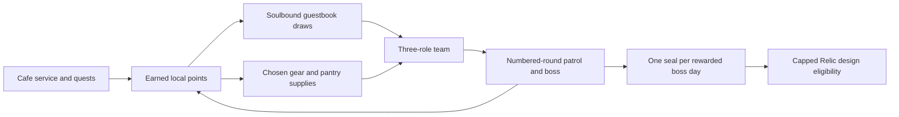

# Taskbar Hero Card RPG design bible

Status: implemented local systems with explicitly labelled future content. Contract: `packages/game-rules/src/cardrpg/contract.ts`; tuning: `packages/game-rules/src/cardrpg/config.ts`. Runtime exports: `@taskbar-hero/game-rules/cardrpg`. Source imports and every state transition are pure; the caller holds in-memory state. This is an unsaved prototype, not a launch economy.

## Player promise and loop

Choose three cafe cats, prepare four-slot equipment and finite supplies, read enemy intentions, and resolve one action per living actor per numbered round. Return from the patrol to claim the exact previewed reward, improve a build, welcome a new cat with earned stamps, or save toward a deterministic design. Ten minutes should create a useful choice, while extra play has diminishing economic returns.

All branches remain local and unsaved. `Design only, not minted` accompanies every chain-facing entry. No purchase, cash-out, wallet, marketplace, server mutation or storage path is part of this mode.

## Cards, roles and identity

A card definition has a stable catalog ID, name, rarity, role, flavour, lore, base stats, four skills and passive text. An owned instance has stable instance ID, level, stars, matching shards and `soulbound:true`. There is one owned instance per cat; duplicates become shards. No card is consumed or removed by ascension.

| Rarity | Level cap | Duplicate shards | Guardian | Witch | Alchemist |
| --- | ---: | ---: | --- | --- | --- |
| common | 20 | 2 | Mochi / hearth | Soot / moon | Clover / garden |
| rare | 30 | 5 | Panko / garden | Mallow / hearth | Sorrel / moon |
| epic | 40 | 12 | Biscuit / hearth | Inkcap / garden | Cinnamon / hearth |
| legendary | 50 | 25 | Brioche / moon | Velvet / moon | Marigold / garden |

Higher rarity gives more long-term development headroom, not a large initial multiplier. Starter cats retain ordinary role stats. Recruits gain a small flavour trait: hearth +5% shield power/+5% effect resistance; moon +2% crit/+5% effect hit; garden +5% healing/+15 HP. Flavour is not an elemental damage triangle. The 12 cats are honestly labelled role variants sharing three battle kits, not 12 independent combat classes.

| Role | Base HP / ATK / DEF | Crit / initiative | Four-skill kit | Passive |
| --- | --- | --- | --- | --- |
| guardian | 540 / 52 / 34 | 8% / 8 | basic, Shield Bash, Rally, Hearthwall | shelters an ally through existing guardian passive |
| witch | 415 / 65 / 22 | 12% / 6 | basic, Thread Snare, Ember Orb, Lanternstorm | gathers charge through existing witch passive |
| alchemist | 350 / 38 / 20 | 5% / 4 | basic, Milk Flask, Moss Flask, Nine Lives | shields injured patients through existing alchemist passive |

Skills reuse the authored, tested round engine. A basic is always available. Other skills have round cooldowns; ultimates use charge, normally 100, with initial charge 15 and normal per-action/received increments 16/7. Legendary efficiency lowers ultimate cost by 15, with an engine floor of 70. Summoning a recruit does not change an actor's action allowance. Distinct additional kits, a larger team and elemental weakness interactions are future content, not hidden implementations.

## Stats and formulas

All exported stats and basis-point values are integers. 100 basis points = 1%. `critDamageBp` means **extra** critical damage: 5000 gives 1.5 times normal damage. Initiative is an integer rank; larger acts earlier among eligible actors, never more often.

1. Start from card base stats including its flavour trait.
2. For HP, ATK and DEF only, multiply by `1 + .012*(level-1) + .025*(stars-1)`, round once.
3. Add each equipped main stat, rounded after multiplying by `1 + .06*enhancement`. Add each instance affix without extra multiplication.
4. Add activated two- and four-piece set stats; both thresholds apply at four pieces.
5. Round/clamp stats to the caps below. `computeCardStats` returns this pre-doctrine snapshot; `previewEquip` returns before/after/delta from the same function.
6. The battle bridge freezes the snapshot plus item IDs and identity. Battle HP uses 1.04 formation multiplier in this mode; both doctrines multiply ATK by 1.04. Hearthkeepers further multiplies healing/shield by 1.12/1.15; Lanternbreakers instead adds one initiative rank. Temporary expedition gear adds its explicit existing bonuses for this run only. It never enters the account inventory at the end.
7. Damage per hit uses `max(1, round(raw * variance * critical * enrage * exposed * 80/(80+max(0,DEF)) * (1-guard)))`. `raw` is the acting skill's ATK coefficient. Variance is uniform ±8%; critical is 1 plus critical bonus; ordinary guard is 30% and guard is capped at 50%. Exposed Yarn Giant damage multiplier is 1.6. Existing shield absorbs resolved damage first. DOT and reflected-hit paths follow the engine's explicit no-extra-roll rules.
8. Healing and shielding multiply skill flat values by doctrine and `(1+healingBp/10000)` / `(1+shieldBp/10000)`, then round; healing cannot exceed max HP, accumulated shield cannot exceed 60% max HP. No overheal-to-currency conversion exists.
9. Harmful effects in the card RPG path use `chanceBp = clamp(9500 + source.effectHitBp - target.effectResistBp, 1500, 9500)`. Ordinary enemies have 1000 resistance, so an unmodified starter applies an effect with 85% chance; +800 hit from Moonwick raises that to 93%. Heroes use their computed resistance, enemies have zero effect hit. Beneficial guard and boss exposure are not random. Control recovery/boss duration limits still prevent repeated locks. Each attempt consumes one seeded roll; event replay freezes these tuning values.

| Stat | Cap | Meaning |
| --- | ---: | --- |
| HP | 9999 | pre-doctrine maximum health |
| ATK | 999 | skill damage input |
| DEF | 300 | diminishing mitigation: at 80 DEF, ordinary physical damage factor is 0.5 |
| critBp | 4000 | at most 40% critical chance |
| critDamageBp | 10000 | at most +100% critical damage |
| effectHitBp | 7500 | harmful-effect chance modifier |
| effectResistBp | 6000 | harmful-effect resistance modifier |
| healingBp / shieldBp | 6000 each | at most +60% from the account stat |
| initiative | 1–12 | integer in-round ordering rank |

These are account-stat caps. Explicit expedition bonuses have the existing engine caps; they are not a second copy of account equipment. The existing live game's `packages/game-rules/src/config.ts` is unchanged. Meta battle tuning is opt-in through `TurnOptions.cardRpg`; the old turn sandbox retains its original values when absent.

## Equipment, affixes and sets

Four slots remain Weapon, Outfit, Charm and Relic. Four gives a legible complete build at desktop sizes and supports 2+2 or one four-piece set; adding more slots would multiply inventory effort without a new decision. A Relic-slot gear piece is ordinary soulbound equipment and is unrelated to NFT eligibility.

There are 48 templates: 3 sets × 4 rarities × 4 slots. Weapons require their set's role; the other three slots fit every role. Weapon main stat is ATK, Outfit HP, Charm DEF, Relic HP. Common main values are 12/45/6/25 respectively; each rarity step adds 4/12/2/8. Main stats are fixed by template, never random.

Common gear has no affix, rare has one, epic two, legendary three. Template pools start with DEF (tier 1), crit (tier 2), resistance (tier 3). Reforge selects an existing slot and a desired stat: HP, ATK, DEF, crit, effect hit/resist, healing or shielding. It costs 90 fish and 15 threads, never fails, preserves affix tier, and rejects duplicate secondary stat types. Tier-scaled reforge values are in config; locked/favourite items cannot be reforged or salvaged. Initiative is deliberately unavailable to reforge. Item `level=1` identifies this edition's fixed item level; enhancement is the actual development axis. There is no fake item-level button.

| Set | Two pieces | Four pieces adds | Legendary template behavior |
| --- | --- | --- | --- |
| Hearthloom | +5 DEF, +6% shield | +30 HP, +6% shield | guarding shelters a neighboring ally |
| Moonwick | +6 ATK, +2% crit | +8% effect hit, +10% crit bonus | ultimate costs 15 less charge |
| Mossbrew | +6% healing, +15 HP | +6% healing, +10% resistance | healing skills restore 18 extra base HP |

A property appears once per actor even if several pieces provide it. Enhancement +0→+12 is failure-free. At current level `e`, next level costs `30*(e+1)^2` fish and `3*(e+1)` threads; total +12 cost is 19,500 fish/234 threads. It increases only the main stat (6% per level), preserving stable affix and set choices. Salvage returns common/rare/epic/legendary 2/5/12/25 threads, independent of enhancement. No fish, stamps or essence refund: upgrading then salvaging cannot create value. Equipping is free; an item has at most one owner; transfers require unequipping first.

Deterministic rare sewing costs 180 fish/30 threads. After chapter one, epic tailoring costs 120 fish/180 threads/5 essence. This creates a repeatable essence/thread sink. Neither route requires random equipment. Legendary functional gear remains an earned equipment draw goal in this prototype; there is no NFT conversion for it.

## Item types and economy

| Resource | Faucet | Sink | Repeatable daily earned cap |
| --- | --- | --- | ---: |
| fish | service, won battles, quests; initial and first-clear grants | cat levels/stars, gear enhancement, sewing/tailoring, reforge and designs | 420 |
| threads | service, won battles, daily service quest, salvaging finite items | sewing/tailoring, enhancement, reforge, level cost, pantry-key mending, designs | 90 from capped grants; salvage is recycling |
| stamps | service, won battles, quests; initial/first-clear/mender grants | all three earned-only banners, 150 per draw | 480 |
| essence | weekly wins, first-boss achievement, five-star shard overflow | epic tailoring, cafe ribbon, deterministic Relic designs | 12 |
| matching shards | duplicate owned cats | stars; after five stars, 10 shards→1 essence | bounded by daily draws and essence cap |
| Yarnkeeper Seal | first rewarded boss clear of each day | 3/10-seal design recipes | 1 |
| pantry key | weekly wins or 40-thread mending | one chosen supply recipe (+10 threads) | weekly quest once/week; mending is a sink |
| five pantry supplies | chosen pantry recipe | packed on entry and consumed by battle actions | carry cap: two each, one Starlight Treat |
| Cafe Ribbon | 10 essence +20 threads | single collection unlock; no combat advantage | once per account |

Currencies are off-chain, non-transferable integer points. There is no hard/premium currency. `fish` is a cafe resource, not money. Initial balances are 600 fish/40 threads/600 stamps/0 essence. Each won rewarded battle supplies 90 fish/12 threads/40 stamps and 60 XP; a loss supplies 20 XP. Each rewarded victory also grants one uniformly selected equipment template: a first chapter win selects among the 12 rare templates (1/12 each); later rewarded wins select among the 12 common templates (1/12 each). Losses and post-cap practice grant no item. Epic/legendary battle drop probability is zero; those tiers have chosen tailoring or the published equipment banner. Only the first six completed battles per day advance rewarded battle quests. A first chapter clear adds 200 fish/200 stamps once. Cafe service gives 140 fish/20 threads/70 stamps per ten-minute claim, at most two claims daily. These flows are further limited by shared per-currency and 180 repeatable-XP daily caps. One-time achievements are separate and cannot repeat.

The mode has no energy meter. Practice remains playable after reward caps. Service time/day is explicit simulation input and is visibly labelled local; the client can advance it. It is not anti-bot security or a claim of actual elapsed desktop time. A future taskbar integration must supply authenticated elapsed-time evidence and authoritative dates without penalizing absence. No server work is authorized here.

## Guestbook, equipment basket and fairness

| Banner | Common | Rare | Epic | Legendary | Pity group |
| --- | ---: | ---: | ---: | ---: | --- |
| Cafe Guestbook | 60% | 30% | 9% | 1% | cats-standard |
| Marigold at Closing Time | 60% | 30% | 9% | 1% | cats-featured |
| Mending Basket | 55% | 34% | 10% | 1% | gear |

Each row is stored as exact basis points summing to 10000. Those are base odds, not the next draw after pity. At next-pull number `n=sinceLegendary+1`, legendary chance is 100 bp through pull 40, then increases by 300 bp per pull beginning on 41. Pull 60 is exactly 10000 bp. For earlier soft-pity pulls, the remaining probability is apportioned proportionally to common/rare/epic with integer rounding remainder assigned to common. `getBannerOdds` exposes the exact next-pull row; `getDrawPool` includes ownership and featured conditional probabilities. Each item probability is a mathematical fraction represented as a JS number; B may format it but must not recompute it.

Draw first chooses rarity. For standard cats/equipment, unowned catalog members in that rarity are preferred, otherwise all are eligible. Protection never upgrades a rarity. Featured legendary: 50% is Marigold; a miss guarantees Marigold on the next legendary, so the worst case is 120 draws from a reset counter. Other legendary choices exclude Marigold and prefer unowned cats. Pity resets only on that group's legendary; distinct groups do not share progress. There is no rotating banner deadline in this local version.

A batch of 1–10 is atomic and costs its full amount; daily maximum is 30 draws. Visible history retains the last 200 results; counters survive history truncation until reload. Seed is explicit and deterministic for replay; this local RNG is not adversarially secure. Future security cannot trust the local seed, balance, day or claim payload. Every result says soulbound true/tradeable false. None contains a voucher, mintable item or payment path.

## Chapters, quests and features

Chapter one, The Tangled Cafe, uses the existing three patrol waves and Yarn Giant; reward completion unlocks tailoring and design recipes. The catalogue includes 13 enemy entries: the nine existing actors plus Pollen Scout, Rain Spool, Crumb Sentinel and Pantry Crown. The latter four are designed variants, not playable actors.

Rooftop Orchard is chapter two's design: pollen volley, a wet row, cleansing before burst, Rain Spool boss. Midnight Pantry is chapter three's design: alternating row pressure, brace/focus choices and finite supplies, Pantry Crown boss. Both have wave data, role-derived stats, counters and `implemented:false`; `startBattle` rejects them. Distinct final enemies, authored content, balance and art are later work.

Daily quests: finish two rewarded battles; complete one cafe service. Weekly: win three battles, granting stamps, essence and a pantry key. Achievements: first campaign win; six enhancements. Account level is `min(50,1+floor(XP/200))`; it is a progress signal, not an extra hidden damage bonus. Cat level cost is `25*currentLevel` fish plus two threads. Ascension to the next star costs `10*currentStars` matching shards and `150*currentStars` fish; max five stars.

MVP: hub, collection/card detail, inventory/equipment, previews, chosen forge/enhance/salvage/reforge, earned draws/odds/pity/history, daily/weekly/achievement claims, codex, editable team, two doctrines, Auto, full run/reward boundary, Relic design status. B implements and verifies screens. Later: independent new hero kits, chapters 2/3, more saved team presets, replay viewer (headless replay already works), friend support, guild/PvP, earned-only season pass and durable authenticated progression. These are product choices, not omitted claims of functioning features.

## Scarcity and NFT readiness

| Design | Existing Relic ID / rarity index | Global / season cap | Deterministic recipe | Limit |
| --- | --- | --- | --- | --- |
| Moon Collar | 3 / 2 (epic) | 2400 / 400 | 3 distinct rewarded boss days, 900 fish,120 threads,15 essence | one eligibility/account/series/season |
| Golden Maneki | 4 / 3 (legendary) | 360 / 60 | 10 distinct rewarded boss days,2400 fish,300 threads,30 essence | one eligibility/account/series/season |

`mintedSoFar` stays zero. `issuedDesign` counts local eligibility simulation only. Global and season caps are both checked before spending. Never silently increase a published cap to fill demand; if exhausted, show it and continue offering ordinary gameplay. Caps constrain issuance, not market price. No value or investment return is promised. Epic/legendary collectible identity should offer provenance, badge/display and commemorative utility, not a paid combat requirement.

All cats, gear, materials, points and draw outputs are soulbound. The only **future** tradeable candidate is a separately earned Relic NFT, Avalanche Fuji chain 43113 only. The source contract `contracts/src/RelicNFT.sol` is ERC-1155, with EIP-712 `TaskbarHeroRelic` version `1`, voucher fields player/relicId/rarity/nonce/expiry and per-nonce replay protection. Existing content pins IDs 1/2/3/4 to common/rare/epic/legendary. Do not repurpose IDs or add a fifth rarity. Metadata uses name/description/image/attributes plus design properties; the image is the existing Relic SVG, no mint signature is manufactured.

**Existing contract limitation:** it does not enforce total/season supply caps, per-person limits, soulbinding, seasons or per-instance equipment stats, and has no public item-burn operation. Therefore our local proof is not a chain supply proof. Future issuance needs an authoritative global reservation ledger, concurrency-safe cap accounting, voucher-expiry release rules, nonce reconciliation and an audited approval boundary. Existing copies must be counted against any cap before defining a real collection. All are design-only future requirements, not tasks authorized here. A metadata field cannot enforce scarcity.

Off-chain duplicates are consumed into bounded development or salvage. No NFT burn is implemented. Future collectible burns must not silently re-open an edition's lifetime issuance cap; any replacement policy must be explicit. Never require gacha-obtained objects for a tradeable mint path: the effort recipe's resources are all obtainable from deterministic service/quest/boss play. Season supply does not reset global supply.

## Legal/fairness boundary

The regulation review is historical source-backed design research, not an opinion that this prototype is universally lawful. Belgium paid loot-box scrutiny, the Dutch fact-specific FIFA judgment, China's historical disclosure notice, Japan's complete-gacha restrictions and Apple/Google purchase-odds rules are distinguished in RESEARCH.md.

The implemented guardrail is stronger than an odds label: no purchase path at all; only free/earned stamps; exact published base and conditional odds; visible pity; no tradeable random prize. Paid draws, purchased draw-enabling currency, transferable draw rewards and paid completion sets are out of scope and **need legal review** before any design discussion could become implementation. No fungible asset, mainnet, custom L1 or tradeable currency is introduced before the stated 2026-11-30 contest end; the current task authorizes none afterward either.
