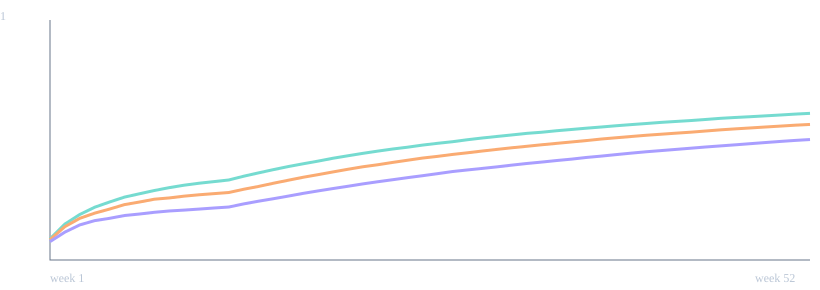

# YARN — Fuji, không có giá trị thật

1 tỷ YARN tạo một lần; tiền mềm nằm ngoài blockchain.

| Phân bổ | % |
|---|---:|
| Người chơi / đội ngũ | 35 / 15 |
| Kho bạc / nhà đầu tư | 12 / 12 |
| Hệ sinh thái / thử nghiệm sớm | 10 / 6 |
| Thanh khoản / cố vấn / dự phòng | 5 / 3 / 2 |

Demo đã chạy trên Fuji: tặng 20 YARN một lần; chưa phát thưởng chiến dịch định kỳ.
Phí seal 10% giá tham chiếu, đốt toàn bộ; Star Thread tốn 2 YARN.
Phí bán 5%: 2% giá bán đốt, 3% kho bạc. AVAX không tính là đốt YARN.
Giá bán tự chọn, không sàn/trần. V1/chuyển trực tiếp có thể bỏ qua phí V2.
Hợp đồng tự giảm trần thưởng mùa sau nếu đốt/phát hành dưới 0,8; tính cả trợ cấp.
Trần ban đầu 12 YARN/tuần, tổng32 gồm trợ cấp; boss6/tuần, rank tối đa6/mùa là đề xuất chưa bật.
Vesting là lịch dự kiến, chưa được khóa bởi hợp đồng phân phối.

Ba nhóm 1.000 ví, 52 tuần; nhóm nhiều người farm có 20% bot.
Chỉ nguồn đốt đã có: phát hành/đốt 2.07 / 2.21 / 2.41; ngưỡng <=2: CHƯA ĐẠT.
Forge/mỹ phẩm chưa triển khai được tách sang kịch bản riêng.
Nguồn cung đo có điều kiện từ luật drop; chưa phải dữ liệu người chơi/C2; [720 lượt với luật drop thật](../../chain/balance-study.html) vẫn chưa chứng minh nhu cầu.
Ít người mua, 50% bot và bỏ qua phí đều được kiểm tra; không có cam kết thu nhập.
1.000 trợ cấp cần 20.000 YARN, không phải dự báo cho quỹ demo hiện có.
[CSV, biểu đồ và giới hạn](../../chain/tokenomics.html) · [Nguồn nghiên cứu](TOKENOMICS-RESEARCH.md).
