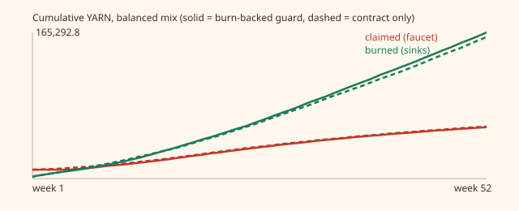

# Economy simulation results

Generated by `node tools/economy/sim.mjs` on 2026-11-19. Seeded and deterministic: the same command prints the same numbers.
All game numbers come from `packages/game-rules/src/cardrpg/economy-v3.ts`; contract numbers from the deployed Fuji contracts.
Behaviour inputs are assumptions (listed at the end), not telemetry. Testnet YARN has no real value.



## Verdict per scenario (52 weeks, 1,000 starting accounts, +150/week)

| Scenario | Policy | YARN claimed | YARN burned | Burn / claim | Withdraw fill | Bot share | Fused / sealed | Regular: first Legendary (day) | Gates |
|---|---|---:|---:|---:|---:|---:|---:|---:|---|
| balanced | contract-only | 58,897.79 | 159,964.2 | **2.72** | 100% | 16% | 5.65 | 8 | PASS |
| balanced | burn-backed | 58,033.96 | 165,292.8 | **2.85** | 93% | 15% | 5.56 | 8 | PASS |
| casual-heavy | contract-only | 42,942.61 | 92,857.3 | **2.16** | 100% | 16% | 5.92 | 8 | PASS |
| casual-heavy | burn-backed | 41,826.36 | 95,905.7 | **2.29** | 87% | 14% | 5.77 | 8 | PASS |
| farmer-heavy | contract-only | 80,826.25 | 186,011.1 | **2.3** | 100% | 43% | 5.49 | 8 | PASS |
| farmer-heavy | burn-backed | 79,833 | 190,465.6 | **2.39** | 93% | 44% | 5.46 | 9 | PASS |
| half-demand | contract-only | 54,151.54 | 57,229.4 | **1.06** | 100% | 19% | 4.23 | 9 | PASS |
| half-demand | burn-backed | 46,747.09 | 53,172.8 | **1.14** | 52% | 23% | 4.69 | 9 | PASS |
| low-demand | contract-only | 38,415.22 | 11,422.2 | **0.3** | 100% | 26% | 3.69 | 9 | FAIL: burn>=claims |
| low-demand | burn-backed | 20,067.38 | 7,580.5 | **0.38** | 13% | 30% | 5.77 | 9 | FAIL: burn>=claims, rewards-flow |
| half-bots | contract-only | 100,306.43 | 127,448.7 | **1.27** | 100% | 74% | 5.13 | 8 | PASS |
| half-bots | burn-backed | 96,789.85 | 126,943.1 | **1.31** | 59% | 77% | 5.25 | 8 | PASS |

*contract-only* = today's deployed SeasonRewards controller alone (12 YARN/wallet/week, auto-cut next 13-week season when burn/emission < 0.8).
*burn-backed* = the same plus the server guard added in this change: a withdrawal is signed only while
`emittedInSeason + amount <= 2,000 + 90% x burnedInSeason` (both read from Fuji).

## Gates

- **burn>=claims**: Cumulative YARN burned >= all YARN claimed (incl. tester grants)
- **fairness**: Heavy player earns <= 3x Spool per week of a casual player
- **item-sink**: Fusion consumes >= 0.5 Epic per Epic sealed (no endless NFT pile-up)
- **progress**: Median regular player owns a Legendary between day 7 and day 42
- **rewards-flow**: >= 50% of requested withdrawals are paid (rewards stay real)

## Base case detail (balanced mix, burn-backed)

| Flow | YARN |
|---|---:|
| Tester grants (one-time, first 500 wallets) | 10,000 |
| Spool withdrawn to YARN (net) | 48,033.96 |
| Withdraw fee retained in the pool (never paid out) | 16,011.32 |
| Burned: seal fees | 39,793 |
| Burned: Legendary fusion | 102,186 |
| Burned: studio crafts (decor, showcase, polish) | 23,284 |
| Burned: market fee share | 29.8 |
| Bought from treasury / LP by paying players | 131,003.08 |
| Spool still held in game (spendable 1:1, not on-chain) | 37,809.7 |

| Player type | Spool / active week | Spool / hour | Median first Legendary (day) | Has a Legendary by week 8 |
|---|---:|---:|---:|---:|
| casual | 0.633 | 0.3163 | 11 | 100% |
| regular | 1.052 | 0.1753 | 8 | 100% |
| heavy | 1.354 | 0.0645 | 7 | 100% |
| bot | 1.411 | 0.0504 | 8 | 100% |

Items: 373,023 Epics dropped, 1,233 Legendaries dropped, 59,070 bound Legendaries tailored without YARN, 5,677 tradable Legendaries fused, 3,061 sealed as NFTs, 5,677 fusions burned 17,031 Epics, sealed stock left on the market 2,763.

Gacha (Bells only, outputs soulbound): cat banner Legendary every 41.7 pulls on average (effective 2.40%), gear banner every 37.0 pulls (2.70%).

Revenue lines, base case, at an assumed reference of $0.05/YARN and $20/AVAX (illustration only):
treasury YARN sales $6,550.15, market fee share $4.47, sponsored guest gas $-8,650.

## Assumptions

```json
{
 "weeks": 52,
 "startAccounts": 1000,
 "newAccountsPerWeek": 150,
 "testerSlots": 500,
 "deedSupply": 3000,
 "priceEpicYarn": 10,
 "priceRefUsd": 0.05,
 "avaxUsd": 20,
 "yarnListingShare": 0.5,
 "encounterMix": {
  "battle": 0.78,
  "elite": 0.18,
  "boss": 0.04
 },
 "stampsPerPull": 150,
 "types": {
  "casual": {
   "days": 4,
   "wins": 8,
   "stamps": 260,
   "boss": 0.6,
   "lv15": 3,
   "withdraw": 0.3,
   "fuse": 0.5,
   "seal": 0.1,
   "cosmetic": 0.25,
   "payer": 0.03,
   "ret": [
    0.4,
    0.94
   ],
   "hours": 2
  },
  "regular": {
   "days": 6,
   "wins": 16,
   "stamps": 400,
   "boss": 0.9,
   "lv15": 2,
   "withdraw": 0.5,
   "fuse": 0.7,
   "seal": 0.25,
   "cosmetic": 0.45,
   "payer": 0.08,
   "ret": [
    0.55,
    0.96
   ],
   "hours": 6
  },
  "heavy": {
   "days": 7,
   "wins": 30,
   "stamps": 480,
   "boss": 1,
   "lv15": 1,
   "withdraw": 0.7,
   "fuse": 0.9,
   "seal": 0.5,
   "cosmetic": 0.7,
   "payer": 0.2,
   "ret": [
    0.8,
    0.98
   ],
   "hours": 21
  },
  "bot": {
   "days": 7,
   "wins": 40,
   "stamps": 480,
   "boss": 1,
   "lv15": 1,
   "withdraw": 1,
   "fuse": 0,
   "seal": 0.9,
   "cosmetic": 0,
   "payer": 0,
   "ret": [
    1,
    1
   ],
   "hours": 28
  }
 }
}
```
