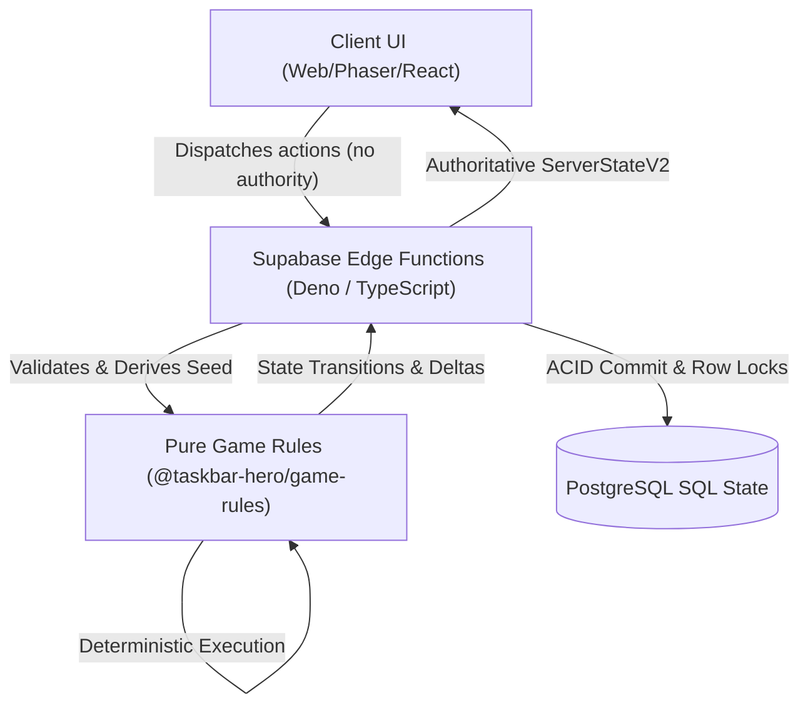

# Cat RPG v2 — Game Mechanics Specification

A 5-minute technical reference for judges evaluating **Taskbar Hero (Cat RPG v2: Cat Café Quest)**.
This document formalizes the complete server-authoritative, deterministic, and bounded game rules as executed in production code.

---

## 1. System Architecture & Where Rules Run

Every rule in Cat RPG v2 adheres to strict execution boundaries ensuring **100% server authority**, **zero client trust**, and **deterministic replayability**:

| Layer | Responsibility & Execution Scope | Enforced Guarantees |
| --- | --- | --- |
| **Pure `game-rules`** | Stateless mathematical core: stat derivation, combat calculations, binomial loot drops, timeline generation, PRNG streams (`Rng` with split seeds). | Deterministic, portable, zero I/O, runs identically in client preview, Edge Functions, and unit tests. |
| **Supabase Edge Functions** | Authentication verification (SIWE / JWT), request rate-limiting, transaction boundaries, timestamp assignment, seed derivation. | Rejects stale revisions (`progress_rev`), validates wallet ownership, enforces daily limits. |
| **PostgreSQL SQL** | ACID persistence: `cat_state`, `player_stacks`, `owned_items`, `boss_clears`. Optimistic locking via `progress_rev`. | Guarantees atomic stack modifications, prevents double-spend and race conditions. |
| **Client UI** | Visual presentation, timeline interpolation (Phaser 3), user feedback ("Why is this disabled?"). | Zero simulation authority; displays server-derived snapshots only. |

---

## 2. Stat Pipeline & Derivation Formulas

All combat stats are calculated deterministically on demand via `deriveStats()` in `packages/game-rules/src/v2/combat/stats.ts`. Stats are never stored pre-aggregated.

### Core Attributes (HP, ATK, DEF)

$$
\text{BaseStat}(L) = \text{base} \times (1 + \text{levelGrowth})^{L - 1}
$$

For a cat at level $L \in [1, 60]$ with configuration base values ($\text{baseHp} = 100$, $\text{baseAtk} = 10$, $\text{baseDef} = 5$, $\text{levelGrowth} = 0.06$):

$$
\text{TotalFlatStat} = \left( \text{BaseStat}(L) + \sum \text{ItemStat} + \sum \text{BonusLine} \right) \times \text{ClassMultiplier}
$$

- **Item Stat Scaling**:
  $$
  \text{ItemStat} = \text{DefBaseStat} \times \text{RarityMultiplier} \times (1 + \text{itemLevelGrowth} \times (\text{itemLevel} - 1))
  $$
  where $\text{itemLevelGrowth} = 0.07$, item level is clamped to $[1, \text{rarity.maxLevel}]$, and rarity multipliers are: Common ($1.0\times$), Uncommon ($1.3\times$), Rare ($1.7\times$), Epic ($2.3\times$), Legendary ($3.2\times$).
- **Equip Filters**: Items in locked accessory slots (Collar at Lv 1, Earring at Lv 5, Ring at Lv 10, Charm at Lv 20) or weapons mismatched to the cat's class weapon profile are ignored.
- **Class Multiplier**: Applied to the entire sum, allowing gear to scale harmoniously with class leanings.

### Secondary Stats & Hard Caps

Secondary attributes combine class baselines with rolled bonus lines, bounded by hard ceilings in `V2_CONFIG.caps`:

| Stat | Formula | Hard Cap (`V2_CONFIG.caps`) |
| --- | --- | --- |
| **Crit Chance** | $\min(0.75, \text{class.critChance} + \sum \text{critChance})$ | $0.75$ ($75\%$) |
| **Crit Damage** | $\text{class.critMultiplier} + \sum \text{critDamage}$ | Uncapped ($1.5\times - 3.5\times+$) |
| **Dodge** | $\min(0.60, \text{class.dodge} + \sum \text{dodge})$ | $0.60$ ($60\%$) |
| **Attack Speed** | $\min(1.00, \sum \text{attackSpeed})$ | $1.00$ ($100\%$ bonus) |
| **Attack Interval** | $\max(200\text{ ms}, \frac{\text{class.attackIntervalMs}}{1 + \text{attackSpeed}})$ | Minimum $200\text{ ms}$ ($5\text{ hits/sec}$) |
| **HP Regen** | $\min(0.05, \sum \text{hpRegen})$ | $0.05$ ($5\%$ max HP / sec) |
| **Material Find** | $\sum \text{materialFind} + (\text{Hunter passive: } 0.20)$ | Uncapped |

### Power Rating Formula

Single evaluation metric displayed in UI and used for analytic idle gating:

$$
\text{PowerRating} = \operatorname{round}\left(\sqrt{\max(0, \text{DPS}) \times \max(0, \text{EHP})}\right)
$$

where:
- $\text{DPS} = \frac{\text{ATK} \times \text{hitsPerAttack} \times (1 + \text{critChance} \times (\text{critDamage} - 1)) \times \text{PassiveMultiplier} \times 1000}{\text{attackIntervalMs}}$
- $\text{EHP} = \frac{\text{HP} \times (\text{defScale} + \text{DEF})}{\text{defScale} \times (1 - \text{dodge})}$

---

## 3. Damage Formula

Every physical strike calculates damage through diminishing returns defense scaling:

$$
\text{RawDamage} = \frac{\text{ATK} \times \text{defScale}}{\text{defScale} + \text{DEF}}
$$

$$
\text{Damage} = \min\left(10^{15}, \max\left(\text{minDamage}, \operatorname{round}(\text{RawDamage})\right)\right)
$$

- $\text{defScale} = 100$: Exactly $100\text{ DEF}$ halves incoming damage ($50\%$), $300\text{ DEF}$ reduces it to $25\%$.
- $\text{minDamage} = 1$: Every landing strike inflicts at least $1$ damage regardless of target defense.
- $\text{MAX\_DAMAGE} = 10^{15}$: Bounded upper limit preventing numeric overflow in simulation or event logs.

---

## 4. Idle Claim System

Progression runs offline and server-side through `computeClaimV2()`:

### Time Bounding & Offline Efficiency

1. **Clamping**: $\text{countedSeconds} = \min(\max(0, \text{elapsedSeconds}), \text{offlineCapSeconds})$.
   - $\text{offlineCapSeconds} = 28,800\text{ s}$ ($8\text{ hours}$).
   - Any negative, infinite, or $\text{NaN}$ elapsed time evaluates to $0\text{ seconds}$.
2. **Two-Tier Window**:
   - $\text{onlineSeconds} = \min(\text{countedSeconds}, 300\text{ s})$ ($5\text{ minutes}$ online window at $100\%$ full rate).
   - $\text{offlineSeconds} = \text{countedSeconds} - \text{onlineSeconds}$.
   - $\text{EffectiveTimeMs} = \left(\text{onlineSeconds} + \text{offlineSeconds} \times 0.5\right) \times 1000$ ($50\%$ offline efficiency).

### Deterministic Round Simulation

- **Round Profile**: $6$ kills in Chapter 1, $10$ kills in Chapters 2–5. Regular monsters cycle in fixed order, ending with $1$ Elite.
- **Time per Monster**: $\text{timeToKillMs} + \text{walkTimeMs}$ ($\text{walkTimeMs} = 1,000\text{ ms}$).
- **Analytic Gate**: If the cat cannot defeat the next regular monster, progress halts at the gate (`gated = true`), and idle time safely farms earlier cleared rounds.
- **Max Rounds per Claim**: Bounded at $4,096$ rounds per claim call to enforce strict execution time limits.
- **Rewards**:
  - $\text{XP} = \sum \lfloor \text{monster.xp} \times (1 + \text{xpBonus}) \rfloor$
  - $\text{Fish} = \sum \lfloor \text{monster.fish} \times (1 + \text{fishBonus}) \rfloor$
  - $\text{Yarn} = \lfloor \sum n \times 0.1 \times 1.1^{\text{stage} - 1} \times \text{monster.lootMul} \rfloor$
- **Daily Cat Key**: Exactly $1$ key granted on the first claim of each UTC+7 calendar day (held up to max stack $5$).

---

## 5. Drop Rates & Smart Loot

Drops roll once per kill using fast geometric skipping (exact binomial distribution):

- **Gear Drop Rate**: $2\%$ base chance per kill (`gearDropChance = 0.02`) multiplied by monster `lootMul` ($1.0\times$ Regular, $3.0\times$ Elite).
- **Rarity Weights**:
  - Common: $70$ ($70.0\%$)
  - Uncommon: $20$ ($20.0\%$)
  - Rare: $8$ ($8.0\%$)
  - Epic: $1.8$ ($1.8\%$)
  - Legendary: $0.2$ ($0.2\%$)
- **Smart Loot Weapon Bias**: When a gear drop selects the `weapon` slot, there is a $60\%$ chance (`SMART_LOOT.classWeaponShare = 0.6`) to drop the active class's weapon type, and $40\%$ chance for off-class weapons.
- **Material Drops**:
  - Fluff Tuft: $15\%$ from Chapter 1+
  - Shiny Button: $4\%$ from Chapter 2+
  - Catnip Crystal: $0.5\%$ from Chapter 1+ (Elite only)
  - Starlight Scale: dropped from Chapter 3+ chests
  - Cleared Chapter Keys: $1 / 150$ chance per kill when farming cleared chapters.

---

## 6. The Forge & Economy

Guaranteed rarity crafting with deterministic item level scaling:

### Crafting Formula & RNG Stream

1. **Recipe Guarantee**: Recipe $1:1$ dictates target rarity (`rcp.common`, `rcp.uncommon`, `rcp.rare`, `rcp.epic`, `rcp.legendary`).
2. **Item Level**: $\text{itemLevel} = \min(\text{rarity.maxLevel}, \max(1, \lfloor \text{bestStage} \rfloor))$.
3. **Bonus Lines**: Rolled without replacement from eligible secondary stats. Number of lines equals `rarity.bonusLines`:
   - Common: $0$ lines (Max Lv 10)
   - Uncommon: $1$ line (Max Lv 20)
   - Rare: $2$ lines (Max Lv 30)
   - Epic: $3$ lines (Max Lv 40)
   - Legendary: $4$ lines (Max Lv 50)
4. **RNG Order**: Draw catalog candidate item $\to$ for each bonus line: draw stat without replacement $\to$ draw uniform value $\in [\min, \max]$.
5. **Costs & Salvage Guarantee**:
   - Common: $10\text{ Yarn} + 4\text{ Fluff Tuft} + 50\text{ Fish} \to \text{Salvage: } 1\text{ Yarn} + 2\text{ Fluff Tuft}$
   - Uncommon: $25\text{ Yarn} + 8\text{ Fluff Tuft} + 1\text{ Button} + 150\text{ Fish} \to \text{Salvage: } 3\text{ Yarn} + 4\text{ Fluff Tuft}$
   - Rare: $60\text{ Yarn} + 10\text{ Fluff Tuft} + 6\text{ Button} + 500\text{ Fish} \to \text{Salvage: } 8\text{ Yarn} + 2\text{ Button}$
   - Epic: $150\text{ Yarn} + 6\text{ Button} + 3\text{ Crystal} + 1,500\text{ Fish} \to \text{Salvage: } 20\text{ Yarn} + 1\text{ Crystal}$
   - Legendary: $400\text{ Yarn} + 6\text{ Crystal} + 2\text{ Scale} + 5,000\text{ Fish} \to \text{Salvage: } 50\text{ Yarn} + 1\text{ Scale}$
   - *Salvage recovery is strictly $\sim 25\%$ of materials and $0$ Fish, mathematically preventing infinite cycling loops.*
6. **Relic NFT Forge**: $30\text{ Yarn} + 1\text{ Moon Pearl}$. Limited to $1$ craft per UTC+7 calendar day.

---

## 7. Boss Battles

Boss encounters run as deterministic discrete-event simulations:

- **Key Cost**: Exactly $1$ Cat Key consumed **only upon victory**. Defeat keeps the key.
- **Loss Catnap Cooldown**: A lost boss fight triggers a $60\text{-second}$ cooldown (`lossCooldownSeconds = 60`) across all chapters.
- **Combat Cadence**:
  - Cat attacks every `stats.attackIntervalMs`.
  - Boss basic attacks every $1,500\text{ ms}$ with $400\text{ ms}$ windup telegraph.
  - Boss heavy slam lands every $6,000\text{ ms}$ ($2.5\times$ damage) with $1,000\text{ ms}$ big windup telegraph.
- **Max Duration**: Match ends as defeat if combat exceeds $60,000\text{ ms}$ ($60\text{ seconds}$).
- **Seed Determinism**: Timeline generated entirely from player stats, boss definition, and seed; replayed frame-for-frame in Phaser 3.

---

## 8. Bag Capacity & Overflow Protection

- **Hard Limit**: $200$ items (`V2_CONFIG.bag.limit = 200`).
- **Warning Threshold**: $90\%$ capacity ($180$ items, `nearFullRatio = 0.9`).
- **Atomic Auto-Salvage**: When a claim or chest yields items that exceed capacity, excess drops are immediately converted to salvage materials at standard rates and credited to player stacks. Items are never lost or silently discarded.

---

## 9. Rounding & Numeric Precision Summary

To avoid IEEE 754 floating-point drift across platforms, rounding behavior is strictly defined:

| Target Value | Rounding Method | Formula / Location |
| --- | --- | --- |
| Cat & Item Level | `Math.floor` | `clamp(Math.floor(cat.level), 1, maxLevel)` |
| Crafted Item Level | `Math.floor` | `Math.min(maxLevel, Math.max(1, Math.floor(bestStage)))` |
| Idle XP Reward | `Math.floor` | `Math.floor(monster.xp * (1 + stats.xpBonus))` |
| Idle Fish Reward | `Math.floor` | `Math.floor(monster.fish * (1 + stats.fishBonus))` |
| Idle Yarn Yield | `Math.floor` | `Math.floor(accumulatedYarn)` |
| Geometric Jump | `Math.floor` | `Math.floor(Math.log1p(-rng.next()) / logMiss)` |
| Round Rotation Index | `Math.floor` | `Math.floor(normal / regulars)` |
| Physical Damage | `Math.round` | `Math.round((atk * defScale) / (defScale + def))` |
| Monster Baseline HP | `Math.round` | `Math.round(hpBase * hpGrowth^k * def.hpMul)` |
| Power Rating | `Math.round` | `Math.round(sqrt(dps * ehp))` |
| XP to Next Level | `Math.ceil` | `Math.ceil(xpBase * xpGrowth^(level - 1))` |
| Search Bisect Step | `Math.ceil` | `Math.ceil((low + high) / 2)` |

---

*This document is verified against runtime code by `packages/game-rules/src/v2/content/mechanics-doc.test.ts`.*
