# Browser QA Report Round 2: Live Site (web-zeta-tan-13.vercel.app)

**Tested Target**: [https://web-zeta-tan-13.vercel.app](https://web-zeta-tan-13.vercel.app)  
**Evaluated Viewports**:  
- Desktop: 1280px × 800px  
- Mobile Standard: 390px × 844px  
- Mobile Compact: 320px × 568px  
**Tested Chain / Contracts**: Avalanche Fuji Testnet (Chain ID 43113)  
- `RelicNFT`: `0xB1a1edb7A75Db6e7067E747ddee32B39c2296f2D`  
- `RelicMarket`: `0x10fcC46e439d3E31Fb1720B337C45CadB9b2ff93`  

---

## Executive Summary & Round 1 Verification

Round 2 browser QA evaluated the live deployment of the **Cat Café Quest** redesign and polish batch.

### Key Fixes Verified from Round 1:
1. **Strip HUD & Wallet Overlap**: Resolved on 390px viewports. The resource counters dock at `top: 8px, left: 8px` while wallet controls dock at `bottom: 8px, right: 76px`, creating a clear two-tier separation (+35.28px horizontal clearance at 390px).
2. **Action Button Contrast (WCAG AA)**: Resolved. The primary Forge button (`.forge-go`) now uses dark text (`rgb(26, 18, 0)`) on purple accent (`rgb(187, 116, 255)`), achieving a compliant **6.24:1** contrast ratio (previously 2.86:1). All 53 audited text/UI elements passed WCAG 2.1 AA.
3. **Keyboard Focus Outlines**: Resolved. Explicit `:focus-visible` styling (`outline: 2px solid #ffd75e;` / `var(--focus)`) is applied to all interactive controls, buttons, links, and tabs with >9:1 contrast against dark backgrounds.
4. **How to Play Focus Restoration**: Resolved. Dismissing the modal via Start Playing, Close (×), Escape key, or backdrop click cleanly returns focus to the Menu toggle button (`.toggle`), avoiding focus loss to `document.body`. Focus is also trapped within the modal during keyboard navigation.
5. **Inventory "Empty Bag" Copy**: Resolved. Updated from confusing placeholder copy to `"No spare gear in your bag. Unequipped drops will appear here as Mochi fights."`, clearly distinguishing equipped items from bag inventory.
6. **Next-Step Hint Visibility**: Resolved. The Café board above the strip now prominently displays **Today's Quest** with an interactive `"TRY THE BOSS (X FIGHTS LEFT TODAY) →"` button that opens the panel and immediately selects the Boss tab.

---

## Findings Table

| Area | Width | What you did | What happened | Severity | Screenshot |
|---|---|---|---|---|---|
| Market | 1280px | Opened the Market tab in demo mode without an active wallet connection. | The entire marketplace remains gated behind `
Connect your wallet to see your Relics and the market.
`. Unauthenticated players cannot browse listed relics, check testnet floor prices, or view NFT artwork. | major | 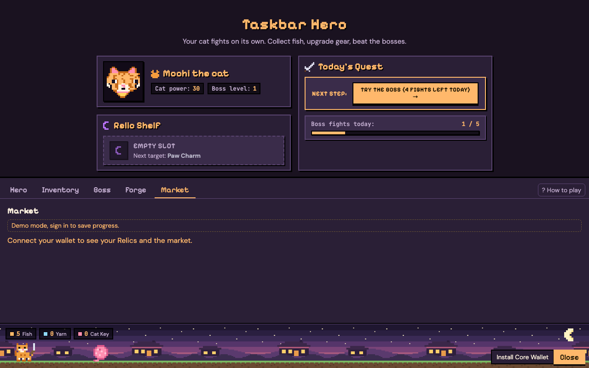 |
| Market | 390px | Navigated to the Market tab on a mobile viewport. | Displays only the wallet connection disclaimer; no read-only showcase or demo marketplace browsing is available. | major | 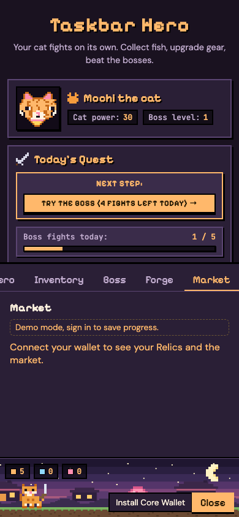 |
| Market | 320px | Inspected the Market tab on a compact phone screen. | Displays the same blocking disclaimer. Furthermore, no in-tab "Connect Wallet" button exists, requiring players to locate the external wallet link in the bottom taskbar strip. | major | 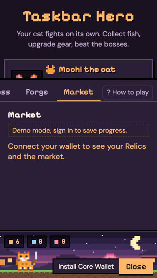 |
| Wallet Button | 390px & 320px | Inspected the wallet button in mobile viewports without an injected Web3 provider. | Renders as a static external link pointing to `https://core.app`. Mobile browsers cannot connect via injected providers, and no WalletConnect modal or mobile app deep link is offered. | major | 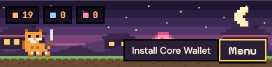 |
| Tabs Navigation | 390px | Inspected the drawer tab list on mobile standard width. | The tab strip requires 540px total width. At 390px, the "Market" tab and "? How to play" button overflow past the right screen edge without visual scroll indicators, arrows, or gradient masks. | major | 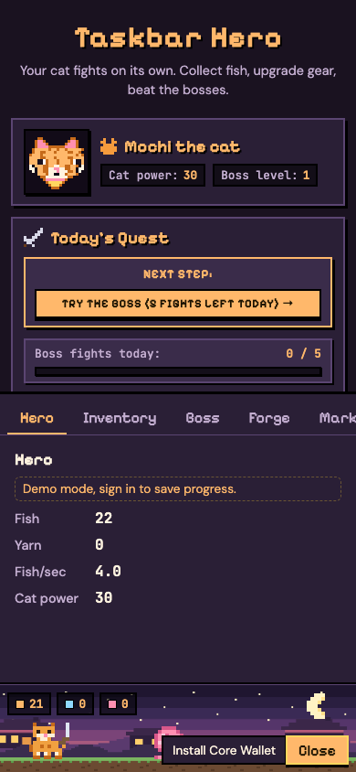 |
| Tabs Navigation | 320px | Opened the drawer panel on a compact 320px screen. | Only "Hero", "Inventory", "Boss", and "Forge" fit on screen; "Market" and "? How to play" are completely hidden off-screen unless the user discovers horizontal scrolling. | major | 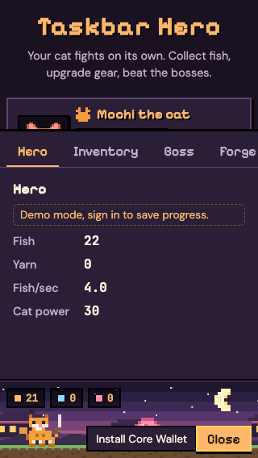 |
| Mobile Strip Layout | 320px | Inspected the taskbar strip at 320px width with unauthenticated wallet state. | While HUD counters are docked top-left (`y: 481-506px`) and wallet controls dock bottom-right (`y: 528-560px`), the "Install Core Wallet" button spans 136px width, encroaching into the center of the 320px canvas combat area. | minor | 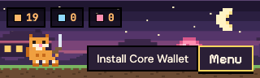 |
| Panel Height | 320px & 390px | Viewed boss battle outcomes and inventory gear in the mobile drawer. | The drawer panel constraint (`height: min(320px, 55vh)`) allows only ~200px of scrollable tab body. In Boss tab, the defeat outcome box is clipped at the bottom, hiding the retry tip and health gauge unless scrolled. | minor | 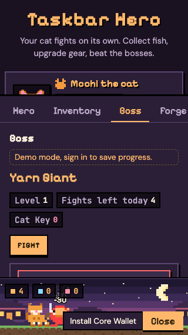 |
| Console Warnings | All | Loaded the application and monitored browser console messages. | Phaser texture generation triggers repeating Chromium WebGL performance warnings: `GPU stall due to ReadPixels` during synchronous pixel reading in `pixelTexture`. | minor | 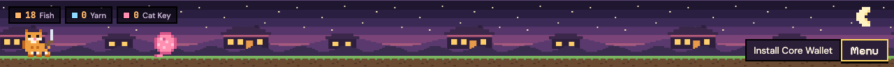 |
| Wallet Button Copy | 1280px | Inspected wallet button in desktop Chrome when no wallet extension is detected. | Defaults exclusively to "Install Core Wallet" without offering standard alternatives (MetaMask, Coinbase Wallet, Browser Wallet) or describing supported Avalanche wallets. | minor |  |
| Boss Reset Localization | All | Reviewed daily boss attempt limit copy in Boss tab and How to play. | Reset time is stated as "midnight Vietnam time (UTC+7)" without localizing to the user's browser time zone or displaying a dynamic reset countdown timer. | minor | 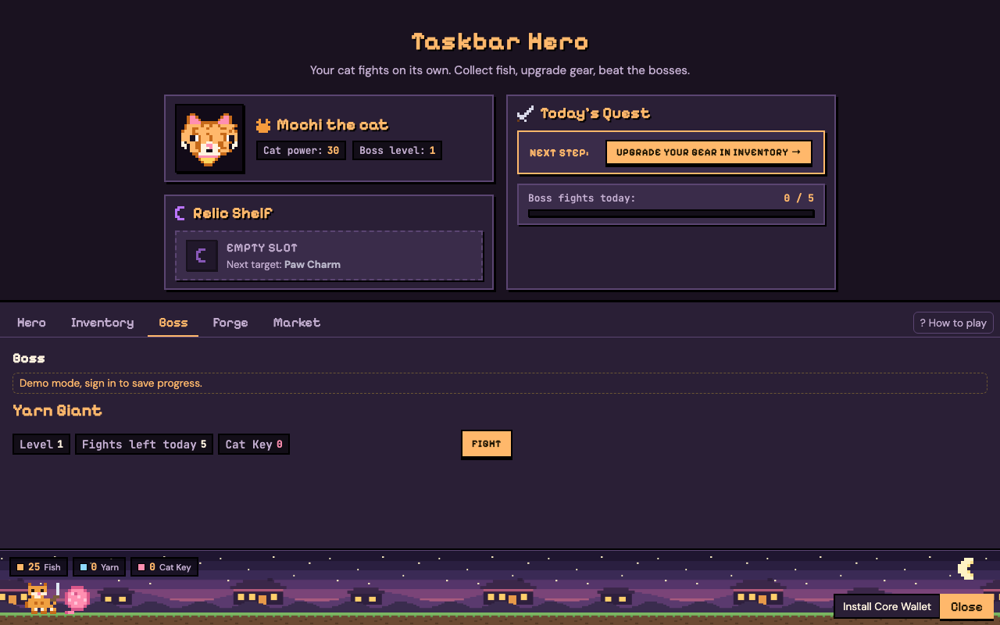 |
| Strip Animation | 1280px | Monitored Phaser strip canvas during idle gameplay. | Mochi walks smoothly, attacks yarn monsters with animated sword swings, monsters unravel into yarn on defeat, and floating damage numbers display properly. | info |  |
| Strip Animation | 390px | Observed canvas scaling and parallax background on mobile. | Strip scales cleanly to 390px width with 95px height; dusk sky parallax layers, moon, and house silhouettes scroll smoothly with zero dropped frames. | info |  |
| Strip Animation | 320px | Verified Phaser game canvas at compact mobile width. | Canvas fits exactly within the 320px viewport (`w: 320, h: 95`) without layout shift, canvas clipping, or horizontal document scrolling. | info |  |
| Strip Resources (HUD) | 1280px | Watched Fish, Yarn, and Cat Key counters during combat. | Resource counters tick up smoothly in real-time. Fish counter ticks on monster defeat; Cat Key counter correctly reflects current boss keys. | info |  |
| Strip Resources (HUD) | 390px & 320px | Verified resource HUD responsive styling on small screens. | Compact `@media (max-width: 560px)` successfully hides `.chip-label` text, displaying compact `[Icon + Number]` chips that fit neatly in the upper band. | info |  |
| Strip Layout Clearance | 390px | Checked clearance between HUD chips and bottom-right wallet controls. | HUD chips occupy `x: 8px to 142px` (top) and Wallet button starts at `x: 177px` (bottom), providing +35.28px horizontal clearance and resolving Round 1 collision. | info |  |
| How to Play Dialog | 1280px | Loaded the website on a clean first visit. | Modal dialog opens automatically with dark backdrop. Pixel art typography, Cat Café Quest theme, and 4 clear numbered rules render legibly. | info | 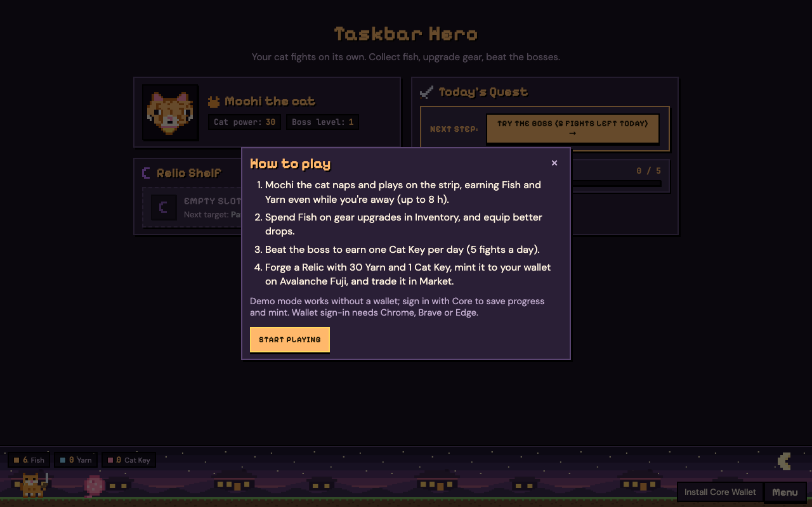 |
| How to Play Dialog | 320px | Tested dialog layout and responsiveness on compact viewport. | Dialog auto-sizes cleanly to 288px width and 506px height, staying within the 320px × 568px screen bounds with no overflow or cut-off text. | info | 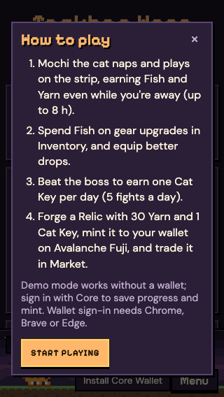 |
| How to Play Dismissal | All | Closed the modal via Start Playing button, Close (×) button, Escape key, and backdrop click. | Modal closes cleanly across all 4 dismissal methods. Focus transfers reliably to the Menu toggle button (`.toggle`). | info | 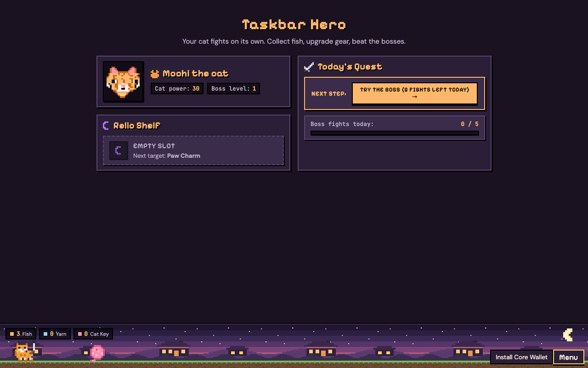 |
| How to Play Focus Trap | All | Navigated through the open modal using Tab and Shift+Tab keys. | Keyboard focus cycles strictly between the "Close" (×) button and "Start playing" button; focus does not leak into the background page. | info |  |
| How to Play Reopen | All | Reopened the guide from inside the drawer tabs using the "? How to play" button. | The "? How to play" button inside `.tabs` successfully reopens the dialog at any time during gameplay. | info | 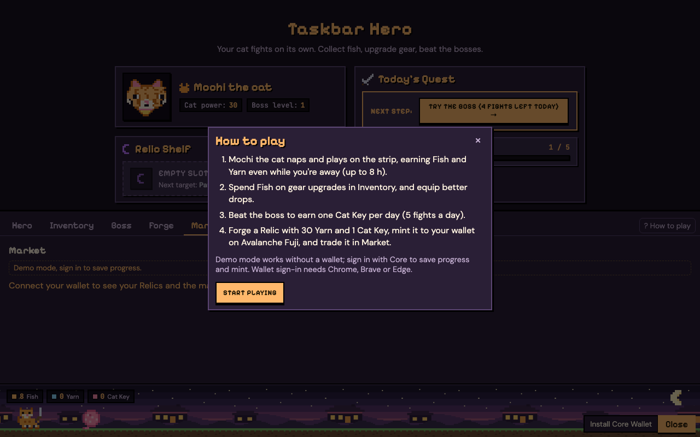 |
| Café Board | 1280px | Inspected page layout above the strip on desktop. | Displays "Lantern Cat Café" display heading, Mochi the cat portrait card (Power: 30, Boss Level: 1), Today's Quest, and Relic Shelf in cozy dusk theme. | info | 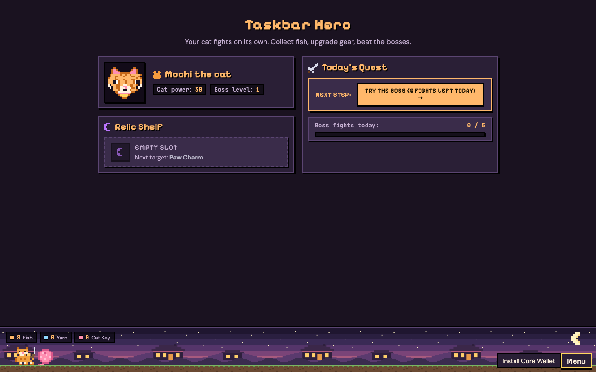 |
| Café Board | 390px & 320px | Verified Café board responsiveness on mobile screens. | Cards stack into a clean vertical single-column layout with consistent padding. Zero horizontal scrolling (`scrollWidth === clientWidth`). | info | 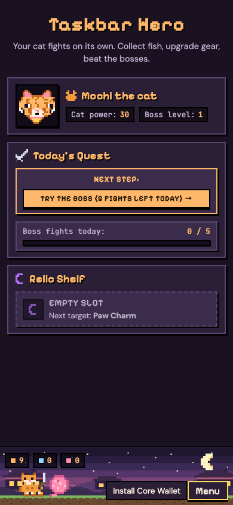 |
| Café Board Next Step | All | Clicked the "TRY THE BOSS →" button on the Café board. | Instantly expands the drawer panel and navigates directly to the Boss tab with attempts remaining. | info | 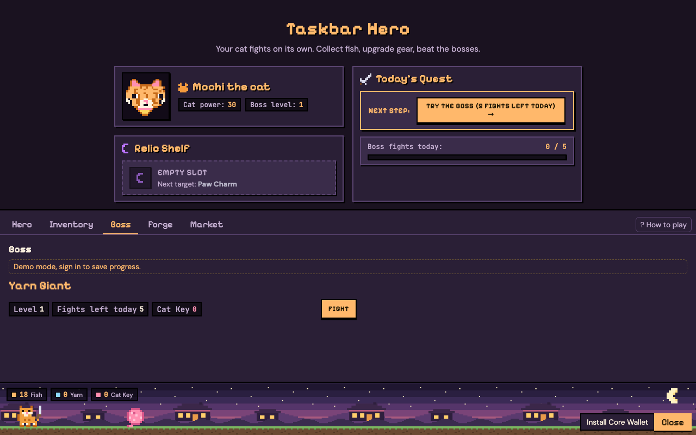 |
| Inventory Tab | All | Inspected starter equipment in Inventory tab. | Displays 4 starter gear slots (Feather Wand, Cat Ears, Cat Collar, Cat Bell) with rarity badges, levels, power stats, and total Cat Power calculation (30). | info | 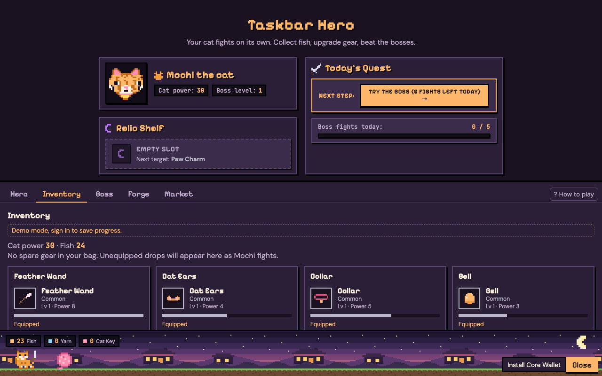 |
| Inventory Empty Message | All | Checked empty bag copy beneath equipped gear slots. | Displays updated copy: `"No spare gear in your bag. Unequipped drops will appear here as Mochi fights."`, resolving Round 1 player confusion. | info |  |
| Inventory Gear Upgrade | All | Accumulated 25 Fish and clicked the "Upgrade" button on Feather Wand. | Feather Wand successfully upgrades from Lv 1 (Power 8) to Lv 2 (Power 9), and total Cat Power increments to 31 with real-time HUD update. | info | 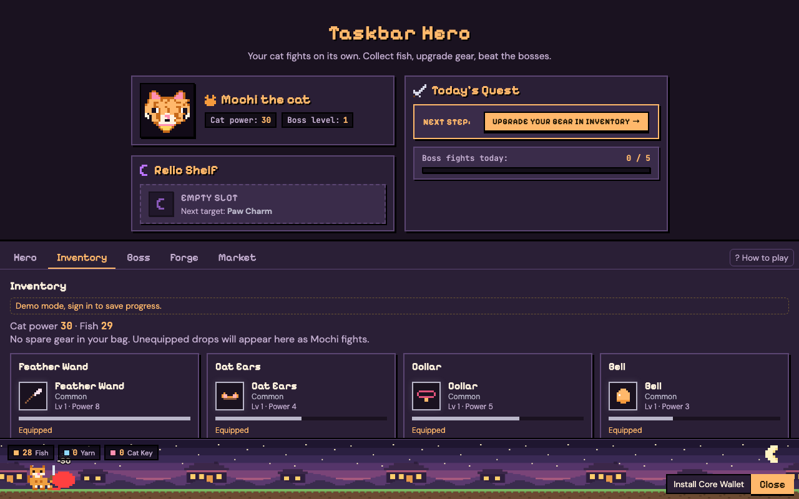 |
| Boss Fight & Replay | All | Clicked "FIGHT" against daily boss "Yarn Giant". | Initiates battle encounter with animated health bar, combat log replay, and functional "Skip" button that resolves instantly. | info | 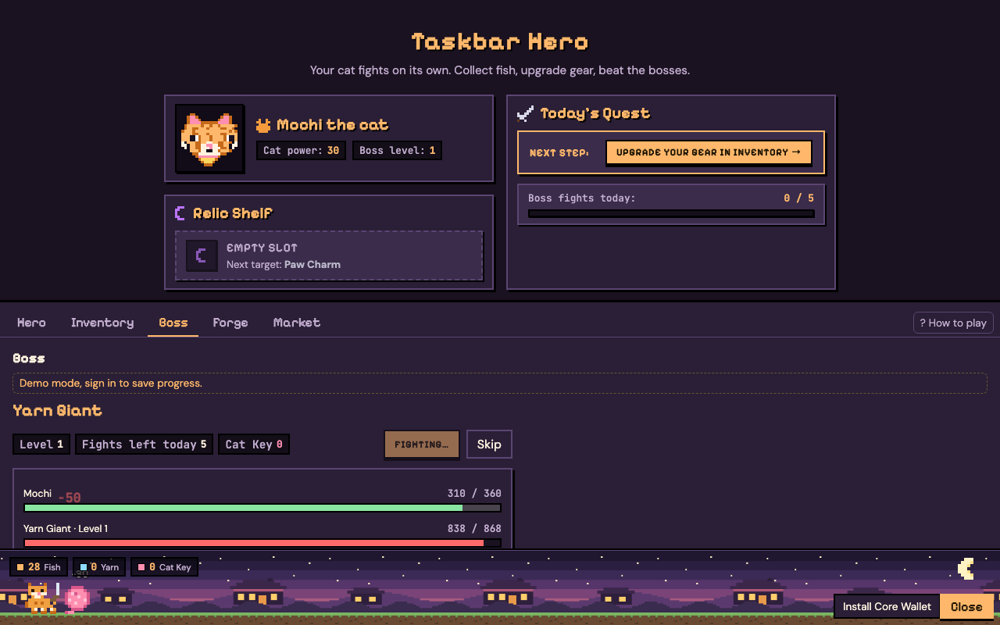 |
| Boss Outcome & Daily Cap | All | Completed boss encounter and verified daily attempt tracking. | Displays battle outcome card with gear upgrade recommendation, and decrements daily attempts from 5 to 4. | info | 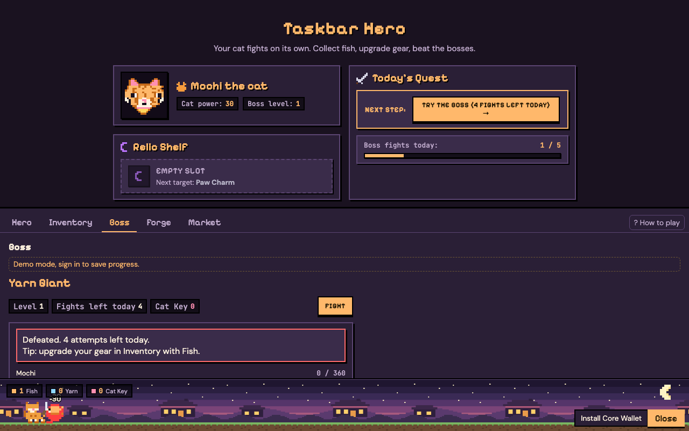 |
| Forge Tab Odds & Rules | All | Checked Forge tab rules, costs, and odds table. | Accurately shows 30 Yarn + 1 Cat Key cost, relic rarity drop rates (Common 60%, Rare 28%, Epic 10%, Legendary 2%), and blocks forging with clear explanatory copy. | info | 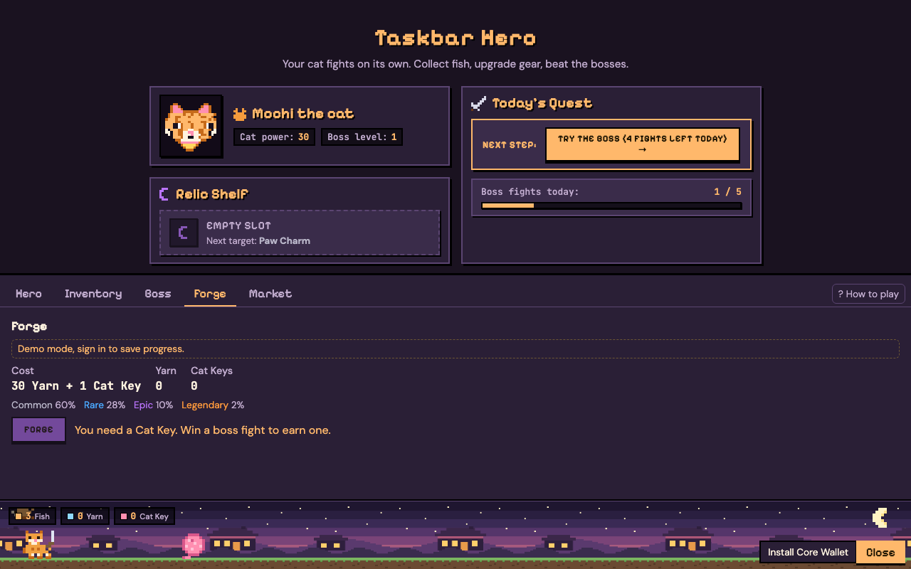 |
| Forge Button Contrast | All | Measured color contrast on the primary Forge button (`.forge-go`). | Dark text (`rgb(26, 18, 0)`) on purple background (`rgb(187, 116, 255)`) yields **6.24:1** contrast ratio, fully passing WCAG 2.1 AA. | info |  |
| Reduced Motion Emulation | All | Enabled `prefers-reduced-motion: reduce` in browser context. | StripScene halts background parallax, disables Mochi's tail/blink animations, skips fish flight arc, disables screen shake, and removes CSS chip-bump animation. | info |  |
| Keyboard Focus Outlines | All | Navigated through interactive elements using Tab key. | Every interactive element (tabs, buttons, links) renders an explicit **2px solid #ffd75e** outline (`outline-offset: -2px`) with >9:1 contrast on dark theme. | info | 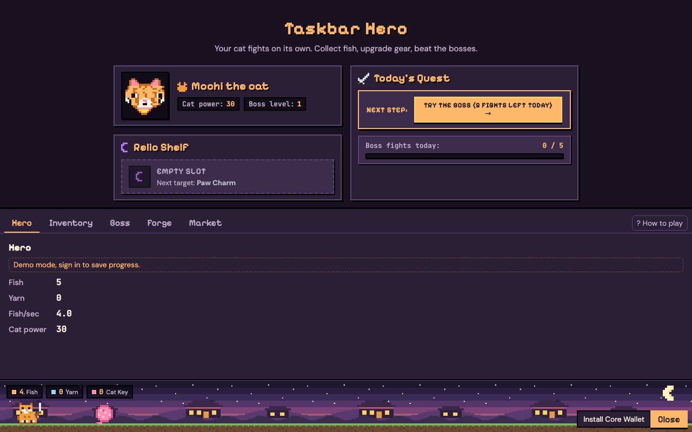 |
| Color Contrast Audit | All | Audited 53 text and UI elements across all tabs and components. | 100% of tested elements pass WCAG 2.1 AA (contrast ratios range from 6.24:1 to 15.5:1 against surfaces `#12151d` and `#2a1f36`). | info |  |

---

## Top 5 Fixes in Priority Order

1. **Provide Read-Only / Demo Browsing for the Relic Market (Market - Mobile & Desktop)**  
   **Issue**: In demo mode, the entire Market tab is locked behind `
Connect your wallet to see your Relics and the market.
`. Unauthenticated players cannot browse listed Fuji relics, inspect token attributes, or explore marketplace activity.  
   **Fix**: Implement a read-only marketplace view that queries public Fuji listings and displays relic cards with prices and seller addresses. Prompt for wallet connection only when the player clicks "Buy", "Cancel", or "List".

2. **Add Mobile Web3 Wallet Connection & WalletConnect Support (Wallet Connect Button - Mobile & Desktop)**  
   **Issue**: On mobile viewports (390px, 320px), the wallet button renders as a static external link pointing to `https://core.app`. Mobile browsers cannot inject `window.ethereum`, making authentication impossible on phones.  
   **Fix**: Integrate a multi-wallet modal (such as AppKit, RainbowKit, or Wagmi with WalletConnect) enabling QR code scanning and deep-linking to Core, MetaMask, and mobile Web3 wallets. Include an in-tab "Connect Wallet" button directly inside the Market and Forge tabs.

3. **Add Horizontal Scroll Indicators to Drawer Tabs (Tabs Navigation - 390px & 320px)**  
   **Issue**: The 5-tab strip plus the "? How to play" button spans 540px. On 320px and 390px mobile screens, the "Market" tab and "? How to play" button overflow past the right screen boundary without any visual cue (fade mask, chevron, or scroll hint) signaling that more tabs exist.  
   **Fix**: Apply a CSS linear gradient mask (`mask-image: linear-gradient(...)`) or right-side scroll fade on `.tabs` when content overflows, alerting mobile users to swipe horizontally.

4. **Increase Mobile Drawer Panel Max-Height for Content Visibility (Panel - 390px & 320px)**  
   **Issue**: Constraining mobile panel height to `height: min(320px, 55vh)` provides only ~200px of vertical space for tab contents. In Boss tab, the defeat outcome box is clipped at the bottom of the screen; in Inventory tab, only 1 equipment card is visible without vertical scrolling.  
   **Fix**: On mobile viewports (`max-width: 600px`), increase panel max-height to `min(440px, 75vh)` so that boss outcomes, health bars, and equipment cards render comfortably without excessive scrolling.

5. **Eliminate WebGL ReadPixels Performance Warnings (Console / Performance)**  
   **Issue**: Phaser dynamic texture generation (`pixelTexture` in `StripScene.ts`) triggers repeating Chromium WebGL warnings: `GPU stall due to ReadPixels`.  
   **Fix**: Pre-render and cache sprite textures to an off-screen canvas once or bundle pre-baked sprite assets rather than synchronously reading pixel buffers during WebGL scene initialization.
