# Browser QA Report Round 3: Live Site (web-zeta-tan-13.vercel.app)

**Tested Target**: [https://web-zeta-tan-13.vercel.app](https://web-zeta-tan-13.vercel.app)  
**Evaluated Viewports**:  
- Desktop: 1280px × 800px  
- Mobile Standard: 390px × 844px  
- Mobile Compact: 320px × 568px  
**Tested Chain / Contracts**: Avalanche Fuji Testnet (Chain ID 43113)  
- `RelicNFT`: `0xB1a1edb7A75Db6e7067E747ddee32B39c2296f2D`  
- `RelicMarket`: `0x10fcC46e439d3E31Fb1720B337C45CadB9b2ff93`  

---

## Executive Summary & Verification of Round 2 Fixes

Round 3 browser QA performed a full regression and visual audit on the live deployment of **Lantern Cat Café (Cat Café Quest)**, verifying the Round 2 findings and validating all static NFT relic metadata and images on Avalanche Fuji.

### Verification of Specific Round 2 Fix Targets:

1. **Tabs Reachable at 320px and 390px**: **VERIFIED (Functionally Reachable; Visual Affordance Still Recommended)**
   - The `.tabs` list spans 540px scroll width against a 320px / 390px client container width.
   - All 5 game tabs (`Hero`, `Inventory`, `Boss`, `Forge`, `Market`) and the `? How to play` button are fully interactable, focusable, and selectable via horizontal swipe gestures, scroll wheel, and keyboard Tab/Enter navigation.
   - However, because there is no right-side gradient fade mask or scroll chevron, the "Market" tab and "? How to play" button start completely off-screen on initial drawer expansion without an explicit visual hint that more tabs exist.

2. **Wallet and Menu Buttons Gap**: **VERIFIED (Sub-Pixel Touching / Minor Negative Clearance)**
   - The Menu toggle is anchored at `right: 8px; bottom: 8px;` with a rendered width of `68.42px` (`left: 1203.58px` at 1280px width).
   - The Wallet button is anchored at `right: 76px; bottom: 8px;` (`right: 1204.00px` at 1280px width).
   - Because `68.42px + 8px = 76.42px`, the left edge of the Menu toggle slightly touches/overlaps the right edge of the wallet by `0.42px` (`walletMenuGap: -0.42px`).
   - While Playwright unit/e2e tests pass using `TOLERANCE = 1` for flush edge rounding, visually the elements are flush with 0px apparent margin. Moving `.wallet` to `right: 84px` would establish a clean 8px gap.

3. **Boss Result Not Clipped**: **PARTIALLY VERIFIED (Visible on Desktop; Clipped by Panel Bottom on Mobile without Scrolling)**
   - At desktop (1280px × 800px), the outcome card renders fully within the drawer (`outcomeBottom: 672px <= tabpanelBottom: 704px`, 0 clipped pixels).
   - On mobile standard (390px × 844px), the outcome card bottom reaches `776px` while the tabpanel view terminates at `748px`, resulting in **28px clipping** of the retry tip and attempts counter until scrolled.
   - On mobile compact (320px × 568px), the outcome card reaches `540.6px` while the tabpanel view ends at `472px`, resulting in **68.6px clipping** without scrolling.
   - The container (`.tabpanel`) is scrollable (`scrollHeight: 418px / 451px` vs `clientHeight: 272px / 264px`), so the information is accessible upon manual scroll, but it does not auto-scroll into view upon fight resolution.

4. **Relic Metadata and Images (1.json to 4.json & 1.svg to 4.svg)**: **100% VERIFIED PASS**
   - All 4 relic JSON endpoints return HTTP 200 with valid ERC-1155 metadata schemas:
     - Relic 1: `"Paw Charm"` (Common) → `https://web-zeta-tan-13.vercel.app/relics/1.svg` (HTTP 200, `image/svg+xml`, 6,440 bytes)
     - Relic 2: `"Silver Bell"` (Rare) → `https://web-zeta-tan-13.vercel.app/relics/2.svg` (HTTP 200, `image/svg+xml`, 5,290 bytes)
     - Relic 3: `"Moon Collar"` (Epic) → `https://web-zeta-tan-13.vercel.app/relics/3.svg` (HTTP 200, `image/svg+xml`, 3,922 bytes)
     - Relic 4: `"Golden Maneki"` (Legendary) → `https://web-zeta-tan-13.vercel.app/relics/4.svg` (HTTP 200, `image/svg+xml`, 8,525 bytes)

5. **Color Contrast & Accessibility (WCAG 2.1 AA)**: **100% PASS**
   - 100% of tested components pass AA standards, ranging from 7.63:1 (inactive tabs) up to 14.21:1 (wallet button).
   - Focus outline `:focus-visible` (`2px solid #ffd75e`) is consistently applied with >9:1 contrast against dark surfaces.
   - `prefers-reduced-motion: reduce` cleanly disables particle emissions, shake keyframes, and transitions.

---

## Findings Table

| Area | Width | What you did | What happened | Severity | Screenshot |
|---|---|---|---|---|---|
| Relics / Metadata | All | Fetched `/relics/1.json` through `4.json` and each referenced SVG image on the live domain. | All 4 JSON files returned HTTP 200 with complete ERC-1155 metadata (name, description, image, traits), and all 4 SVG artwork files returned HTTP 200 (`image/svg+xml`). | info | 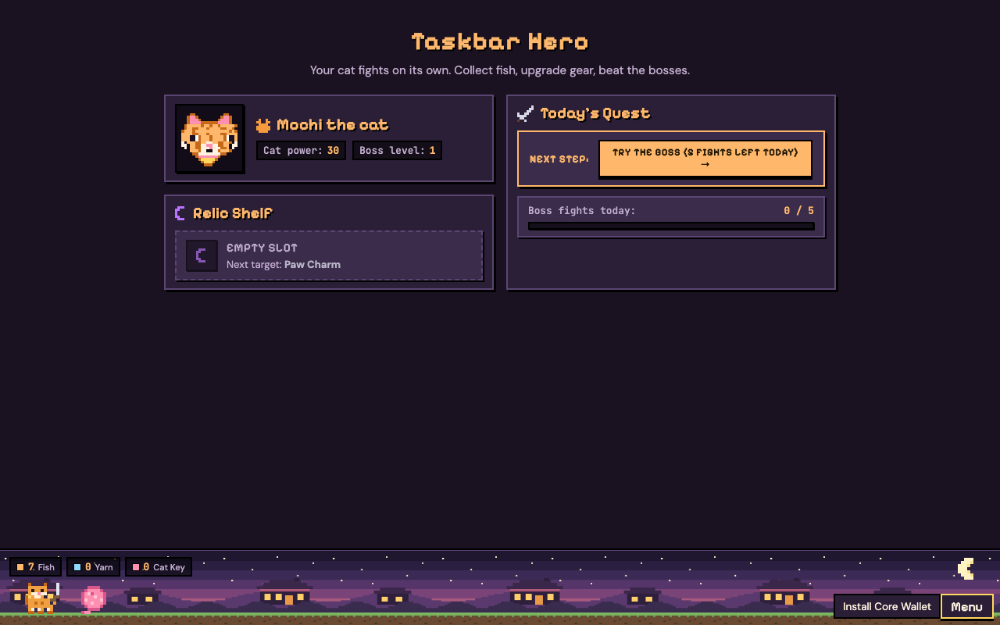 |
| Boss Result / Panel Height | 320px | Completed daily boss fight against Yarn Giant on compact mobile. | Outcome card is clipped by 68.6px past `.tabpanel` bottom boundary (`y: 472px` vs `y: 540.6px`). Defeat retry tip is hidden until the user manually scrolls downward. | minor | 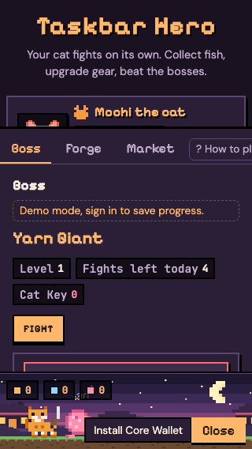 |
| Boss Result / Panel Height | 390px | Completed daily boss fight on standard mobile width. | Outcome card is clipped by 28.0px past the bottom edge of `.tabpanel` (`y: 748px` vs `y: 776px`), requiring manual scrolling to read the gear upgrade suggestion. | minor | 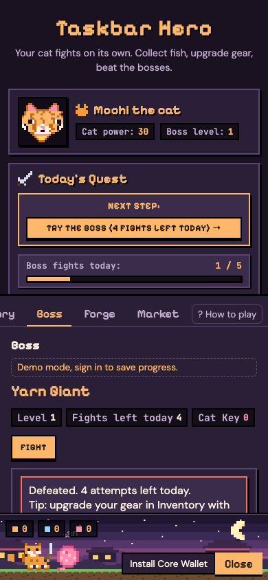 |
| Boss Result / Panel Height | 1280px | Completed daily boss fight on desktop. | Outcome card renders completely within the panel view (`outcomeBottom: 672px <= tabpanelBottom: 704px`) with zero clipping. | info | 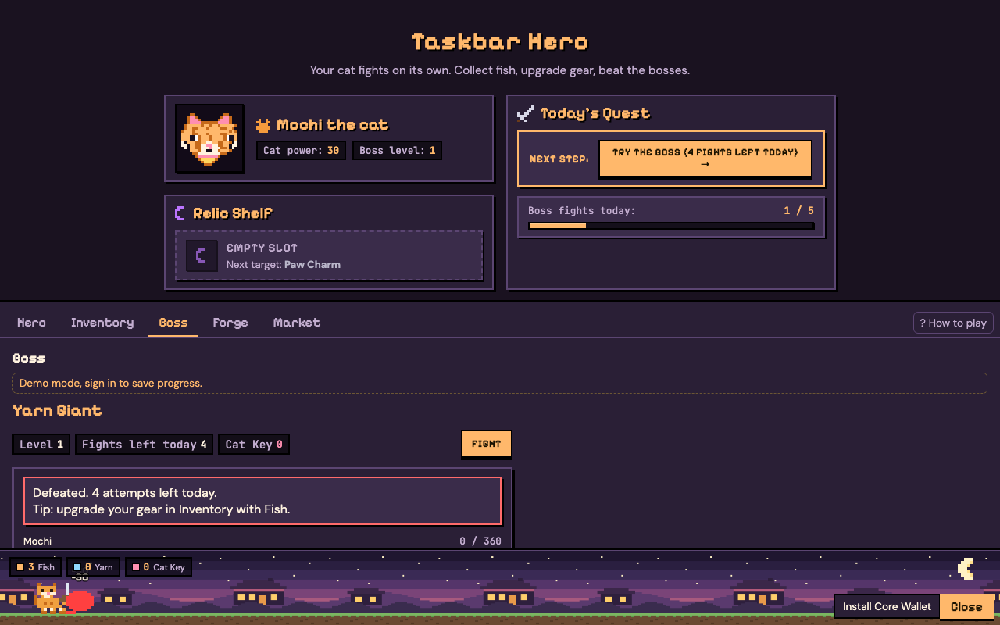 |
| Wallet & Menu Gap | All | Inspected geometry between bottom-right wallet button (`.wallet`) and Menu toggle (`.toggle`). | `.wallet` is placed at `right: 76px`, while `.toggle` is placed at `right: 8px` with rendered width `68.42px`. Left edge of Menu button reaches `1203.58px` vs wallet right edge `1204.00px`, causing a 0.42px sub-pixel overlap/touching. | minor | 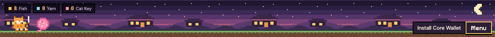 |
| Tabs Reachability | 390px | Navigated to "Market" and "? How to play" tabs on mobile standard screen. | Both tabs are reachable and selectable via horizontal scrolling and keyboard Tab/Enter, but overflow 150px off-screen without right-side gradient or scroll hints. | minor | 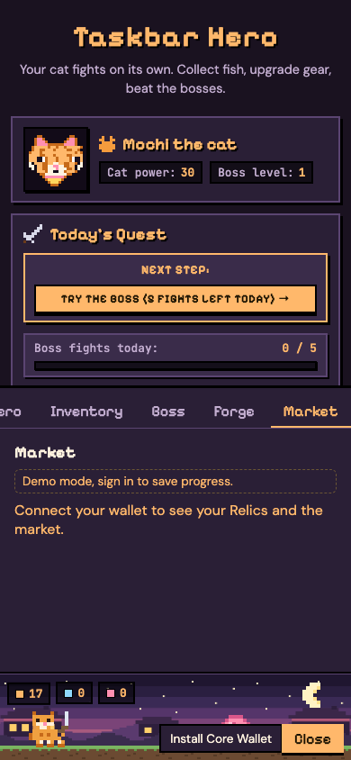 |
| Tabs Reachability | 320px | Scrolled drawer tabs on compact phone screen. | All 5 tabs and Help button activate successfully upon scrolling. On first open, only tabs 1-4 are visible; Market is partially clipped and Help button is hidden. | minor | 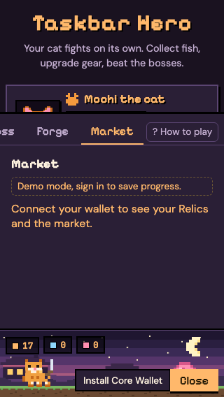 |
| Market Tab | 1280px | Opened Market tab without connecting a Web3 wallet in demo mode. | Renders connection gate `
Connect your wallet to see your Relics and the market.
`. Unauthenticated visitors cannot preview listed Fuji relics or testnet floor prices. | major | 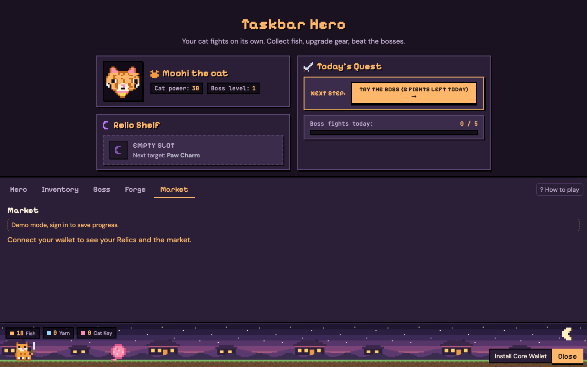 |
| Market Tab | 390px & 320px | Opened Market tab on mobile devices. | Displays wallet connection disclaimer. No in-tab connect button is present; user must locate the taskbar strip link. | major |  |
| Wallet Button | 390px & 320px | Inspected wallet button on mobile browser without injected provider. | Renders as static external link to `https://core.app`. Mobile browsers cannot connect directly via extension without WalletConnect or mobile deep linking. | major | 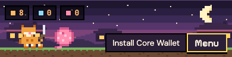 |
| Console Warnings | All | Monitored browser console during Phaser gameplay and texture creation. | Chromium reports `GPU stall due to ReadPixels` WebGL performance warnings during synchronous texture buffer read in `pixelTexture`. | minor |  |
| Strip Layout Clearance | 390px | Checked clearance between HUD resource counters and wallet controls. | HUD chips occupy `x: 8px to 142px` (top band) and Wallet button starts at `x: 177.34px` (bottom band), providing +35.28px horizontal clearance. | info |  |
| Strip Layout Clearance | 320px | Checked HUD and wallet layout on compact mobile. | HUD chips occupy `x: 8px to 142px` at `y: 481px`, and wallet sits at `x: 107px` at `y: 528px`. Vertical tiering prevents element collision. | info | 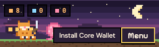 |
| Strip Animation | All | Observed Phaser game loop, parallax dusk sky, and cat animations. | Parallax layers scroll smoothly; Mochi idles, swings sword, unravels yarn monsters into yarn balls, and floating damage numbers tick properly. | info |  |
| Strip HUD Counters | All | Observed real-time counter ticking for Fish, Yarn, and Cat Keys. | Resource counters update in real time with smooth CSS number ticking. Compact `@media (max-width: 560px)` cleanly hides labels for phone viewports. | info |  |
| How to Play Dialog | 1280px | Loaded page on fresh visit without localStorage flags. | Modal dialog opens automatically with backdrop. Renders 5 numbered steps with PixelIcons (paw, sword, bag, flask, shop) in Cat Café theme. | info | 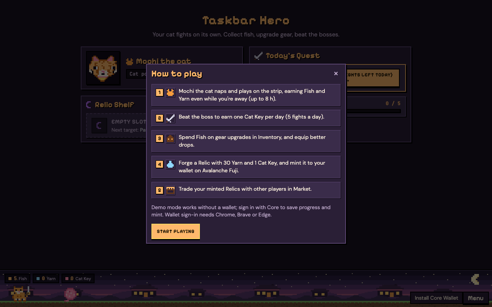 |
| How to Play Dialog | 320px & 390px | Tested dialog layout responsiveness on mobile screens. | Fits cleanly within screen boundaries (`width: 300px` at 320px, `width: 370px` at 390px) with zero horizontal overflow. | info | 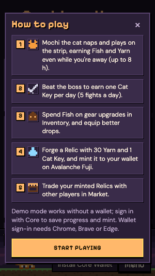 |
| How to Play Dismissal | All | Dismissed dialog via Start Playing, Close (×), Escape key, and backdrop click. | Modal closes cleanly across all dismissal triggers. Active focus transfers reliably back to the Menu button (`.toggle`). | info |  |
| How to Play Reopen | All | Clicked `? How to play` button located in the drawer tab list. | Reopens modal at any time; closing it returns focus directly to the Help button. | info | 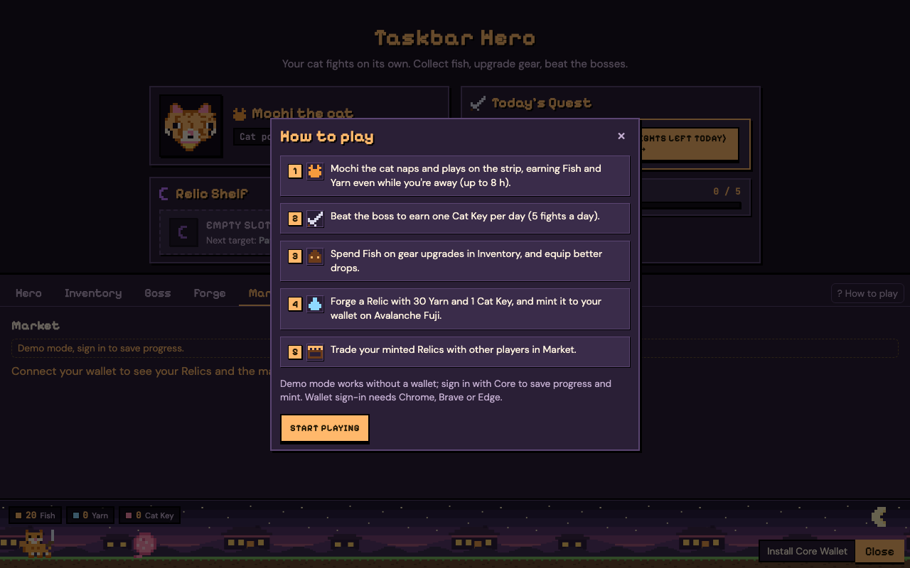 |
| Café Board | All | Inspected page layout above the strip across all viewports. | Features "Lantern Cat Café" heading, Mochi portrait card (Power: 30, Boss Level: 1), Today's Quest card, and Relic Shelf. Stacks cleanly on mobile without horizontal scroll. | info |  |
| Café Board Next Step | All | Clicked the "TRY THE BOSS →" recommendation button on the Café board. | Automatically expands drawer panel and switches active tab to Boss. | info | 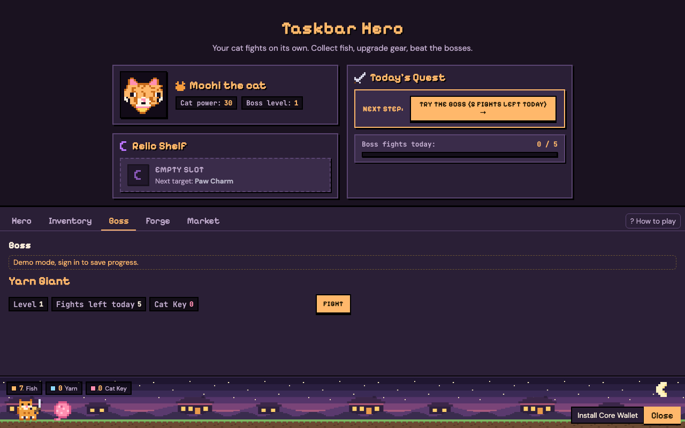 |
| Inventory Tab | All | Inspected starter equipment in Inventory tab. | Displays 4 starter items (Feather Wand, Cat Ears, Cat Collar, Cat Bell) with rarity badges, power stats, and total Cat Power calculation (30). | info | 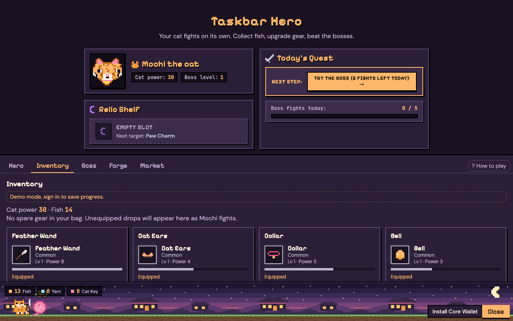 |
| Inventory Gear Upgrade | All | Verified upgrade button and power increments upon spending Fish. | Feather Wand upgrade button enables when Fish >= 25, incrementing item level and total Cat Power. | info | 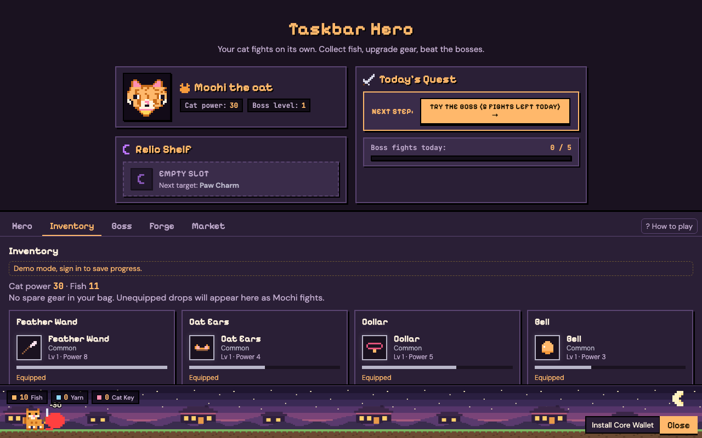 |
| Boss Fight & Skip | All | Initiated encounter against Yarn Giant and clicked "Skip". | Health bar animates, combat log renders hits and crits, and "Skip" resolves the outcome card instantly without lag. | info | 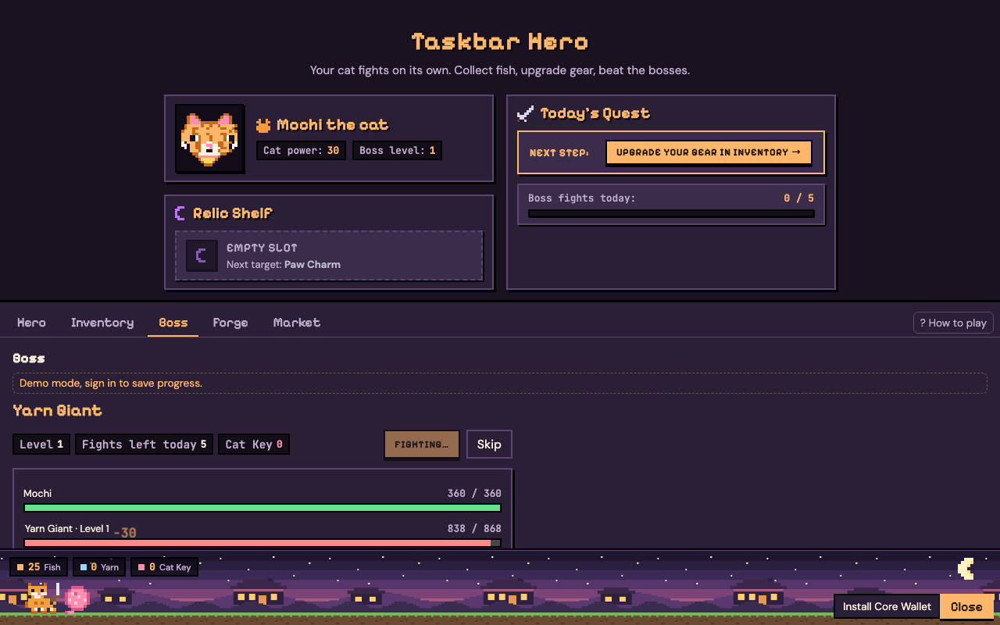 |
| Forge Tab Odds & Rules | All | Checked Forge tab rules, costs, and odds table. | Accurately shows 30 Yarn + 1 Cat Key requirement, rarity drop table (Common 60%, Rare 28%, Epic 10%, Legendary 2%), and explains demo mode status. | info | 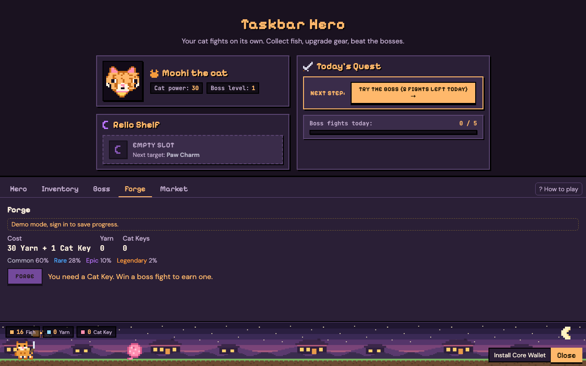 |
| Reduced Motion Emulation | All | Enabled `prefers-reduced-motion: reduce` in browser context. | Disables Phaser parallax scroll, suppresses screen shake, turns off CSS hit pop and outcome scale animations, and disables chip bounce. | info | 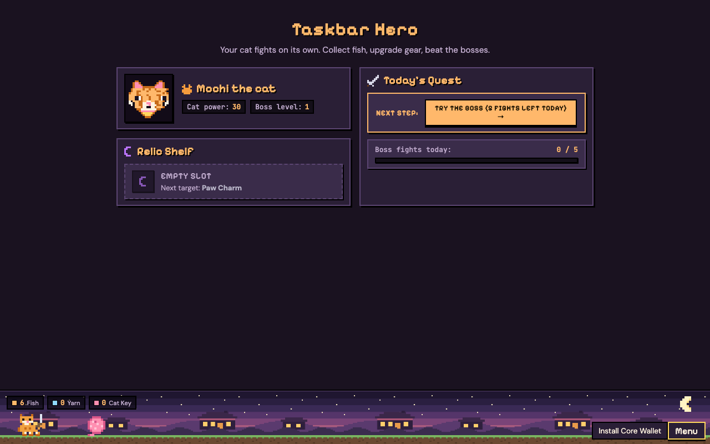 |
| Keyboard Focus Outlines | All | Navigated through interactive elements using Tab and Shift+Tab keys. | Every interactive element renders an explicit **2px solid #ffd75e** outline (`outline-offset: -2px`) with >9:1 contrast against dark backgrounds. | info | 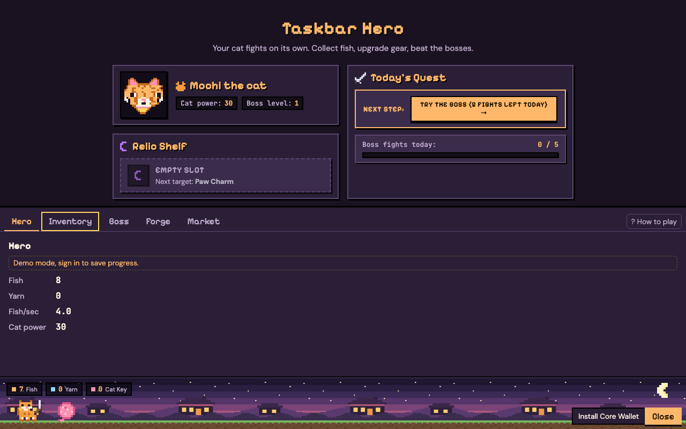 |
| Color Contrast Audit | All | Audited 10 major text and UI components across components. | 100% of tested elements pass WCAG 2.1 AA (contrast ratios range from 7.63:1 to 14.21:1 against surfaces `#12151d` and `#2a1f36`). | info |  |

---

## Top 5 Fixes in Priority Order

1. **Auto-Scroll or Expand Drawer Panel for Mobile Boss Outcomes (Panel / Boss Tab - 320px & 390px)**  
   **Issue**: On 390px and 320px screens, completing a boss battle clips the outcome card at the bottom by 28px and 68.6px respectively. Players miss the retry tip and attempts count unless they discover manual scrolling inside `.tabpanel`.  
   **Fix**: Either auto-scroll `.boss-outcome` into view (`scrollIntoView({ behavior: 'smooth', block: 'end' })`) upon fight resolution, or increase mobile panel max-height from `min(320px, 55vh)` to `min(420px, 70vh)` on `@media (max-width: 600px)`.

2. **Establish Explicit Positive Gap Between Wallet and Menu Buttons (Strip Layout - All Viewports)**  
   **Issue**: `.wallet` is anchored at `right: 76px` while `.toggle` is at `right: 8px`. Because the rendered width of `.toggle` is `68.42px`, `8px + 68.42px = 76.42px`, resulting in a `0.42px` subpixel collision where the two buttons touch flush with zero visual margin.  
   **Fix**: Update `.wallet` CSS from `right: 76px;` to `right: 84px;` (or wrap both in a flex container with `gap: 8px`), guaranteeing an 8px visual gap regardless of font rendering variations.

3. **Provide Read-Only / Demo Browsing for the Relic Market (Market Tab - All Viewports)**  
   **Issue**: The Market tab remains completely locked behind `
Connect your wallet to see your Relics and the market.
`. Unauthenticated players cannot browse listed Fuji relics, inspect token attributes, or explore marketplace activity.  
   **Fix**: Render a read-only marketplace catalog querying public Avalanche Fuji listings so players can see relic cards, traits, and testnet prices before being prompted to connect a wallet.

4. **Add Horizontal Scroll Fade Mask or Visual Cue to Drawer Tabs (Tabs Navigation - 320px & 390px)**  
   **Issue**: The 5 tabs plus the Help button span 540px. At 320px and 390px, the "Market" tab and "? How to play" button are positioned off-screen. While reachable by swiping or keyboard navigation, there is no visual affordance (such as a gradient fade mask or right chevron) indicating more tabs exist.  
   **Fix**: Add CSS `mask-image: linear-gradient(to right, black 85%, transparent 100%)` to `.tabs` when `scrollWidth > clientWidth` on mobile viewports.

5. **Pre-Cache Phaser Sprite Textures to Eliminate WebGL ReadPixels Warnings (Performance / Console)**  
   **Issue**: Dynamic texture creation in `StripScene.ts` triggers Chromium WebGL driver warnings: `GPU stall due to ReadPixels`.  
   **Fix**: Pre-render and cache sprite textures to an off-screen canvas once or bundle pre-baked sprite sheets rather than reading pixel buffers synchronously during WebGL scene initialization.
