# Browser QA Report: Live Site (web-zeta-tan-13.vercel.app)

**Tested Target**: [https://web-zeta-tan-13.vercel.app](https://web-zeta-tan-13.vercel.app)  
**Evaluated Viewports**: Desktop (1280px × 800px) and Mobile Phone (390px × 844px)  
**Tested Chain / Contracts**: Avalanche Fuji Testnet (Chain ID 43113)  
- `RelicNFT`: `0xB1a1edb7A75Db6e7067E747ddee32B39c2296f2D`  
- `RelicMarket`: `0x10fcC46e439d3E31Fb1720B337C45CadB9b2ff93`  

---

## Findings Table

| Area | Width | What you did | What happened | Severity | Screenshot |
|---|---|---|---|---|---|
| Idle Strip | 390px | Loaded the live site on a 390px mobile viewport and inspected the bottom taskbar strip. | The "Install Core Wallet" button (`.wallet`, right: 88px) collides directly with the centered resource HUD counters (`.hud`, left: 50%), overlapping by ~97px and obscuring the gold and shard values. | major | 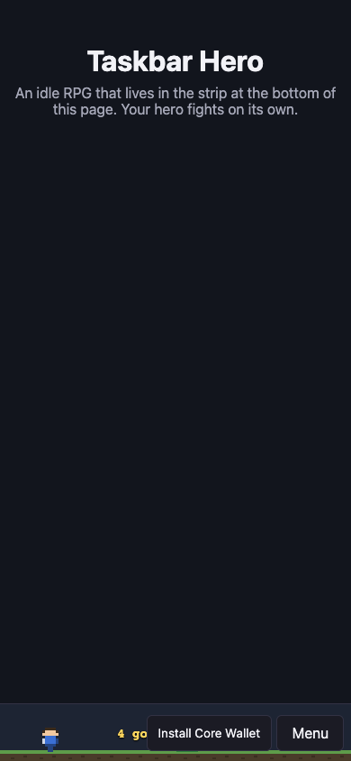 |
| Wallet Connect Button | 390px | Attempted to connect a Web3 wallet from a mobile browser at 390px width. | Mobile browsers do not inject `window.ethereum`; the wallet button renders as a static external link to `https://core.app` without WalletConnect or mobile deep linking, making Web3 authentication impossible on mobile. | major | 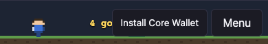 |
| Market | 1280px | Opened the Market tab while testing in demo mode without a connected wallet. | The entire marketplace is locked behind `
Connect your wallet to see your Relics and the market.
`. Unauthenticated players cannot browse listings, inspect token prices, or view relic art. | major | 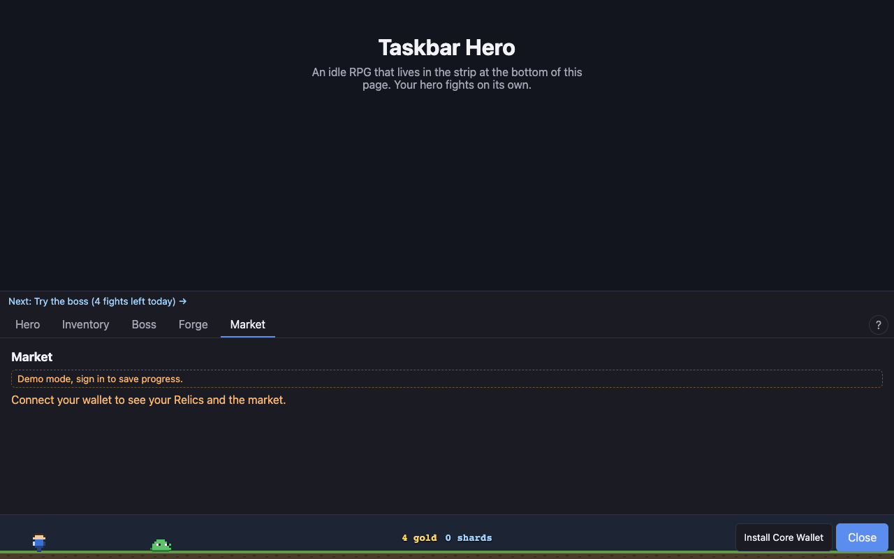 |
| Market | 390px | Opened the Market tab on phone width (390px) without a wallet. | Displays only the single-sentence connection warning; no read-only or demo view is available on mobile. | major | 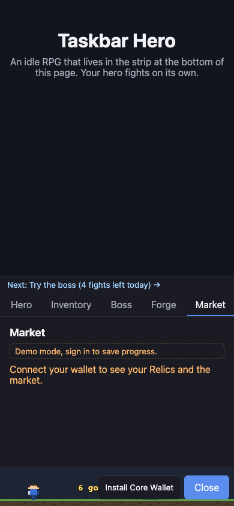 |
| Wallet Connect Button | 1280px | Inspected the wallet button in desktop Chrome when no wallet extension is injected. | Hardcodes an "Install Core Wallet" link to `https://core.app` without offering alternative options (MetaMask, Coinbase Wallet, WalletConnect modal) or explaining why a wallet is needed. | minor | 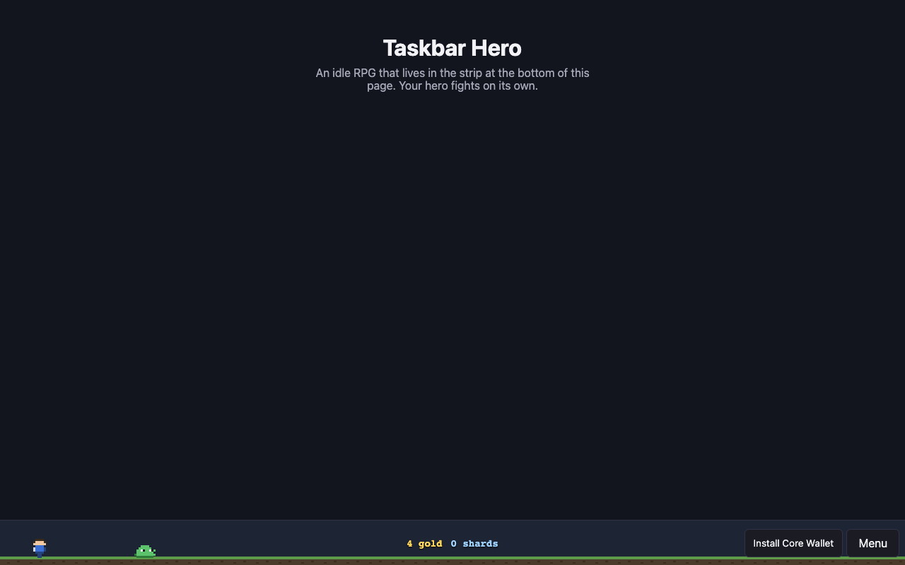 |
| How to Play Dialog | 1280px | Visited the site for the first time. | An intrusive modal dialog with a full-screen dark backdrop auto-opens on page load, blocking all interactions with the idle strip before the player sees the game in action. | minor | 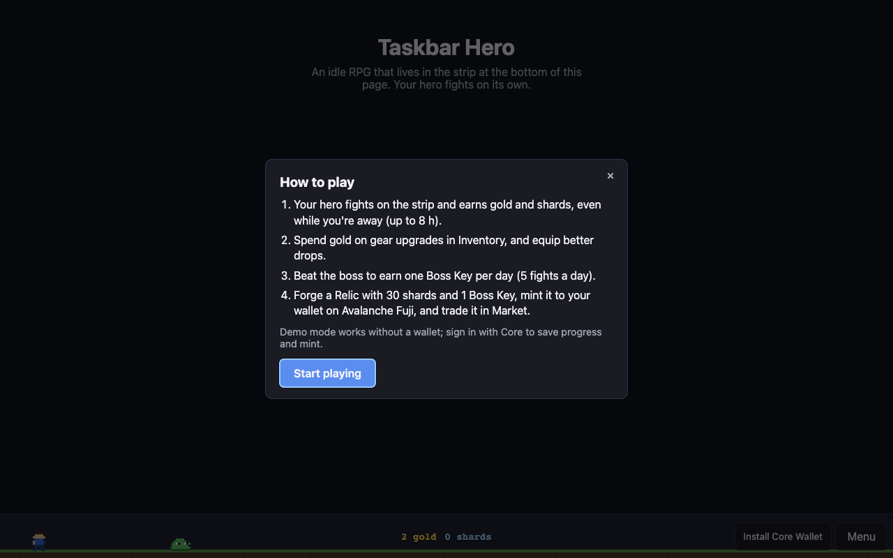 |
| How to Play Dialog | 1280px | Closed the How to Play modal using the "Start playing" button, the "×" button, or the Escape key. | Focus is dumped onto `document.body` instead of transferring to a logical control (such as the Menu toggle or the taskbar strip), leaving keyboard users without context. | minor |  |
| How to Play Dialog | 1280px & 390px | Closed the initial dialog and attempted to find how to review the rules. | There is no Help link on the main page or idle strip; the guide can only be reopened via an unlabelled circular "?" button (`.help-btn`) hidden inside the drawer tab list next to Market. | minor | 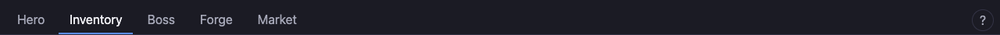 |
| Next-Step Hint | 1280px | Looked for guidance on what to do next while the bottom menu panel was closed. | The next-step hint is completely hidden when the menu drawer is collapsed. Players on the main page receive no visual cue to fight a boss or upgrade gear. | minor |  |
| Next-Step Hint | 390px | Opened the menu panel at 390px phone width. | The next-hint button ("Next: Try the boss (5 fights left today) →") sits above the tabs inside a panel constrained to `min(320px, 55vh)`, reducing usable space for tab content. | minor | 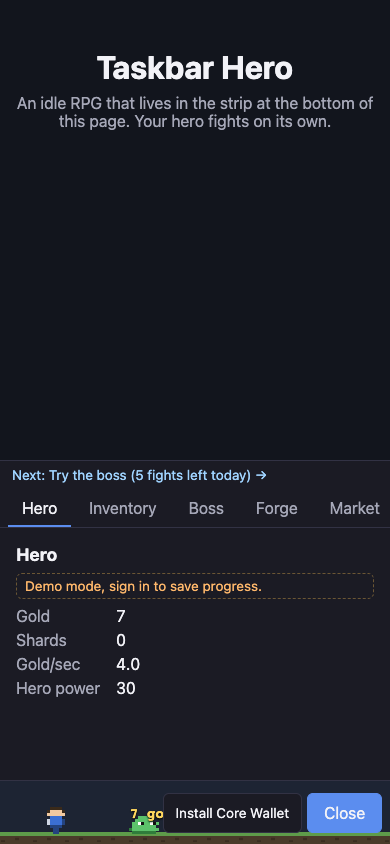 |
| Inventory | 1280px | Opened the Inventory tab with starter equipment. | Displays "Your bag is empty. Your hero picks up new gear while fighting, so check back soon." directly above 4 clearly visible equipped items (Weapon, Armor, Ring, Boots), confusing players. | minor | 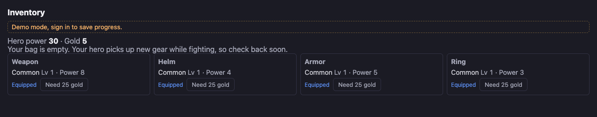 |
| Inventory | 390px | Browsed equipped gear on 390px width. | Panel height constraint (`height: min(320px, 55vh)`) allows only one gear slot card to be visible at a time, requiring excessive scrolling. | minor | 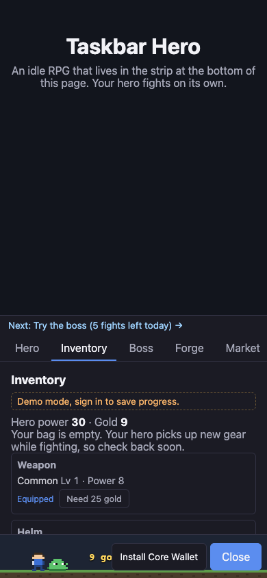 |
| Inventory | 1280px | Evaluated color contrast of the "Equip" button (`.inv-equip`). | White text (`#f2f2f7`) on blue accent background (`#5b8def`) has a contrast ratio of 2.89:1, failing the WCAG AA minimum requirement of 4.5:1 for standard text. | minor | 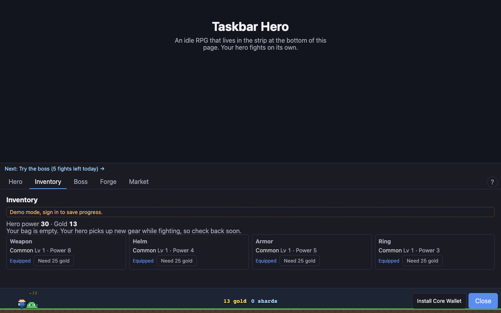 |
| Boss Fight | 1280px & 390px | Checked boss fight rules and daily attempt limits. | Reset notice is hardcoded to "midnight Vietnam time (UTC+7)" without localizing the reset time or displaying a countdown for players in other time zones. | minor | 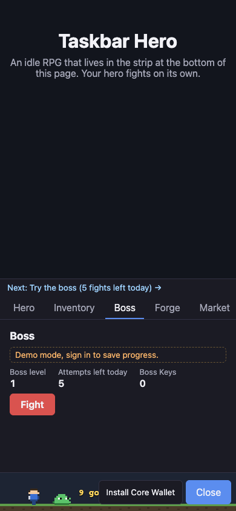 |
| Forge | 1280px | Measured color contrast on the primary "Forge" action button (`.forge-go`). | White text (`#f2f2f7`) on purple background (`#b86bff`) yields a contrast ratio of 2.86:1, failing the WCAG AA requirement of 3:1 for bold graphical interface controls. | minor | 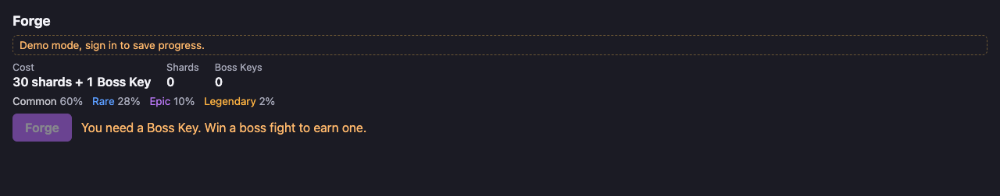 |
| Forge | 1280px & 390px | Earned a Boss Key and examined the shard requirement notice. | Shows "You need 30 shards to forge. Idle on the strip to earn shards." but provides no indication of shard drop probability (10% per kill) or estimated idle time (~20 minutes). | minor | 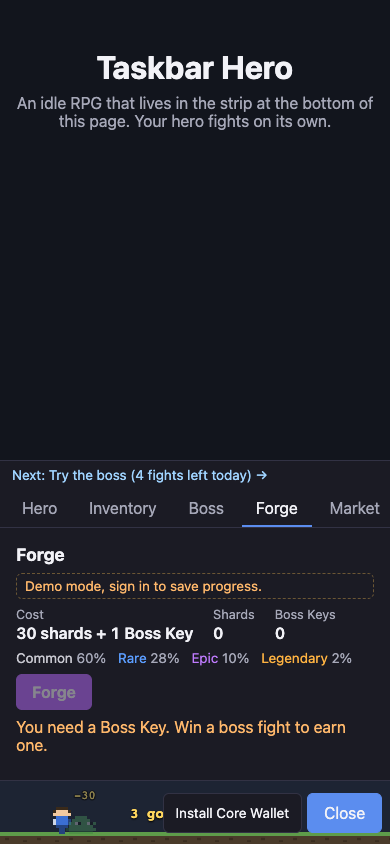 |
| Keyboard Focus | 1280px | Navigated through interactive elements using the `Tab` key. | No explicit `:focus-visible` styles exist in CSS; tabs and buttons rely on browser-default faint outlines (`rgb(153, 200, 255) auto 1px`) which lack clear contrast on dark `#1b1b24` surfaces. | minor | 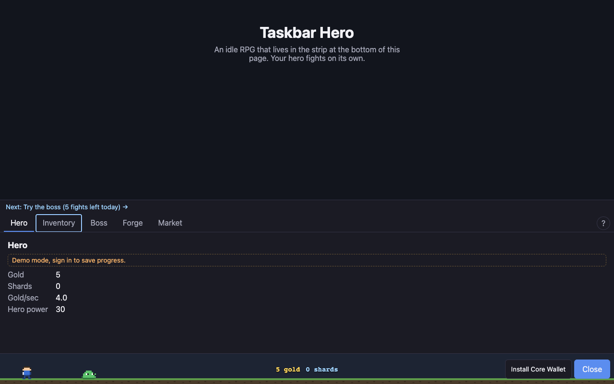 |
| Relic Metadata | N/A | Inspected token metadata fetched from `/relics/3.json`. | Grammatical typo in description: `"A epic Relic forged in Lantern Cat Café..."` instead of `"An epic Relic forged in Lantern Cat Café..."`. | minor | 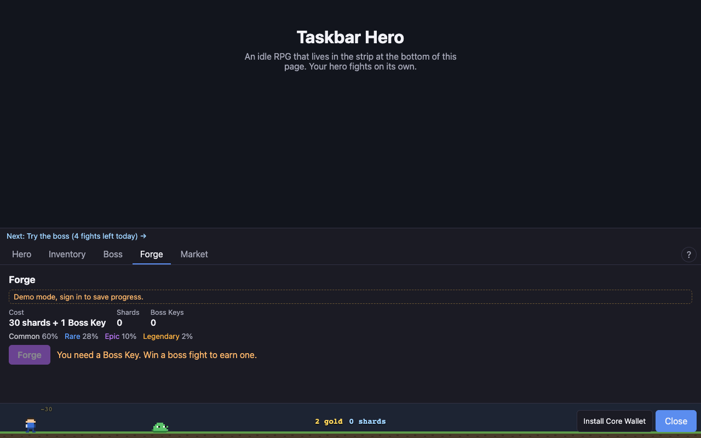 |

---

## Top 5 Fixes in Priority Order

1. **Resolve Mobile Strip Layout Overlap (Idle Strip - 390px)**  
   **Issue**: At phone width (390px), the "Install Core Wallet" button collides with the centered resource counters (`hudOverlapWallet: true`, overlapping by 97px).  
   **Fix**: Update `.strip` layout on screens `<= 560px` to use a flexible multi-row layout or dock the resource counters on the left and the wallet/menu controls on the right, preventing overlapping elements.

2. **Add WalletConnect & Multi-Wallet Support (Wallet Connect Button - Mobile & Desktop)**  
   **Issue**: Users without an injected wallet are locked into an external link pointing to `https://core.app`. Mobile users cannot authenticate at all.  
   **Fix**: Integrate a wallet modal (e.g. Wagmi connectors with WalletConnect / AppKit / RainbowKit) allowing users to connect via MetaMask, Coinbase Wallet, or scan a QR code from mobile wallets.

3. **Provide Read-Only / Demo Browsing for the Relic Market (Market - Mobile & Desktop)**  
   **Issue**: The Market tab is completely empty in demo mode, blocking players from exploring tokens, prices, and marketplace activity.  
   **Fix**: Allow read-only browsing of active Fuji market listings and relic metadata without requiring an active wallet connection, prompting the user to connect only when initiating a Buy, Cancel, or List action.

4. **Correct Action Button Contrast to Meet WCAG AA Standards (Forge & Inventory)**  
   **Issue**: The "Forge" button (`.forge-go`, white on `#b86bff`, ratio 2.86:1) and "Equip" button (`.inv-equip`, white on `#5b8def`, ratio 2.89:1) fail WCAG AA contrast standards.  
   **Fix**: Darken the button backgrounds (e.g., `#7d3cc7` for Forge, `#2f65cc` for Equip) or switch to dark text (`#12151d`) to achieve at least 4.5:1 contrast against button labels.

5. **Clarify Inventory "Empty Bag" Copy and Expand Mobile Drawer Height (Inventory)**  
   **Issue**: Players see "Your bag is empty" while looking directly at 4 equipped items, and the 320px panel height requires heavy scrolling on phones.  
   **Fix**: Change the copy to "No spare gear in your bag. Unequipped drops will appear here." and increase mobile drawer max height (e.g. `min(480px, 80vh)`) to display multiple inventory cards comfortably.
