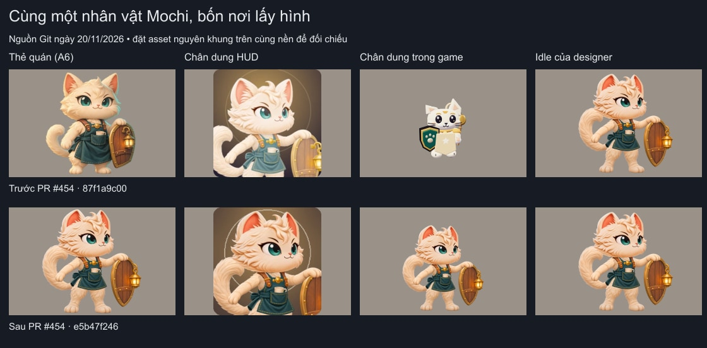

# Hậu kiểm mã nguồn, nhánh và quá trình tích hợp

**Lantern Cat Café, ngày 23/11/2026.** Điểm đáng sửa nhất trong tổ chức code là cùng một ý định của người chơi có thể đi qua nhiều màn và nhiều cách lấy asset. Nhóm từng thêm phần thưởng đúng vào một component, qua được kiểm thử, rồi phát hiện chiến dịch thật dùng component khác. Đây là chi phí của kiến trúc đã quan sát được. Chỉ đếm nhánh sẽ bỏ qua nguyên nhân ấy. [PR thêm phần thưởng](https://github.com/ntbaoheyhey/lantern-cat-cafe/pull/459) · [PR sửa đường chơi thật](https://github.com/ntbaoheyhey/lantern-cat-cafe/pull/468)

## Phạm vi kiểm được

| Phạm vi | Kết quả |
| --- | --- |
| GitHub trực tiếp | Repo public. Đọc ref của main và giải annotated tag `v5-m2.18` về commit `e8abba972`. API cây đệ quy trả đủ 14.488 mục tính cả thư mục. Toàn bộ **13.529 đường dẫn tệp và gitlink** trên main khớp cả tên và mã đối tượng giữa GitHub và bản đọc cục bộ. |
| Nhánh | **581/581 nhánh remote**, trỏ đến 577 commit và 575 cây khác nhau. Có 35 tag. Clone chính có 406 nhánh local, trong đó 74 tên chưa có trên remote hoặc cùng tên nhưng khác tip. Lưu cả tập này. |
| PR, issue, release | **473/473 PR**. Có 278 merged, 192 open và 3 closed chưa merge. 186 PR có base khác main. Đã đọc thêm nội dung chi tiết của 21 PR, lần theo diff và mã của các trường hợp bên dưới. GitHub có 0 issue độc lập và 0 GitHub Release tại lần đọc. Bản thi dùng Git tag. |
| Mức bao phủ ngoài PR | 149 nhánh remote có SHA đầu nhánh khác mọi SHA đầu PR hiện có. Chúng vẫn được quét. Theo quan hệ tổ tiên với main, có 257 nhánh là tổ tiên, 322 nhánh rẽ ra, một nhánh đi trước main và một chính là main. Squash hoặc đưa thay đổi qua nhánh tích hợp có thể giữ nội dung dù hai tip rẽ ra. |
| Toàn bộ lịch sử Git đã đọc | Riêng mọi nhánh và tag remote có 5.568 commit và 103.324 blob riêng biệt. Hợp thêm đầu PR, kể cả đầu lịch sử không còn sẵn trong clone, và nhánh local của dự án được **5.671 commit, 44.421 tree, 103.421 blob**. Đã đọc **32.033.263.864 byte** nội dung giải nén và tính lại Git SHA-1 của từng blob. Tất cả khớp. |
| Mã nguồn | Trong tập hợp trên có **11.763 phiên bản mã nguồn**, tính theo nội dung duy nhất, gồm cả HTML/CSS, script công cụ và bản dựng lưu trong docs. Đã lập chỉ mục nội dung, dấu hiệu gọi API và biến cấu hình cho từng bản. TypeScript 5.9.3 phân tích cây cú pháp của **9.431** phiên bản JS/TS. Python 3.13 phân tích **1.220** phiên bản Python. SQL, Solidity, shell, CSS và các ngôn ngữ khác nằm trong kiểm kê nội dung. |
| Tài sản và phụ thuộc | 44.647 blob được phân loại binary. Hash chứng minh đúng dữ liệu. Đánh giá mắt người tập trung vào các ảnh, phim và cảnh nêu ở báo cáo chính. Hai gitlink thư viện Solidity của bản thi được khôi phục đúng SHA để chạy Foundry. Mã nội bộ của repo bên thứ ba nằm ngoài mẫu số blob của Lantern. |

Một blob được đếm một lần kể cả khi xuất hiện trong hàng trăm nhánh. Phân loại theo một tên đường dẫn đại diện và nội dung đầu tệp. Các gói demo nhúng media trong JavaScript/HTML làm số byte mã nguồn rất lớn. Kết quả về thẩm mỹ, kiến trúc và lỗi dưới đây dựa trên các đường code đọc sâu, ảnh hoặc phép thử riêng. Kiểm tính nguyên vẹn và phân tích cú pháp toàn bộ không thể chứng nhận logic của mọi dòng. [Danh sách 581 nhánh, từng SHA và chênh lệch](inventory/branches.tsv) · [Các con số kiểm toán](inventory/summary.json) · [Snapshot Git và toàn bộ PR](inventory/snapshot.json.gz)

## Sáu phát hiện từ mã và lịch sử

### 1. Các màn cùng mô tả một việc nhưng có thể lệch hành vi

Ở `main`, bộ chọn đầu vào phân biệt năm entry là `depth`, `cardrpg`, `squad3d`, `squad` và `legacy`. Ngay trong game chính vẫn có campaign, đường ghi hình và nhánh dịch vụ được bật qua build flags. PR #459 đặt ưu đãi Moon Collar vào `RouteComplete`. Campaign đang dùng `RouteC2` cho màn kết thúc rút gọn. PR #468 ghi nhận người thử chơi hết chương mà lời mời nhận Relic vẫn chưa xuất hiện trong bản trung gian. Bản thi đã có sửa lỗi và có test màn rút gọn. Đây là ví dụ mạnh nhất để giải thích vì sao test một component riêng có thể xanh trong khi người dùng mất cả phần khác biệt của game. [Bộ chọn entry](https://github.com/ntbaoheyhey/lantern-cat-cafe/blob/f9ad06462/apps/web/src/game-entry-loader.ts) · [Sửa và kiểm đúng luồng](https://github.com/ntbaoheyhey/lantern-cat-cafe/pull/468) · [Test đã thêm](../../../apps/web/src/game/cardrpg/ui-v3/RouteC2Relic.test.tsx)

**Sửa tiếp** bằng một phép thử chấp nhận đi từ URL trần, kết thúc chương, mở Moon Collar, tới trạng thái giữ vật phẩm. Đặt test ở điểm vào người chơi mở. Dùng cùng một bản ghi “thắng chương và đủ điều kiện” cho component chính và đường rút gọn. Các renderer vẫn có thể trình bày khác nhau.

**Cân bằng và trải nghiệm người mới.** Cùng PR #468 còn ghi nhận trong bản trung gian một người thử thua Pantry Crown hai lần khi để hệ thống chờ rồi tự tung chiêu. Bật Auto từ cùng save thì thắng. Nhóm thử thêm tám seed với nâng đồ giữa các chương, Auto thắng 6/8, chính sách chờ hai lượt thắng 0/8. Bản sửa đưa lựa chọn bật Auto ra sau khi thua. Đây là một mẫu nhỏ của bản trung gian, có ý nghĩa về thiết kế hướng dẫn. Với vòng sau, đo một trận người chơi tự canh khiên hoặc hồi máu rồi hỏi họ vì sao thắng. Thắng nhờ bật tự động chưa trả lời được họ có hiểu quyết định chiến thuật hay không. [Kết quả lượt chơi và tám seed](https://github.com/ntbaoheyhey/lantern-cat-cafe/pull/468)

### 2. Vì sao các lớp hình thiếu nhất quán khi ghép vào trận

PR #454 phải thống nhất ngoại hình ba mèo trên **68 tệp**. Trước đó, nhóm ghi nhận battle dùng idle của designer, thẻ quán dùng concept cũ, HUD dùng bộ portrait khác, hình landing và nhiều bộ chân dung trong game còn khác phụ kiện và tỉ lệ. Sau khi đổi hiệu ứng va chạm, PR #457 ghi nhận tia sáng làm lông sáng của Mochi mất chi tiết và hiệu ứng đỏ của boss có thể chồng lên chiêu hồi máu xanh của Clover. Sửa tiếp chỉ chạm hai tệp. Đội đã nhìn thấy và sửa cả hai vấn đề trước bản thi. Dòng lịch sử này ủng hộ việc **duyệt phối hợp nhân vật, nền, hiệu ứng và HUD trong cảnh thật ngay từ pilot**. [Đồng bộ nhân vật](https://github.com/ntbaoheyhey/lantern-cat-cafe/pull/454) · [Điều chỉnh tương phản hiệu ứng](https://github.com/ntbaoheyhey/lantern-cat-cafe/pull/457)

PR #462 cho biết hiện tượng khựng khi tung chiêu giảm từ một lần giữ khung khoảng 1,6–2,0 giây mỗi trận xuống 0 trong phép đo của nhóm. Bản thử trên nhánh `codex/astra-enemy-light-2026-11-21` còn làm viền sáng, bóng tiếp đất và ánh sáng cho 13 dáng địch trên sáu bảng màu. PR #463 mở, tệp `enemy-relight.ts` của nhánh này vắng ở cây main đã công bố. Đây là bằng chứng đội hiểu vấn đề tiếp đất và đã bỏ công xử lý. Chỉ nên tính thử nghiệm đó cho bản đã được tích hợp và duyệt. [Sửa khựng](https://github.com/ntbaoheyhey/lantern-cat-cafe/pull/462) · [Nguồn nhánh ánh sáng](https://github.com/ntbaoheyhey/lantern-cat-cafe/blob/73213fe6bef16ca70050b41199281283aace682f/apps/web/src/game/cardrpg/spine/enemy-relight.ts) · [Phạm vi PR #463](https://github.com/ntbaoheyhey/lantern-cat-cafe/pull/463)

### 3. Một lỗi portrait vẫn quan sát được trên host công khai

Ở bản công bố, hàng thứ tự lượt có thể lấy chân dung địch qua catalog. Băng chiêu ở `scene.ts` lại ghép đường dẫn `/units/<id>/portrait.webp`. Ngày hậu kiểm, GET ảnh của **Teacup Healer** qua đúng quy ước đó trả **404**. GET ảnh đối chứng của **Mochi** trả **200, image/webp**. PR #473 vẫn mở, đã đưa hai nơi về cùng hàm tra ảnh và kiểm cả MIME để trang HTML trả thay ảnh không lọt qua smoke test. Người chơi gặp đúng chiêu có thể mất chân dung trên băng tên. Việc BGK có thấy lỗi này chưa được xác nhận. [Dòng dựng banner của bản thi](https://github.com/ntbaoheyhey/lantern-cat-cafe/blob/f9ad06462/apps/web/src/game/cardrpg/spine/scene.ts#L588) · [Diff và test #473](https://github.com/ntbaoheyhey/lantern-cat-cafe/pull/473) · [Trạng thái HTTP đã ghi](inventory/summary.json)

**Sửa tiếp** bằng cách đưa đường sửa qua vòng duyệt phát hành, kiểm ba động tác của cả đội mình và địch trên **bản build tĩnh**, với ảnh đúng loại và kích thước khác 0. Tập trung vào các điểm sử dụng chung của asset, trước khi tạo thêm một bộ chân dung.

### 4. “Đã từng nhận” và “đang sở hữu” bị gộp trong một thông báo

Khi server trả voucher đã sử dụng, `journeyClient` kết thúc thành công và bỏ qua giao dịch mới. Đây là hành vi tốt cho thao tác thử lại. Nhưng `ConnectedReward` nhận kết quả, đặt `minted = true` và hiện “Your reward is in your Fuji Collection.” Màn này không hỏi số dư ví. Bộ sưu tập ở màn khác có phép đọc đúng. Mình dựng lại đúng component và client tại **tag thi** trong JSDOM, giả lập ví và backend trả voucher đã dùng. Test xác nhận dòng chữ xuất hiện, không hề có lần mint thứ hai hay lần đọc quyền sở hữu. Trên Fuji, ở lần bán #6, số dư thật của bên bán sau giao dịch là 0. Đây là hai phép kiểm độc lập, không phải ghi hình phiên của người bán. [Code retry](https://github.com/ntbaoheyhey/lantern-cat-cafe/blob/v5-m2.18/apps/web/src/game/cardrpg/chain/journey-client.ts#L15) · [Thông báo giao diện](https://github.com/ntbaoheyhey/lantern-cat-cafe/blob/v5-m2.18/apps/web/src/game/cardrpg/chain/JudgeRewardV9.tsx#L33) · [Phép thử tái hiện](ownership-probe.tsx) · [Số dư ở block rút tiền](verification.json)

**Sửa tiếp** bằng một thông báo riêng cho “ví này đã nhận phần thưởng trước đây”. Chỉ đưa ra phát biểu “đang sở hữu” sau khi đọc số dư. Thử trường hợp một người đã nhận, bán rồi quay lại, bên cạnh trường hợp mint lần đầu.

### 5. Ranh giới giữa dựng hình, điều phối game và luật dùng chung đã có chỗ chịu tải

| Mốc đo trên `f9ad06462` | Hệ quả có thể kiểm | Thay đổi vừa đủ |
| --- | --- | --- |
| `spine/scene.ts` có **702 dòng**, 53 dòng khai báo import. Cùng một cảnh lo nạp actor bất đồng bộ, clock, layout, hiệu ứng và băng chân dung. | Các lỗi tia sáng, dừng video và ảnh banner đều gặp nhau trong đường hiển thị này. Số dòng chỉ là tín hiệu. Ba thay đổi cụ thể cung cấp bằng chứng mạnh hơn. | Tách trách nhiệm ở lần sửa kế tiếp. Catalog giải quyết ảnh theo `actor + context`, bộ lấy mẫu trả tư thế, scene dùng kết quả để vẽ. Giữ một ca kiểm tích hợp ở kích thước thật. [Mã scene theo bản công bố](https://github.com/ntbaoheyhey/lantern-cat-cafe/blob/f9ad06462/apps/web/src/game/cardrpg/spine/scene.ts) |
| `depth/model.ts` có **508 dòng**, 19 dòng import. Nó vừa phục hồi save, điều khiển âm thanh, lịch trận và phát thông báo. Biểu diễn trận có nhiều nguồn như gallery, replay, tutorial và run thật. | Một kiểm thử phát lại và một lần chơi từ save thật có thể đi qua nhánh khác. Việc phục hồi save, giữ luật deterministic và chia sẻ kiểu dữ liệu đã hữu ích. | Lúc sửa progression, lập một bảng trạng thái vào/ra cho bốn nguồn trận. Dùng replay ngắn và save cũ làm hai mẫu hồi quy tách biệt. [DepthModel](https://github.com/ntbaoheyhey/lantern-cat-cafe/blob/f9ad06462/apps/web/src/game/cardrpg/depth/model.ts#L142) |
| **148 tệp JS/TS ngoài test** trong `apps/web/src` có chuỗi tham chiếu nội bộ `@taskbar-hero/game-rules/src/`. Build flags và query selector quyết định các lớp khác nhau. | Đổi cấu trúc thư mục hoặc trạng thái nhận thưởng kéo theo nhiều consumer. Bật query của đường quay cũng không bật được backend mint. | Với phần đang sửa, ưu tiên một API xuất công khai cho quy tắc đủ điều kiện, kết quả trận và trạng thái thưởng. Ghi cặp URL/flags vào từng bằng chứng QA. [Entry của campaign](../../../apps/web/src/game/cardrpg/depth/entry.tsx) · [Flags](../../../apps/web/src/game/cardrpg/chain/flags.ts) |
| Hai job lint và typecheck đều nhận tên riêng, nhưng script `lint` của web dùng `tsc --noEmit`. | Hai job xanh chưa bổ sung hai bộ bảo đảm độc lập về chất lượng UI và mã. | Gọi đúng công dụng của job. Dành một kiểm tra riêng cho catalog asset và một ca chơi thật đi qua màn nhận thưởng. [Package web](../../../apps/web/package.json) |

Duy trì ranh giới đã làm đúng. Luật TypeScript có thể chạy lại, Collection đọc trực tiếp ERC-1155 ở Fuji, Supabase chịu trách nhiệm ký và hợp đồng xử lý thanh toán. Ở UI của phần thưởng, team còn viết rõ server chạy lại **thử thách guardian cố định**. Nếu muốn kể rằng Moon Collar là kỷ vật của *chính trận vừa đánh*, có thể lưu một mã trận và bản tóm tắt có thể kiểm ở cùng lúc quyết định trao vòng. Receipt hiện tại chứng minh lần mint và quyền chuyển vật, còn thông tin về quyết định trong trận thuộc lớp khác. [Lời giải thích trong component](../../../apps/web/src/game/cardrpg/chain/GuardianRelicOffer.tsx) · [Hướng dẫn kiến trúc](../../ARCHITECTURE.md)

### 6. Đội đã học, nhưng có lúc người duyệt đang nhìn một sản phẩm khác

Trên nhánh `ag/v5-learn-2026-11-17`, chính đội đã **rút lại năm phát hiện QA** do lần đầu mở giao diện pixel cũ. Lần thứ hai mở đúng URL, nhóm mới ghi nhận hành động đánh thiếu cảm giác chạm và CTA trên mobile khó tìm. Các phát hiện của lần hai chỉ thuộc baseline V5 ở thời điểm đó. Khi đọc cùng sửa lỗi #466 và #468, bài học là phải ghim SHA, URL, chế độ và loại save ngay trên clip mà người duyệt thấy. Đây là một nhánh có tip không trùng bất cứ tip PR nào trong snapshot. [Báo cáo đã rút lại](https://github.com/ntbaoheyhey/lantern-cat-cafe/blob/ebfa22fc8f3903a9ab13d24827015b6af064f8de/reports/v5/AG1/Q0-FINDINGS.md) · [Bản kiểm lại đúng đường](https://github.com/ntbaoheyhey/lantern-cat-cafe/blob/ebfa22fc8f3903a9ab13d24827015b6af064f8de/reports/v5/AG1/Q0b-FINDINGS.md) · [Sửa đường tiếp tục sau trận](https://github.com/ntbaoheyhey/lantern-cat-cafe/pull/466)

**Thứ tự làm lại.** Người phụ trách sản phẩm viết lời hứa của một trận và một kỷ vật. Người phụ trách hình ảnh duyệt clip ở kích thước chơi, có trước và sau tác động. Người tích hợp giữ một URL đại diện, một bản mẫu đầu vào, và yêu cầu mỗi nhánh chứng minh thay đổi trên chính URL đó. Người phụ trách nghiên cứu mời người ngoài nhóm chơi. Mỗi buổi tích hợp nên kết thúc bằng quyết định giữ, sửa hoặc bỏ *một thay đổi người chơi cảm nhận được*. Dọn toàn bộ nhánh cũ hay đổi engine đều không phải điều kiện để bắt đầu.

## Hướng dẫn tra cứu mọi nhánh và mọi phiên bản mã

- [branches.tsv](inventory/branches.tsv) có một dòng cho mỗi nhánh remote, SHA, cây tệp, số đường dẫn source, chênh lệch đường dẫn và quan hệ tổ tiên với main. [tip-results](inventory/tip-results.json.gz) để tra cả tag, PR và đầu nhánh local.
- [snapshot](inventory/snapshot.json.gz) có tên và SHA của mọi nhánh, tag và đầu PR đã dùng. [blob-inventory](inventory/blob-inventory.jsonl.gz) có một mảng trên mỗi dòng theo thứ tự SHA, đường dẫn đại diện, loại, số byte, số dòng ước tính với tệp văn bản. Với SHA bất kỳ, dùng `git cat-file -p SHA` trong repo.
- [code-index](inventory/code-index.jsonl.gz) có một dòng cho mỗi phiên bản source, nhóm dấu hiệu API có trong nội dung và số khai báo top-level/import của JS/TS. Dấu hiệu có thể xuất hiện trong mã thử, comment hoặc bundle. [summary](inventory/summary.json) ghi các giới hạn và kết quả.
- Parser phát hiện hai bản `.mjs` có lỗi cú pháp, đều là output thử lịch sử và không có blob đó ở main. Python 3.13 ghi nhận bốn bản với chẩn đoán cú pháp. Có một blob còn trên main trong `tools/cardrpg-big/a5-drafts/b1-prep/a5-b1-report.py`, là script sinh báo cáo nháp. Đây là bằng chứng về vệ sinh công cụ, không phải lỗi của game khi chơi. [Python bản nháp](https://github.com/ntbaoheyhey/lantern-cat-cafe/blob/f9ad06462/tools/cardrpg-big/a5-drafts/b1-prep/a5-b1-report.py#L46)
- Để tái lập trên clone có đủ Git object, chạy các lệnh dưới. Nếu dùng máy khác, cần lấy các đầu nhánh và refs PR trong snapshot trước. Tệp dữ liệu khóa một thời điểm nên một nhánh được đổi tên sau đó vẫn có thể tra theo SHA. [Mã đọc lịch sử](audit_history.py) · [Mã phân tích source](inspect_source.cjs)

~~~sh
review=docs/retrospectives/unihack-2026
audit_out=$(mktemp -d)
python3 "$review/audit_history.py" tips "$review/inventory/snapshot.json.gz" "$audit_out"
python3 "$review/audit_history.py" history "$review/inventory/snapshot.json.gz" "$audit_out"
node "$review/inspect_source.cjs" "$audit_out/blob-inventory.jsonl.gz" "$audit_out"
~~~

## Lặp lại phép kiểm thông báo sở hữu

Đặt file [ownership-probe.tsx](ownership-probe.tsx) vào thư mục tạm dưới tên `case.test.tsx`. Thư mục tạm dùng liên kết `src` đến `apps/web/src` và `node_modules` đến `apps/web/node_modules` của checkout đã cài đúng tag. Chạy Vitest trong JSDOM. Phép thử chỉ giả lập nguồn đăng nhập, backend và ví. Component thưởng và hàm xử lý voucher là mã dự thi. Kết quả của hậu kiểm là **1/1 tái hiện được thông báo sai trạng thái sở hữu**, không có yêu cầu giao dịch hoặc chữ ký mới. [Hành vi client](https://github.com/ntbaoheyhey/lantern-cat-cafe/blob/v5-m2.18/apps/web/src/game/cardrpg/chain/journey-client.ts)

## Sau khi dọn máy

Kiểm kê ghi đúng các đầu nhánh tại thời điểm hậu kiểm. Các đối tượng từng chỉ tồn tại local có thể không có trên clone mới từ GitHub. Bản tag thi và các commit công khai được dẫn trong báo cáo vẫn là nguồn dùng để đối chiếu. Gói source bổ sung của đợt đóng dự án giữ riêng các biến thể mã văn bản tìm thấy ngoài lịch sử công khai; chúng chưa được chứng nhận là một bản game có thể build.
