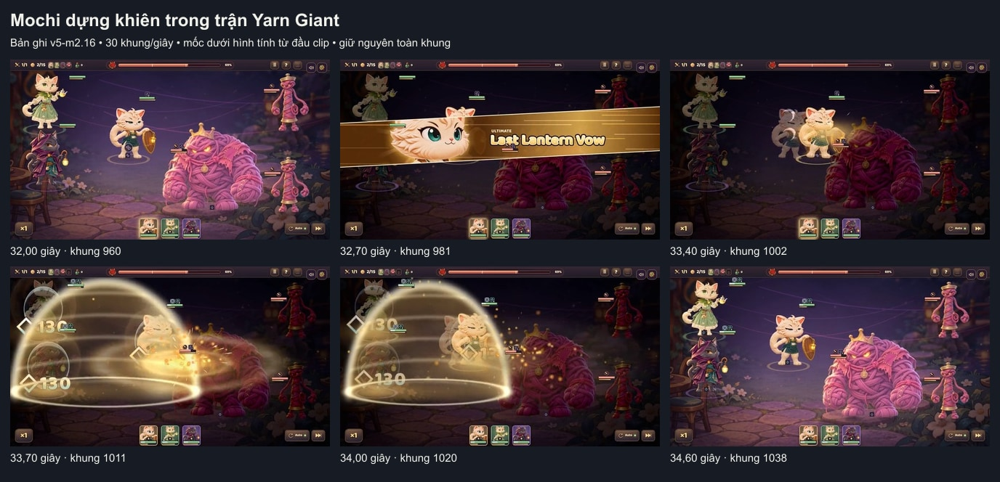
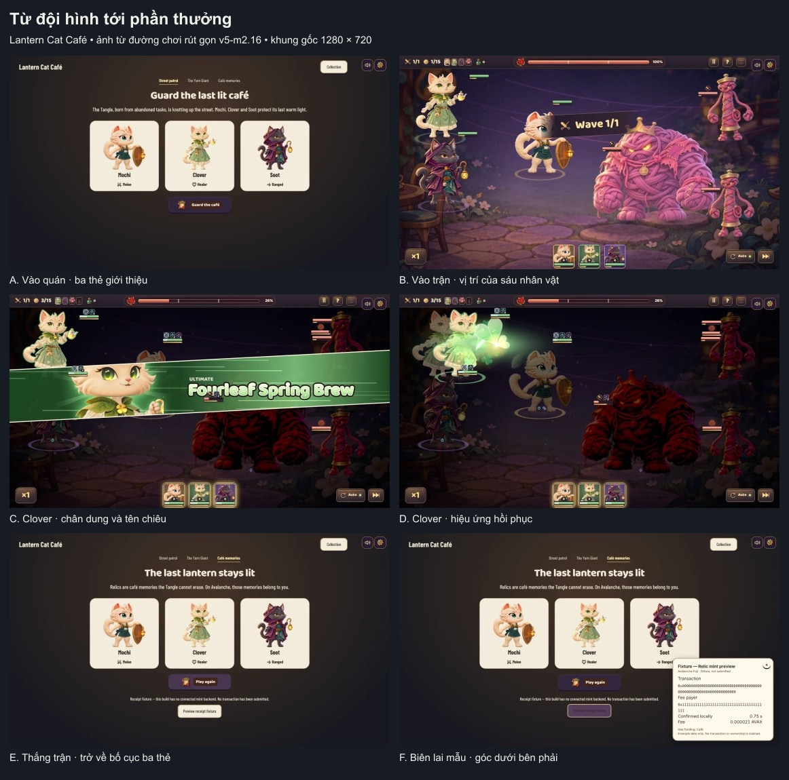

# Lantern Cat Café · Hậu kiểm UniHack 2026

**23/11/2026 · Vòng chọn Top 10 · Bản game dự thi `v5-m2.18`.** Đội xác nhận đã nộp đúng. Team1 công bố mười dự án vào chung kết, trong đó không có Lantern Cat Café. Ngày 30/11 là ngày thi chung kết của mười đội đó. Hậu kiểm này đánh giá những gì một người ngoài có thể thấy ở sản phẩm. Động cơ của từng giám khảo, điểm của đội và điểm cắt vẫn là dữ liệu chưa có. [Thông báo chính thức của Team1](https://x.com/Team1VN/status/2124850456241348847) · [Lịch chung kết](https://luma.com/dar03gfl) · [Bản phát hành](https://github.com/ntbaoheyhey/lantern-cat-cafe/tree/v5-m2.18)

## Kết luận của mình

**Bạn nhìn đúng một vấn đề thị giác.** Khi Mochi dựng khiên, người xem thấy vòm vàng, tên chiêu và lượng khiên rất rõ. Khó thấy hơn là khoảnh khắc chính con mèo ghì chân, chịu lực rồi đẩy khiên. Game thật sự di chuyển nhân vật. Cách dựng khiến phần lớn thay đổi dễ nhìn nhất nằm ở các lớp bao quanh cơ thể. Thêm một vòng hiệu ứng hoặc làm bộ lông chi tiết hơn sẽ ít tác động tới cảm giác này. [Sáu khung của Mochi](figures/02-mochi.jpg)

**Giả thuyết có sức giải thích tốt nhất cho kết quả vòng loại là khoảng cách giữa điều đội làm được và điều người lạ nhận ra.** Người chơi phải hiểu trong thời gian ngắn rằng quyết định của mình có ý nghĩa, rằng phần thưởng đáng giữ và rằng Avalanche giúp họ làm được một việc có giá trị. Bản công khai cho bằng chứng thuyết phục về vế cuối ở mức kỹ thuật. Bằng chứng về hai vế đầu mỏng hơn. Độ cứng của trận đánh ảnh hưởng trực tiếp tới niềm tin vào *phần thưởng của trận đó*. Cộng cả hai vấn đề lại có sức giải thích lớn hơn việc quy kết mọi chuyện cho chất lượng tranh. [Hướng dẫn chơi và receipt công khai](https://github.com/ntbaoheyhey/lantern-cat-cafe/blob/f9ad06462/README.md) · [Phạm vi nghiên cứu của đội](../../design/cardrpg/RESEARCH.md)

**Mình sẽ sửa thứ tự đầu tư.** Đội đã lập kế hoạch, nghiên cứu và duyệt thử. Điều còn thiếu trong bằng chứng mình đọc là một trận mẫu đủ ngắn, có tiêu chuẩn cảm nhận do người ngoài xác nhận và có quyền chặn việc sản xuất hàng loạt. Mình sẽ giữ ba nhân vật, thế giới quán đèn và đường nhận Moon Collar. Việc đầu tiên sẽ là làm cho một người mới hiểu *một quyết định trong một trận* và muốn giữ kỷ vật của trận ấy. [Pilot mỹ thuật đã duyệt](../../art-direction.md) · [Bộ quy chuẩn hình ảnh](../../design/cardrpg/LOOK-BIBLE.md) · [Sổ kiểm chứng và cách chạy lại](EVIDENCE.md)

**Phạm vi GitHub đã kiểm.** Đã duyệt toàn bộ 581 nhánh remote, 35 tag và 473 PR, gồm 149 nhánh có tip khác mọi tip PR hiện tại. Cây main khớp GitHub ở cả 13.529 đường dẫn và mã đối tượng. Toàn bộ lịch sử khả dụng cùng đầu PR và nhánh local của repo cho 103.421 phiên bản tệp. Trong đó có 11.763 phiên bản source đã lập chỉ mục nội dung. Sổ riêng ghi cách đọc, những phần đã đọc sâu và những lỗi tái hiện được. [Hậu kiểm mã nguồn và tích hợp](GITHUB.md) · [Từng nhánh và SHA](inventory/branches.tsv)

## 1. Vì sao game có chuyển động mà vẫn trông cứng?

Ở **32,00 giây**, nhìn hướng mặt, chân và góc khiên của Mochi. **32,70 giây**, băng chân dung lấy phần giữa màn hình. **33,40 giây**, Mochi lao lên, có bóng lưu phía sau. **33,70–34,00 giây**, vòm sáng và các số 130 cho biết cả đội được bảo vệ. **34,60 giây**, mèo về vị trí. Mình đọc được *kết quả của chiêu* ngay. Nếu chỉ nhìn vai, chân và mặt khiên, mình khó phân biệt lúc chuẩn bị, lúc dồn lực và lúc chịu phản lực. Đòn phòng thủ vẫn cần trọng lượng, ngay cả khi mục tiêu của nó là đồng đội. [Clip gốc 57,93 giây](../../demo-v5-m2.16/demo.mp4)

Mã giải thích được điều đang thấy. Đường hiển thị của Mochi, Clover và Soot đặt video nhân vật lên một mặt phẳng. Khi tung chiêu, vòng idle có thể tiếp tục ở hệ số **0,25**. Hàm lấy mẫu phần thân nhận tên động tác nhưng giao việc phát hình cho video. Cảnh chiến đấu vẫn có nhịp chuẩn bị, lao, giữ và thu về qua vị trí, góc và tỉ lệ của toàn thân. Vậy đội đã chữa được hiện tượng nhân vật ngừng thở khi tung chiêu. Một vai hạ xuống, bàn chân chống lên sàn hay cánh tay đổi góc theo sức nặng lại cần tư thế riêng. Tệp điều khiển video có cùng Git blob ở `v5-m2.16` và `v5-m2.18`. Kết luận này áp dụng cho đường hiển thị đang xét. [Bộ phát video nhân vật](https://github.com/ntbaoheyhey/lantern-cat-cafe/blob/v5-m2.18/apps/web/src/game/cardrpg/spine/designer-video.ts#L95) · [Chuyển động toàn thân](https://github.com/ntbaoheyhey/lantern-cat-cafe/blob/v5-m2.18/apps/web/src/game/cardrpg/spine/scene.ts#L418)

Đội ghi nhận không còn lần đứng idle từ 100 ms trở lên trong phép thử được công bố. Video minh họa được ghi ở 1280 × 720, tiến đồng hồ chính xác 1/30 giây mỗi khung và không chứa track âm thanh. Nó cho phép xét tư thế và bố cục. Đo giật khung trên máy giám khảo hoặc độ khớp giữa tiếng va và hình cần phép đo khác. README cũng ghi rõ có tranh và idle của designer. Cụm “trông như AI” ở đây mô tả ấn tượng khi các lớp ghép lại. Nó không xác định ai làm một bức tranh. [Bản ghi và điều kiện đo](../../demo-v5-m2.16/index.html) · [Credits của bản công bố](https://github.com/ntbaoheyhey/lantern-cat-cafe/blob/f9ad06462/README.md#credits)

| Chỗ nhìn | Mình thấy gì | Hướng sửa đầu tiên |
| --- | --- | --- |
| Vào quán và sau khi thắng, A và E | Ba mèo có hình dáng riêng dễ nhận ra. Cả hai màn giữ cùng ba thẻ trắng, cùng kích thước và vị trí. Dòng tiêu đề thay đổi nhiều hơn chính cảnh quán. Chiến thắng ít để lại dấu vết thị giác. | Dùng lại đúng góc máy của quán. Khi thắng, đèn sáng lên, Moon Collar xuất hiện trên vòng cổ hoặc trên móc trưng bày, rồi người chơi mới chọn giữ. |
| Sàn đấu, B | Ba mèo ở ba cao độ, có vòng chân rõ. Đặc biệt ở mèo phía trên bên trái, vòng xác định ô đứng dễ đọc hơn mặt sàn đỡ bàn chân. Nền có phối cảnh, hoa và đá. Các thân nhân vật vẫn có cảm giác được đặt lên từng ô. | Chốt một đường chân trời, vị trí chân và bóng tiếp xúc cho từng hàng. Duyệt cảnh với một mèo và một địch, ở kích thước chơi thật, trước khi thêm trang trí. |
| Clover, C và D | Băng xanh và chân dung đẹp, đọc rõ tên chiêu. Ở khung tiếp theo, lá sáng thu hút mắt về Clover. Để biết đồng đội nào vừa hồi máu, mắt phải rời điểm sáng và tìm các thanh trạng thái nhỏ. | Giữ chiếc lá làm dấu hiệu của Clover. Cho luồng sáng kết ở người nhận, đồng bộ với lượng HP đổi và một phản ứng cơ thể ngắn. |
| Điều khiển trong trận | Chân dung dưới giữa màn hình là nơi người chơi tác động. Tên chiêu, thanh máu và hiệu ứng lớn lại ở ba vùng khác. Mức độ nổi bật của nút quyết định thời điểm tung chiêu còn thấp ở nhiều khung của đoạn phim. | Đưa một dấu hiệu sẵn sàng dễ nhận từ chân dung tới đúng nhân vật. Thử xem người mới tự bấm khi boss báo đòn và giải thích được vì sao vừa bấm. |
| Thưởng và ví, E và F | Ở đoạn quay rút gọn, “Play again” nằm giữa và biên lai mẫu hiện góc dưới. Một vật phẩm vốn là điểm khác biệt của game kết thúc bằng một hộp văn bản kỹ thuật nhỏ. | Cho người chơi nhìn thấy vật vừa nhận và hai trạng thái “đã kiếm được” và “đã ở trong ví”. Để hash, phí và explorer trong chi tiết có thể mở. Giữ nhãn mô phỏng khi dùng fixture. |

Đây là **đường quay rút gọn**. URL trần của game mở chiến dịch ba chương. Mình cũng so bộ ảnh arena ngày 20/11. Nền Garden tạo khoảng thoáng và tách mèo cho người xem tốt hơn cảnh thảm gỗ cũ. Đó là phần làm đẹp có hiệu quả. Thay nền vẫn để nguyên kiểu đứng và cách đặt quân. Riot mô tả hai tiêu chí phù hợp với chính ví dụ này là nhận ra động tác qua chuỗi tư thế và để sự kiện quan trọng nhất giành sự chú ý. [Ảnh trước](../../arena-2026-11-20/before.jpg) · [Ảnh Garden](../../arena-2026-11-20/garden.jpg) · [Riot về diễn hoạt](https://www.riotgames.com/en/artedu/character-animation) · [Riot về độ dễ đọc trong trận](https://www.leagueoflegends.com/en-us/news/dev/clarity-in-league/)

**Có một điểm hình ảnh đội đã sửa rất tốt.** Đặt bốn hình Mochi trước PR #454 cạnh nhau: chân dung HUD là mèo lông sáng, hình trong bộ cardrpg3 là mèo khối với khiên xanh, còn idle của designer có khiên gỗ và đèn treo. Sau PR, tai, búi tóc, chiếc tạp dề và khiên trở nên nhất quán giữa các nguồn. Tấm so này giúp xác định khoản công đã có ích. Nó cũng cho thấy sau khi thống nhất diện mạo, việc tiếp tục vẽ lại chân dung sẽ không giải quyết được tư thế khi đỡ đòn. [So trực tiếp bốn asset trước và sau PR #454](figures/03-mochi-qua-cac-man.jpg)

## 2. Đội có thực sự đi sai từ đầu?

| Mốc giờ Việt Nam | Quyết định hoặc kết quả có dấu vết | Ý nghĩa khi nhìn lại |
| --- | --- | --- |
| 23–28/10 | Khởi đầu là idle RPG ở mép màn hình. Có React/Phaser, luật dùng chung, Supabase, hợp đồng Relic và thị trường. Ngày 28/10 đội duyệt pilot pixel rồi mở rộng ra các chương. | Lời hứa “chơi cạnh công việc” và góc nhìn ngang từng cho cả đội một giới hạn thiết kế cụ thể. [Bản đầu](https://github.com/ntbaoheyhey/lantern-cat-cafe/tree/683ad53) · [Pilot](https://github.com/ntbaoheyhey/lantern-cat-cafe/commit/25bd76bfa) |
| 29/10–03/11 | Làm lại shell, Bag, Forge, màn mở đầu, khả năng phục hồi và kiểm chứng Fuji. Ngày 03/11 đã có bản chuẩn và bản nháp dành cho người đánh giá. | Đội có kỷ luật kiểm chứng từ sớm. Nhiều bằng chứng giai đoạn này phục vụ sản phẩm idle cũ. [Giao diện ngày 03/11](https://github.com/ntbaoheyhey/lantern-cat-cafe/tree/340f88b92) |
| 04–09/11 | Chuyển sang tổ đội, turn combat và sân khấu 3D. Bản nghiên cứu ngày 06/11 khảo sát **34 game**. Ngày 07/11 đã có quy chuẩn về chất liệu, silhouette, ánh sáng, góc máy và độ tương phản. | Đội **đã cho AI đi học**. Nghiên cứu dựa vào tài liệu của các game. Việc chuyển từ nhân vật tí hon trên một dải màn hình sang đội mèo chiếm cả màn hình làm đổi bài toán diễn xuất, điều khiển và lý do mở game. [Quyết định tổ đội](../../design/squad-slice-2026-11-05.md) · [Nghiên cứu](../../design/cardrpg/RESEARCH.md) · [Quy chuẩn](../../design/cardrpg/LOOK-BIBLE.md) |
| 10–16/11 | Mở rộng thiết bị, chiêu, cân bằng, hoạt họa, âm thanh và QA. Trong đợt thử ngày 16/11, 20/20 hành trình tự động qua được trên Anvil/SQL cô lập. | Đội đo được độ ổn định của luồng. Một script luôn biết chỗ bấm. Nó không cung cấp tỉ lệ người lạ tự tìm ra chỗ đó. [Bằng chứng của đợt thử](https://github.com/ntbaoheyhey/lantern-cat-cafe/blob/d89b61ab3ddd73659f45158d1abe5835b9445b81/reports/v4-ship/S4/final-journeys-1.json) |
| 17–19/11 | Chuỗi tag v5, các đợt tối ưu idle, âm thanh, hiệu ứng, bản ghi và mô hình kinh tế. Ngày 19/11 đã mint và list trên Fuji. Lần thử đó dừng trước bước mua và ghi rõ trở ngại ở ví tài trợ và cấu hình. | Nhật ký cho phép phân biệt sản phẩm đang được dựng với những gì môi trường công khai đã chạy. [Lịch sử tag](https://github.com/ntbaoheyhey/lantern-cat-cafe/tags) · [Đối soát Fuji](../../avalanche/LIVE-E2E.md) |
| 20–21/11 | Hai ngày có **20 commit trên tuyến tích hợp chính `--first-parent`**. Chốt nền trận, hiệu ứng, idle, thu lại cảnh trailer, hoàn tất giao dịch, gắn tag dự thi lúc 11:12 và cập nhật trang giới thiệu lúc 21:38 ngày 21/11. | Phần nhìn thấy đầu tiên và phần minh chứng chain cùng được hoàn thiện sát nhau. Điều đó tạo áp lực quay và kiểm lại. Số commit không cho biết số giờ hay số token dành cho từng việc. [Bản tag](https://github.com/ntbaoheyhey/lantern-cat-cafe/commit/e8abba972) · [Bản giới thiệu cuối](https://github.com/ntbaoheyhey/lantern-cat-cafe/pull/472) |
| 23/11 | Team1 công bố danh sách vòng chung kết. | Mốc kết thúc của đội là vòng tuyển chọn online. Bài pitch sân khấu ngày 30/11 không thể là nguyên nhân của kết quả này. [Team1](https://x.com/Team1VN/status/2124850456241348847) |

**Điều mình đồng ý với bạn** là tiêu chuẩn “đẹp và có hồn” cần thành một vật mẫu có thể bác bỏ. **Điều mình nhìn khác** là đội đã có nhiều kế hoạch và đã làm nhiều chi tiết riêng. Pilot pixel thậm chí có tiêu chí silhouette. Bộ quy chuẩn sau đó chỉ định ánh sáng, chất liệu và tỉ lệ đầu. Lựa chọn khó hơn là khi đổi thể loại hoặc cách dựng, ai có quyền xem một đoạn mười giây và nói “cảm giác phòng thủ vẫn chưa ra, quay lại pose”. Mình không có căn cứ để kết luận bạn không biết mình muốn gì. Có bằng chứng rằng lời hứa sản phẩm và cách thể hiện đã đổi trong lúc quy mô sản xuất tăng. [Thiết kế động tác cũ](../../art-direction.md) · [Định hướng trận tự động](../../design/cardrpg/RESEARCH-ADDENDUM-AUTO.md) · [Thay đổi idle ngày cuối](https://github.com/ntbaoheyhey/lantern-cat-cafe/commit/3eebbb8fa)

Với Codex và Claude, một đặc tả như “vòm khiên xuất hiện, có sự kiện, khung video tiếp tục thay đổi” là việc kiểm được. “Mochi trông như đang lấy thân che cho bạn” đòi hỏi chọn giữa các tư thế, nhìn toàn cảnh ở tốc độ chơi và xem người khác có đọc đúng không. Model mạnh có thể sản xuất nhiều phiên bản rất nhanh. Nếu người duyệt chỉ nhận một loạt ảnh tĩnh hoặc báo cáo đạt test, tăng lượt sinh cũng có thể chỉ làm chi tiết của hướng cũ đẹp hơn. Đây là suy luận từ cách dựng và kiểm tra trong repo. Nhật ký phiên và chi phí riêng tư nằm ngoài phạm vi hậu kiểm.

## 3. Giải thích kết quả vòng loại theo mức độ bằng chứng

| Giả thuyết | Căn cứ và ảnh hưởng | Điều có thể làm đổi nhận định |
| --- | --- | --- |
| **Ưu tiên 1 · Giá trị đối với người chơi chưa được chứng minh tương xứng** | Có bằng chứng mạnh về ai giữ vật sau giao dịch. Nghiên cứu 34 game ghi rõ phạm vi nghiên cứu tài liệu. Hồ sơ doanh thu của đội ghi nhận 0 USD tại thời điểm lập. Mình chưa thấy số người chơi ngoài nhóm, tỉ lệ quay lại hoặc bao nhiêu người tự muốn giữ/chuyển Moon Collar trong các tài liệu kiểm. Hai tiêu chí Impact và Creativity cộng lại 30 điểm. | Dữ liệu trước cuộc thi về người tự quay lại, giao vật cho bạn hoặc lời phỏng vấn cụ thể sẽ làm giả thuyết yếu đi. [Nghiên cứu](../../design/cardrpg/RESEARCH.md) · [Giá trị và doanh thu](../../v4/REVENUE-AND-VALUE.md) |
| **Ưu tiên 2 · Bằng chứng Avalanche mạnh nhưng đến muộn trong trải nghiệm** | URL mặc định đưa người chơi vào ba chương, mỗi chương bảy điểm dừng. Moon Collar xuất hiện sau boss chương 1. Có đường rút gọn cùng receipt nổi bật ngay đầu README. Bản dựng trailer hai phút trong Git dành 55–75 giây cho phần sở hữu và lần đầu lời đọc nhắc Avalanche ở khoảng **60,1 giây**. Khi đọc README, một giám khảo có thể thấy proof ngay. Người chỉ xem đầu phim hoặc chơi URL trần trải nghiệm khác hẳn. | Nếu người chấm mở receipt trước, hoặc slide thực tế đã làm rõ người nhận và ích lợi ngay đầu, ảnh hưởng này nhỏ hơn. Mốc phim thuộc kịch bản dựng, không phải lịch sử xem của BGK. [Đường chơi](../../../apps/web/src/game-entry-loader.ts) · [Bản dựng trailer](https://github.com/ntbaoheyhey/lantern-cat-cafe/blob/0b576bdfc618e2d898639c41b08f77a56c112da9/trailer/VO-SCRIPT.md) |
| **Ưu tiên 3 · Diễn hoạt và thứ tự thị giác làm quyết định chiến đấu kém nổi bật** | Động tác của mèo chưa truyền đủ trọng lượng so với hiệu ứng. Màn thưởng dành nhiều chỗ cho ba thẻ quen thuộc. Điều này có thể ảnh hưởng cả UI/UX, ấn tượng sáng tạo và khả năng người chơi muốn giữ phần thưởng. Bản thân game vẫn có cá tính ở chủ đề quán, vai trò ba mèo và màu chiêu. | Một thử nghiệm mù cho thấy người mới nhận đúng mục tiêu, thời điểm bấm và hậu quả sẽ giảm mức ưu tiên của giả thuyết. Điểm số UI thực tế chưa được công bố. [Khung hình kiểm chứng](figures/01-giao-dien.jpg) |
| **Ưu tiên 4 · Vòng lặp phần thưởng có điểm căng với hướng dẫn của BTC** | Bộ dữ liệu ý tưởng Team1 mô tả phần thưởng theo hành vi hoặc thời gian và nêu giới hạn với phần thưởng ngẫu nhiên. Game có gacha bằng Bells, bảng xác suất và vật rơi ngẫu nhiên. Bells gắn với tài khoản, đầu ra gacha khoá giao dịch, còn boss trao cố định Moon Collar số 3. Bốn điều này phải được xét cùng nhau. | Trang ý tưởng cho phép đề xuất riêng. Tệp công khai hiện có dấu tạo ngày 23/11, mình chưa xác minh được cùng câu chữ trước hạn nộp hoặc cách BGK áp dụng vào loot ngoài chuỗi. Chỉ BTC mới xác nhận được tác động tới chấm điểm. [Hướng dẫn và tiêu chí](https://team1vn.xyz/topics.json) · [FAQ](https://team1vn.xyz/#faq-submit) · [Luật kinh tế game](../../ECONOMY.md) |
| **Yếu tố góp phần · Phạm vi lớn làm tăng chi phí đổi hướng** | Pixel idle, tổ đội, hoạt họa, nhiều đồng tiền, chợ, ba chương và video đều có kết quả hữu hình. Mỗi lần đổi hình thức chiến đấu kéo theo phải làm lại HUD, góc quay, chuyển động và kịch bản giới thiệu. Bản phác mười slide trong repo dành phần lớn câu chuyện đầu cho thế giới và trận đánh. | Đây là nhận định về chi phí phối hợp. Chỉ bảng thời gian, chi phí theo việc hoặc phản hồi của đội mới định lượng được phần lãng phí. Bản phác slide không đại diện cho toàn bộ deck đã nộp. [Phác thảo slide](../../submission/SLIDES-OUTLINE.md) · [Quy chuẩn cũ và mới](../../design/cardrpg/LOOK-BIBLE.md) |

### Sáu tiêu chí của Team1

| Tiêu chí | Điểm tối đa | Ưu thế đội đã có | Câu hỏi cần trả lời tốt hơn |
| --- | ---: | --- | --- |
| Technical Implementation | 25 | Luật chiến đấu dùng chung, dịch vụ xác thực, voucher, hợp đồng và CI có kiểm thử. | Người đánh giá có thể tự lần theo một hành động từ nút bấm đến kết quả trong một phút không? |
| Avalanche Integration | 25 | Mint thật, chợ ký quỹ, mua bằng ví khác, rút tiền và số dư ERC-1155 kiểm được. | Người chơi cần quyền nào ngoài game và vì sao chọn hạ tầng này? |
| Creativity & Innovation | 15 | Quán đèn, thế giới bị “sợi rối” xâm chiếm và ba mèo có đạo cụ dễ nhớ. | Cơ chế nào chỉ nhìn mười giây là nhận ra đây là Lantern? |
| Impact & Use Case | 15 | Chơi trước, nhận quyền sở hữu sau, có thể dùng ví khách được cấp gas thử nghiệm. | Có người nào chủ động giữ, tặng hoặc quay lại dùng vật phẩm sau lần thử đầu? |
| Presentation & Pitching | 10 | Có trailer được dựng, lời đọc, kịch bản và proof thật. | Ai gặp vấn đề gì, và tại sao họ quan tâm tới chiếc vòng ngay từ đầu? |
| UI/UX & Demo | 10 | Đường chơi rút gọn, diễn biến và trạng thái fixture được ghi rõ. | Người mới có nhìn ra lúc cần bấm, ai được che và đã giữ món gì? |

Đây là trọng số công bố, không phải điểm tự chấm. Trong dữ liệu Team1, 25 điểm Avalanche còn có các mục về sử dụng thiết thực, triển khai hợp đồng, chọn hạ tầng, chất lượng tích hợp và giá trị rõ ràng. Số lượng hợp đồng chỉ trả lời được một phần các câu hỏi ấy. Fuji là lựa chọn BTC chấp nhận. [Thể lệ Team1](https://team1vn.xyz/) · [Chi tiết tiêu chí](https://team1vn.xyz/topics.json)

**Hai ví dụ từ Top 10.** Với Commitment Stake, người tổ chức sự kiện gặp vấn đề người đăng ký rồi vắng mặt. Tiền đặt cọc và điều kiện xác nhận tham dự có liên hệ trực tiếp với vấn đề. Với FleetShares, người xem theo được một khoản tiền thuê xe đi tới quản lý và những người giữ phần sở hữu như thế nào. Từ README của chính họ, có thể nêu người dùng, sự thay đổi quyền lợi và phép kiểm bằng một câu. Với Lantern, câu có thể kiểm ngay là “Mình thắng trận, ví khác xác minh được chiếc vòng, và mình có thể chuyển nó cho một người bạn.” Phần còn thiếu bằng chứng là vì sao người bạn muốn nhận nó. Danh sách finalist không cho biết thứ tự điểm hay lý do chọn hai đội. [Công bố của BTC](https://x.com/Team1VN/status/2124850456241348847) · [Commitment Stake](https://github.com/huyle85/Commitment-Stake/blob/ef958354b8558cef5d7b822114cc4cba05bf6e1d/README.md) · [FleetShares](https://github.com/kongou2002/rwa-fleet/blob/3cc9666d20dae9cdb49e871c10173caf042fe75c/README.md)

## 4. Phần kỹ thuật đáng giữ và phần cần đơn giản hóa

- **Game và giao diện.** Vite/React/TypeScript dựng giao diện. Three.js, Spine và media của nhân vật dựng trận hiện hành. Phaser thuộc đường chơi cũ. Chiến đấu tự động với lựa chọn thời điểm tung chiêu, đội hình và trang bị. Cổng vào, campaign, đường quay rút gọn và legacy được phân biệt trong mã. Tách engine luật khỏi bộ dựng hình cho phép sửa tư thế mà vẫn giữ kết quả chiến đấu. [Kiến trúc](../../ARCHITECTURE.md) · [Mã chọn đường vào](../../../apps/web/src/game-entry-loader.ts)
- **Biên giới tin cậy.** Save của chiến dịch nằm ở trình duyệt. SIWE xác thực ví. Supabase chạy lại thử thách thưởng cố định, cấp voucher EIP-712 gắn với người nhận. Chủ ví gọi mint. Trang Collection có thể đọc số dư trực tiếp từ Fuji. Phép kiểm trial của server và lịch sử từng cú bấm trong cả chiến dịch là hai loại bằng chứng khác nhau. [Luồng cấp thưởng](../../../apps/web/src/game/cardrpg/chain/journey-client.ts) · [Kiến trúc dịch vụ](../../ARCHITECTURE.md)
- **Bằng chứng mạnh nhất.** Kiểm lại RPC Fuji ngày 23/11 cho thấy năm địa chỉ có bytecode. Mint từ bản web cấp một Moon Collar ở block **61.409.492**. Một lần chạy riêng qua host ghi hình và backend thật đã bán một Moon Collar theo listing **#6**, giá **0,001 test AVAX**. Sau khi người bán rút **0,00095**, đọc đúng block **61.406.037** trả người bán **0**, người mua **1**. Đó là hai giao dịch mint khác nhau. Hình biên lai mẫu trong clip 58 giây cũng là một nguồn khác. [Giao dịch mint từ web](https://testnet.snowtrace.io/tx/0x566fe1355cad0c4b71dcab6daa8c0f23fe94282e7f601d2f16700800ddf47c56) · [Lần bán số 6](../../avalanche/LIVE-E2E.md) · [Kết quả RPC độc lập](verification.json)
- **Cấu hình phát hành.** Node 24, pnpm 10.28.0, Vite build flags quyết định guest wallet, chain loop và chợ. SIWE cần đúng origin. Ví khách nhận test AVAX từ sponsor và tự trả gas mint. Thiếu dịch vụ hoặc mint lỗi thì UI có thể hiện fixture có nhãn. Engine có đường dự phòng, nhưng buổi demo lại phụ thuộc đồng thời vào host, RPC, backend và ngân sách gas. Có lần lỗi cấu hình ngày 19/11 và có bằng chứng sửa ngày 21/11. Không có cơ sở gán lỗi cũ cho buổi chấm. [Flags](../../../apps/web/src/game/cardrpg/chain/flags.ts) · [Hướng dẫn bật chuỗi](../../RUN-CHAIN-MODE.md) · [Nhật ký đã đối soát](../../avalanche/LIVE-E2E.md)
- **Kinh tế.** Chạy lại mô hình 52 tuần, 1.000 tài khoản mô phỏng ban đầu và thêm 150 mỗi tuần. Với chính sách giới hạn chi theo lượng burn, tỉ lệ burn/claim là **2,848** ở kịch bản cơ sở, **1,137** khi nhu cầu giảm một nửa và **0,378** khi nhu cầu thấp. Tỉ lệ đáp ứng yêu cầu rút tương ứng **93,3%, 52,1%, 13,1%**. Kết quả cho thấy mô hình nhạy với nhu cầu của người chơi. Một buổi quan sát hành vi thật có thể trả lời câu hỏi mà thêm một kịch bản mô phỏng không thể trả lời. [Giả định và mô hình](../../economy/SIM-REPORT.md) · [Kết quả chạy lại](verification.json)
- **Chạy lại bản thi từ đầu.** Trong clone tách riêng ở đúng tag, Node 24.22.2 và pnpm 10.28.0 cài được từ lockfile offline. Typecheck, lint, build và toàn bộ lệnh test workspace trả mã 0. Có **5.615 test báo đạt, 11 bỏ qua, 2 được đánh dấu dự kiến thất bại**. Foundry riêng có **128/128 test đạt**. Các con số này không cộng thêm lần chạy chọn lọc trên nhánh làm việc. E2E trình duyệt và chain-E2E có kết quả từ CI của PR công bố. [Số theo từng package và điều kiện chạy](EVIDENCE.md) · [CI GitHub](https://github.com/ntbaoheyhey/lantern-cat-cafe/actions/runs/44913116333)

### Ba phát hiện về cách tổ chức code làm đổi hướng sửa

1. **Cùng một phần thưởng từng được gắn vào nhầm màn.** PR #459 thêm Moon Collar sau boss chương một. Đến #468, một lượt chơi xuyên chiến dịch cho thấy màn đang dùng là `RouteC2`, còn nút được viết trong `RouteComplete`. Đội đã sửa trước bản thi. Lần tới cần một bài thử bắt đầu ở URL trần và đi đến lúc người chơi nhìn thấy món đồ. [PR #468](https://github.com/ntbaoheyhey/lantern-cat-cafe/pull/468)
2. **Cùng một con mèo từng có nhiều diện mạo.** Đội phải đồng bộ artwork ở 68 tệp trong PR #454. Với quái, phần banner vẫn ghép đường dẫn ảnh theo quy ước khác với hàng lượt đánh. GET ảnh banner Teacup Healer trên host trả 404 ngày hậu kiểm. Nhánh sửa #473 đang mở. Nên duy trì một danh mục cho mỗi nhân vật, xem cùng lúc nhân vật ở quán, trong đội hình, khi chiến đấu và trên banner. [PR #454](https://github.com/ntbaoheyhey/lantern-cat-cafe/pull/454) · [PR #473](https://github.com/ntbaoheyhey/lantern-cat-cafe/pull/473)
3. **Giao dịch đúng, thông báo vẫn có thể sai.** Phép thử trên mã của tag dự thi cho thấy dùng lại voucher đã nhận có thể làm UI hiện vật phẩm đang ở trong Collection dù chưa đọc quyền sở hữu. Việc bán được vật cho ví khác chính là lý do lỗi câu chữ này có ý nghĩa. Hãy tách “đã từng nhận” khỏi “hiện đang giữ” và kiểm thông báo bằng một ví đã bán vật. [Phép thử và kết luận kỹ thuật](GITHUB.md) · [Kết quả đối soát](inventory/summary.json)

## 5. Nếu làm lại, mình sẽ quyết định gì và khi nào?

Các mốc dưới đây là đề xuất cho một lượt thử bảy ngày. Một người có thể kiêm nhiều vai. Người duyệt hình cần có quyền bỏ một phương án, kể cả khi phương án đó đã tốn công.

| Khi nào, ai phụ trách | Việc cụ thể | Điều kiện chuyển bước đề xuất |
| --- | --- | --- |
| Ngày 1 · người phụ trách sản phẩm và người duyệt hình | Viết một trang cho đúng một cảnh. Người chơi muốn che bạn trước cú đánh của Yarn Giant. Mochi hạ vai, trụ chân, đỡ. Người bạn sống và trao Moon Collar. Chọn hai tham chiếu chuyển động và một tham chiếu bố cục, ghi đúng chi tiết đáng học. | Hai người độc lập mô tả được cùng một hành động, hậu quả và cảm xúc sau khi xem storyboard 6 ô. Ghi các tính năng tạm gác. |
| Ngày 2 · animation và frontend | Dựng Mochi, một bạn, một địch và nền xám. Vẽ tư thế chuẩn bị, chạm, hồi phục ở đúng kích thước game. Đặt HUD và điểm va ngay trong game từ bản đầu. | Tắt chữ và VFX, xem clip 3–5 giây ở tốc độ thường. Có ít nhất 4/5 người ngoài nhóm nhận ra ai che ai. Nếu chưa đạt, đổi tư thế trước khi trang trí. |
| Ngày 3 · người duyệt hình và họa sĩ/AI | Duyệt cạnh nhau hai biến thể. Kiểm chân trụ, trọng tâm, hướng nhìn, ánh sáng và người nhận hiệu ứng. Áp màu, âm thanh, hạt sáng vào biến thể đã chọn. Lưu một clip chuẩn kèm một clip bị loại và lý do. | Vai, khiên và mặt sàn vẫn đọc được khi thu về kích thước mục tiêu. Hướng sửa phải chỉ ra frame và bộ phận cần đổi. Sau hai vòng chưa cải thiện, đổi phương pháp diễn hoạt hoặc thu hẹp phạm vi. |
| Ngày 4 · game và chain | Nối từ thắng trận đến Moon Collar trong cùng một luồng. Cho thấy vật trong quán, quyền sở hữu sau mint và cách ví thứ hai xác minh hoặc nhận vật. Giữ cả lối chơi đầy đủ và một đường thử ngắn công khai. | Một người mới giải thích được chiếc vòng đang ở game hay ở ví. Phiên thử có receipt thật, còn bản mô phỏng ghi nhãn ngay khi dùng. |
| Ngày 5 · người nghiên cứu sản phẩm | Mời 5–8 người đúng đối tượng chơi từng người, không gợi ý. Ghi lần bấm đầu, lúc tự dùng khiên, điểm bỏ, người muốn giữ/tặng vòng và lý do. Hôm sau hỏi ai tự quay lại. | Ghi tử số/mẫu số và nguyên văn lý do từ chối. Với mẫu nhỏ chỉ dùng để quyết định vòng sửa. Nếu người chơi hiểu mà vẫn không muốn chiếc vòng, đổi công dụng phần thưởng. |
| Ngày 6 · người làm pitch | Dựng bản 2 phút. Trong 15 giây đầu cho thấy người chơi đỡ thành công, thấy chiếc vòng và ví thứ hai xác minh được. Phần sau giải thích tại sao chọn Fuji, cách cấp gas, rồi quay lại thế giới và cá tính của mèo. | Cho ba người ngoài nhóm xem 30 giây. Họ kể lại độc lập được ai chơi, họ làm gì, họ sở hữu gì và chain giúp phần nào. |
| Ngày 7 · người chịu trách nhiệm phát hành | Đóng băng bản đã duyệt, ghi tag, URL, video, đường chơi và trạng thái chain ở cùng một nơi. Dùng quỹ thời gian cuối cho kiểm lại luồng, nhận phản biện từ mentor và sửa điểm người ngoài hiểu sai. | Có một bản dự phòng mở được, một bộ receipt thật có thể kiểm, và một log thay đổi đủ ngắn để người khác thử lại đúng bản. |

**Dùng AI cho vòng sau.** Giao một lượt với đầu vào cố định gồm clip chuẩn, khung có vấn đề và một thay đổi quan sát được. Ví dụ “ở nhịp đỡ, hạ vai trái và giữ chân sau đúng một vị trí, xuất lại cùng góc máy”. Giữ seed, camera, tốc độ và cảnh khi so A/B. Dùng một model tạo biến thể, một lượt khác chỉ ra frame vi phạm tiêu chí, người phụ trách hình ảnh chọn bản. Ghi chi phí từng vòng và quyết định mà vòng đó đã mở khóa. Sớm nhất có thể, mời một animator hoặc UI artist độc lập xem chính đoạn phim. Họ có thể sửa một bản pose trong vài phút hoặc chỉ ra cần vẽ một góc mới. Giá trị của buổi đó nằm ở quyết định tiếp theo, không ở số trang góp ý.

**Nếu tiếp tục phát triển Lantern sau cuộc thi**, mình sẽ giữ quán, ba mèo và bằng chứng Fuji, dành đợt đầu cho một cuộc chạm trán có thể nhận ra khi tắt tên game. Khi người chơi tự nhớ Mochi đã che cho ai và muốn đem chiếc vòng về quán, đội có lý do để làm thêm chương, thêm skin và mở rộng chợ. Nếu họ chỉ nhớ “mèo đẹp” hoặc “có NFT”, cần quay lại quyết định trong trận hoặc giá trị của món đồ.

## Bàn giao cho Claude

Đọc mục 1 cùng ba bảng hình trước, rồi mở video ở giây 32–35. Thử tìm chi tiết bác bỏ nhận định về chân trụ và góc khiên. Tiếp theo, so đường chơi rút gọn với campaign thật, đối chiếu kết quả Fuji và xem liệu có bằng chứng người chơi độc lập mà báo cáo đã bỏ sót. Nếu có phản hồi chính thức của BGK, bổ sung nguyên văn có nguồn rồi cập nhật thứ tự giả thuyết. [Sổ bằng chứng và câu hỏi phản biện](EVIDENCE.md) · [Dữ liệu kiểm tra](verification.json)
