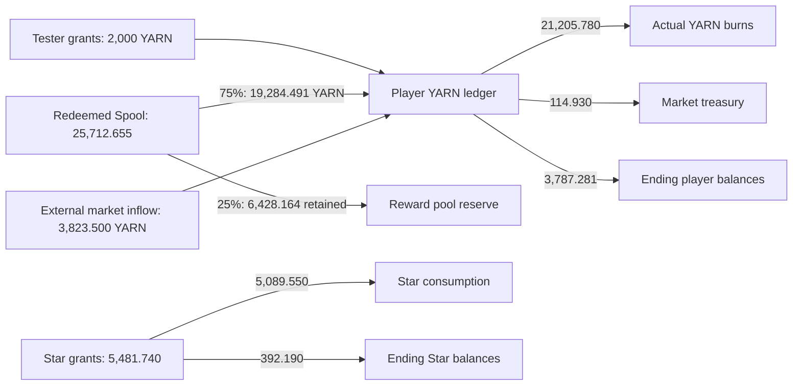

# Economy evidence — frozen 25% retention, class 1.15

**E3: 16/18 scenarios. G-CLASS remains open.** This is modeled behavior, not live-player telemetry. [The source report](https://github.com/ntbaoheyhey/lantern-cat-cafe/blob/d89b61ab3ddd73659f45158d1abe5835b9445b81/reports/v4-ship/S2b/econ/CLASS-POWER-RETENTION25.json) contains 18 combinations of population mix, demand and bot share, each with 200 token seeds over 52 weeks. Combat acquisition comes from 1,000 accounts: 200 per profile over 42 days. Gates and failed results remain unchanged.

## Faucets, sinks and retained value

The graph uses arithmetic means from the same 200 original low-bot boundary runs (`casual-heavy-d0.5-b0.1`, 500 modeled accounts, 52 weeks). [Extracted ledger data and checks](https://github.com/ntbaoheyhey/lantern-cat-cafe/blob/d89b61ab3ddd73659f45158d1abe5835b9445b81/reports/v4-ship/S9/model-1.json) conserve YARN within 1e-6 and exactly conserve Star Thread. Rounded labels are for reading; full values remain in JSON.

YARN credits are withdrawals plus tester grants; external market inflow is a separate modeled source. Burns include fusion, seal, market and studio sinks. Internal player trades do not create tokens. Craft rebates enter Spool and are not added again as YARN income. Retention, treasury and ending balances are not burns. Test YARN has no assumed USD exchange rate.

| Gate metric | Measured result | Threshold / conclusion |
|---|---:|---|
| Median burn/claims across 18 scenarios | 0.996828–1.291342 | Low-demand, low-bot casual-heavy scenario fails ≥1 |
| Median Star source/sink across 18 scenarios | 1.042096–1.101542 | High-bot casual-heavy scenario fails ≤1.10 |
| Independent boundary holdout, low-bot burn/claims | 0.992246 | Failure reproduces |
| Independent boundary holdout, high-bot Stars | 1.101742 | Failure reproduces |
| Source-config hash equality | Exact match | Source only; hosted configuration unverified |

Ratios above are medians of per-seed ratios. The chart shows means of ledger amounts; its ratio is not substituted for a gate median. In the high-bot case, mean Star balances are 414.185, including 142.515 inactive, against 4,074.480 consumed. Inactive balances remain part of the conservation equation.

## First Legendary timing

| Profile | Modeled hours on an active day | Median day | P10–P90 day |
|---|---:|---:|---:|
| Casual | 0.5 | 14 | 1.9–18 |
| Regular | 1 | 10 | 1.9–13 |
| Heavy | 3 | 9 | 1.9–11 |
| Whale-free | 6 | 9 | 1.9–11 |
| Bot | 12 | 9 | 1.9–11 |

All five cohorts have 200 seeds and zero censored first-Legendary observations. “Whale-free” is a time-intensity profile, not a purchaser. [Native cohort manifest](https://github.com/ntbaoheyhey/lantern-cat-cafe/blob/d89b61ab3ddd73659f45158d1abe5835b9445b81/reports/v4-ship/S2b/econ/CLASS-OFFENSE115-POWER-200.json); its historical full config contains 15% retention, but the native acquisition projection is unchanged by retention. The subsequent **token** simulation above uses the required 25%. The model does not use the unauthorized 15% token result as a gate pass.

## Binding to source and deployment

Canonical SHA-256 of the current `ECONOMY_LAB` and the stored 25% token simulation config:

`860d9a7a5ac92349914acd76206c63c60e74bc519bf202c96df0dc1ebd720798`

[The extractor](../../tools/v4ship-lab/research/model.mjs) loads the current rules export, canonicalizes keys, verifies the stored simulation hash, and checks exact equality. It also binds the raw ledger and manifests by file SHA-256. This attests config equality, not whole-engine behavioral equivalence, an approved class parity baseline or a public deployment. **No deployed-config equality claim is available until S12 records the deployed commit/build configuration and verifies it against this evidence.**

Production retention remains 2,500 bp; class attack/Power remains 1.15; healer damage remains zero. The rejected 1.20 variant and archived 15% counterfactual are retained as failures/diagnostics. [Boundary decision](https://github.com/ntbaoheyhey/lantern-cat-cafe/blob/d89b61ab3ddd73659f45158d1abe5835b9445b81/reports/v4-ship/S2b/boundary-decision.json) explains the hold. E4/E5 and the single new class baseline require a valid candidate first.
