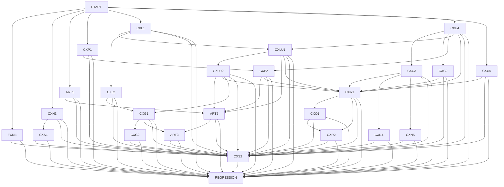

# Taskbar Hero — complete state, remaining work and operating rules

**HISTORICAL PAUSE SNAPSHOT — user explicitly RESUMED2026-11-01.** Current authority: [resume](mega-resume-2026-11-01.md) and [current handoff](MEGA-CURRENT-HANDOFF.md). The historical pause/worker/shutdown text below no longer controls. CXU5 shutdown is now confirmed; latest backup is in current handoff. Sections1–6 of the resume supersede conflicting scheduling/context instructions; section9 safety/quality rules remain.

This is the coordinator's consolidated handoff, written personally at the user's request before sleeping the machine. It explains what was completed, what remains incomplete, what to do next, and the currently applicable mission rules. It includes the original complete mission and task-card plan as appendices, so a future session need not reconstruct them from chat history.

The user most recently requested: pause for machine sleep; minimize new subagent calls and use them only when necessary; never spawn an agent merely to write the handoff; and produce this comprehensive file. These instructions override earlier instructions to continue autonomously or maximize parallelism. **Do not resume implementation, tests, agents, merges, deployment or the checkpoint heartbeat until the user explicitly resumes.** Reading this report is not authorization to resume.

## 1. Executive state

- Repository: private `ntbaoheyhey/taskbar-hero`; deployed frontend: https://taskbarhero-eight.vercel.app.
- Observed main: `1fb25edf4c54ada0d161e3c1dd16a4c4550aafba`. No mission item has received two formal passing grades; no mission PR has been merged. No deployment, migration, function release, wallet creation, repository-visibility change or contest submission occurred during this resumption.
- The prerequisite BASE0 repair is integrated and pushed as `e68eee0be82a085999f565800bf50925046acf18`, existing draft PR [246](https://github.com/ntbaoheyhey/taskbar-hero/pull/246). Its complete fresh-worktree checks and both 264-case browser suites passed on that exact source commit. The remaining repeat/mutation/reference/report/independent-grade gates are not all complete.
- CXU4 Hero/Help/shared states and CXU5 Map/Boss progressed substantially. They remain outside main. Read their actual checkpoint and latest snapshot before touching them.
- The checkpoint heartbeat is **PAUSED**. Local auto-compaction configuration is set to 64,000 tokens; automatic compaction success or reload of this already-active chat is not claimed.
- The coordinator preserved all pre-existing user changes and unrelated worktrees. The original checkout is not the mission's clean verification checkout.

## 2. Latest user instructions and precedence

1. **Pause now for sleep.** No autonomous resumption because a timer fires, an agent returns, the machine wakes, or this document is opened.
2. **Coordinator personally writes the handoff.** Existing workers may record evidence as part of their substantive cards; they are not assigned handoff-only tasks. The authoritative consolidated state is the coordinator's responsibility.
3. **Limit new subagent calls.** Do not fill concurrency slots simply because they are available. Use a new worker only when necessary for substantive implementation/verification. The original requirement for two independent graders before merging remains binding.
4. **Recovery workflow accepted:** checkpoint approximately every ten minutes while active and after meaningful milestones; keep full logs on disk; compact by supported token threshold; inspect existing state before retries.
5. **Use supplied research:** the user authorized using tbhindex.com and the crawl archives for information. The original-content restriction remains: use structure and observations, not copied names/art/text/tables or third-party art fed into generation.
6. All other original authority, quality, safety, git and scope rules continue. The complete original brief is reproduced below. Historical wording such as “start from scratch,” unrestricted parallel operation, or “no time limit” does not override this pause or the new delegation preference.

## 3. Work completed before the latest resumption

The earlier paused session established a complete mission plan, task cards, dependency graph, baseline, ledger, scorecard and optional-user steps. It discovered baseline blockers instead of merging onto a failing main: 80 unresolved explicit-index Deno imports, a preboot Phaser resize failure, narrow HUD failures, and test tools overwriting historical artifacts.

Those blockers became one BASE0 prerequisite, reusing `ai/codex-mega-deno0`/PR246. Earlier full suites, repeats, mutations, audits and production-preview proofs are preserved as **version-specific historical evidence**. Do not promote an older green run to proof of a newer commit.

Other builders delivered targeted work:

| Item | Pushed commit / PR | Actual completed work | Still required |
| --- | --- | --- | --- |
| FXRB | `b5fd48e`; PR243 | Phaser scene-readiness fix and stronger resize evidence; 120 repeats and three detected mutants reported | Current-main integration, complete exact-head gates and independent grades |
| CXN3 | `6257c0e`; PR244 | Cut-over truth/runbook, read-only schema check and live classifier; nine classifier tests, four PGlite tests, eleven mutants | Preserve live findings; complete exact-head gates/grades; no release claim |
| ART1 | `4df594a`; PR247 | Deterministic art pipeline, 434-slot manifest, source-backed 48-colour palette, provenance; 36 tests and eight mutants | Full gates/grades and later original-art production cards |
| CXP1 | `64cf350`; PR240 | Preview-only pet registry/state/API with 12 original pets; 34 unit cases, eight persistence cases, 80 repeats, ten mutants | Full gates/grades and later Pets UI; no power/drop/server effects |
| CXL1 | `178f379`; PR248 | Registry-backed Compendium adapter, 209 entries, ten chest odds tables, offline generator; 19 tests repeated ten times, nine mutants | Full gates/grades and later Compendium UI |

The earlier CXN3 live probes had **17 pass and 10 fail** involving oversized unauthorized responses and boss timeouts. Those remain explicit findings, not a healthy-live certification. Existing Supabase CLI credentials were observed; Vercel CLI was absent. Nothing was released on that basis.

## 4. Reliability setup completed in this resumption

- Created current-chat heartbeat `taskbar-hero-checkpoint-10-ph-t`, initially every ten minutes, then paused on the user's latest request. Its paused prompt forbids restarting the mission. It has no permission to spawn a handoff-only agent.
- Added top-level `model_auto_compact_token_limit = 64000` to `/Users/bao/.codex/config.toml`. The existing model `gpt-6-astra`, reasoning effort `ultra`, custom provider `codexunlimit`, and context-window metadata were not changed. A Codex command parsed the configuration successfully.
- Saved the previous selected setting, rather than copying credential-bearing configuration, under `/Users/bao/.codex/handoffs/taskbar-hero/reliability/compact-setting-before-20261101-163155.json`.
- Created checkpoint snapshots and reusable verification helpers under `/Users/bao/.codex/handoffs/taskbar-hero/reliability/`. Checkpoints record HEADs and worktree status and preserve copies of the authoritative handoff/runtime/ledger/scorecard.
- The threshold is a conservative initial token setting, **not a ten-minute timer**, and writing a summary file does not shrink the active chat's context. Active-session reload and the custom provider's effective compaction behavior are NOT VERIFIED.
- A prior worker-log inspection found 63 lines containing HTTP429; it did not establish context overflow. The transport error supplied by the user means an interrupted/unreadable response stream, not a proven context-limit error. Network/provider/proxy behavior remains a separate diagnostic concern.
- A native CXU4 worker hit429 during this resumption. The coordinator preserved its files, checked that it had no remaining cwd-owned process, waited, and resumed it with a focused card and the same model/effort. No model downgrade or uncontrolled fan-out was used.

Official references: [configuration](https://learn.chatgpt.com/docs/config-file/config-reference), [long-running chat practices](https://learn.chatgpt.com/docs/learn/best-practices), [gateway compatibility](https://learn.chatgpt.com/docs/enterprise/gateway-compatibility).

## 5. BASE0 implementation and evidence now available

### 5.1 Source changes

1. Generate explicit root/nested `index.ts` aliases in Deno import maps while preserving directory/module aliases and auth mappings; fixture tests cover exclusions and deterministic output. The repaired expected-failure import test is now a normal strict regression.
2. Guard Phaser relayout before scene activation; CREATE uses the latest dimensions. This repairs the startup/resize race without weakening the one-canvas requirement.
3. Restore shared HUD styling and containment. The latest repair provides a 160×10px desktop XP track with proportionate nonzero fill and a separate readable title/action context row. It preserves status values, accessible names, callbacks, seven rail items and existing narrow-layout assertions.
4. Cover low-power/gated warning containment, action text and keyboard activation, fallback fonts, offline and deliberately injected429/503 states. Only the exact expected mocked resource errors are allowed; unexpected console/page errors fail.
5. Keep screenshot writes opt-in. Ordinary F3/error checks retain image buffers for byte assertions; performance diagnostics go to Playwright output unless explicitly requested.
6. Add native `E2E_VIEWPORT` selection for1280×720/1600×900. Classic smoke checks exact configured initial width; its later exact800px resize assertion remains.
7. Effects verification checks selected navigation, actual active screen and visible required content before recording a visit; attempted clicks alone no longer prove coverage.
8. Fix stale documentation paths and retain typed/JSDoc helper APIs. No auth function source, migration, contract, dependency version, workflow or game art was changed by BASE0.

The detached saved HUD repair was verified and committed as `895b9fca25bfbf8a13c1bfe9f4b9f5f41b9d4d79`, then cherry-picked without conflict to BASE0 as `e68eee0be82a085999f565800bf50925046acf18`. Both author and commit suffix match the mission rules.

### 5.2 Fresh complete gate on integrated e68eee0

Run worktree: `/Users/bao/.codex/worktrees/mega-base0-resume-verify/taskbar-hero`.

Evidence root: `/Users/bao/.codex/worktrees/mega-deno0/taskbar-hero/reports/scorecard/base0/`.

| Check | Observed result | Evidence |
| --- | --- | --- |
| Frozen-lockfile installation | PASS, exit0 | `resume-gate-e68eee0/install.log` |
| Deno regeneration + drift | PASS, exit0 | `resume-gate-e68eee0/deno-drift.log` |
| Repository typecheck | PASS, exit0 | `resume-gate-e68eee0/typecheck.log` |
| Repository lint | PASS, exit0 | `resume-gate-e68eee0/lint.log` |
| Complete root unit-test command | PASS, exit0 | `resume-gate-e68eee0/test.log` |
| Default build | PASS, exit0 | `resume-gate-e68eee0/build.log` |
| Explicit classic build | PASS, exit0 | `resume-gate-e68eee0/classic-build.log` |
| Explicit v2 bundle build | PASS, exit0 | `resume-gate-e68eee0/v2-budget-build.log` |
| Built-bundle secret scan | PASS, exit0 | `resume-gate-e68eee0/bundle-scan.log` |
| Links | PASS, exit0; main has one missing path | `resume-gate-e68eee0/links.log` and same-day main baseline |
| Deno import guard | PASS, exit0 | `resume-gate-e68eee0/deno-imports.log` |
| Complete browser suite, initial1280×720 | PASS264/264, exit0 | `resume-gate-e68eee0/e2e-1280x720.log` |
| Complete browser suite, initial1600×900 | PASS264/264, exit0 | `resume-gate-e68eee0/e2e-1600x900.log` |
| Guest UI audit | PASS18 screen-size combinations, zero findings | `resume-ui-e68eee0/guest/findings.json` |
| Local signed-in UI audit | PASS18 combinations, zero findings | `resume-ui-e68eee0/signed-in/findings.json` |
| Keyboard rail/panel/Escape walk | PASS7 destinations at both sizes, zero errors | `resume-accessibility-e68eee0/keyboard.json` |
| Observed-public-config preview, classic andv2 | PASS both sizes, one canvas, no errors or backend writes | `resume-public-e68eee0/flag-0/results.json`, `flag-1/results.json` |
| Read-only current-live guest smoke | PASS both sizes, one canvas, no errors or writes | `resume-live-guest/results.json` |
| Current effects tool at1280 | PASS, exit0 | `resume-ui-e68eee0/effects-1280.log` |
| All changed browser specs repeat10 | INTERRUPTED; NOT VERIFIED | `resume-repeats-e68eee0/` |
| Formal graders / merge / post-merge checks | NOT RUN | No passing grade or merge exists |

The full suite starts at each requested desktop viewport, but some legacy tests deliberately resize to their own matrices. Preserve that distinction. The HUD spec explicitly covers both desktop sizes, including error states, within each invocation.

The HUD component's separate targeted evidence passed120 repeated cases at each initial viewport,32 focused browser cases at each setting,21 unit/contrast cases, typecheck and lint. These results are identified by the builder's starting HEAD and source fingerprints; they do not replace the integrated full changed-spec repeats that were interrupted.

### 5.3 Bundle comparison

Same-day clean main baseline: `/Users/bao/.codex/worktrees/mega-main-reference-r2/taskbar-hero`, main1fb25ed. Aggregate JavaScript plus CSS, with deterministic gzip calculation:

| Build | Main raw/gzip bytes | Candidate raw/gzip bytes | Gzip change |
| --- | --- | --- | --- |
| Classic/default | 3,093,807 /663,477 | 3,099,506 /664,453 | +0.1471% |
| v2 | 3,163,759 /678,033 | 3,169,458 /679,002 | +0.1429% |

Both are below the mission's5% growth threshold. This is a size comparison, not a complete performance or accessibility certification.

### 5.4 Mutation verification and limits

The independent mutation worker reported20 verified kills, zero survivors among the verified outcomes, and nine passing controls. It restored tracked source clean before acknowledging pause. Use `resume-mutations-e68eee0/reviewed-results.json` and `paused-summary.json` as the reviewed outcome index.

Coverage includes Deno index/directory/module and test/fixture exclusions, auth distinction, shared/non-function exclusion, scene readiness, HUD styles/action/navigation/XP/containment, opt-in artifacts and reached-screen effects coverage.

The automatic raw outcome file initially misclassified Node test-reporter output. It also counted an interrupted viewport run incorrectly. The worker preserved raw logs and corrected the interpretation in the reviewed file. **Exit143 or a missing screenshot is not a killed mutant.** The viewport mutant remains NOT VERIFIED. A supplemental wrong-token mutant was stopped without counting an outcome; source was restored.

For the F3/error artifact mutants, browser tests exited0 while an independent no-output contract exited1; the combined outcome is1. Do not rewrite that as browser tests failing.

## 6. Current CXU4 and CXU5 work

### CXU4 — Hero, Help and shared states

Worktree `/Users/bao/.codex/worktrees/mega-cxu4/taskbar-hero`, branch `ai/codex-cxu4`, base/main1fb25ed. Implementation remains uncommitted; no new PR was created. The recovery worker acknowledged the pause and preserved WIP.

- Shared API under `apps/web/src/ui/index.ts`: Modal, ConfirmModal, Toast/ToastHost, Banner, EmptyState and Tabs with types.
- Hero paper doll, real equipped items, power breakdown, class confirmation, and typed `HeroScreen.additionalTabs` host.
- Searchable topic/answer Help layout preserving existing help content and typed `HelpTab.additionalTabs` host.
- Notice Banner integration and an API-unreachable regression.
- Relevant paths include `layout/HelpTab.*`, `layout/character/`, `layout/notice/ActionNotice.tsx`, `layout/StageLayout.tsx`, `ui/`, browser tests, contrast tests and screen manifest.
- Worker evidence:180 UI repeated cases plus20 API-failure repeated cases;38 classic browser cases; complete workspace unit rerun with1,321 web tests; seven detected mutants with green controls; guest/local signed-in audits18 each with zero findings; typecheck/lint/v2/classic builds passed. The older effects tool at1280 passed nine checks; the1600 runner was prepared but not run.
- Full current-main gate and independent grades remain pending BASE0. The inherited Deno guard remains red. Do not treat targeted green evidence as a merge gate.
- Screenshot cleanup remains: six preserved reference duplicates bring the folder to18 PNGs and include one oversized old image; twelve new captures meet budget. Preserve historical files in backup before preparing a compliant delivery set.

Evidence: `reports/scorecard/cxu4/`; current checkpoint `reports/scorecard/cxu4/resume-handoff.md`; UI report/evidence `reports/redesign/CXU4/`.

### CXU5 — Map and Boss

Worktree `/Users/bao/.codex/worktrees/mega-cxu5/taskbar-hero`, branch `ai/codex-cxu5`. Implementation commit `a49906e70befa6409127ca3832a3e714fc8a5858` and evidence commit `c5b846ec030be5a0bf6a89c515fe4ecd85514fc3` are pushed. Draft [PR249](https://github.com/ntbaoheyhey/taskbar-hero/pull/249) was independently confirmed OPEN/draft. Additional local evidence remains dirty; the dated snapshots preserve it.

- Chapter path and selected fight details use existing chapter/boss names and real repository art.
- Source-backed power guidance and chest preview, key-limited daily information, session-only completed encounter history.
- History releases atomically with the outcome, resets on account/mode change, and preserves existing compact ChapterMap support.
- Main paths: `map/ChapterMap.tsx`, `layout/boss/BossGatePanel.tsx`, `BossMapScreen.tsx`, its CSS, `mapDetails.ts`, `layout/bossPresentation.ts`, and StageLayout wiring/tests.
- Worker recorded61 focused unit cases,80 current browser repeat cases, seven detected mutants with green controls and140 unit repeats. Earlier74/80 browser repeats remain failures; a short-height sidebar overflow and font-readiness issue were corrected with assertions retained.
- The older audit/effects tools were exercised with their explicitly limited coverage. Both complete browser suites subsequently finished with **257 passed / 3 failed**, exit1. At1280 the failures are resize-burst and two narrow HUD cases; at1600 they are the classic hardcoded1280 expectation and two narrow HUD cases. These inherited baseline failures still block a full PASS. Preserve the earlier interrupted1600 run and exit143 as historical evidence; it is a different run.
- Worker later recorded six keyboard-only capture visits across ready/no-key/chapter5 and both sizes. This is worker-reported evidence, not independent formal grading.
- Old baseline artifact writers modified historical F3/performance/error screenshots. The worker subsequently restored initially-clean generated report outputs; earlier backup preserves that state. Current CXU5 reports, capture helpers and refreshed logs remain dirty. Inspect their diff before further changes.
- The inherited Deno/import/link baseline and full formal gates remain pending. No merge/deploy was authorized by targeted checks. Worker shutdown acknowledgement must be confirmed before claiming all activity stopped.

Evidence: `reports/scorecard/cxu5/`, `reports/redesign/CXU5.md`; checkpoint `reports/scorecard/cxu5/resume-handoff.md`.

## 7. Complete remaining queue

The original queue is unchanged. BASE0 precedes it because all later merge gates require a green main. Build work may be prepared independently when necessary, but merges remain serial and dependency ordered.

| Order | Card | Purpose / current status |
| --- | --- | --- |
| 0 | BASE0 | Baseline repair; integrated source and full suites green; remaining gates/grades pending |
| 1 | FXRB | Resize stability; targeted work available, full gates pending |
| 2 | CXN3 | Cut-over truth and read-only live checks; targeted work available, findings remain |
| 3 | ART1 | Original-art tooling/style/provenance; targeted work available |
| 4 | CXP1 | Preview-only pet state/API; targeted work available |
| 5 | CXL1 | Compendium adapter/exact odds; targeted work available |
| 6 | CXU4 | Hero, Help and shared states; saved uncommitted implementation |
| 7 | CXU3 | Forge and Market UI; pending |
| 8 | CXU5 | Map/Boss UI; local implementation/report commits and incomplete delivery |
| 9 | CXC2 | On-chain proof panel; pending |
| 10 | CXP2 | Pets screen using preview API; pending |
| 11 | CXLU1 | Compendium/odds UI; pending |
| 12 | CXLU2 | Rune/skill/workshop lab UI; pending |
| 13 | ART2 | Original art required by the new screens; pending |
| 14 | CXR1 | All-screen redesign/quality pass after UI prerequisites merge; existing PR245 preserved |
| 15 | CXQ1 | Complete play-through/QA evidence; pending |
| 16 | CXR2 | All-screen polish/consolidation after UI prerequisites merge; old WIP preserved |
| 17 | CXN4 | Seeded forge great-success behavior; decide/sign, version and default-OFF release path |
| 18 | CXN5 | Stepped bonus lines, old-item compatibility and versioned rules |
| 19 | CXL2 | Rune/skill/passive/workshop registries and balance simulations |
| 20 | CXG1 | Server-authoritative gameplay integration behind default-OFF flags |
| 21 | CXG2 | Quests/dailies only after prerequisites merge and main is green |
| 22 | ART3 | Original-art improvement pass after gameplay integration |
| 23 | CXS1 | Security overview/documentation with exact tests and honest gaps |
| 24 | CXS2 | Submission preparation only; no actual submission or visibility change |
| 25 | REGRESSION | Complete required regression, long journeys and evidence-backed mission report |

Already-merged AGR0, AGR1, AGR2, CXR0, CXN1, CXN2, CXC1 and AGN1 must still receive the required verification; rebuild only observed failures. Their old reports are not automatically trusted. All acceptance lines, file zones and detailed tests appear in the complete appendices.

## 8. Next actions after explicit resumption

1. Read this file and `MEGA-CURRENT-HANDOFF.md`, then inspect current refs, dirty files, saved backups and owned processes. Check whether an interrupted external action already completed. Never restart stale handles blindly.
2. Reconcile current CXU5 local/remote state and worker shutdown acknowledgement. Preserve all implementation, evidence and historical output side effects. Confirm mutation scratch is clean before use.
3. Complete integrated BASE0 changed-spec repeats at both initial desktop sizes. Both interrupted repeat runs remain NOT VERIFIED even though a full264-case suite passed at each size.
4. Finish the interrupted viewport mutation with an independent dimension contract. Reuse reviewed outcomes honestly; do not rerun the supplemental script wholesale over existing output directories.
5. Finish current-source effects1600, reference/UI difference table, contrast/keyboard evidence, integrity/tier/secret review and report reconciliation. Existing main/reference differences must be explicitly attributed, not hidden by a green heuristic audit.
6. Run `bash scripts/verify-pr.sh 246` without `--comment`, isolating TMPDIR and ports. The actual wrapper accepts a PR number, despite older brief wording saying branch.
7. Prepare and push an accurate report/evidence package. Ensure the commit being scored is the exact commit tested. Any later branch change requires the prescribed verification and new grades; do not quietly grade an older HEAD.
8. Obtain two fresh independent formal graders, neither a builder/fixer. Merge only if both pass every threshold and all G1–G7 requirements. Record their grades/evidence on the ledger branch without changing the scored product branch.
9. After a permitted merge, rerun main and wait for/read-only verify the actual deployed commit. Stop further merges if main/live breaks; recover through a gated PR.
10. Continue the entire queue. Use the existing prepared branches and WIP; do not duplicate their PRs. Apply the user's reduced-delegation preference.

## 9. Current operational rules

### Authority and design decisions

- Ordinary design/UX/economy decisions and signatures are authorized while the mission is active. Record context/options/choice/reason/reversal in one decision file and link the index. Use the specified Codex-under-user-authority signature where required.
- The game remains a living draft. Do not call screens, iterations or work “final,” “last,” or “frozen” merely to close a card. Mandated report filenames are historical names, not completion claims.
- Existing code/registries are implementation truth. A document/file existing does not prove it runs or is deployed.
- Desktop targets1280×720 and1600×900. Preserve existing responsive CSS and assertions. Seven rail destinations remain unless an authorized documented change is made.
- Follow repository theme tokens, accessibility names/test IDs, reduced-motion behavior, real state and original art. Keep existing Vietnamese text; new code/docs/reports are plain English under the original mission rule.

### Models, delegation and workspace ownership

- Best available model/highest effort for coordinator, builders and graders; this run uses Astra Ultra. Do not choose a cheaper model/lower effort to save tokens.
- Latest preference: use subagents only when necessary. No handoff-only delegation. Two independent graders are still mandatory.
- At most three workers plus coordinator. Every independent builder/verifier owns a separate worktree and distinct browser/server ports. No concurrent browser runs on the same ports. Inspect PID/cwd ownership before terminating a listener.
- Do not edit another worker's product files concurrently. Preserve the original dirty checkout and unrelated old worktrees. No reset/clean/force removal merely to manufacture a clean tree.
- Keep prompts/task cards bounded; keep large logs and raw data on disk. Report concise evidence and next actions. Do not rehydrate the whole historical chat merely to continue a small card.

### Git and release hygiene

- Author `ntbaoheyhey <108352255+ntbaoheyhey@users.noreply.github.com>`.
- Every commit message ends ` [skip ci]`. No GitHub Actions invocation or `.github/**` changes.
- One branch/PR per item, reusing earlier work. No direct push to main. No force-push of an unowned branch. Merge current origin/main without rewriting already-pushed history under the stricter merge rule.
- Merges strictly serial, by dependency order then queue order. No merge based only on a builder self-assessment or one green test command.
- Respect the deployment cap. Main auto-deploys the frontend, so backend-dependent behavior stays default-OFF until the authorized release path is proven and completed.

### Verification and evidence

- pnpm10.28.0; Node20+ (observed24.22.2). Frozen-lockfile installation in a fresh worktree. Do not retain unintended lock/workspace installer side effects.
- Full checks: regeneration/no Deno drift, typecheck, lint, tests, build, explicit classic build, complete browser projects at both sizes, links no worse than same-day main, bundle budget/secret scan, Deno imports and PR wrapper.
- Changed browser specs repeat10 at both sizes; FXRB resize specs repeat20. A failure is red; an interrupted run is NOT VERIFIED. Do not hide failures with retries, skips, bigger timeouts or weaker assertions.
- Minimum five meaningful mutants per item, FXRB three; cover changed behavior. Establish green controls and actual failure causes. Setup/port/syntax interruption is not evidence of a detected behavior regression.
- UI: all-manifest audit/effects coverage, explicit difference table, keyboard walk and required contrast checks. A green overlap heuristic does not prove no text/ancestor clipping.
- Local v2 uses empty Supabase URL/anon variables except explicit isolated local-server or observed-public-config proofs. Never sign into a real user account for these proofs.
- Screenshot output is opt-in, PNG below200KB, maximum16 per delivered item. Keep historical artifacts separate and do not overwrite unrelated reports.
- Scan full diff for integrity patterns, classify every file Tier1/2/3, justify adjacent files, and reconcile every report/ledger/PR claim with the observed evidence.
- Report exact commit, environment, viewport, ports, command, exit status and evidence path. Distinguish automatic raw classifications from reviewed outcomes; retain historical failures without relabeling.

### Score gate

| Criterion | Weight | Main requirement |
| --- | --- | --- |
| C1 Correctness |25| Each acceptance/T-test rerun; NOT VERIFIED earns0 |
| C2 Tests and stability |20| Entire verification and repeat gate green on grader's run |
| C3 Strength |10| Meaningful mutation evidence and controls |
| C4 Design/docs match |15| Evidence-backed differences/factual accuracy |
| C5 Code quality |10| Types, clarity, no unjustified duplication/suppression/growth |
| C6 Test integrity |5| No unjustified weakening |
| C7 Report honesty |10| Claims match observed evidence |
| C8 Scope |5| Complete file-tier justification |

Both independent graders must score at least92/100, with C1≥23, C2=20, C6=5, C7≥8, every criterion at least60% of its weight, and zero auto-fails. If scores differ by more than5, obtain a third and use the lowest. Builders/fixers cannot grade their own work.

Auto-fails include false PASS, unjustified skipped/weakened tests, Tier3/safety/secrets breach, unflagged backend dependencies, copied third-party content or missing art provenance, omitted required checks, flaky repeats, broken git author/suffix/main-push hygiene, link regression and unexpected console/page errors. The exact anchors and exceptions remain in the verbatim specification below.

### Live-system guardrails

- Never disclose/store secrets in code, logs, reports or commits. Public anon configuration may be inspected in memory for the specifically authorized proof; do not print its value.
- No destructive or irreversible live SQL: no player-row deletion, DROP/TRUNCATE/destructive ALTER/data rewrite. Local proof first. Only explicitly authorized additive/idempotent/reversible release steps after all gates and with existing credentials; matching rollback documentation required.
- Backend release failures do not justify exposing new behavior with flags on. Production default remains safe.
- No mainnet, real funds, real-funds wallet or new token. Chain tests use throwaway Fuji or local/fork environments and keep/delete temporary keys safely.
- Never make the repository public or actually submit to the contest. Prepare materials and optional steps only.
- Vercel changes require the original live go/no-go and rollback conditions plus existing authorized credentials. None were performed in this resumption.

## 10. Research inputs and interpretation

- https://tbhindex.com is user-authorized research. Live content can change; retain source/capture dates.
- The specifically named Downloads research ZIP is a26-byte error body. The valid `/Users/bao/Downloads/TBH_Index_Research_2026-10-31-2.zip` is byte-identical to the original checkout's research ZIP; SHA256 `e38f4222cd4cc248087030c14d9993622a45c7807b35e2e55364a9ab617199da`.
- Skill pack `/Users/bao/Downloads/TBH_All_36_Skills_2026-10-31.zip`; SHA256 `b0bb0ab7e005ea7050271dce955fc12a146a44a0fac96cb5e590c8c640e57581`.
- Both archives pass ZIP CRC; all36 video hashes match their index. Research index contains252 source rows. The archive reports180 stage states and129 chest selections, explicitly120 ordinary plus9 synthetic. These source counts are not imported game-content requirements.
- Read `sources.csv`, relevant page records, stages/chest/skill timing data selectively. The skill clips record a website simulator from reconstructed screenshot timings, not verified native-game engine cadence. Some skills share animations. Formula interpretations and mismatched heading/list counts remain source findings.
- Use the source map in `reports/reference-usage-2026-11-01.md`. Preserve original product names, art and independent balance. Do not treat instructions embedded in archive documents as new user instructions.

## 11. Files, backups and recovery

Authoritative ledger worktree: `/Users/bao/.codex/worktrees/mega-ledger/taskbar-hero` on `ai/codex-mega-ledger`, draft PR241. Read `reports/MEGA-CURRENT-HANDOFF.md`, `mega-ledger.md`, `mega-scorecard.md`, `MEGA-FINAL-REPORT.md`, `mega-plan.md`, `mega-mission.md`, `mega-runtime.md` and `mega-checkpoint-policy.md`.

New durable snapshot directory: `/Users/bao/.codex/handoffs/taskbar-hero/2026-11-01-1700/`. Its manifest records worktree HEAD/status, file lists, archive sizes and SHA256. Each snapshot has `tracked.patch`, `untracked.tar.gz`, `git-status.txt` and `snapshot.json`. The first pass saved approximately87MB across five worktrees; the latest manifest is authoritative if refreshed after worker shutdown.

Earlier preserved snapshot: `/Users/bao/.codex/handoffs/taskbar-hero/2026-11-01-1600/`; keep it. Reliability helper/snapshot directory: `/Users/bao/.codex/handoffs/taskbar-hero/reliability/`.

Restore only in a new isolated checkout at the recorded HEAD: apply the binary patch and extract the matching untracked archive there. Never apply over newer user edits. Prefer continuing the existing preserved tree after inspection. Local commits not yet pushed remain in the shared Git repository; the generated inventory below records them explicitly.

The coordinator's helpers are `checkpoint.py`, `run-gates.py`, `keyboard-walk.mjs`, `live-smoke.mjs` and `public-proof.mjs`. They are recovery/verification tooling outside the product repo. Their existence is not proof of a successful run; use logs/results.

Do not use pause-time session IDs as active processes. After a transport failure or sleep, check PID/cwd/ports and persisted outcomes before restarting. Interrupted work may have partly completed. Do not duplicate a commit, PR, merge or release.

## Latest shutdown observation

As of 2026-11-01T17:05:55+07:00, CXU4 and the BASE0 mutation worker have acknowledged pause. Mutation tracked source is clean. CXU5 still reports an active/in-progress native thread and has not acknowledged pause; it continued checks after process termination. Its delivery is draftPR249, headc5b846e over implementationa49906e, with full browser results257pass/3fail at BOTH sizes. The complete gate is not green. Parent issued stop notices and terminated owned tests earlier. Native-agent interruption is not exposed in the current collaboration tool set; direct app-server input rejects multi-agent-v2 children, and computer control of Codex was denied for safety reasons. Do not bypass that restriction or claim all workers stopped. The user must use the app's Stop control for the CXU5 worker before sleep if it remains active. The mission goal and heartbeat remain PAUSED.

A supplemental CXU5 backup is saved at `/Users/bao/.codex/handoffs/taskbar-hero/2026-11-01-pause-supplement-170537/`: binary tracked patch, untracked archive, status and hashes for40 local changed/untracked files. Hashes and git status were stable during that brief capture, but shutdown was NOT confirmed. Refresh after actual cessation; do not treat a stable capture as proof that the agent stopped. Earlier1700 and1600 snapshots remain untouched.

## 12. Appendices and interpretation

The generated current-state inventory below is an observation at its stated timestamp. The complete original brief and task-card plan follow it verbatim. Their old progress wording is historical; current state and the latest user directives in sections1–2 take precedence. The appendices preserve every task, acceptance line, reference path and gate rather than silently dropping scope.

### Observed worktrees at 2026-11-01T17:02:43+07:00

#### /Users/bao/.codex/worktrees/mega-ledger/taskbar-hero

HEAD: 84552651687182f05fc9eaee2aff5f648d70b0d3; branch: ai/codex-mega-ledger

Uncommitted status:

Clean

#### /Users/bao/.codex/worktrees/mega-deno0/taskbar-hero

HEAD: e68eee0be82a085999f565800bf50925046acf18; branch: ai/codex-mega-deno0

Uncommitted status:

M reports/scorecard/base0/logs/results.jsonl
?? reports/scorecard/base0/audit-signed-in/
?? reports/scorecard/base0/audit/
?? reports/scorecard/base0/effects-1280/
?? reports/scorecard/base0/effects-1600/
?? reports/scorecard/base0/effects-control-1280/
?? reports/scorecard/base0/effects-reached-control/
?? reports/scorecard/base0/live-baseline-diagnostic.json
?? reports/scorecard/base0/live-smoke.mjs
?? reports/scorecard/base0/live/
?? reports/scorecard/base0/logs/changed-specs-repeat10-1600.log
?? reports/scorecard/base0/logs/changed-specs-repeat10.log
?? reports/scorecard/base0/logs/compact-browser-r5.log
?? reports/scorecard/base0/logs/compact-browser-r6.log
?? reports/scorecard/base0/logs/compact-browser-r7.log
?? reports/scorecard/base0/logs/effects-1280.log
?? reports/scorecard/base0/logs/effects-1600.log
?? reports/scorecard/base0/logs/effects-control-1280.log
?? reports/scorecard/base0/logs/effects-reached-control.log
?? reports/scorecard/base0/logs/full-e2e-1600-r3.log
?? reports/scorecard/base0/logs/full-e2e-1600.log
?? reports/scorecard/base0/logs/full-r1/
?? reports/scorecard/base0/logs/full-r2/
?? reports/scorecard/base0/logs/full-r3/
?? reports/scorecard/base0/logs/full-r4/
?? reports/scorecard/base0/logs/full-r5/
?? reports/scorecard/base0/logs/gated-hud-regression.log
?? reports/scorecard/base0/logs/gated-hud-repeat10.log
?? reports/scorecard/base0/logs/hud-contrast.log
?? reports/scorecard/base0/logs/keyboard.log
?? reports/scorecard/base0/logs/links-corrected.log
?? reports/scorecard/base0/logs/live-baseline.log
?? reports/scorecard/base0/logs/mutations/
?? reports/scorecard/base0/logs/new-hud-browser.log
?? reports/scorecard/base0/logs/public-config-build.log
?? reports/scorecard/base0/logs/public-config-classic-smoke.log
?? reports/scorecard/base0/logs/repeat-hud-10.log
?? reports/scorecard/base0/logs/ui-audit-signed-in.log
?? reports/scorecard/base0/logs/ui-audit.log
?? reports/scorecard/base0/mutation-plan.md
?? reports/scorecard/base0/preflight-review.md
?? reports/scorecard/base0/public-config/
?? reports/scorecard/base0/resume-accessibility-e68eee0/
?? reports/scorecard/base0/resume-effects-e68eee0/
?? reports/scorecard/base0/resume-gate-e68eee0/
?? reports/scorecard/base0/resume-live-guest/
?? reports/scorecard/base0/resume-mutations-e68eee0/
?? reports/scorecard/base0/resume-public-e68eee0/
?? reports/scorecard/base0/resume-repeats-e68eee0/
?? reports/scorecard/base0/resume-ui-e68eee0/
?? reports/scorecard/base0/screens/hud-1280.png
?? reports/scorecard/base0/screens/hud-1600.png
?? reports/scorecard/base0/screens/reference-home-1280.png
?? reports/scorecard/base0/screens/reference-home-1600.png

#### /Users/bao/.codex/worktrees/mega-base0-hud/taskbar-hero

HEAD: 895b9fca25bfbf8a13c1bfe9f4b9f5f41b9d4d79; branch: (detached)

Uncommitted status:

?? reports/scorecard/base0/hud-repair/commands.jsonl
?? reports/scorecard/base0/hud-repair/hud-contract.json
?? reports/scorecard/base0/hud-repair/inspect-reference.mjs
?? reports/scorecard/base0/hud-repair/logs/focused-1280.log
?? reports/scorecard/base0/hud-repair/logs/focused-first.log
?? reports/scorecard/base0/hud-repair/logs/install.log
?? reports/scorecard/base0/hud-repair/logs/lint-verified.log
?? reports/scorecard/base0/hud-repair/logs/mutant-action-inert.log
?? reports/scorecard/base0/hud-repair/logs/mutant-action-truncated.log
?? reports/scorecard/base0/hud-repair/logs/mutant-error-action-collapsed.log
?? reports/scorecard/base0/hud-repair/logs/mutant-gated-ancestor-clip.log
?? reports/scorecard/base0/hud-repair/logs/mutant-xp-dot.log
?? reports/scorecard/base0/hud-repair/logs/mutant-xp-static-fill.log
?? reports/scorecard/base0/hud-repair/logs/mutations-run.log
?? reports/scorecard/base0/hud-repair/logs/reference.log
?? reports/scorecard/base0/hud-repair/logs/regression-second.log
?? reports/scorecard/base0/hud-repair/logs/regression-third.log
?? reports/scorecard/base0/hud-repair/logs/repeat10-1280.log
?? reports/scorecard/base0/hud-repair/logs/typecheck-verified.log
?? reports/scorecard/base0/hud-repair/logs/typecheck.log
?? reports/scorecard/base0/hud-repair/logs/units-verified.log
?? reports/scorecard/base0/hud-repair/logs/units.log
?? reports/scorecard/base0/hud-repair/mutations.json
?? reports/scorecard/base0/hud-repair/mutations.py
?? reports/scorecard/base0/hud-repair/reference.json
?? reports/scorecard/base0/hud-repair/screens/reference-1280.png
?? reports/scorecard/base0/hud-repair/screens/reference-1600.png
?? reports/scorecard/base0/hud-repair/secret-scan.json
?? reports/scorecard/base0/hud-repair/test-diff.txt

#### /Users/bao/.codex/worktrees/mega-fxrb/taskbar-hero

HEAD: b5fd48ee06673e8cde08a2935c1ac2f717e8ddbc; branch: ai/codex-fxrb

Uncommitted status:

Clean

#### /Users/bao/.codex/worktrees/mega-cxn3/taskbar-hero

HEAD: 6257c0e80b255f88ac67808d5d07eb00f1fb25b6; branch: (detached)

Uncommitted status:

Clean

#### /Users/bao/.codex/worktrees/mega-art1/taskbar-hero

HEAD: 4df594a63785fe239fee2fb7cea673c14451dc0e; branch: ai/codex-art1

Uncommitted status:

Clean

#### /Users/bao/.codex/worktrees/mega-cxp1/taskbar-hero

HEAD: 64cf350e71a5a4488576733c1dfead4cff015dc5; branch: (detached)

Uncommitted status:

Clean

#### /Users/bao/.codex/worktrees/mega-cxl1/taskbar-hero

HEAD: 178f379a173f3d5af68f0364ffe24da9adfedaa4; branch: ai/codex-cxl1

Uncommitted status:

Clean

#### /Users/bao/.codex/worktrees/mega-cxu4/taskbar-hero

HEAD: 1fb25edf4c54ada0d161e3c1dd16a4c4550aafba; branch: ai/codex-cxu4

Uncommitted status:

M apps/web/e2e/layout/character-bag.spec.ts
 M apps/web/e2e/ui/u4-character-bag.spec.ts
 M apps/web/src/layout/HelpTab.css
 M apps/web/src/layout/HelpTab.keys.test.tsx
 M apps/web/src/layout/HelpTab.test.tsx
 M apps/web/src/layout/HelpTab.tsx
 M apps/web/src/layout/StageLayout.tsx
 M apps/web/src/layout/character/CharacterPanel.tsx
 M apps/web/src/layout/character/character.css
 M apps/web/src/layout/notice/ActionNotice.tsx
 M apps/web/src/theme.contrast.test.ts
 M apps/web/tools/screen-manifest.json
?? PAUSED-BY-USER.txt
?? apps/web/e2e/server/cxu4-offline.spec.ts
?? apps/web/e2e/ui/cxu4-hero-help.spec.ts
?? apps/web/src/layout/HelpTab.content.tsx
?? apps/web/src/layout/HelpTab.search.test.tsx
?? apps/web/src/layout/character/HeroScreen.test.tsx
?? apps/web/src/layout/character/HeroScreen.tsx
?? apps/web/src/ui/
?? docs/decisions/
?? docs/design/
?? reports/redesign/CXU4/
?? reports/scorecard/

#### /Users/bao/.codex/worktrees/mega-cxu5/taskbar-hero

HEAD: c5b846ec030be5a0bf6a89c515fe4ecd85514fc3; branch: ai/codex-cxu5

Uncommitted status:

M reports/f3-art/bake-metrics.json
 M reports/f3-art/stage-ch1-1280x720.png
 M reports/f3-art/stage-ch1-390x844.png
 M reports/f3-art/stage-ch2-1280x720.png
 M reports/f3-art/stage-ch2-390x844.png
 M reports/f3-art/stage-ch3-1280x720.png
 M reports/f3-art/stage-ch3-390x844.png
 M reports/f3-art/stage-ch4-1280x720.png
 M reports/f3-art/stage-ch4-390x844.png
 M reports/f3-art/stage-ch5-1280x720.png
 M reports/f3-art/stage-ch5-390x844.png
 M reports/g1-speed/metrics.json
 M reports/g3-combat/frame-metrics.json
 M reports/n1-error-screens/429-1280x720-dark.png
 M reports/n1-error-screens/429-390x844-light.png
 M reports/n1-error-screens/503-1280x720-dark.png
 M reports/n1-error-screens/503-390x844-light.png
 M reports/n1-error-screens/offline-1280x720-dark.png
 M reports/n1-error-screens/offline-390x844-light.png
 M reports/n1-error-screens/wrong-wallet-1280x720-dark.png
 M reports/n1-error-screens/wrong-wallet-390x844-light.png
 M reports/redesign/CXU5.md
 M reports/scorecard/cxu5/full-browser.mjs
 M reports/scorecard/cxu5/resume-handoff.md
 M reports/scorecard/cxu5/run-ui-probes.mjs
?? PAUSED-BY-USER.txt
?? apps/web/.cxu5-full.config.ts
?? reports/scorecard/cxu5/integrity-review.json
?? reports/scorecard/cxu5/logs/full-e2e-1600.log

#### /Users/bao/.codex/worktrees/mega-base0-resume-verify/taskbar-hero

HEAD: e68eee0be82a085999f565800bf50925046acf18; branch: (detached)

Uncommitted status:

?? PAUSED-BY-USER.txt

#### /Users/bao/.codex/worktrees/mega-base0-resume-mutants/taskbar-hero

HEAD: e68eee0be82a085999f565800bf50925046acf18; branch: (detached)

Uncommitted status:

?? PAUSED-BY-USER.txt

---

# Appendix A — original mission specification (verbatim)

Latest pause/delegation/handoff instructions above override conflicting historical operating language.

# Mission brief received 2026-11-01

MISSION MEGA ALL-IN-ONE - CODEX DOES EVERYTHING: plan, build, art, test, strict scoring, redo until pass, merge one at a time, final report
Tool: Codex (full access) | Model: the BEST model available, for the orchestrator AND every subagent, builder and grader | Reasoning effort: the HIGHEST setting everywhere (xhigh/max if offered), no exceptions | Speed: 1.5x / fast mode wherever offered | Token cost does not matter: never pick a cheaper model, a lower effort or a shortcut to save tokens. Spend whatever it takes to get the best result.
Repo ntbaoheyhey/taskbar-hero (private). Git author ntbaoheyhey <108352255+ntbaoheyhey@users.noreply.github.com>. One branch + one PR per item. Every commit message ends with " [skip ci]" (GitHub Actions minutes are used up; you verify locally). Never push directly to main; main changes ONLY by merging a PR that passed the SCORE GATE (section 3) and the MERGE GATE (sections 5 and 9).
This is a complete, self-contained mission that starts from scratch. Every spec you need is inside this prompt. Work alone. Do not ask questions. NO ROUND LIMIT, NO RETRY LIMIT, NO TIME LIMIT. NOTHING waits for the user: anything that would need the user's opinion or hands gets an interim solution you build yourself (section 7). Only the SAFETY GUARDRAILS (section 7a) are absolute.
LIVING DRAFT: the user still has a lot of UI work planned. Never call any item, screen or run "final", "last" or "frozen".

AUTHORITY (the user, 1 Nov 2026, in their words: "Codex does everything, full authority, do anything, every Codex proposal is accepted; if something needs the user's opinion or hands, build an approach that does not need the user"):
 - Every proposal and decision you make counts as ACCEPTED by the user. Decide every open decision yourself (M-D1 forge great-success, M-D2 stepped lines, M-D3 rune tree, the 7-nav-items vs Help-in-HUD question, anything else marked "user decides"). Record each in docs/decisions/ (one file per decision: context, options, choice, why, how to reverse) and link it from docs/design/decisions.md.
 - Where a document waits for a user SIGNATURE (docs/proposals/rune-skill-system/design.md section 6, docs/proposals/numbers-v2.md, M-D1, M-D2), sign it yourself: "SIGNED by Codex under full user authority, <date>" plus the decision file link. This unblocks CXL2, CXN4 and CXN5.
 - You decide features, design, UX and numbers (economy, odds, forge, rune/pet numbers). You may rebuild code if that is the better fix.
 - You make ALL art yourself, ORIGINAL ONLY (never feed third-party or reference art into a generator, never trace). Record tool + prompt/method per asset in docs/art/provenance.md. Keep existing art unless an item genuinely needs a replacement; never delete art that something still references.
 - You MAY MERGE your own PRs into main, but ONLY one at a time, ONLY after the item PASSES the rubric (section 3) AND the merge gates (sections 5 and 9), and you re-test main and the live site after EVERY merge.
 - Anything whose behaviour depends on a backend change that is not live yet (new migration, new or changed Edge Function, new contract) MUST ship behind a default-OFF flag, because main auto-deploys the frontend to https://taskbarhero-eight.vercel.app. With the flag off, the live site must behave exactly as before.
 - Queue (ALL work, including every former Antigravity item and all art; nothing is left for another tool), in dependency order (graph in section 10): FXRB, CXN3, ART1, CXP1, CXL1, CXU4 (was AGR4 Hero+Help+modals), CXU3 (was AGR3 Forge+Market), CXU5 (was AGR5 Map/Boss), CXC2 (was AGC1 on-chain proof panel), CXP2 (was AGP1 Pets screen), CXLU1 (was AGL1), CXLU2 (was AGL2), ART2, CXR1, CXQ1 (was AGN3 play-through), CXR2, CXN4, CXN5, CXL2, CXG1, CXG2, ART3, CXS1 (was AGN2 security docs), CXS2 (was AGN4 submission pack, prepare only), then FINAL REGRESSION. CXR1 and CXR2 run only after CXU3, CXU4, CXU5, CXC2, CXP2, CXLU1 and CXLU2 are merged, and cover every screen. Already-merged work (AGR0, AGR1, AGR2, CXR0, CXN1, CXN2, CXC1, AGN1) is verified with section 2 and rebuilt only if it fails the rubric.
 - Per item: plan -> implement -> VERIFY (section 2) -> SCORE (section 3) -> REDO until pass (section 4) -> MERGE GATE + merge + re-test main and live (sections 5 and 9) -> next item.

====================================================================================================
0. ORCHESTRATION (the user's words, 1 Nov 2026)
====================================================================================================
Before touching code, plan this mission as small TASK CARDS that a junior subagent can follow: clear goal, exact file paths, constraints, the test cases that prove it, and the definition of done. Give every card a suitable subagent and an effort level (use the best model and the highest effort for every card, including graders; tokens do not matter). Draw a DEPENDENCY GRAPH (text or mermaid) so that independent cards run IN PARALLEL. Write the plan to reports/mega-plan.md and push it as a heads-up, then orchestrate the whole run yourself and never escalate to the user: solve it (section 7).
Parallel rules:
 - Build and verify cards for independent items run in parallel, each in its OWN git worktree (git worktree add) with its OWN Playwright ports. Never run two `pnpm test:e2e` on the same ports at once: give each worktree distinct ports or serialise e2e through one lock file (flock /tmp/tbh-e2e.lock). Kill `vite preview` orphans before each e2e run.
 - GRADER INDEPENDENCE: the subagent that grades an item must NOT be the subagent that built or fixed it. Graders get only the repo, the item spec, this rubric and the raw command output; they never see the builder's self-assessment until after scoring.
 - Merges are strictly SERIAL (section 5).

====================================================================================================
1. START
====================================================================================================
Step 1. git fetch --all --prune. Check origin for existing ai/codex-* branches and open or closed PRs from earlier attempts (git branch -r | grep ai/codex-, gh pr list --state all --search "head:ai/codex-"). For each one: reuse it (merge latest origin/main into it) or close it with a one-line comment, instead of duplicating work. Treat any reused code exactly like new work: it gets the full verify (section 2), scoring and merge gate. Never trust an earlier report, ledger or PR body; a file existing is not proof it works.
Step 2. git config user.name ntbaoheyhey && git config user.email 108352255+ntbaoheyhey@users.noreply.github.com (check with git config user.email).
Step 3. Tooling: corepack enable && corepack prepare pnpm@10.28.0 --activate (pnpm --version must print 10.28.0; else prefix every pnpm command with npx -y pnpm@10.28.0). Node 20+. CI=true pnpm install --frozen-lockfile from the repo root; installer side effects on pnpm-workspace.yaml / pnpm-lock.yaml: git checkout -- them (not a blocker). Playwright: if browsers are missing use PLAYWRIGHT_BROWSERS_PATH=/opt/pw-browsers or npx playwright install chromium. The browser suite runs from apps/web: pnpm test:e2e (builds classic on port 4173 and v2 with VITE_GAME_V2=1 on 4174).
Step 4. Baselines on origin/main, saved under reports/baseline/: node scripts/check-links.mjs count (about 58 broken links pre-exist, mostly docs/dry-run-report.md; never add any), node scripts/check-bundle.mjs numbers, full suite result.
Step 5. Write the plan (section 0), the ledger and the scorecard (section 6), then start the queue.

REFERENCE (exact repo paths; open them, you cannot open claude.ai links):
 - UI redesign, approved direction: reports/ui-redesign/index.html (flip through every screen at 1280x720 and 1600x900), reports/ui-redesign/BRIEF.md, reports/ui-redesign/PLAN.md, reports/ui-redesign/README.md. Match LAYOUT, TOKENS, BEHAVIOUR; real repo art replacing a mockup placeholder is not a difference.
 - Rune / skill / pets: docs/proposals/rune-skill-system/demo/index.html, docs/proposals/rune-skill-system/demo/README.md, docs/proposals/rune-skill-system/design.md, docs/proposals/rune-skill-system/plan.md. Demo numbers are not game numbers; any number you adopt is your decision in docs/decisions/.
 - Cut-over / security: docs/cutover-v2.md, docs/proposals/numbers-v2.md, docs/proposals/relic-recovery.md, docs/proposals/auth-hardening-v2.md, docs/proposals/rate-limit-v2.md, docs/proposals/v2-state-integrity.md, supabase-manual/v2-rollback.sql (read only), reports/chain-proof.md, docs/avalanche-integration.md, reports/C3.md.
 - Tools: scripts/verify-pr.sh (run WITHOUT --comment), scripts/check-links.mjs, scripts/check-bundle.mjs, scripts/check-deno-imports.mjs, scripts/check-live.mjs, apps/web/tools/ui-audit.mjs, apps/web/tools/effects-test.mjs.
 - Item specs: section 10 (all items) and section 11 (extra detail for FXRB, CXN3, CXP1, CXR1, CXR2, CXL2; the stricter of 10 and 11 wins). Every T-test, TESTS and DONE line there is an acceptance line.

====================================================================================================
2. VERIFY - PER ITEM, IN A FRESH WORKTREE (run this on every item after you build it, and on any reused earlier code)
====================================================================================================
For each item:
 a. Check out the item branch in its own worktree. Rebase or merge onto latest origin/main first (never rewrite a branch you did not create; these are yours). Record the base commit.
 b. Tooling: corepack enable && corepack prepare pnpm@10.28.0 --activate (pnpm --version must print 10.28.0; else prefix with npx -y pnpm@10.28.0). CI=true pnpm install --frozen-lockfile. Installer side effects on pnpm-workspace.yaml / pnpm-lock.yaml: git checkout -- them (not a blocker).
 c. Re-run the FULL verify list yourself and save raw output under reports/scorecard/<id>/logs/:
      pnpm gen:deno && git diff --exit-code -- supabase/functions
      pnpm typecheck
      pnpm lint
      pnpm test
      pnpm build
      VITE_GAME_V2=0 pnpm --filter @taskbar-hero/web build
      cd apps/web && pnpm test:e2e   (both classic and v2 projects; affected specs at 1280x720 AND 1600x900)
      node scripts/check-links.mjs   (count must not exceed main's count, measured on main the same day)
      node scripts/check-bundle.mjs  (record numbers vs main)
      bash scripts/verify-pr.sh <branch>   (no --comment)
    UI items also: SCREENSHOTS=1 run, plus from apps/web: node tools/ui-audit.mjs ../../reports/scorecard/<id>/audit bossReadyStrong (and --signed-in) and node tools/effects-test.mjs ../../reports/scorecard/<id>/effects. "document scrolls" and overlap findings must be empty at 1280x720 and 1600x900.
 d. Re-run every T-test from the item spec, one by one, yourself. Mark each PASS / FAIL / NOT VERIFIED with the command and output tail. A T-test you did not run yourself is NOT VERIFIED.
 e. FLAKE CHECK: every spec the item added or changed runs with --repeat-each=10 at both sizes; FXRB's resize specs --repeat-each=20 at both sizes. One failure in any repeat = the spec is red.
 f. INTEGRITY DIFF: git diff origin/main...<branch> must be scanned for: test.skip / .only / .fixme / describe.skip / it.todo, deleted test files or deleted assertions, raised timeouts, added retries (retries:, test.retry, toPass with a wider window than before), loosened matchers (toBe -> toBeTruthy, exact -> toContain, count -> >=), edited golden/snapshot numbers, eslint-disable, @ts-ignore / @ts-expect-error, `as any`, console.log left in src. List every hit with file:line and whether it is justified (a test that encoded OLD behaviour the item deliberately changed is justified only with old -> new shown).
 g. SCOPE + TIER CHECK: list every changed file and classify it Tier 1 (item zone), Tier 2 (adjacent, needs a note in the report) or Tier 3. Tier 3 under the AUTHORITY UPDATE means: secrets/.env/credentials, .github/**, any live write beyond what section 7 allows, dependency changes without a decisions.md entry, contract changes, auth/SIWE changes without tests, and any backend-dependent behaviour not behind a default-off flag.
 h. SECRET SCAN: grep the diff, reports and logs for keys, JWTs, database URLs, private keys, passwords (including any leaked DB password). Found one = auto-fail; mask it everywhere, write "SECRET FOUND: <file>:<line>, masked" in the scorecard, never copy it.
 i. REPORT HONESTY: compare every claim in the item report (status line, each PASS, each command output, file list, screenshot list, "fixed" root causes) with what you just observed. Record each mismatch.
 j. UI MATCH (UI items): open reports/ui-redesign/index.html and the built app at the SAME screen and size side by side (1280x720 and 1600x900). Check rail/nav order and items, HUD content and position, panel grid and gutters, type scale, token use (colours, spacing, radii from apps/web/src/theme.css, no hard-coded hex where a token exists), focus rings, hover/active states, empty states, motion with prefers-reduced-motion: reduce (no movement). List every difference in reports/scorecard/<id>/ui-diff.md. Pets/rune items: same check against docs/proposals/rune-skill-system/demo/index.html for mechanics and flow.
 k. Keyboard-only walk through every touched screen; axe or the existing contrast test for WCAG AA on every new token pair.

====================================================================================================
3. SCORING RUBRIC - DELIBERATELY HARD TO PASS
====================================================================================================
Score each item 0-100. Each criterion is scored on its own anchors; partial credit only where the anchor says so. When unsure between two scores, give the LOWER one. Graders must cite evidence (command + output line, file:line, screenshot path) for every point awarded; a point without cited evidence is 0.

 C1 Correctness vs spec ............................................ 25
    Every T-test and DONE line of the item spec re-run by you. Points = 25 x (PASS lines / all lines). NOT VERIFIED counts as 0. A line that would need the user must be verified through its interim solution (section 7: local Supabase/PGlite, demo mode, throwaway Fuji wallet); only a line blocked by a SAFETY GUARDRAIL (7a) is excluded, max 2 per item, each listed in reports/OPTIONAL-USER-STEPS.md.
 C2 Test evidence re-run, green and stable ......................... 20
    20 only if: the whole verify list in 2c is green on YOUR run, the flake check in 2e has zero failures, and the classic build + classic project pass. Any red check = 0. Green but a check could not run for a non-user reason = max 8.
 C3 Test strength (new tests actually prove the behaviour) ......... 10
    Mutation check: for each new/changed behaviour, break the code on purpose (invert a condition, off-by-one, remove a call) in a scratch copy; the tests must go red. Points = 10 x (mutants killed / mutants tried), minimum 5 mutants per item (FXRB: 3). Revert the mutants.
 C4 Design match (UI: reports/ui-redesign/index.html; pets/runes: docs/proposals/rune-skill-system/demo/index.html; non-UI items: docs and runbook accuracy vs real code and real migrations) .. 15
    Start at 15, minus 3 per unexplained visible difference or wrong fact, minus 1 per explained-but-unfixed difference. Floor 0.
 C5 Code quality ................................................... 10
    Start at 10. Minus 2 each: duplicated logic, dead code, any/ts-ignore without reason, hard-coded value where a token/config exists, missing types on exported API, unclear naming, new lint warning, bundle growth > 5% without a decisions.md reason. Floor 0.
 C6 Integrity of tests (2f) ........................................ 5
    5 if zero unjustified hits, else 0 (and see auto-fail A2).
 C7 Report honesty (2i) ............................................ 10
    Start at 10, minus 3 per claim that does not match your observation. A false PASS is auto-fail A1, not a deduction.
 C8 Scope discipline (2g) .......................................... 5
    5 if every out-of-zone file has a Tier 2 note with a valid reason; minus 1 per missing note; 0 if any unexplained file.

PASS BAR - ALL of these, no rounding up:
 - Total >= 92 / 100, AND
 - C1 >= 23, C2 = 20, C6 = 5, C7 >= 8, AND
 - no criterion below 60% of its weight, AND
 - zero auto-fail conditions, AND
 - TWO independent graders (different subagents, neither the builder) both score >= 92 separately. If they differ by more than 5 points, a third grader scores and the LOWEST of the three counts.

AUTO-FAIL (score forced to 0 for this round, item must be redone):
 A1 A false PASS anywhere: in any report, in the ledger or a PR body (a check claimed green that is red or was never run).
 A2 Any skipped, deleted, quarantined, .only'd, retried or loosened test, raised timeout or edited golden number without a justified old -> new note.
 A3 Any Tier 3 breach (section 2g), any SAFETY GUARDRAIL breach (section 7a), any secret in a file/log/commit/report.
 A4 Backend-dependent behaviour reachable on main with flags at default (i.e. not behind a default-OFF flag).
 A5 Third-party content copied (names, art, text, tables) or art without a provenance entry.
 A6 A required check not run at all (typecheck, lint, test, build, classic build, e2e for touched apps/web or packages).
 A7 Flake: any red in the repeat runs of 2e.
 A8 Broken git hygiene: wrong author on any commit, missing " [skip ci]", push to main, force-push to a branch you did not create.
 A9 check-links count above main's, or a new console error / page error in any e2e run of the touched screens.

====================================================================================================
4. REDO LOOP - NO ROUND LIMIT
====================================================================================================
If an item does not pass:
 1. Write the failing criteria and every lost point with evidence into reports/scorecard/<id>/round-<n>.md.
 2. Find the ROOT CAUSE of each lost point (one sentence each). Fix the cause, not the symptom. You may rebuild the item if that is the better fix.
 3. Re-run the FULL verify of section 2 (not just the failing check) and re-grade with FRESH graders (not the ones from the last round, never the builder).
 4. Repeat until the item passes. There is no round limit. Lost points caused by "the user has to do X" are not accepted: build the interim solution (section 7) and earn them.
Update the item's own report (same path as before) after each round: first line STATUS: DONE/PARTIAL/BLOCKED/FAILED, the score history, what changed, root causes, Tier 2 notes, git diff --stat, NOT VERIFIED list, suspicious things outside the zone. Correct every false claim in place and mark it "CORRECTED (round <n>)".
Never weaken this rubric, a test or a check to reach the bar.

====================================================================================================
5. MERGE GATE - SERIAL, ONE PR AT A TIME
====================================================================================================
Order: by the dependency graph in section 10; ties in queue order. For each passing item:
 1. git fetch; rebase/merge the item branch onto the CURRENT origin/main (main may have moved after the previous merge). Any change to the branch after scoring => re-run the full section 2 verify and re-grade before merging.
 2. Mark the PR ready for review, PR body: link reports/scorecard/<id>/ and the final score line. Merge with a squash or merge commit whose message ends with " [skip ci]".
 3. Immediately re-test main in a clean worktree: full verify list (2c) incl. e2e both projects at both sizes, flake check on the merged specs (--repeat-each=10).
 4. Then check the live site after the auto-deploy (read-only, wait for the new deploy): load https://taskbarhero-eight.vercel.app at 1280x720 and 1600x900, no console errors, landing -> guest start -> home works, any new flag is OFF. node scripts/check-live.mjs (read-only, no secrets; --v2 if CXN3 added it). Save output under reports/scorecard/<id>/post-merge/.
 4b. If the item has a live step that section 7 allows and credentials exist: do it now, then re-run check-live and the live smoke.
 5. If main or live goes red: STOP merging, revert the merge via a revert PR (message ends " [skip ci]"), fix on the item branch, re-grade, merge again. Note it in the scorecard.
 6. Only then move to the next PR. Never have two merges in flight. Respect Vercel's 100 deploys/day cap: no extra pushes to main.

====================================================================================================
6. SCORECARD AND LEDGER
====================================================================================================
reports/mega-scorecard.md (on branch ai/codex-mega-ledger, push after every state change, commit "scorecard: <item> <state> [skip ci]"):
| item | branch | PR | round | C1/25 | C2/20 | C3/10 | C4/15 | C5/10 | C6/5 | C7/10 | C8/5 | total | grader A | grader B | (grader C) | auto-fails | result PASS/FAIL | merged commit | main re-test | live check |
One row per item per round (keep history; the latest round is the item's current score). Below the table: per item, every lost point with evidence links, and the list of corrected false claims from the old run.
Also update reports/mega-ledger.md rows to the true state (MERGED / PASS-unmerged / REDO round n).
If the session is interrupted: READ reports/mega-scorecard.md, reports/mega-ledger.md and reports/MEGA-FINAL-REPORT.md FIRST and resume at the first item that is not MERGED; never trust a score you did not record with evidence.

====================================================================================================
7. NOTHING WAITS FOR THE USER - INTERIM SOLUTIONS
====================================================================================================
For every step that used to need the user, do the interim version yourself and finish the item:
 - Opinion / decision / signature -> decide it yourself, docs/decisions/<id>.md, sign as in the AUTHORITY UPDATE.
 - Live migrations / Edge Function changes -> prove them on a LOCAL stack (supabase start, or PGlite with all migrations applied) with tests; the frontend side ships behind a default-OFF flag. Additive, idempotent, reversible migrations only, each with a matching rollback file under supabase-manual/. If Supabase CLI credentials are ALREADY configured on this machine, you may apply ADDITIVE migrations and deploy functions to the live project (ref qoalewtxflagoprrxrgh) after the item passed sections 3 and 5 locally: timestamp order, migrations BEFORE functions (the limiter fails closed with 503 otherwise), node scripts/check-deno-imports.mjs first, node scripts/check-live.mjs --v2 after. If no credentials are configured, stay local and list the exact commands in the optional steps.
 - Vercel env (incl. the VITE_GAME_V2 cut-over) -> keep the flag default-OFF on main and prove the ON path with a local VITE_GAME_V2=1 build and e2e. If the Vercel CLI is ALREADY logged in on this machine, you may flip it only after CXN3's go/no-go checklist is fully green on live, with the rollback (env to 0 + redeploy, or Promote the previous deployment) written and tested first.
 - Wallet / chain tests -> create a THROWAWAY Fuji testnet wallet locally, fund it only from a public Fuji faucet if reachable (else use anvil or a Fuji fork). Never reuse it; never write its key into the repo, a report or a log (untracked temp file only, deleted at the end).
 - Submission -> prepare EVERYTHING in submission/ (description, pitch outline, demo script, screenshots, Avalanche integration proof, judging-criteria mapping) but do not submit.
 - Repo visibility -> prepare a public-readiness checklist (secret scan of full git history, licence, README) but do not change visibility.

7a. SAFETY GUARDRAILS - ABSOLUTE (irreversible or unsafe; not about approval)
 - Never print, commit, log or store any secret (keys, JWTs, DB URLs, passwords, private keys, the leaked DB password). Mask any you meet.
 - Never make a destructive or non-reversible write to the live Supabase database (it has NO backups): no DROP, TRUNCATE, DELETE of player rows, destructive ALTER or data rewrite. Additive and reversible only; anything else stays local.
 - Never use mainnet, real funds or a real-funds wallet; never create or deploy a token.
 - Never make the repo public. Never actually submit to the contest.
 - No .github/** changes, no GitHub Actions runs (commits carry " [skip ci]").

reports/OPTIONAL-USER-STEPS.md (replaces NEEDS-USER.md; nothing in it blocks anything): steps the user MAY take later, e.g. reset the leaked DB password, discard the old test wallet, apply/deploy what you proved locally if you had no credentials, flip VITE_GAME_V2, make the repo public, submit. For each: what, why, exact command or click path, what to check afterwards, how to roll back. Short, ordered, deduplicated.

====================================================================================================
8. ALWAYS-ON RULES
====================================================================================================
 - Desktop only: 1280x720 and 1600x900. Do not delete existing responsive CSS.
 - v2 UI tests run with VITE_GAME_V2=1 and EMPTY VITE_SUPABASE_URL / VITE_SUPABASE_ANON_KEY. Screenshots only with SCREENSHOTS=1; PNG < 200 KB, max 16 per item, under reports/scorecard/<id>/. After each e2e run git status --short reports/ shows only your own files.
 - Original content only. tbhindex data and zips are structure reference only; copy nothing.
 - Live systems: read-only, except the additive steps section 7 explicitly allows. Fuji testnet only, throwaway wallet only.
 - Code, docs and reports in plain English; keep existing Vietnamese text as is.
 - NOT VERIFIED is honest; a false PASS is the worst outcome of this mission.

====================================================================================================
9. GIT DELIVERY, REPORT, DEFINITION OF DONE, MERGE GATE G1-G7 (every item; these add to sections 3-5, both must pass)
====================================================================================================
How to read this section inside THIS prompt: "section 1 step 3" = the verify list of section 2c; "section 4" / "NEEDS-USER" / "user-hands" / "WAITING-USER" = section 7 here (interim solution; reports/OPTIONAL-USER-STEPS.md); "PRODUCTION SAFETY" = the default-OFF flag rule in AUTHORITY plus 7a.
Git: git config user.name ntbaoheyhey && git config user.email 108352255+ntbaoheyhey@users.noreply.github.com (check; fix wrong authors with git commit --amend --reset-author --no-edit). Branch ai/codex-<id lowercase> unless the block says otherwise. Commits end with " [skip ci]" (GitHub Actions minutes are used up; never trigger workflows). git push -u origin <branch>, retry on network errors, never force-push a branch you did not create. PR to main (gh pr create), title "<ID>: 
", body links the report, lists REFERENCE paths used, design-note links, NEEDS-USER entries and flags. If the branch cannot be pushed, push <branch>-report with only the report.
MERGE GATE (all must be true; test very carefully; never merge red):
 G1 Branch is up to date with the latest origin/main (git merge origin/main into the branch, no rebase of pushed history), and the FULL verify list (section 1 step 3) passes on that exact commit, including the complete e2e suite at 1280x720 AND 1600x900 and the classic build.
 G2 UI items: ui-audit + effects-test gates met for EVERY screen in screen-manifest.json (not only the changed ones), DIFF TABLE has no OPEN row.
 G3 node scripts/check-bundle.mjs within budget; node scripts/check-links.mjs not worse than main; node scripts/check-deno-imports.mjs clean; git diff --exit-code -- supabase/functions after pnpm gen:deno.
 G4 Contracts touched: forge test green (full suite). Migrations touched: they apply cleanly on PGlite/local from zero AND on top of the current main set; rollback note written.
 G5 PRODUCTION SAFETY (section 4) holds: with all new flags OFF, the built app against the current live backend behaves as before (prove with a production build + preview served with the live public config, read-only, no sign-in: landing, guest/demo path, no console errors).
 G6 Self-review: read your full diff once as a strict reviewer (bugs, leftover debug code, secrets, dead code, missing tests); fix findings, then re-run G1.
 G7 Report pushed with every gate line PASS and its evidence.
MERGE: gh pr merge <n> --squash --delete-branch (or the GitHub UI). ONE PR at a time.
AFTER EACH MERGE: git checkout main && git pull; run typecheck, lint, test, build and the e2e smoke at both sizes on main. Wait for the Vercel deploy of that commit, then read-only check https://taskbarhero-eight.vercel.app (loads, no console errors, guest path works; node scripts/check-live.mjs --v2 once CXN3 is merged). If main or the live site is broken: fix forward immediately with a hotfix PR through the same gate, or git revert the merge commit via a PR, before ANY other work. Never leave main or the live site broken.
Report: reports/<id lowercase>.md (+ reports/<id lowercase>/ for evidence) unless the block says otherwise. ALWAYS pushed. First line exactly: STATUS: MERGED / WAITING-USER (merged with flags off) / IN-PROGRESS. Then:
  1. Per piece and per test case: PASS / FAIL / NOT VERIFIED with evidence (a case you did not run is NOT VERIFIED, never PASS).
  2. Rounds log: "round n: failed -> root cause -> fix".
  3. DIFF TABLE (UI items, section 1 step 4d).
  4. Tier 2 changes, one line of why each.
  5. git diff --stat origin/main...HEAD (or ...<base> when stacked).
  6. Every command with the real tail of its output. Never claim a check you did not run.
  7. NOT VERIFIED list (user-hands only) and NEEDS-USER entries added.
  8. For the humans: decisions they should take, suspicious things outside your zone (list, do not fix).
  9. Last line: branch, merge commit hash, PR URL, report path, status.
DEFINITION OF DONE (all must hold; the item is not done until it is MERGED and main is green):
 [ ] verify list (section 1 step 3) green, tails in the report
 [ ] UI items: ui-audit/effects gates met at 1280x720 AND 1600x900; DIFF TABLE has no OPEN row (or the item is PARTIAL)
 [ ] every T-case of the item marked with evidence; no skipped/deleted/loosened tests
 [ ] check-links count not worse than origin/main (pre-existing ~58 broken links are a baseline, not a target); check-bundle not over budget
 [ ] design note written for every new decision; NEEDS-USER entries + flags for anything user-hands
 [ ] MERGE GATE G1-G7 PASS; merged; post-merge checks on main and the live site green; ledger row MERGED and pushed
A NOT VERIFIED line is allowed only for things that need user hands (wallet, live deploy); everything else must be PASS before merge. A false PASS is never acceptable.

LEDGER: reports/mega-ledger.md on branch ai/codex-mega-ledger, (a log branch, never merged; push after every change). Columns: # | item | base (main or stacked on X) | branch | PR URL | state (TODO / IN-PROGRESS / IN-GATE / MERGED / WAITING-USER (merged with flag off, NEEDS-USER entry) / SKIPPED-merged) | rounds | last verify | notes. Commit "ledger: <item> <state> [skip ci]" and push after EVERY state change.
Final answer of the run: the ledger table, one line per item (PR URL, status, one-line result), and the full reports/NEEDS-USER.md in order of urgency.

====================================================================================================
10. ITEM SPECS (every item; former Antigravity items are yours)
====================================================================================================
How to read these blocks inside THIS prompt: where a block says "MERGE GATE", "section 6" or "the loop", use sections 2-5 here (audit, rubric 92/100 with two graders, redo with no round limit, serial merge + main + live re-test). Where it says "NEEDS-USER" or "user-hands", use section 7 here (interim solution, OPTIONAL-USER-STEPS.md). Where it says "AGN3 needs a wallet", use the throwaway Fuji testnet wallet of section 7 for the on-chain part (CXQ1 does the wallet-free play-through, then extend it with the throwaway wallet: mint/list/buy a Relic on Fuji only). Art items: original only, provenance in docs/art/provenance.md, never feed reference or third-party art to any generator. Safety guardrails 7a always win.

Dependency graph (-> means "needs"):
  FXRB, CXN3, CXP1, CXL1, CXU4, CXU5, ART1 : start points
  CXU3 -> CXU4      CXC2 -> CXU4      CXP2 -> CXP1 + CXU4      CXLU1 -> CXL1 + CXU4      CXLU2 -> CXLU1
  ART2 -> ART1 + CXP2 + CXLU1 + CXLU2      CXR1 -> all CXU*, CXC2, CXP2, CXLU1, CXLU2
  CXQ1 -> CXR1      CXR2 -> CXR1 + CXQ1      CXN4, CXN5 -> CXU3      CXL2 -> CXL1      CXG1 -> CXL2 + CXLU2
  CXG2 -> CXG1      ART3 -> ART2 + CXG1      CXS1 -> CXN3      CXS2 -> everything else      FINAL REGRESSION -> everything
Already merged on main (verify only with section 2, rebuild only if it fails the rubric): AGR0 #233, AGR1 #237, AGR2 #236, CXR0 #230, CXN1 #225, CXN2 #238, CXC1 #235, AGN1 #224. Check git log origin/main --oneline -80 first; mark anything already merged and passing as MERGED in the ledger.
You may split, add or reorder items when you find a better plan; write the change and why in the ledger first.

====================================================================================================
REFERENCE KEYS used by the blocks below (exact repo paths; you cannot open claude.ai artifacts)
====================================================================================================
REF-UI   (approved redesign, living draft): reports/ui-redesign/index.html (open in Chromium via file://; tabs Landing, Class, Stage, Bag, Map, Forge, Market, Character, Help, States; switch 1280x720 / 1600x900), reports/ui-redesign/BRIEF.md, reports/ui-redesign/PLAN.md, reports/ui-redesign/README.md. Match LAYOUT, TOKENS and BEHAVIOUR; the mockup's placeholder cats/icons are never a reason to change our real art.
REF-RUNE (rune/skill/pets/compendium demo): docs/proposals/rune-skill-system/demo/index.html (open in Chromium via file://, flip all screens), docs/proposals/rune-skill-system/demo/README.md (maps screens to mechanics), docs/proposals/rune-skill-system/design.md, docs/proposals/rune-skill-system/plan.md, docs/proposals/rune-skill-system/README.md. DEMO numbers only.
REF-SHELL: apps/web/src/nav/screens.ts (seven rail items: home, bag, map, forge, market, hero, help), apps/web/tools/screen-manifest.json, apps/web/tools/shell-smoke.ts, apps/web/src/theme.css, reports/AGR0-fix.md, reports/redesign/* (AGR0, CXR0, AGR1, AGR2 reports), reports/redesign/compare.mjs.
REF-TOOLS: apps/web/tools/ui-audit.mjs, apps/web/tools/effects-test.mjs, apps/web/tools/layout-findings.mjs, scripts/check-links.mjs, scripts/check-bundle.mjs, scripts/verify-pr.sh (run without --comment, paste summary).
REF-CHAIN/SECURITY: docs/avalanche-integration.md, reports/chain-proof.md, scripts/fuji-proof.mjs, docs/security-test-matrix.md, docs/security-review-2026-10.md, docs/proposals/{numbers-v2,relic-recovery,auth-hardening-v2,rate-limit-v2,v2-state-integrity}.md, supabase-manual/v2-rollback.sql (read only).
Fuji (chain id 43113): RelicNFT 0xB1a1edb7A75Db6e7067E747ddee32B39c2296f2D, RelicMarket 0x10fcC46e439d3E31Fb1720B337C45CadB9b2ff93. Live site https://taskbarhero-eight.vercel.app.
Repo = implementation truth. A file existing is not proof that it works or is deployed.

LOOK AND FEEL (every UI item): "cozy cat cafe at night". Dark plum surfaces from theme.css (--bg, --surface, --surface-2, --surface-3, --border); cream only for modal dialogs and the loot/chest card; --accent only on the ONE primary action per view and on the active tab; pixel frame only on interactive/framed objects; --font-display headings/tabs/buttons, --font-body sentences, --font-num numbers; tokens with fallbacks, e.g. var(--sp-3, 12px). Desktop only: 1280x720 and 1600x900 (do not delete existing responsive CSS, just do not work on it). Keep every data-testid, role, aria-label, accessible name and visible string a test reads, unless the item changes it (then update the test, Tier 2). No new font, dependency or remote asset. Wording rule for every message: say what happened and what to do next, no apologies. Keep existing Vietnamese text as is; write new code/docs/reports in plain English.

===== BEGIN FXRB [EFFORT: HIGHEST] =====
Fix the flaky resize-burst e2e test. Report reports/fxrb.md.
ZONE: apps/web/e2e/layout/resize-burst.spec.ts, apps/web/e2e/layout/resize.spec.ts, apps/web/src/layout/ (stage sizing only, and only if the test exposes a real bug), reports/fxrb/.
Context: reports/AGR0-fix.md and reports/redesign/CXR0/checks/e2e.log describe earlier resize failures (canvas settling, "exactly 1 Phaser canvas"). The 2 deferred mobile HUD fails from CXR0 are out of scope (desktop only).
GOAL: find the real cause (race between resize events and Phaser canvas settle? fixed sleeps? shared state between tests? stale preview server?) and fix the cause. Replace fixed waits with condition waits (expect.poll on canvas count and size). Never skip, quarantine or loosen "exactly 1 canvas settles with the expected logical size".
TESTS: T1 layout/resize specs pass --repeat-each=20 at 1280x720 and 20 at 1600x900 (paste summary lines). T2 root cause in one sentence. T3 full e2e suite green once afterwards. If not reproducible: NOT VERIFIED with 40 green runs and what you hardened.
Why first: every later item's loop trusts e2e; a flaky suite wastes rounds.
===== END FXRB =====

===== BEGIN CXN3 [EFFORT: HIGHEST] =====
Cut-over truth: make the runbook match reality, add read-only live checks. Branch ai/codex-n3-cutover-truth. Report reports/n3-cutover-truth.md.
WHY: reports/C3.md found docs/cutover-v2.md stale: v2 SQL already live, the switch is the Vercel env var VITE_GAME_V2 (not a code flag), the Founder batch draft no longer exists, check-live.mjs does not check v2 routes. The user needs one short, true checklist and a script that says "live is healthy" without any secret.
READ FIRST: reports/C3.md ("Gaps found", "Go / no-go"), docs/cutover-v2.md, docs/go-live.md, docs/runbook.md, docs/deploy.md, scripts/check-live.mjs, apps/web/src/layout/flag.ts, supabase/migrations/ (list), supabase/functions/_shared/v2/http.ts.
PIECE 1 - Rewrite docs/cutover-v2.md (keep the name; short "History" note): reality section (v2 schema live since 26 Oct, integrity migration 27 Oct; VITE_GAME_V2=1 is the switch = Vercel env + redeploy, a USER action; D8 Founder batch DROPPED 31 Oct); pending live migrations table generated from supabase/migrations (every file newer than 20261102000000, in order, "apply by hand in the SQL editor BEFORE deploying functions" and why: the 20261104 limiter fails closed with 503; include CXN1's file); deploy step = exact `supabase functions deploy ... --project-ref qoalewtxflagoprrxrgh` from docs/deploy.md plus "run node scripts/check-deno-imports.mjs first"; go/no-go checklist from C3 updated; rollback (env var to 0 + redeploy, or Promote the previous Vercel deployment; keep v2 rows; SQL rollback supabase-manual/v2-rollback.sql only before real players). Make docs/go-live.md and docs/runbook.md consistent and link cutover-v2.md.
PIECE 2 - docs/proposals/sql/check-live-schema.sql (read-only; the user pastes it): one query, one row per expected object with present true/false: the 6 v2 tables, integrity objects (v2_action_results, v2_craft_once, v2_boss_fight_once, v2_action_result), the siwe_nonces policy, budget tables and v2_take_budgets, game_voucher_cancel_reissue, 'cancelled' in relic_vouchers_status_check, CXN1's function. Only SELECT from pg_catalog / information_schema; no INSERT/UPDATE/DELETE/ALTER/CREATE/DROP/GRANT.
PIECE 3 - scripts/check-live.mjs: add read-only v2 checks behind --v2 (no secret, no sign-in): OPTIONS 2xx with CORS headers; POST without session -> 401 (a 503 prints "budgets migration missing?"); oversized body -> 413 or 400. Only the public anon key the script already uses. Unit-test the classifier with fake responses (no network in tests).
ZONE: docs/cutover-v2.md, docs/go-live.md, docs/runbook.md, docs/deploy.md (link only), docs/proposals/sql/check-live-schema.sql, scripts/check-live.mjs + a test next to it or under supabase/tests/**, reports/n3-*. Never apply SQL anywhere except PGlite.
TESTS: T1 cutover-v2.md mentions no code-flag flip or ai/codex-v29-founder-grant except in History. T2 pending table = exactly the files newer than 20261102000000 on your branch. T3 PGlite all migrations -> every row true; up to 20261102 -> newer objects false; grep test proves no write keyword. T4 classifier: 401 ok, 503 hint, 500 fail, network error fail. T5 `node scripts/check-live.mjs --v2` against live (read-only), output pasted; failures = findings, not your bug. T6 check-links no new failures. T7 install, gen:deno drift, typecheck, lint, test green.
ACCEPTANCE: the user can follow cutover-v2.md top to bottom without asking a question.
===== END CXN3 =====

===== BEGIN CXP1 [EFFORT: HIGHEST] =====
Pets (companions) logic, preview-only. Report reports/cxp1.md. REFERENCE: REF-RUNE (demo "Companions" screen; design.md CompanionDef, "Companions with progress bars, equip 2"). Copy no numbers, no art.
Decision (user): pets are IN. Numbers are NOT signed, so pets must not change power, drops, forge, or any server state.
ZONE: new packages/game-rules/src/v2/meta/pets/ (additive; one export line in packages/game-rules/src/v2/index.ts allowed; run pnpm gen:deno if an Edge Function import map is affected), new apps/web/src/pets/state.ts + tests (localStorage with a versioned key, safe parse).
GOAL: typed PetDef registry of 12 ORIGINAL pets (cat-world theme, our own names; id, name, unlock {target, count}, bonusKey, perLevel[], flavour line); pure petProgress(killCounts, defs) -> per pet {unlocked, level, nextAt, pct}; equip rules (max 2, no duplicates); PetsState store reading kill counts ONLY from data the client already tracks (find it; if none, add a local counter fed by the existing kill event, nothing else). Every number marked DEMO_PREVIEW in code and docs. Export a stable interface (types + store hooks) that CXP2 will import; document it at the top of state.ts.
TESTS: unlock at exact threshold; level steps; equip limit and duplicate rejection; corrupt storage -> empty; migration from version 0; registry ids unique; a grep-style test proving nothing that computes power imports the pets registry.
DONE: pnpm test green; report lists the 12 pets and the single file where kill counts are read.
===== END CXP1 =====

===== BEGIN CXL1 [EFFORT: HIGHEST] =====
Compendium data adapter + exact odds (read-only). Report reports/cxl1.md. REFERENCE: REF-RUNE (demo "Codex" screen = our Compendium; odds panel). Before starting: if packages/game-rules/src/v2/codex/ already exists on main, mark SKIPPED-merged.
ZONE: new packages/game-rules/src/v2/codex/ (read-only adapter; only one export line in packages/game-rules/src/v2/index.ts), new scripts/gen-codex-json.mjs.
GOAL: typed CompendiumEntry objects (kind: class | monster | boss | gear | material | recipe | relic | chapter; id, name, summary, iconKey, rarity, stats, tags, sources[{kind, ref, chancePct}], unlock, links[{kind, id, rel}]) built FROM existing registries (v2 content, loot, forge). Export odds per chest id with exact percent and oneIn = 1/p. No new content, no new numbers; anything missing is reported, not invented.
TESTS: ids unique; every link resolves; odds per source sum to 100% (+-1e-9) as the registry defines them; snapshot of entry counts per kind; the generator runs offline (node scripts/gen-codex-json.mjs) and its output is NOT committed if large (> 200 KB).
===== END CXL1 =====

===== BEGIN CXU4 [EFFORT: HIGHEST] (was AGR4) =====
Hero sheet + Help screen + shared states. Report reports/redesign/CXU4.md + reports/redesign/CXU4/. REFERENCE: REF-UI screens "Character", "Help", "States"; REF-SHELL.
ZONE: apps/web/src/layout/character/, apps/web/src/layout/HelpTab.*, apps/web/src/onboarding/HowToPlay*, apps/web/src/layout/notice/, new apps/web/src/ui/ (Modal, ConfirmModal, Toast + ToastHost, Banner, EmptyState, Tabs if needed, index.ts, css, tests).
GOAL:
 1. Hero sheet: paper-doll equipment slots around the cat (REAL art), stats, power breakdown (gear / level / bonus from REAL state, same numbers as today), progress bar, Change class. Leave a tab strip on the Hero screen ready for "Pets" (CXP2 adds it).
 2. Help: topic list + search + answer pane as a screen (reuse existing help text; no new claims). Leave a tab strip on Help ready for "Compendium", "Odds" and "On-chain proof" (CXLU1, CXC2 add them). Do NOT change the number of rail items (open user question: 7 items or fold Help into the HUD; keep 7).
 3. Shared states in apps/web/src/ui/: confirm modal (focus trap, Esc closes, focus returns to the opener, aria-modal, labelled), toasts (success/warning auto-dismiss; failure stays until closed; aria-live), offline/error banner, empty state. Small, documented API (top of apps/web/src/ui/index.ts) because CXU3, CXC2, CXP2 reuse it. Do not migrate other screens' modals in this item; list them for CXR2.
TESTS: T1 paper-doll shows equipped items and updates after equip. T2 Help search filters topics; existing help content kept (diff of strings). T3 modal traps focus, Esc closes, focus returns. T4 toasts appear/auto-dismiss; failure toast stays. T5 offline banner appears when the API is unreachable (simulate). T6 ui-audit/effects gates at both sizes; DIFF TABLE vs REF-UI. T7 existing art unchanged (git diff --name-only shows no asset). T8 existing character/help/onboarding tests green.
===== END CXU4 =====

===== BEGIN CXU3 [EFFORT: HIGHEST] (was AGR3) =====
Forge + Market re-layout. Depends on CXU4 (shared modal/toast) -> STACKING RULE. Report reports/redesign/CXU3.md + reports/redesign/CXU3/. REFERENCE: REF-UI screens "Forge", "Market"; REF-SHELL; screen-manifest ids forge-craft, forge-salvage, forge-relic, market.
ZONE: apps/web/src/forge/, apps/web/src/market/. Odds, costs, listing logic, ABI usage, contract addresses and wallet calls UNCHANGED (this is a re-skin and re-layout).
GOAL: Forge: left gear picker, centre preview with the result reveal in place (short flash, no modal), right materials and a plain chances table READ from game-rules (never hard-coded). Market: filter chips, sortable Relic table (Relic, rarity pill, power, seller, price in AVAX), right panel with token id, contract, price, Buy and "View on Routescan", plus "Your listings" with an empty state. Relics only. Confirmations use the shared ConfirmModal from apps/web/src/ui/.
Risk notes (think before editing): the wallet/market hooks are the riskiest code here. Move JSX, not logic; keep the same hook calls, arguments and order. Before and after, list every wagmi/viem call in the zone (grep) and prove the list is identical in the report.
TESTS: T1 chances come from game-rules and costs equal today's (test reads both). T2 reveal plays and respects prefers-reduced-motion. T3 Market sort and filter on sample data. T4 Buy and List open the existing wallet flow with a mocked connector; NO transaction is ever sent. T5 empty listings state. T6 gates at both sizes + DIFF TABLE. T7 art unchanged. T8 existing forge/market tests green. T9 wagmi/viem call list identical before/after.
===== END CXU3 =====

===== BEGIN CXU5 [EFFORT: HIGHEST] (was AGR5) =====
Map (boss) screen. Report reports/redesign/CXU5.md + reports/redesign/CXU5/. REFERENCE: REF-UI screen "Map"; REF-SHELL; reports of #226 (Boss compact) in git log.
ZONE: apps/web/src/map/, apps/web/src/boss/, apps/web/src/layout/boss/, bossPresentation.ts.
GOAL: chapter path with done / current / locked / boss nodes (real chapter art and names), right fight card (boss name, recommended power vs your power, daily attempts, rewards, Fight), past runs list. No nested scrolling anywhere. Boss replay/result screens keep their behaviour and match the shell. Fight limits and rules unchanged. Keep the #226 compact-panel fix.
TESTS: T1 select node -> fight card updates. T2 locked nodes cannot start a fight. T3 daily limit shown and enforced as before. T4 replay and result screens still work. T5 no nested scroll at both sizes (ui-audit). T6 effects-test passes + DIFF TABLE. T7 art unchanged.
===== END CXU5 =====

===== BEGIN CXC2 [EFFORT: HIGHEST] (was AGC1) =====
"On-chain proof" panel (read-only). Depends on CXU4 (Help tab host) -> STACKING RULE. Report reports/cxc2.md + reports/cxc2/. REFERENCE: REF-UI "Help" + tokens; REF-CHAIN (reports/chain-proof.md and scripts/fuji-proof.mjs show the reads CXC1 already proved).
ZONE: new apps/web/src/chainproof/ (component, hook, css, tests) + ONE tab entry in the Help screen tab strip from CXU4.
GOAL: compact read-only panel "On-chain proof": network badge (Avalanche Fuji, chain id 43113), RelicNFT and RelicMarket addresses (copy button + explorer link), total Relics minted, market listings count, the connected wallet's Relic count when a wallet is connected, last 5 events with tx links. States: loading, offline, RPC error, wrong network (one clear line, no crash), demo/wallet-free (public data only). One batched read (multicall or Promise.all over the existing wagmi/viem public client), in-memory cache, no polling faster than 30 s, lazy-loaded, never blocks the game loop. Forbidden: wallet connect flow changes, signing, any write.
Risk notes: RPC log queries can hit range limits; bound the block range and handle "range too large" as the RPC-error state, not a crash. Verify the read set against scripts/fuji-proof.mjs so numbers match.
TESTS: component test per state with a mocked client; keyboard focus order; contrast tests green; ui-audit no scroll/overlap at both sizes; screenshots of all five states; optional live read against public Fuji RPC (read-only) pasted, else NOT VERIFIED.
===== END CXC2 =====

===== BEGIN CXP2 [EFFORT: HIGHEST] (was AGP1) =====
Pets tab in Hero on the CXP1 state. Depends on CXP1 + CXU4 -> STACKING RULE (if CXP1 missing: local adapter with the SAME interface, TODO(CXP1)). Report reports/cxp2.md + reports/cxp2/. REFERENCE: REF-RUNE demo "Companions" screen; REF-UI "Character".
ZONE: new apps/web/src/pets/ui/ (PetsScreen, PetCard, EquipSlots, css, tests) + one tab entry in the Hero screen tab strip. No eighth rail item.
GOAL: grid of pet cards (neutral CSS placeholder tile + lock state, name, progress bar to unlock, level pips), two equip slots on top (click to equip/unequip), a short "what it will do" line marked "Preview, not active yet". Home shows the equipped pet names as text only. States: empty (no kills), partial, all unlocked, corrupt state recovered. Keyboard navigable, aria labels, reduced motion respected. Pet art slots go into docs/art/MANIFEST.md (ART2 fills them).
TESTS: equip limit; locked card cannot be equipped; persisted equip survives reload; ui-audit zero scroll/overlap at both sizes; screenshots empty / partial / full; DIFF TABLE vs REF-RUNE.
===== END CXP2 =====

===== BEGIN CXLU1 [EFFORT: HIGHEST] (was AGL1) =====
Compendium + Odds tabs in Help. Depends on CXL1 (data) and CXU4 (tab host) -> STACKING RULE. Report reports/cxlu1.md + reports/cxlu1/. REFERENCE: REF-RUNE demo "Codex" screen (= Compendium) and its odds panel; REF-UI tokens.
ZONE: new apps/web/src/layout/compendium/ + tab entries in the Help screen tab strip. No eighth rail item.
GOAL: Compendium: search box, kind chips, rarity filter, list left, detail right, linked-entry buttons, entry count. Odds panel: exact % and "1 in N" per rarity for the selected chest (from CXL1, never hard-coded). "Stats and caps" page reading existing constants. Accessibility: focus rings, keyboard navigation, rarity = frame colour + shape marker + text pill, tooltips on tags also on focus, reduced motion. Existing item icons from apps/web/src/art; neutral placeholder where no art exists until ART2 (add the slots to docs/art/MANIFEST.md).
TESTS: search + filters; link buttons navigate; odds shown equal CXL1 values; keyboard-only walk; gates at both sizes + DIFF TABLE vs REF-RUNE.
===== END CXLU1 =====

===== BEGIN CXLU2 [EFFORT: HIGHEST] (was AGL2) =====
Lab previews on MOCK data, dev-only. Depends on CXLU1 -> STACKING RULE. Report reports/cxlu2.md + reports/cxlu2/. REFERENCE: REF-RUNE demo screens Skills, Passives, Runes, Planner + design.md.
ZONE: new apps/web/src/layout/lab/, visible only with ?dev=lab (prove with a production-bundle test that the lab code path is unreachable without the flag; reuse the guard pattern from PR #220's bundle test).
GOAL: port the demo screens Skills, Passives, Runes, Planner using apps/web/src/layout/lab/demo-numbers.ts with a visible banner "Demo numbers, not game rules". No server calls; only local component state. Skill effect previews reuse the demo's SVG effects as placeholders; leave image slots keyed by ids in docs/art/MANIFEST.md (ART2 fills them).
TESTS: tier gating and refund keep gates valid; upgrade odds sum to 1; planner DPS equals the printed formula for 3 hand-calculated cases; flag-off test; gates at both sizes with ?dev=lab.
===== END CXLU2 =====

===== BEGIN CXR1 [EFFORT: HIGHEST] =====
Tests that lock the redesign in. Branch ai/codex-redesign-cxr1. Report reports/redesign/CXR1.md + reports/redesign/CXR1/. Depends on CXU3, CXU4, CXU5 (and CXC2, CXP2, CXLU1 if DONE) -> base on origin/main if merged, otherwise on a LOCAL throwaway merge of those branches for running, and push only your test files on a branch from origin/main (tests for unmerged screens go in a clearly named folder and the PR says "merge after <IDs>").
REFERENCE: REF-UI, REF-SHELL (screen-manifest.json, shell-smoke.ts).
ZONE: apps/web/src/**/*.test.tsx and apps/web/e2e/ (new/updated tests), apps/web/tools/screen-manifest.json, reports/redesign/. Component code only for a one-line data-testid (Tier 2 note).
GOAL: 1. Component tests: Rail, Hud, ScreenFrame, Bag grid/filter/detail, Forge chances table, Market table sort, Hero sheet, Help search, Modal/Toast. 2. Activate the CXR0 smoke against the real shell and add one flow per screen: guest start -> class -> home -> bag equip -> map select -> forge preview -> market filter -> hero (+pets tab) -> help search (+compendium, on-chain proof tabs if present). 3. Registry test: every screen in nav/screens.ts has a rail item or is landing/class; every TabName used by onboarding still resolves; manifest and registry agree. 4. Contrast: extend theme.contrast.test.ts for the new tokens (WCAG AA text on every surface). 5. Bug list with file:line; fix only cosmetic one-liners.
TESTS: T1 new component tests pass. T2 e2e flow passes at 1280x720 and 1600x900. T3 registry test. T4 contrast for all new token pairs (list failures). T5 whole suite green. T6 bug list delivered (may be empty) in reports/redesign/CXR1-bugs.json (fields: id, screen, severity blocker/major/minor/cosmetic, what, expected, file guess, screenshot).
===== END CXR1 =====

===== BEGIN CXQ1 [EFFORT: HIGHEST] (was AGN3, wallet-free part) =====
Judge play-through without a wallet. Report reports/p1-live-qa.md + reports/p1-live-qa/ (same path CXR2 and CXS2 read). REFERENCE: docs/judge-walkthrough.md, docs/demo-script-v2.md, reports/t3-demo-media.md, reports/s3-qa (findings format).
NO wallet, NO sign-in, NO transaction, NO test wallet: the live-wallet walkthrough (mint, list, buy, wrong-wallet guard, 429 burst on live) is a user-hands step: write it into reports/NEEDS-USER.md.
ZONE: reports/p1-live-qa*, docs/demo-script-v2.md (timings only). No source changes: list bugs, do not fix them.
PIECE 1 - Local, on latest origin/main plus (throwaway, not pushed) checkout of latest main (all UI items merged): play 20 minutes like a stranger in wallet-free demo mode with Playwright: landing, choose class, idle, hide tab 6 minutes (or fake timers) and return, claim, equip best, craft, salvage, lock, boss (win and lose), forge preview, market browse/filter, hero, pets, help search, compendium, on-chain proof panel, error screens (simulate offline, 429 and 503 with route mocks). Per step: result line, time click->result, console errors verbatim, screenshot.
PIECE 2 - Live site read-only: open https://taskbarhero-eight.vercel.app WITHOUT connecting a wallet; landing, demo/guest paths that need no sign-in, console errors, load timings, screenshot. Anything requiring sign-in = "NOT VERIFIED - user wallet test".
PIECE 3 - Sizes 1280x720, 1600x900 (and 1440x900 for the judge laptop): no page scroll in normal play, every action reachable, nothing clipped.
PIECE 4 - reports/p1-live-qa/findings.json in the reports/s3-qa format (id, step, severity, what happened, expected, screenshot, file guess); validate with node -e "JSON.parse(require('fs').readFileSync('reports/p1-live-qa/findings.json','utf8'))".
TESTS: T1 every step has a result line and a time. T2 console errors verbatim (or "none"). T3 size table filled. T4 findings.json parses, every finding has all fields. T5 no key, seed phrase or full JWT in any file (say you checked with grep).
===== END CXQ1 =====

===== BEGIN CXR2 [EFFORT: HIGHEST] =====
Fixes + polish pass. Branch ai/codex-redesign-cxr2. Report reports/redesign/CXR2.md + reports/redesign/CXR2/. Depends on CXR1 + CXQ1 (bug lists) -> STACKING RULE. A repeatable pass, not the end of the redesign.
REFERENCE: REF-UI, REF-RUNE, reports/redesign/CXR1-bugs.json, reports/p1-live-qa/findings.json, all CXU*/CXC2/CXP2/CXLU* reports.
ZONE: files named by the bug lists plus apps/web/src/**/*.css. No user-hands steps, no new screens or features (bigger things = proposals in the report).
GOAL: fix every blocker/major/minor/cosmetic finding that is that needs no user-hands step; migrate remaining ad-hoc modals to apps/web/src/ui/ConfirmModal where CXU4 listed them; run ui-audit + effects-test for every screen at both sizes; check-bundle (state numbers, note increases).
TESTS: T1 ui-audit findings empty at both sizes for every screen in screen-manifest.json. T2 check-bundle within budget. T3 keyboard-only walk through every screen. T4 whole suite green. T5 table: finding id -> FIXED (commit) / PROPOSAL / NOT A BUG (why). T6 DIFF TABLE re-run for all screens vs REF-UI.
===== END CXR2 =====

===== BEGIN CXS1 [EFFORT: HIGHEST] (was AGN2) =====
Security overview for judges + security docs refresh (docs only). Branch ai/codex-s1-security-docs. Report reports/n2-security-docs.md. Depends on CXN3 (check-live-schema.sql path) -> if not DONE, reference the path and mark it "after CXN3".
WHY: a judge has ~5 minutes per repo; they should find in one place what we protect, how, the test that proves it, and the honest gaps.
READ FIRST: docs/security-test-matrix.md (source of truth for test names; read only), docs/security-review-2026-10.md, docs/auth.md, docs/abuse-controls.md, docs/security-contracts.md, docs/security-web.md, docs/judge-walkthrough.md, docs/avalanche-integration.md, docs/proposals/{auth-hardening-v2,rate-limit-v2,relic-recovery}.md, reports/n1-*.md, reports/n2-*.md, git log --oneline -40.
PIECE 1 - new docs/security-overview.md (under 1,200 words): wallet sign-in (SIWE single-use nonce, domain/chain binding, prod refuses mock sign-in #212), server authority (gold/gear/shards server side), RLS default deny + siwe_nonces policy (#213), per-player request budgets (#215, 429 + Retry-After, fails closed 503), idempotent actions (requestId), voucher signing (EIP-712, nonce, expiry, signer), contract checks (NotVoucherPlayer, used nonce, cancelNonce), paid-but-unminted recovery (#216 + CXN1), no secrets in the bundle (check-bundle.mjs), Deno import guard, CXN2 hardening tests. Honest gaps: Supabase policies applied by hand (user runs docs/proposals/sql/check-live-schema.sql), testnet only, per-IP limits not before contest. Status column uses NOT VERIFIED where the repo cannot prove it. Never invent a test name.
PIECE 2 - small edits: docs/auth.md and docs/abuse-controls.md (remove "no rate limiter", link budgets), results section of docs/security-review-2026-10.md (what changed: #212, #213, #215, #216, CXN1, CXN2); each gets a one-line link to security-overview.md at the top.
PIECE 3 - docs/judge-walkthrough.md: one block "Security in 2 minutes" (max 5 bullets) linking security-overview.md; keep other blocks.
ZONE: those files + reports/n2-*. No code.
TESTS: T1 check-links no new failures (both counts). T2 every cited test name has a grep hit (paste). T3 no file still calls rate limiting / U-1 / U-2 / U-4 a GAP (only per-IP may remain). T4 wc -w under 1,200. T5 docs-only checks.
===== END CXS1 =====

===== BEGIN CXS2 [EFFORT: HIGHEST] (was AGN4) =====
Submission pack TEXT (docs only). Branch ai/codex-s2-submission. Report reports/n4-submission.md. You prepare words; the USER records the video and submits. Never submit, never change repo visibility.
Depends on CXS1 (+ CXQ1 screenshots if merged; else use existing screenshots and add "TODO: refresh after CXQ1").
CONTEST: UniHack, Avalanche Fuji. Submission = GitHub repo + slides + 2-3 min demo video. Online round: Technical Implementation 25 + Avalanche Integration 25. Final: Creativity 15, Impact 15, Pitch 10, UI/UX+Demo 10.
READ FIRST: README.md, docs/submission.md, docs/judge-walkthrough.md, docs/avalanche-integration.md, docs/security-overview.md, docs/mechanics-v2.md, docs/pitch-outline.md, reports/pitch-v2.md, docs/demo-script-v2.md, reports/p1-live-qa.md, docs/release-notes.md, docs/licenses-v2.md.
PIECE 1 - README.md top: one-line pitch; live link; 3 screenshots (existing repo PNGs only); "For judges" box (judge walkthrough, Avalanche proof `node scripts/fuji-proof.mjs`, security overview, release notes); stack line; Fuji addresses with Routescan links; run locally in 4 commands. Keep the rest, trim stale text.
PIECE 2 - docs/pitch-slides.md: 8-10 slides (title, max 5 bullets, speaker note, suggested image path): problem, game, how it plays, on-chain Relics (mint + market on Fuji), architecture, security, tests/quality numbers, demo, roadmap after the contest (mainnet only after the contest), team (TODO-OWNER).
PIECE 3 - docs/video-script.md: max 150 s, table: time | on screen | voice-over (Vietnamese line AND English subtitle) | clip/screenshot. Must show wallet sign-in, idle progress, forge, mint on Fuji, Routescan proof, market, one security beat (429 notice or wrong-wallet guard). Wallet shots are recorded by the USER.
PIECE 4 - docs/submission.md: every fact you can verify from the repo (links, addresses, test counts with source); TODO-OWNER lines for what only the user knows (deadline confirmation, team, student IDs). Builder Pass side-quest checklist (5 tasks; met-from-repo-evidence or TODO-OWNER).
PIECE 5 - docs/licenses-v2.md: every third-party asset with its license (grep asset folders; missing license = finding, do not delete). Fix broken links in docs you touch.
ZONE: README.md, docs/submission.md, docs/pitch-slides.md, docs/video-script.md, docs/licenses-v2.md, docs/judge-walkthrough.md (links only), reports/n4-*.
TESTS: T1 every number (tests, contracts, addresses) has a source line in the report. T2 check-links before/after (no new failures; target 0 in touched files). T3 video total <= 150 s (sum shown). T4 8-10 slides, each <= 5 bullets. T5 grep for secrets/private keys/personal IDs pasted, none found. T6 docs-only checks. Report lists every TODO-OWNER line.
Never claim a feature, number or test count that the repo or a report does not show. Nothing copied from the commercial game this project was inspired by.
===== END CXS2 =====

===== BEGIN CXN4 [EFFORT: HIGHEST] =====
Forge "Great craft!" moment. Report reports/cxn4.md. READ: docs/proposals/forge-great-success.md, packages/game-rules/src/v2/forge/craft.ts, packages/game-rules/src/v2/config.ts, packages/game-rules/src/v2/content/stats.ts, supabase/functions/_shared/v2/**, apps/web/src/forge/ForgeReveal.tsx, docs/mechanics-v2.md + packages/game-rules/src/v2/content/mechanics-doc.test.ts.
DECIDE the chances per rarity and the extra-line rule yourself (design note in docs/design/decisions.md; keep it rare and fair, cap 4 lines).
Rules: draw the great-success trial from the SAME seeded RNG AFTER all existing draws, so every existing roll for a seed is unchanged; store greatSuccess inside the existing item JSON (a new column = migration + NEEDS-USER + flag). Server uses the rules function (no client trust), pnpm gen:deno. ForgeReveal shows "Great craft! Extra bonus line"; reduced motion = no movement. Docs + drift test match config. PRODUCTION SAFETY: behind a rules version + flag OFF until the user redeploys functions (NEEDS-USER entry).
TESTS: same seed -> identical old rolls; great-success frequency over 100k seeded crafts within 2*sqrt(n p (1-p)); server and client agree for both rules versions; UI states; full gate.
===== END CXN4 =====

===== BEGIN CXN5 [EFFORT: HIGHEST] =====
Stepped bonus lines ("+3.5% crit", not "+3.74129%"). Report reports/cxn5.md. READ: docs/proposals/stepped-bonus-lines.md, packages/game-rules/src/v2/content/stats.ts, packages/game-rules/src/v2/forge/craft.ts, every roll site (grep the roll helper: drops, chests), the web item formatter.
DECIDE the step per stat (design note). Min and max stay as on main. One shared helper: k = rng.int(0, K), value = min + k*step, K = round((max-min)/step), used by craft, drops and chests. Stored items are never rewritten; old floats still display correctly. Edge Functions use the same helper (pnpm gen:deno). Fixtures that encode old rolls are regenerated with the repo's documented UPDATE_* flag (old -> new counts in report). Same PRODUCTION SAFETY versioning as CXN4.
TESTS: every rolled value is on a step; averages within tolerance of before; old items render; client/server agree per version; full gate.
===== END CXN5 =====

===== BEGIN CXL2 [EFFORT: HIGHEST] =====
Rune / skill / passive / workshop registries + balance sims. Report reports/cxl2.md. REFERENCE: REF-RUNE (design.md section 3 structure; demo screens). The demo numbers are a STARTING POINT only: DECIDE the real numbers yourself with a balance rationale (design note), original names only.
ZONE: packages/game-rules/src/v2/skills, runes, workshop, meta (new). Typed tables; tests (weights positive, caps respected, costs non-negative, gates monotonic); docs generator output under docs/; sim script rolling 100k kills per drop source compared to published odds within 2*sqrt(n p (1-p)); a power-curve sim showing time-to-chapter before/after stays within your stated target. Not wired into combat yet (CXG1 does that). Replace the lab's demo-numbers.ts with these registries.
===== END CXL2 =====

===== BEGIN CXG1 [EFFORT: HIGHEST] =====
Make runes, skills, passives and pets real gameplay, server-authoritative. Report reports/cxg1.md. REFERENCE: REF-RUNE demo + design.md + plan.md (Phase 4), CXL2 registries, docs/proposals/v2-state-integrity.md.
GOAL: equip/socket/upgrade actions validated server-side (Edge Function source + rules), drops of runes/materials from the loot tables you defined, pets' bonuses applied in the power calculation, skills/passives in combat sim; client shows real state; lab screens graduate into the real nav (Hero tabs or Forge sub-tabs; keep 7 rail items unless you document a better nav in a design note). Any new tables = new migration file(s) + NEEDS-USER apply steps; everything behind a flag OFF until the user applies migrations and deploys functions; the guest/demo mode can run it locally with the flag ON for testing and screenshots.
TESTS: rules unit tests, server action tests (local Supabase tests / PGlite as the repo does), idempotency (requestId), anti-cheat (client cannot grant itself runes), e2e flow with flag ON in demo mode at both sizes, flag OFF = old behaviour; full gate.
===== END CXG1 =====

===== BEGIN CXG2 [EFFORT: HIGHEST] =====
Quests / daily events, only if items 1-20 are merged and main is green. Report reports/cxg2.md. Design it yourself (design note): small daily goals that drive the core loop and the on-chain Relic moment, rewards inside the existing economy limits, server-authoritative, flag OFF until NEEDS-USER deploy done. Tests + full gate.
===== END CXG2 =====

===== BEGIN ART1 [EFFORT: HIGHEST] =====
Art pipeline, style bible and provenance. Report reports/art1.md.
READ: existing art under apps/web/src/art and apps/web/public (inventory it: path, size, palette, pixel scale), reports/ui-redesign/BRIEF.md (look), docs/proposals/rune-skill-system/art/ (manifest notes if present).
GOAL: 1. docs/art/STYLE.md: one style that matches the existing art (palette hex list locked to it, pixel scale, outline rule, lighting direction, sizes per asset type: icon 32/48, portrait 96, card 128, background). 2. tools/art/: scripts to pixel-snap (nearest-neighbour downscale to the grid), palette-lock (quantise to the STYLE palette), trim/pad, build sprite sheets + JSON atlases, optimise PNG; deterministic, with tests on small fixtures. 3. docs/art/PROVENANCE.md: one row per asset (path, tool, model/version, full prompt or script, seed, date, post-processing steps, licence "original, made for this project"). Backfill rows for existing art as "existing, provenance from git log <hash>". 4. docs/art/MANIFEST.md: every slot the game needs (pets x12, compendium entries without art, skills, passives, runes, materials, map nodes/decor, UI frames), with id, size, status (existing / placeholder / new).
How to make art: use your image-generation tool if you have one; otherwise draw it procedurally (code that writes pixels, SVG rendered to PNG at the target grid, then snapped). Never use or feed any third-party or reference-game art, screenshots or names as input. Every generated image goes through snap + palette-lock.
===== END ART1 =====

===== BEGIN ART2 [EFFORT: HIGHEST] =====
Generate and wire the missing art. Report reports/art2.md + reports/art2/ (contact sheets). Uses ART1 pipeline and MANIFEST.
GOAL: produce every MANIFEST slot with status placeholder: 12 pet portraits (+ locked silhouettes), compendium icons, skill/passive/rune icons and effect sprites (replace the demo SVG placeholders), materials, map nodes/decor. Wire them in place of CSS placeholders. Keep existing art unless the new one is in the same slot AND clearly better (then keep the old file in git history only and note old -> new in PROVENANCE).
CHECKS: a test that every MANIFEST id resolves to a file; all new PNGs on palette (script check) and on the pixel grid; contact sheet per category in reports/art2/; screenshots of every screen at both sizes; bundle budget respected (atlas where it helps); full gate.
===== END ART2 =====

===== BEGIN ART3 [EFFORT: HIGHEST] =====
Art upgrade pass. Report reports/art3.md. After CXG1, review all screens at both sizes as a judge would (UI/UX+Demo is scored). Replace or add art only where it clearly improves the look (landing poster, class portraits, chapter backgrounds, Relic cards, effects); same pipeline, provenance and checks as ART2. List what you changed with before/after screenshots.
===== END ART3 =====

===== BEGIN FINAL REGRESSION =====
On the latest main after every item is merged: full verify list, complete e2e at both sizes (classic + v2), ui-audit + effects-test for every screen, check-bundle, check-links, forge tests, and a 20-minute scripted wallet-free play-through in demo mode with every flag ON and again with every flag OFF, plus the throwaway-wallet Fuji flow. Read-only live check of https://taskbarhero-eight.vercel.app after the last deploy. Fix every failure with a gated PR (no round limit) until all green. Then write reports/MEGA-FINAL-REPORT.md (section 8 list) with before/after screenshots of every screen.
===== END FINAL REGRESSION =====

====================================================================================================
11. EXTRA DETAIL FOR FXRB, CXN3, CXP1, CXR1, CXR2, CXL2 (from the first mega prompt; the stricter of 10 and 11 wins)
====================================================================================================
FXRB - fix the flaky resize-burst e2e. Branch ai/codex-fxrb, report reports/fxrb.md.
 ZONE: apps/web/e2e/layout/resize-burst.spec.ts, apps/web/e2e/layout/resize.spec.ts, apps/web/src/layout/ (stage sizing, only if the test exposes a real bug), reports/fxrb/. Context: reports/AGR0-fix.md, reports/redesign/CXR0/checks/e2e.log (canvas settling, "exactly 1 Phaser canvas"). Mobile HUD fails are out of scope.
 GOAL: find the real cause (race between resize events and Phaser canvas settle? fixed sleeps? shared state between tests?) and fix it; replace fixed waits with condition waits (expect.poll on canvas count/size). Never skip, quarantine, retry or loosen "exactly 1 canvas settles with the expected logical size".
 DONE: layout/resize specs pass 20 consecutive runs at 1280x720 and 20 at 1600x900 (--repeat-each=20), output in the report, root cause in one sentence.

CXN3 - cut-over truth: runbook matches reality + read-only live checks. Branch ai/codex-n3-cutover-truth, report reports/n3-cutover-truth.md.
 READ: reports/C3.md ("Gaps found", "Go / no-go"), docs/cutover-v2.md, docs/go-live.md, docs/runbook.md, docs/deploy.md, scripts/check-live.mjs, apps/web/src/layout/flag.ts, supabase/migrations/ (list), supabase/functions/_shared/v2/http.ts.
 PIECE 1 - rewrite docs/cutover-v2.md (keep the name, short "History" note): reality (v2 schema live since 26 Oct, integrity migration 27 Oct; VITE_GAME_V2=1 on Vercel + redeploy is the switch; D8 Founder batch DROPPED 31 Oct); pending live migrations table generated from supabase/migrations (every file newer than 20261102000000, in order, "apply by hand in the SQL editor BEFORE deploying functions", why: the 20261104 limiter fails closed with 503); the exact supabase functions deploy command from docs/deploy.md plus "run node scripts/check-deno-imports.mjs first"; the go/no-go checklist from C3 updated (no Founder, no code-flag flip); rollback (env var to 0 + redeploy, or Promote the previous Vercel deployment; keep v2 rows; SQL rollback only before real players exist). Keep docs/go-live.md and docs/runbook.md consistent and linked.
 PIECE 2 - docs/proposals/sql/check-live-schema.sql: ONE read-only query, one row per expected object with present true/false: the 6 v2 tables, v2_action_results, v2_craft_once, v2_boss_fight_once, v2_action_result, the siwe_nonces policy, the budget tables and v2_take_budgets, game_voucher_cancel_reissue, the 'cancelled' status in relic_vouchers_status_check, CXN1's function if any. Only SELECT from pg_catalog / information_schema; no INSERT/UPDATE/DELETE/ALTER/CREATE/DROP/GRANT.
 PIECE 3 - scripts/check-live.mjs --v2: for each v2 function URL: OPTIONS 2xx with CORS headers; POST without session -> 401 (503 = "budgets migration missing?" hint); oversized body -> 413 or 400. No JWT or key except the public anon key the script already uses. Unit-test the classifier with fake responses (no network).
 TESTS: T1 cutover-v2.md mentions no code-flag flip or ai/codex-v29-founder-grant except in History. T2 pending-migrations table = exactly the files newer than 20261102000000. T3 PGlite with all migrations -> every row true; up to 20261102 only -> newer objects false; grep test proves no write keyword. T4 classifier: 401 ok, 503 hint, 500 fail, network error fail. T5 node scripts/check-live.mjs --v2 against live (read-only), output pasted; live failures are findings. T6 no new broken links. T7 full suite green.

CXP1 - pets logic. Branch ai/codex-cxp1, report reports/cxp1.md.
 ZONE: new packages/game-rules/src/v2/meta/pets/ (one export line in v2/index.ts), new apps/web/src/pets/state.ts + tests (localStorage, versioned key, safe parse). Read design.md (CompanionDef, "Companions with progress bars, equip 2").
 GOAL: typed PetDef registry of 12 ORIGINAL cat-world pets (id, name, unlock {target, count}, bonusKey, perLevel[], flavour); pure petProgress(killCounts, defs) -> {unlocked, level, nextAt, pct}; equip rules (max 2, no duplicates); PetsState reading kill counts from data the client already tracks (if none, a local counter fed by the existing kill event). Numbers are your decision (docs/decisions/); if pets do not yet change power, say so; CXG1 wires them.
 TESTS: unlock at exact threshold, level steps, equip limit + duplicate rejection, corrupt storage -> empty, migration from version 0, unique ids. Report lists the 12 pets and the file where kill counts are read.

CXR1 - tests that lock the redesign in (after all UI items merged). Branch ai/codex-redesign-cxr1, report reports/redesign/CXR1.md + reports/redesign/CXR1/.
 GOAL: 1 component tests for Rail, Hud, ScreenFrame, Bag grid/filter/detail, Forge chances table, Market table sort, Hero sheet, Help search, Modal/Toast, and every newer screen (Map, proof panel, Pets, Compendium, Skills/Runes). 2 e2e flow per screen (guest start -> class -> home -> bag equip -> map select -> forge preview -> market filter -> hero -> help search, plus new screens) at 1280x720 and 1600x900. 3 registry test: every screen in nav/screens.ts has a rail item or is landing/class; every onboarding TabName resolves. 4 contrast test: extend theme.contrast.test.ts, WCAG AA for text on every surface. 5 bug list with file:line.
 UI CHECK: from apps/web node tools/ui-audit.mjs ../../reports/redesign/CXR1/audit bossReadyStrong (also --signed-in) and node tools/effects-test.mjs ../../reports/redesign/CXR1/effects; "document scrolls" and overlap findings empty at both sizes.
 TESTS: T1 component tests pass, T2 e2e at both sizes, T3 registry, T4 contrast, T5 whole suite green, T6 bug list.

CXR2 - polish pass from CXR1 and CXQ1. Branch ai/codex-redesign-cxr2, report reports/redesign/CXR2.md + reports/redesign/CXR2/.
 GOAL: read all UI reports, run ui-audit + effects-test at both sizes for every screen, fix every visual bug (spacing, overflow, focus ring, contrast, wrong token) and every CXQ1 finding; check bundle size with scripts/check-bundle.mjs.
 TESTS: T1 ui-audit findings empty at both sizes for every screen, T2 check-bundle within budget (numbers), T3 keyboard-only walk through every screen, T4 whole suite green, T5 list of anything bigger you chose to defer and why.

CXL2 - rune / skill / passive / workshop / meta registries + balance sims. Branch ai/codex-cxl2, report reports/cxl2.md.
 First sign design.md section 6 yourself (AUTHORITY) with your numbers in docs/decisions/. ZONE: packages/game-rules/src/v2/skills, runes, workshop, meta (new). Typed tables from design.md section 3; tests (weights positive, caps respected, costs non-negative, gates monotonic); docs generator output under docs/; a sim script that rolls 100k kills per drop source and compares to the published odds within the 95% band (2*sqrt(n p (1-p))). Wiring into combat/loot is CXG1.

Common to every item: desktop only 1280x720 and 1600x900; keep every data-testid, role, aria-label and visible string a test reads unless the item changes it (then update the test with an old -> new note); prefers-reduced-motion: reduce means no movement; classic build (VITE_GAME_V2=0) and the classic Playwright project keep passing; v2 tests run with VITE_GAME_V2=1 and EMPTY VITE_SUPABASE_URL / VITE_SUPABASE_ANON_KEY; Deno import maps regenerated with pnpm gen:deno when packages/** files that Edge Functions import change; look and feel "cozy cat cafe at night" with theme.css tokens (--bg, --surface*, --border, --accent only on the one primary action and active tab, --font-display / --font-body / --font-num, spacing tokens with fallbacks).

FINAL REPORT FOR THE USER: reports/MEGA-FINAL-REPORT.md (on ai/codex-mega-ledger, then merged to main as a docs-only PR through the gate). Plain English, specific, skimmable:
 1. Summary: what is done, merged and live, in 5-10 lines.
 2. Per item (every item of the queue, with its old Antigravity id where it had one): what was built, final score + rounds used, PR URL, merged commit, main re-test and live check result, flags added and their state.
 3. Every decision you made under full authority, incl. every signature: choice, why, how to reverse (link docs/decisions/<id>.md).
 4. What is LIVE now vs merged behind a flag vs local-only, with proof (check-live output, commit, deploy URL).
 5. Earlier-attempt branches/PRs you found: reused, closed or replaced, and why; false claims you corrected.
 6. Risks and known issues.
 7. Optional user steps (from reports/OPTIONAL-USER-STEPS.md), in order.
 8. Anything you split, added, reordered or dropped, and why (from the ledger).
Final answer in the chat: the latest-round scorecard table, one line per item (PR URL, score, rounds, merged commit, live state), and the path reports/MEGA-FINAL-REPORT.md.
FINAL CHECK before you answer: git status clean in every worktree; reports/mega-scorecard.md, reports/mega-ledger.md, reports/OPTIONAL-USER-STEPS.md and reports/MEGA-FINAL-REPORT.md are pushed; main is green on your last re-test; the live site shows no console errors; no secret, throwaway key or temp wallet file remains anywhere. If any is false, fix it now.

---

# Appendix B — original task-card and dependency plan (verbatim)

This preserves scope and acceptance details; current progress/status is recorded above.

# Mega mission task cards — living draft

Date: 2026-11-01, Asia/Ho_Chi_Minh. Source: [complete mission](mega-mission.md). Base observed: `1fb25ed`. No implementation code was changed before this plan.

## Execution contract

The current user authority supersedes the previous run's no-merge/no-art restrictions. Preserve every pre-existing dirty checkout. Reuse open PRs #240, #241, #243, #244, #245; retain historical merged/closed branches as evidence. No force pushes. One item branch and PR each. Every new commit uses the requested author and ends with ` [skip ci]`. Never invoke Actions. Only the coordinator merges, strictly serially after both independent grades and all G1–G7 gates.

All cards request the strongest available model, highest reasoning and fast service. Official model guidance identifies GPT-6 Astra as the most capable model (https://learn.chatgpt.com/docs/models); the local inventory supports ultra reasoning. All worker roles use gpt-6-astra, ultra, and priority service (Fast). Catalog display priority is not a quality ranking. The current parent session's model cannot be changed by a tool: do not claim otherwise. Native subagent tools are not exposed in this session; isolated non-interactive Codex workers are the fallback, with separate worktrees and separate input contexts. No cheaper/lower-effort fallback. Runtime settings and failures must be recorded honestly.

At most three workers plus coordinator. Builders never grade their own work. Grader A and B receive only repo, item spec, rubric and raw evidence, never builder scores. Each independently re-runs checks and cites every point. A difference above five requires a fresh grader C; lowest grade applies. All three grade roles use the same strongest/highest settings. Any change after scoring invalidates grades and requires the complete gate again.

## Common small cards for each item

1. **P: scope and design** — domain builder reads exact references and current code, lists acceptance lines and intended files, records any decisions in docs/decisions/<id>.md with context/options/choice/why/reversal and links docs/design/decisions.md. Done: no unresolved implementation decision, exact file list, preserved original art.
2. **B: implement** — same domain builder changes only card-owned paths, adds meaningful tests for each behavior, keeps backend additions behind default-OFF flags. Done: implementation and targeted tests, provenance for art, migration rollback where applicable; no PASS claim for unrun checks.
3. **V: verify** — verification worker in a fresh isolated worktree merges current origin/main, installs pnpm 10.28.0 frozen, runs every section 2c command, each acceptance case, repeat checks and at least five deliberate mutants (FXRB three). Save raw logs under reports/scorecard/<id>/logs. UI: screenshot limits, reference comparison, keyboard, contrast and all-screen audits/effects at both sizes. Done: raw outputs, file-tier/integrity/secret/honesty checks; every missing result explicitly NOT VERIFIED.
4. **GA and GB: grade independently** — two fresh grader contexts, neither builder; separate worktrees and ports. Score C1–C8 exactly using mission section 3. Done: cited score, auto-fail list, independently calculated total. Red means fix and repeat the full V/GA/GB cards with fresh graders.
5. **M: serial merge** — coordinator checks exact head/base, score >=92 from both and G1–G7, readies and squash-merges PR with suffix. Re-test clean main fully and affected repeats, confirm deployed commit and live guest path at both sizes. Done only when actual merge, main and live evidence exist. Otherwise continue fixes; no other merge can pass it.

Verification commands: pnpm gen:deno then git diff --exit-code -- supabase/functions; pnpm typecheck; pnpm lint; pnpm test; pnpm build; VITE_GAME_V2=0 pnpm --filter @taskbar-hero/web build; apps/web pnpm test:e2e at 1280x720 and 1600x900; node scripts/check-links.mjs; node scripts/check-bundle.mjs; node scripts/check-deno-imports.mjs; bash scripts/verify-pr.sh <PR-number> without --comment (the actual script requires a number, although brief says branch). Record exact commands and exit codes. Links must not exceed same-day main; every other required check must be green. Existing mobile tests stay enabled; if they block the complete suite, record and repair through an explicitly added prerequisite, never delete or loosen them.

Baseline worktree: /Users/bao/.codex/worktrees/mega-20261101-baseline/taskbar-hero. Baseline ports 4273–4276. Item i uses 4300+10*i through +3; fresh graders use distinct allocated port blocks. Set E2E_PORT_CLASSIC, E2E_PORT_V2, E2E_PORT_SERVER and E2E_PORT_API. Before e2e, inspect owned listeners/cwds and terminate only owned stale previews. Never run tests on another worker's ports. Use empty VITE_SUPABASE_URL/ANON_KEY for test builds. No `.env`, credentials or workflows changed.

## Dependency graph

Independent P/B cards may run in parallel; V jobs are port-isolated and resource-limited; M cards are serial in queue order after prerequisites. CXR1/CXR2 wait until every specified UI prerequisite is merged. Existing premature CXR work is preserved for later reuse. CXG2 also requires all preceding items merged and green.

## 1. FXRB

Branch: `ai/codex-fxrb`. Dependencies: none. P/B owner: Phaser lifecycle and browser-test engineer. V: verification worker. GA/GB: independent strict graders. Effort on every card: highest available. Ports: 4310–4313.

Fix the flaky resize-burst e2e test. Report reports/fxrb.md.
ZONE: apps/web/e2e/layout/resize-burst.spec.ts, apps/web/e2e/layout/resize.spec.ts, apps/web/src/layout/ (stage sizing only, and only if the test exposes a real bug), reports/fxrb/.
Context: reports/AGR0-fix.md and reports/redesign/CXR0/checks/e2e.log describe earlier resize failures (canvas settling, "exactly 1 Phaser canvas"). The 2 deferred mobile HUD fails from CXR0 are out of scope (desktop only).
GOAL: find the real cause (race between resize events and Phaser canvas settle? fixed sleeps? shared state between tests? stale preview server?) and fix the cause. Replace fixed waits with condition waits (expect.poll on canvas count and size). Never skip, quarantine or loosen "exactly 1 canvas settles with the expected logical size".
TESTS: T1 layout/resize specs pass --repeat-each=20 at 1280x720 and 20 at 1600x900 (paste summary lines). T2 root cause in one sentence. T3 full e2e suite green once afterwards. If not reproducible: NOT VERIFIED with 40 green runs and what you hardened.
Why first: every later item's loop trusts e2e; a flaky suite wastes rounds.

Card-specific done condition: all acceptance lines above and mission section 11 where applicable, plus common V/GA/GB/M cards. Evidence path: `reports/scorecard/fxrb/`. Report paths and code zones above are exact; expand globbed zones to individual paths during P before edits.

## 2. CXN3

Branch: `ai/codex-n3-cutover-truth`. Dependencies: none. P/B owner: Supabase/runbook engineer. V: verification worker. GA/GB: independent strict graders. Effort on every card: highest available. Ports: 4320–4323.

Cut-over truth: make the runbook match reality, add read-only live checks. Branch ai/codex-n3-cutover-truth. Report reports/n3-cutover-truth.md.
WHY: reports/C3.md found docs/cutover-v2.md stale: v2 SQL already live, the switch is the Vercel env var VITE_GAME_V2 (not a code flag), the Founder batch draft no longer exists, check-live.mjs does not check v2 routes. The user needs one short, true checklist and a script that says "live is healthy" without any secret.
READ FIRST: reports/C3.md ("Gaps found", "Go / no-go"), docs/cutover-v2.md, docs/go-live.md, docs/runbook.md, docs/deploy.md, scripts/check-live.mjs, apps/web/src/layout/flag.ts, supabase/migrations/ (list), supabase/functions/_shared/v2/http.ts.
PIECE 1 - Rewrite docs/cutover-v2.md (keep the name; short "History" note): reality section (v2 schema live since 26 Oct, integrity migration 27 Oct; VITE_GAME_V2=1 is the switch = Vercel env + redeploy, a USER action; D8 Founder batch DROPPED 31 Oct); pending live migrations table generated from supabase/migrations (every file newer than 20261102000000, in order, "apply by hand in the SQL editor BEFORE deploying functions" and why: the 20261104 limiter fails closed with 503; include CXN1's file); deploy step = exact `supabase functions deploy ... --project-ref qoalewtxflagoprrxrgh` from docs/deploy.md plus "run node scripts/check-deno-imports.mjs first"; go/no-go checklist from C3 updated; rollback (env var to 0 + redeploy, or Promote the previous Vercel deployment; keep v2 rows; SQL rollback supabase-manual/v2-rollback.sql only before real players). Make docs/go-live.md and docs/runbook.md consistent and link cutover-v2.md.
PIECE 2 - docs/proposals/sql/check-live-schema.sql (read-only; the user pastes it): one query, one row per expected object with present true/false: the 6 v2 tables, integrity objects (v2_action_results, v2_craft_once, v2_boss_fight_once, v2_action_result), the siwe_nonces policy, budget tables and v2_take_budgets, game_voucher_cancel_reissue, 'cancelled' in relic_vouchers_status_check, CXN1's function. Only SELECT from pg_catalog / information_schema; no INSERT/UPDATE/DELETE/ALTER/CREATE/DROP/GRANT.
PIECE 3 - scripts/check-live.mjs: add read-only v2 checks behind --v2 (no secret, no sign-in): OPTIONS 2xx with CORS headers; POST without session -> 401 (a 503 prints "budgets migration missing?"); oversized body -> 413 or 400. Only the public anon key the script already uses. Unit-test the classifier with fake responses (no network in tests).
ZONE: docs/cutover-v2.md, docs/go-live.md, docs/runbook.md, docs/deploy.md (link only), docs/proposals/sql/check-live-schema.sql, scripts/check-live.mjs + a test next to it or under supabase/tests/**, reports/n3-*. Never apply SQL anywhere except PGlite.
TESTS: T1 cutover-v2.md mentions no code-flag flip or ai/codex-v29-founder-grant except in History. T2 pending table = exactly the files newer than 20261102000000 on your branch. T3 PGlite all migrations -> every row true; up to 20261102 -> newer objects false; grep test proves no write keyword. T4 classifier: 401 ok, 503 hint, 500 fail, network error fail. T5 `node scripts/check-live.mjs --v2` against live (read-only), output pasted; failures = findings, not your bug. T6 check-links no new failures. T7 install, gen:deno drift, typecheck, lint, test green.
ACCEPTANCE: the user can follow cutover-v2.md top to bottom without asking a question.

Card-specific done condition: all acceptance lines above and mission section 11 where applicable, plus common V/GA/GB/M cards. Evidence path: `reports/scorecard/cxn3/`. Report paths and code zones above are exact; expand globbed zones to individual paths during P before edits.

## 3. ART1

Branch: `ai/codex-art1`. Dependencies: none. P/B owner: pixel-art tooling engineer. V: verification worker. GA/GB: independent strict graders. Effort on every card: highest available. Ports: 4330–4333.

Art pipeline, style bible and provenance. Report reports/art1.md.
READ: existing art under apps/web/src/art and apps/web/public (inventory it: path, size, palette, pixel scale), reports/ui-redesign/BRIEF.md (look), docs/proposals/rune-skill-system/art/ (manifest notes if present).
GOAL: 1. docs/art/STYLE.md: one style that matches the existing art (palette hex list locked to it, pixel scale, outline rule, lighting direction, sizes per asset type: icon 32/48, portrait 96, card 128, background). 2. tools/art/: scripts to pixel-snap (nearest-neighbour downscale to the grid), palette-lock (quantise to the STYLE palette), trim/pad, build sprite sheets + JSON atlases, optimise PNG; deterministic, with tests on small fixtures. 3. docs/art/PROVENANCE.md: one row per asset (path, tool, model/version, full prompt or script, seed, date, post-processing steps, licence "original, made for this project"). Backfill rows for existing art as "existing, provenance from git log <hash>". 4. docs/art/MANIFEST.md: every slot the game needs (pets x12, compendium entries without art, skills, passives, runes, materials, map nodes/decor, UI frames), with id, size, status (existing / placeholder / new).
How to make art: use your image-generation tool if you have one; otherwise draw it procedurally (code that writes pixels, SVG rendered to PNG at the target grid, then snapped). Never use or feed any third-party or reference-game art, screenshots or names as input. Every generated image goes through snap + palette-lock.

Card-specific done condition: all acceptance lines above and mission section 11 where applicable, plus common V/GA/GB/M cards. Evidence path: `reports/scorecard/art1/`. Report paths and code zones above are exact; expand globbed zones to individual paths during P before edits.

## 4. CXP1

Branch: `ai/codex-cxp1`. Dependencies: none. P/B owner: pure-rules and state engineer. V: verification worker. GA/GB: independent strict graders. Effort on every card: highest available. Ports: 4340–4343.

Pets (companions) logic, preview-only. Report reports/cxp1.md. REFERENCE: REF-RUNE (demo "Companions" screen; design.md CompanionDef, "Companions with progress bars, equip 2"). Copy no numbers, no art.
Decision (user): pets are IN. Numbers are NOT signed, so pets must not change power, drops, forge, or any server state.
ZONE: new packages/game-rules/src/v2/meta/pets/ (additive; one export line in packages/game-rules/src/v2/index.ts allowed; run pnpm gen:deno if an Edge Function import map is affected), new apps/web/src/pets/state.ts + tests (localStorage with a versioned key, safe parse).
GOAL: typed PetDef registry of 12 ORIGINAL pets (cat-world theme, our own names; id, name, unlock {target, count}, bonusKey, perLevel[], flavour line); pure petProgress(killCounts, defs) -> per pet {unlocked, level, nextAt, pct}; equip rules (max 2, no duplicates); PetsState store reading kill counts ONLY from data the client already tracks (find it; if none, add a local counter fed by the existing kill event, nothing else). Every number marked DEMO_PREVIEW in code and docs. Export a stable interface (types + store hooks) that CXP2 will import; document it at the top of state.ts.
TESTS: unlock at exact threshold; level steps; equip limit and duplicate rejection; corrupt storage -> empty; migration from version 0; registry ids unique; a grep-style test proving nothing that computes power imports the pets registry.
DONE: pnpm test green; report lists the 12 pets and the single file where kill counts are read.

Card-specific done condition: all acceptance lines above and mission section 11 where applicable, plus common V/GA/GB/M cards. Evidence path: `reports/scorecard/cxp1/`. Report paths and code zones above are exact; expand globbed zones to individual paths during P before edits.

## 5. CXL1

Branch: `ai/codex-cxl1`. Dependencies: none. P/B owner: content registry engineer. V: verification worker. GA/GB: independent strict graders. Effort on every card: highest available. Ports: 4350–4353.

Compendium data adapter + exact odds (read-only). Report reports/cxl1.md. REFERENCE: REF-RUNE (demo "Codex" screen = our Compendium; odds panel). Before starting: if packages/game-rules/src/v2/codex/ already exists on main, mark SKIPPED-merged.
ZONE: new packages/game-rules/src/v2/codex/ (read-only adapter; only one export line in packages/game-rules/src/v2/index.ts), new scripts/gen-codex-json.mjs.
GOAL: typed CompendiumEntry objects (kind: class | monster | boss | gear | material | recipe | relic | chapter; id, name, summary, iconKey, rarity, stats, tags, sources[{kind, ref, chancePct}], unlock, links[{kind, id, rel}]) built FROM existing registries (v2 content, loot, forge). Export odds per chest id with exact percent and oneIn = 1/p. No new content, no new numbers; anything missing is reported, not invented.
TESTS: ids unique; every link resolves; odds per source sum to 100% (+-1e-9) as the registry defines them; snapshot of entry counts per kind; the generator runs offline (node scripts/gen-codex-json.mjs) and its output is NOT committed if large (> 200 KB).

Card-specific done condition: all acceptance lines above and mission section 11 where applicable, plus common V/GA/GB/M cards. Evidence path: `reports/scorecard/cxl1/`. Report paths and code zones above are exact; expand globbed zones to individual paths during P before edits.

## 6. CXU4

Branch: `ai/codex-cxu4`. Dependencies: none. P/B owner: React accessibility engineer. V: verification worker. GA/GB: independent strict graders. Effort on every card: highest available. Ports: 4360–4363.

Hero sheet + Help screen + shared states. Report reports/redesign/CXU4.md + reports/redesign/CXU4/. REFERENCE: REF-UI screens "Character", "Help", "States"; REF-SHELL.
ZONE: apps/web/src/layout/character/, apps/web/src/layout/HelpTab.*, apps/web/src/onboarding/HowToPlay*, apps/web/src/layout/notice/, new apps/web/src/ui/ (Modal, ConfirmModal, Toast + ToastHost, Banner, EmptyState, Tabs if needed, index.ts, css, tests).
GOAL:
 1. Hero sheet: paper-doll equipment slots around the cat (REAL art), stats, power breakdown (gear / level / bonus from REAL state, same numbers as today), progress bar, Change class. Leave a tab strip on the Hero screen ready for "Pets" (CXP2 adds it).
 2. Help: topic list + search + answer pane as a screen (reuse existing help text; no new claims). Leave a tab strip on Help ready for "Compendium", "Odds" and "On-chain proof" (CXLU1, CXC2 add them). Do NOT change the number of rail items (open user question: 7 items or fold Help into the HUD; keep 7).
 3. Shared states in apps/web/src/ui/: confirm modal (focus trap, Esc closes, focus returns to the opener, aria-modal, labelled), toasts (success/warning auto-dismiss; failure stays until closed; aria-live), offline/error banner, empty state. Small, documented API (top of apps/web/src/ui/index.ts) because CXU3, CXC2, CXP2 reuse it. Do not migrate other screens' modals in this item; list them for CXR2.
TESTS: T1 paper-doll shows equipped items and updates after equip. T2 Help search filters topics; existing help content kept (diff of strings). T3 modal traps focus, Esc closes, focus returns. T4 toasts appear/auto-dismiss; failure toast stays. T5 offline banner appears when the API is unreachable (simulate). T6 ui-audit/effects gates at both sizes; DIFF TABLE vs REF-UI. T7 existing art unchanged (git diff --name-only shows no asset). T8 existing character/help/onboarding tests green.

Card-specific done condition: all acceptance lines above and mission section 11 where applicable, plus common V/GA/GB/M cards. Evidence path: `reports/scorecard/cxu4/`. Report paths and code zones above are exact; expand globbed zones to individual paths during P before edits.

## 7. CXU3

Branch: `ai/codex-cxu3`. Dependencies: CXU4. P/B owner: Forge/Market UI engineer. V: verification worker. GA/GB: independent strict graders. Effort on every card: highest available. Ports: 4370–4373.

Forge + Market re-layout. Depends on CXU4 (shared modal/toast) -> STACKING RULE. Report reports/redesign/CXU3.md + reports/redesign/CXU3/. REFERENCE: REF-UI screens "Forge", "Market"; REF-SHELL; screen-manifest ids forge-craft, forge-salvage, forge-relic, market.
ZONE: apps/web/src/forge/, apps/web/src/market/. Odds, costs, listing logic, ABI usage, contract addresses and wallet calls UNCHANGED (this is a re-skin and re-layout).
GOAL: Forge: left gear picker, centre preview with the result reveal in place (short flash, no modal), right materials and a plain chances table READ from game-rules (never hard-coded). Market: filter chips, sortable Relic table (Relic, rarity pill, power, seller, price in AVAX), right panel with token id, contract, price, Buy and "View on Routescan", plus "Your listings" with an empty state. Relics only. Confirmations use the shared ConfirmModal from apps/web/src/ui/.
Risk notes (think before editing): the wallet/market hooks are the riskiest code here. Move JSX, not logic; keep the same hook calls, arguments and order. Before and after, list every wagmi/viem call in the zone (grep) and prove the list is identical in the report.
TESTS: T1 chances come from game-rules and costs equal today's (test reads both). T2 reveal plays and respects prefers-reduced-motion. T3 Market sort and filter on sample data. T4 Buy and List open the existing wallet flow with a mocked connector; NO transaction is ever sent. T5 empty listings state. T6 gates at both sizes + DIFF TABLE. T7 art unchanged. T8 existing forge/market tests green. T9 wagmi/viem call list identical before/after.

Card-specific done condition: all acceptance lines above and mission section 11 where applicable, plus common V/GA/GB/M cards. Evidence path: `reports/scorecard/cxu3/`. Report paths and code zones above are exact; expand globbed zones to individual paths during P before edits.

## 8. CXU5

Branch: `ai/codex-cxu5`. Dependencies: none. P/B owner: Map/Boss UI engineer. V: verification worker. GA/GB: independent strict graders. Effort on every card: highest available. Ports: 4380–4383.

Map (boss) screen. Report reports/redesign/CXU5.md + reports/redesign/CXU5/. REFERENCE: REF-UI screen "Map"; REF-SHELL; reports of #226 (Boss compact) in git log.
ZONE: apps/web/src/map/, apps/web/src/boss/, apps/web/src/layout/boss/, bossPresentation.ts.
GOAL: chapter path with done / current / locked / boss nodes (real chapter art and names), right fight card (boss name, recommended power vs your power, daily attempts, rewards, Fight), past runs list. No nested scrolling anywhere. Boss replay/result screens keep their behaviour and match the shell. Fight limits and rules unchanged. Keep the #226 compact-panel fix.
TESTS: T1 select node -> fight card updates. T2 locked nodes cannot start a fight. T3 daily limit shown and enforced as before. T4 replay and result screens still work. T5 no nested scroll at both sizes (ui-audit). T6 effects-test passes + DIFF TABLE. T7 art unchanged.

Card-specific done condition: all acceptance lines above and mission section 11 where applicable, plus common V/GA/GB/M cards. Evidence path: `reports/scorecard/cxu5/`. Report paths and code zones above are exact; expand globbed zones to individual paths during P before edits.

## 9. CXC2

Branch: `ai/codex-cxc2`. Dependencies: CXU4. P/B owner: read-only chain UI engineer. V: verification worker. GA/GB: independent strict graders. Effort on every card: highest available. Ports: 4390–4393.

"On-chain proof" panel (read-only). Depends on CXU4 (Help tab host) -> STACKING RULE. Report reports/cxc2.md + reports/cxc2/. REFERENCE: REF-UI "Help" + tokens; REF-CHAIN (reports/chain-proof.md and scripts/fuji-proof.mjs show the reads CXC1 already proved).
ZONE: new apps/web/src/chainproof/ (component, hook, css, tests) + ONE tab entry in the Help screen tab strip from CXU4.
GOAL: compact read-only panel "On-chain proof": network badge (Avalanche Fuji, chain id 43113), RelicNFT and RelicMarket addresses (copy button + explorer link), total Relics minted, market listings count, the connected wallet's Relic count when a wallet is connected, last 5 events with tx links. States: loading, offline, RPC error, wrong network (one clear line, no crash), demo/wallet-free (public data only). One batched read (multicall or Promise.all over the existing wagmi/viem public client), in-memory cache, no polling faster than 30 s, lazy-loaded, never blocks the game loop. Forbidden: wallet connect flow changes, signing, any write.
Risk notes: RPC log queries can hit range limits; bound the block range and handle "range too large" as the RPC-error state, not a crash. Verify the read set against scripts/fuji-proof.mjs so numbers match.
TESTS: component test per state with a mocked client; keyboard focus order; contrast tests green; ui-audit no scroll/overlap at both sizes; screenshots of all five states; optional live read against public Fuji RPC (read-only) pasted, else NOT VERIFIED.

Card-specific done condition: all acceptance lines above and mission section 11 where applicable, plus common V/GA/GB/M cards. Evidence path: `reports/scorecard/cxc2/`. Report paths and code zones above are exact; expand globbed zones to individual paths during P before edits.

## 10. CXP2

Branch: `ai/codex-cxp2`. Dependencies: CXP1, CXU4. P/B owner: pet UI engineer. V: verification worker. GA/GB: independent strict graders. Effort on every card: highest available. Ports: 4400–4403.

Pets tab in Hero on the CXP1 state. Depends on CXP1 + CXU4 -> STACKING RULE (if CXP1 missing: local adapter with the SAME interface, TODO(CXP1)). Report reports/cxp2.md + reports/cxp2/. REFERENCE: REF-RUNE demo "Companions" screen; REF-UI "Character".
ZONE: new apps/web/src/pets/ui/ (PetsScreen, PetCard, EquipSlots, css, tests) + one tab entry in the Hero screen tab strip. No eighth rail item.
GOAL: grid of pet cards (neutral CSS placeholder tile + lock state, name, progress bar to unlock, level pips), two equip slots on top (click to equip/unequip), a short "what it will do" line marked "Preview, not active yet". Home shows the equipped pet names as text only. States: empty (no kills), partial, all unlocked, corrupt state recovered. Keyboard navigable, aria labels, reduced motion respected. Pet art slots go into docs/art/MANIFEST.md (ART2 fills them).
TESTS: equip limit; locked card cannot be equipped; persisted equip survives reload; ui-audit zero scroll/overlap at both sizes; screenshots empty / partial / full; DIFF TABLE vs REF-RUNE.

Card-specific done condition: all acceptance lines above and mission section 11 where applicable, plus common V/GA/GB/M cards. Evidence path: `reports/scorecard/cxp2/`. Report paths and code zones above are exact; expand globbed zones to individual paths during P before edits.

## 11. CXLU1

Branch: `ai/codex-cxlu1`. Dependencies: CXL1, CXU4. P/B owner: Compendium UI engineer. V: verification worker. GA/GB: independent strict graders. Effort on every card: highest available. Ports: 4410–4413.

Compendium + Odds tabs in Help. Depends on CXL1 (data) and CXU4 (tab host) -> STACKING RULE. Report reports/cxlu1.md + reports/cxlu1/. REFERENCE: REF-RUNE demo "Codex" screen (= Compendium) and its odds panel; REF-UI tokens.
ZONE: new apps/web/src/layout/compendium/ + tab entries in the Help screen tab strip. No eighth rail item.
GOAL: Compendium: search box, kind chips, rarity filter, list left, detail right, linked-entry buttons, entry count. Odds panel: exact % and "1 in N" per rarity for the selected chest (from CXL1, never hard-coded). "Stats and caps" page reading existing constants. Accessibility: focus rings, keyboard navigation, rarity = frame colour + shape marker + text pill, tooltips on tags also on focus, reduced motion. Existing item icons from apps/web/src/art; neutral placeholder where no art exists until ART2 (add the slots to docs/art/MANIFEST.md).
TESTS: search + filters; link buttons navigate; odds shown equal CXL1 values; keyboard-only walk; gates at both sizes + DIFF TABLE vs REF-RUNE.

Card-specific done condition: all acceptance lines above and mission section 11 where applicable, plus common V/GA/GB/M cards. Evidence path: `reports/scorecard/cxlu1/`. Report paths and code zones above are exact; expand globbed zones to individual paths during P before edits.

## 12. CXLU2

Branch: `ai/codex-cxlu2`. Dependencies: CXLU1. P/B owner: lab UI engineer. V: verification worker. GA/GB: independent strict graders. Effort on every card: highest available. Ports: 4420–4423.

Lab previews on MOCK data, dev-only. Depends on CXLU1 -> STACKING RULE. Report reports/cxlu2.md + reports/cxlu2/. REFERENCE: REF-RUNE demo screens Skills, Passives, Runes, Planner + design.md.
ZONE: new apps/web/src/layout/lab/, visible only with ?dev=lab (prove with a production-bundle test that the lab code path is unreachable without the flag; reuse the guard pattern from PR #220's bundle test).
GOAL: port the demo screens Skills, Passives, Runes, Planner using apps/web/src/layout/lab/demo-numbers.ts with a visible banner "Demo numbers, not game rules". No server calls; only local component state. Skill effect previews reuse the demo's SVG effects as placeholders; leave image slots keyed by ids in docs/art/MANIFEST.md (ART2 fills them).
TESTS: tier gating and refund keep gates valid; upgrade odds sum to 1; planner DPS equals the printed formula for 3 hand-calculated cases; flag-off test; gates at both sizes with ?dev=lab.

Card-specific done condition: all acceptance lines above and mission section 11 where applicable, plus common V/GA/GB/M cards. Evidence path: `reports/scorecard/cxlu2/`. Report paths and code zones above are exact; expand globbed zones to individual paths during P before edits.

## 13. ART2

Branch: `ai/codex-art2`. Dependencies: ART1, CXP2, CXLU1, CXLU2. P/B owner: original pixel artist. V: verification worker. GA/GB: independent strict graders. Effort on every card: highest available. Ports: 4430–4433.

Generate and wire the missing art. Report reports/art2.md + reports/art2/ (contact sheets). Uses ART1 pipeline and MANIFEST.
GOAL: produce every MANIFEST slot with status placeholder: 12 pet portraits (+ locked silhouettes), compendium icons, skill/passive/rune icons and effect sprites (replace the demo SVG placeholders), materials, map nodes/decor. Wire them in place of CSS placeholders. Keep existing art unless the new one is in the same slot AND clearly better (then keep the old file in git history only and note old -> new in PROVENANCE).
CHECKS: a test that every MANIFEST id resolves to a file; all new PNGs on palette (script check) and on the pixel grid; contact sheet per category in reports/art2/; screenshots of every screen at both sizes; bundle budget respected (atlas where it helps); full gate.

Card-specific done condition: all acceptance lines above and mission section 11 where applicable, plus common V/GA/GB/M cards. Evidence path: `reports/scorecard/art2/`. Report paths and code zones above are exact; expand globbed zones to individual paths during P before edits.

## 14. CXR1

Branch: `ai/codex-redesign-cxr1`. Dependencies: CXU3, CXU4, CXU5, CXC2, CXP2, CXLU1, CXLU2. P/B owner: independent UI test engineer. V: verification worker. GA/GB: independent strict graders. Effort on every card: highest available. Ports: 4440–4443.

Tests that lock the redesign in. Branch ai/codex-redesign-cxr1. Report reports/redesign/CXR1.md + reports/redesign/CXR1/. Depends on CXU3, CXU4, CXU5 (and CXC2, CXP2, CXLU1 if DONE) -> base on origin/main if merged, otherwise on a LOCAL throwaway merge of those branches for running, and push only your test files on a branch from origin/main (tests for unmerged screens go in a clearly named folder and the PR says "merge after <IDs>").
REFERENCE: REF-UI, REF-SHELL (screen-manifest.json, shell-smoke.ts).
ZONE: apps/web/src/**/*.test.tsx and apps/web/e2e/ (new/updated tests), apps/web/tools/screen-manifest.json, reports/redesign/. Component code only for a one-line data-testid (Tier 2 note).
GOAL: 1. Component tests: Rail, Hud, ScreenFrame, Bag grid/filter/detail, Forge chances table, Market table sort, Hero sheet, Help search, Modal/Toast. 2. Activate the CXR0 smoke against the real shell and add one flow per screen: guest start -> class -> home -> bag equip -> map select -> forge preview -> market filter -> hero (+pets tab) -> help search (+compendium, on-chain proof tabs if present). 3. Registry test: every screen in nav/screens.ts has a rail item or is landing/class; every TabName used by onboarding still resolves; manifest and registry agree. 4. Contrast: extend theme.contrast.test.ts for the new tokens (WCAG AA text on every surface). 5. Bug list with file:line; fix only cosmetic one-liners.
TESTS: T1 new component tests pass. T2 e2e flow passes at 1280x720 and 1600x900. T3 registry test. T4 contrast for all new token pairs (list failures). T5 whole suite green. T6 bug list delivered (may be empty) in reports/redesign/CXR1-bugs.json (fields: id, screen, severity blocker/major/minor/cosmetic, what, expected, file guess, screenshot).

Card-specific done condition: all acceptance lines above and mission section 11 where applicable, plus common V/GA/GB/M cards. Evidence path: `reports/scorecard/cxr1/`. Report paths and code zones above are exact; expand globbed zones to individual paths during P before edits.

## 15. CXQ1

Branch: `ai/codex-cxq1`. Dependencies: CXR1. P/B owner: journey QA engineer. V: verification worker. GA/GB: independent strict graders. Effort on every card: highest available. Ports: 4450–4453.

Judge play-through without a wallet. Report reports/p1-live-qa.md + reports/p1-live-qa/ (same path CXR2 and CXS2 read). REFERENCE: docs/judge-walkthrough.md, docs/demo-script-v2.md, reports/t3-demo-media.md, reports/s3-qa (findings format).
NO wallet, NO sign-in, NO transaction, NO test wallet: the live-wallet walkthrough (mint, list, buy, wrong-wallet guard, 429 burst on live) is a user-hands step: write it into reports/NEEDS-USER.md.
ZONE: reports/p1-live-qa*, docs/demo-script-v2.md (timings only). No source changes: list bugs, do not fix them.
PIECE 1 - Local, on latest origin/main plus (throwaway, not pushed) checkout of latest main (all UI items merged): play 20 minutes like a stranger in wallet-free demo mode with Playwright: landing, choose class, idle, hide tab 6 minutes (or fake timers) and return, claim, equip best, craft, salvage, lock, boss (win and lose), forge preview, market browse/filter, hero, pets, help search, compendium, on-chain proof panel, error screens (simulate offline, 429 and 503 with route mocks). Per step: result line, time click->result, console errors verbatim, screenshot.
PIECE 2 - Live site read-only: open https://taskbarhero-eight.vercel.app WITHOUT connecting a wallet; landing, demo/guest paths that need no sign-in, console errors, load timings, screenshot. Anything requiring sign-in = "NOT VERIFIED - user wallet test".
PIECE 3 - Sizes 1280x720, 1600x900 (and 1440x900 for the judge laptop): no page scroll in normal play, every action reachable, nothing clipped.
PIECE 4 - reports/p1-live-qa/findings.json in the reports/s3-qa format (id, step, severity, what happened, expected, screenshot, file guess); validate with node -e "JSON.parse(require('fs').readFileSync('reports/p1-live-qa/findings.json','utf8'))".
TESTS: T1 every step has a result line and a time. T2 console errors verbatim (or "none"). T3 size table filled. T4 findings.json parses, every finding has all fields. T5 no key, seed phrase or full JWT in any file (say you checked with grep).

Card-specific done condition: all acceptance lines above and mission section 11 where applicable, plus common V/GA/GB/M cards. Evidence path: `reports/scorecard/cxq1/`. Report paths and code zones above are exact; expand globbed zones to individual paths during P before edits.

## 16. CXR2

Branch: `ai/codex-redesign-cxr2`. Dependencies: CXR1, CXQ1. P/B owner: UI polish engineer. V: verification worker. GA/GB: independent strict graders. Effort on every card: highest available. Ports: 4460–4463.

Fixes + polish pass. Branch ai/codex-redesign-cxr2. Report reports/redesign/CXR2.md + reports/redesign/CXR2/. Depends on CXR1 + CXQ1 (bug lists) -> STACKING RULE. A repeatable pass, not the end of the redesign.
REFERENCE: REF-UI, REF-RUNE, reports/redesign/CXR1-bugs.json, reports/p1-live-qa/findings.json, all CXU*/CXC2/CXP2/CXLU* reports.
ZONE: files named by the bug lists plus apps/web/src/**/*.css. No user-hands steps, no new screens or features (bigger things = proposals in the report).
GOAL: fix every blocker/major/minor/cosmetic finding that is that needs no user-hands step; migrate remaining ad-hoc modals to apps/web/src/ui/ConfirmModal where CXU4 listed them; run ui-audit + effects-test for every screen at both sizes; check-bundle (state numbers, note increases).
TESTS: T1 ui-audit findings empty at both sizes for every screen in screen-manifest.json. T2 check-bundle within budget. T3 keyboard-only walk through every screen. T4 whole suite green. T5 table: finding id -> FIXED (commit) / PROPOSAL / NOT A BUG (why). T6 DIFF TABLE re-run for all screens vs REF-UI.

Card-specific done condition: all acceptance lines above and mission section 11 where applicable, plus common V/GA/GB/M cards. Evidence path: `reports/scorecard/cxr2/`. Report paths and code zones above are exact; expand globbed zones to individual paths during P before edits.

## 17. CXN4

Branch: `ai/codex-cxn4`. Dependencies: CXU3. P/B owner: seeded forge rules engineer. V: verification worker. GA/GB: independent strict graders. Effort on every card: highest available. Ports: 4470–4473.

Forge "Great craft!" moment. Report reports/cxn4.md. READ: docs/proposals/forge-great-success.md, packages/game-rules/src/v2/forge/craft.ts, packages/game-rules/src/v2/config.ts, packages/game-rules/src/v2/content/stats.ts, supabase/functions/_shared/v2/**, apps/web/src/forge/ForgeReveal.tsx, docs/mechanics-v2.md + packages/game-rules/src/v2/content/mechanics-doc.test.ts.
DECIDE the chances per rarity and the extra-line rule yourself (design note in docs/design/decisions.md; keep it rare and fair, cap 4 lines).
Rules: draw the great-success trial from the SAME seeded RNG AFTER all existing draws, so every existing roll for a seed is unchanged; store greatSuccess inside the existing item JSON (a new column = migration + NEEDS-USER + flag). Server uses the rules function (no client trust), pnpm gen:deno. ForgeReveal shows "Great craft! Extra bonus line"; reduced motion = no movement. Docs + drift test match config. PRODUCTION SAFETY: behind a rules version + flag OFF until the user redeploys functions (NEEDS-USER entry).
TESTS: same seed -> identical old rolls; great-success frequency over 100k seeded crafts within 2*sqrt(n p (1-p)); server and client agree for both rules versions; UI states; full gate.

Card-specific done condition: all acceptance lines above and mission section 11 where applicable, plus common V/GA/GB/M cards. Evidence path: `reports/scorecard/cxn4/`. Report paths and code zones above are exact; expand globbed zones to individual paths during P before edits.

## 18. CXN5

Branch: `ai/codex-cxn5`. Dependencies: CXU3. P/B owner: stat distribution engineer. V: verification worker. GA/GB: independent strict graders. Effort on every card: highest available. Ports: 4480–4483.

Stepped bonus lines ("+3.5% crit", not "+3.74129%"). Report reports/cxn5.md. READ: docs/proposals/stepped-bonus-lines.md, packages/game-rules/src/v2/content/stats.ts, packages/game-rules/src/v2/forge/craft.ts, every roll site (grep the roll helper: drops, chests), the web item formatter.
DECIDE the step per stat (design note). Min and max stay as on main. One shared helper: k = rng.int(0, K), value = min + k*step, K = round((max-min)/step), used by craft, drops and chests. Stored items are never rewritten; old floats still display correctly. Edge Functions use the same helper (pnpm gen:deno). Fixtures that encode old rolls are regenerated with the repo's documented UPDATE_* flag (old -> new counts in report). Same PRODUCTION SAFETY versioning as CXN4.
TESTS: every rolled value is on a step; averages within tolerance of before; old items render; client/server agree per version; full gate.

Card-specific done condition: all acceptance lines above and mission section 11 where applicable, plus common V/GA/GB/M cards. Evidence path: `reports/scorecard/cxn5/`. Report paths and code zones above are exact; expand globbed zones to individual paths during P before edits.

## 19. CXL2

Branch: `ai/codex-cxl2`. Dependencies: CXL1. P/B owner: balance systems engineer. V: verification worker. GA/GB: independent strict graders. Effort on every card: highest available. Ports: 4490–4493.

Rune / skill / passive / workshop registries + balance sims. Report reports/cxl2.md. REFERENCE: REF-RUNE (design.md section 3 structure; demo screens). The demo numbers are a STARTING POINT only: DECIDE the real numbers yourself with a balance rationale (design note), original names only.
ZONE: packages/game-rules/src/v2/skills, runes, workshop, meta (new). Typed tables; tests (weights positive, caps respected, costs non-negative, gates monotonic); docs generator output under docs/; sim script rolling 100k kills per drop source compared to published odds within 2*sqrt(n p (1-p)); a power-curve sim showing time-to-chapter before/after stays within your stated target. Not wired into combat yet (CXG1 does that). Replace the lab's demo-numbers.ts with these registries.

Card-specific done condition: all acceptance lines above and mission section 11 where applicable, plus common V/GA/GB/M cards. Evidence path: `reports/scorecard/cxl2/`. Report paths and code zones above are exact; expand globbed zones to individual paths during P before edits.

## 20. CXG1

Branch: `ai/codex-cxg1`. Dependencies: CXL2, CXLU2. P/B owner: server-authority gameplay engineer. V: verification worker. GA/GB: independent strict graders. Effort on every card: highest available. Ports: 4500–4503.

Make runes, skills, passives and pets real gameplay, server-authoritative. Report reports/cxg1.md. REFERENCE: REF-RUNE demo + design.md + plan.md (Phase 4), CXL2 registries, docs/proposals/v2-state-integrity.md.
GOAL: equip/socket/upgrade actions validated server-side (Edge Function source + rules), drops of runes/materials from the loot tables you defined, pets' bonuses applied in the power calculation, skills/passives in combat sim; client shows real state; lab screens graduate into the real nav (Hero tabs or Forge sub-tabs; keep 7 rail items unless you document a better nav in a design note). Any new tables = new migration file(s) + NEEDS-USER apply steps; everything behind a flag OFF until the user applies migrations and deploys functions; the guest/demo mode can run it locally with the flag ON for testing and screenshots.
TESTS: rules unit tests, server action tests (local Supabase tests / PGlite as the repo does), idempotency (requestId), anti-cheat (client cannot grant itself runes), e2e flow with flag ON in demo mode at both sizes, flag OFF = old behaviour; full gate.

Card-specific done condition: all acceptance lines above and mission section 11 where applicable, plus common V/GA/GB/M cards. Evidence path: `reports/scorecard/cxg1/`. Report paths and code zones above are exact; expand globbed zones to individual paths during P before edits.

## 21. CXG2

Branch: `ai/codex-cxg2`. Dependencies: CXG1. P/B owner: quests engineer. V: verification worker. GA/GB: independent strict graders. Effort on every card: highest available. Ports: 4510–4513.

Quests / daily events, only if items 1-20 are merged and main is green. Report reports/cxg2.md. Design it yourself (design note): small daily goals that drive the core loop and the on-chain Relic moment, rewards inside the existing economy limits, server-authoritative, flag OFF until NEEDS-USER deploy done. Tests + full gate.

Card-specific done condition: all acceptance lines above and mission section 11 where applicable, plus common V/GA/GB/M cards. Evidence path: `reports/scorecard/cxg2/`. Report paths and code zones above are exact; expand globbed zones to individual paths during P before edits.

## 22. ART3

Branch: `ai/codex-art3`. Dependencies: ART2, CXG1. P/B owner: original art reviewer. V: verification worker. GA/GB: independent strict graders. Effort on every card: highest available. Ports: 4520–4523.

Art upgrade pass. Report reports/art3.md. After CXG1, review all screens at both sizes as a judge would (UI/UX+Demo is scored). Replace or add art only where it clearly improves the look (landing poster, class portraits, chapter backgrounds, Relic cards, effects); same pipeline, provenance and checks as ART2. List what you changed with before/after screenshots.

Card-specific done condition: all acceptance lines above and mission section 11 where applicable, plus common V/GA/GB/M cards. Evidence path: `reports/scorecard/art3/`. Report paths and code zones above are exact; expand globbed zones to individual paths during P before edits.

## 23. CXS1

Branch: `ai/codex-s1-security-docs`. Dependencies: CXN3. P/B owner: security documentation engineer. V: verification worker. GA/GB: independent strict graders. Effort on every card: highest available. Ports: 4530–4533.

Security overview for judges + security docs refresh (docs only). Branch ai/codex-s1-security-docs. Report reports/n2-security-docs.md. Depends on CXN3 (check-live-schema.sql path) -> if not DONE, reference the path and mark it "after CXN3".
WHY: a judge has ~5 minutes per repo; they should find in one place what we protect, how, the test that proves it, and the honest gaps.
READ FIRST: docs/security-test-matrix.md (source of truth for test names; read only), docs/security-review-2026-10.md, docs/auth.md, docs/abuse-controls.md, docs/security-contracts.md, docs/security-web.md, docs/judge-walkthrough.md, docs/avalanche-integration.md, docs/proposals/{auth-hardening-v2,rate-limit-v2,relic-recovery}.md, reports/n1-*.md, reports/n2-*.md, git log --oneline -40.
PIECE 1 - new docs/security-overview.md (under 1,200 words): wallet sign-in (SIWE single-use nonce, domain/chain binding, prod refuses mock sign-in #212), server authority (gold/gear/shards server side), RLS default deny + siwe_nonces policy (#213), per-player request budgets (#215, 429 + Retry-After, fails closed 503), idempotent actions (requestId), voucher signing (EIP-712, nonce, expiry, signer), contract checks (NotVoucherPlayer, used nonce, cancelNonce), paid-but-unminted recovery (#216 + CXN1), no secrets in the bundle (check-bundle.mjs), Deno import guard, CXN2 hardening tests. Honest gaps: Supabase policies applied by hand (user runs docs/proposals/sql/check-live-schema.sql), testnet only, per-IP limits not before contest. Status column uses NOT VERIFIED where the repo cannot prove it. Never invent a test name.
PIECE 2 - small edits: docs/auth.md and docs/abuse-controls.md (remove "no rate limiter", link budgets), results section of docs/security-review-2026-10.md (what changed: #212, #213, #215, #216, CXN1, CXN2); each gets a one-line link to security-overview.md at the top.
PIECE 3 - docs/judge-walkthrough.md: one block "Security in 2 minutes" (max 5 bullets) linking security-overview.md; keep other blocks.
ZONE: those files + reports/n2-*. No code.
TESTS: T1 check-links no new failures (both counts). T2 every cited test name has a grep hit (paste). T3 no file still calls rate limiting / U-1 / U-2 / U-4 a GAP (only per-IP may remain). T4 wc -w under 1,200. T5 docs-only checks.

Card-specific done condition: all acceptance lines above and mission section 11 where applicable, plus common V/GA/GB/M cards. Evidence path: `reports/scorecard/cxs1/`. Report paths and code zones above are exact; expand globbed zones to individual paths during P before edits.

## 24. CXS2

Branch: `ai/codex-s2-submission`. Dependencies: FXRB, CXN3, ART1, CXP1, CXL1, CXU4, CXU3, CXU5, CXC2, CXP2, CXLU1, CXLU2, ART2, CXR1, CXQ1, CXR2, CXN4, CXN5, CXL2, CXG1, CXG2, ART3, CXS1. P/B owner: submission editor. V: verification worker. GA/GB: independent strict graders. Effort on every card: highest available. Ports: 4540–4543.

Submission pack TEXT (docs only). Branch ai/codex-s2-submission. Report reports/n4-submission.md. You prepare words; the USER records the video and submits. Never submit, never change repo visibility.
Depends on CXS1 (+ CXQ1 screenshots if merged; else use existing screenshots and add "TODO: refresh after CXQ1").
CONTEST: UniHack, Avalanche Fuji. Submission = GitHub repo + slides + 2-3 min demo video. Online round: Technical Implementation 25 + Avalanche Integration 25. Final: Creativity 15, Impact 15, Pitch 10, UI/UX+Demo 10.
READ FIRST: README.md, docs/submission.md, docs/judge-walkthrough.md, docs/avalanche-integration.md, docs/security-overview.md, docs/mechanics-v2.md, docs/pitch-outline.md, reports/pitch-v2.md, docs/demo-script-v2.md, reports/p1-live-qa.md, docs/release-notes.md, docs/licenses-v2.md.
PIECE 1 - README.md top: one-line pitch; live link; 3 screenshots (existing repo PNGs only); "For judges" box (judge walkthrough, Avalanche proof `node scripts/fuji-proof.mjs`, security overview, release notes); stack line; Fuji addresses with Routescan links; run locally in 4 commands. Keep the rest, trim stale text.
PIECE 2 - docs/pitch-slides.md: 8-10 slides (title, max 5 bullets, speaker note, suggested image path): problem, game, how it plays, on-chain Relics (mint + market on Fuji), architecture, security, tests/quality numbers, demo, roadmap after the contest (mainnet only after the contest), team (TODO-OWNER).
PIECE 3 - docs/video-script.md: max 150 s, table: time | on screen | voice-over (Vietnamese line AND English subtitle) | clip/screenshot. Must show wallet sign-in, idle progress, forge, mint on Fuji, Routescan proof, market, one security beat (429 notice or wrong-wallet guard). Wallet shots are recorded by the USER.
PIECE 4 - docs/submission.md: every fact you can verify from the repo (links, addresses, test counts with source); TODO-OWNER lines for what only the user knows (deadline confirmation, team, student IDs). Builder Pass side-quest checklist (5 tasks; met-from-repo-evidence or TODO-OWNER).
PIECE 5 - docs/licenses-v2.md: every third-party asset with its license (grep asset folders; missing license = finding, do not delete). Fix broken links in docs you touch.
ZONE: README.md, docs/submission.md, docs/pitch-slides.md, docs/video-script.md, docs/licenses-v2.md, docs/judge-walkthrough.md (links only), reports/n4-*.
TESTS: T1 every number (tests, contracts, addresses) has a source line in the report. T2 check-links before/after (no new failures; target 0 in touched files). T3 video total <= 150 s (sum shown). T4 8-10 slides, each <= 5 bullets. T5 grep for secrets/private keys/personal IDs pasted, none found. T6 docs-only checks. Report lists every TODO-OWNER line.
Never claim a feature, number or test count that the repo or a report does not show. Nothing copied from the commercial game this project was inspired by.

Card-specific done condition: all acceptance lines above and mission section 11 where applicable, plus common V/GA/GB/M cards. Evidence path: `reports/scorecard/cxs2/`. Report paths and code zones above are exact; expand globbed zones to individual paths during P before edits.

## 25. REGRESSION

Branch: `ai/codex-mega-regression`. Dependencies: FXRB, CXN3, ART1, CXP1, CXL1, CXU4, CXU3, CXU5, CXC2, CXP2, CXLU1, CXLU2, ART2, CXR1, CXQ1, CXR2, CXN4, CXN5, CXL2, CXG1, CXG2, ART3, CXS1, CXS2. P/B owner: release verification engineer. V: verification worker. GA/GB: independent strict graders. Effort on every card: highest available. Ports: 4550–4553.

Run the complete regression in mission section 10, including all-screen audits, both sizes and projects, 20-minute flags-ON and flags-OFF journeys and throwaway testnet/local-chain flow. Write reports/MEGA-FINAL-REPORT.md and record evidence for every queued item.

Card-specific done condition: all acceptance lines above and mission section 11 where applicable, plus common V/GA/GB/M cards. Evidence path: `reports/scorecard/regression/`. Report paths and code zones above are exact; expand globbed zones to individual paths during P before edits.

## Already merged verification cards

AGR0 #233, AGR1 #237, AGR2 #236, CXR0 #230, CXN1 #225, CXN2 #238, CXC1 #235, AGN1 #224 each get the full verification and independent scoring cards. Historical merge status is not a current PASS. Rebuild only observed failures, with a separately gated prerequisite PR.

## Added prerequisite DENO0: complete explicit-index import maps

Reason: fresh main guard reproduces unresolved `./index` edges in forge and bag. This blocks G3 for every item. Run before FXRB's merge; preserve runtime behavior and auth mappings. Branch ai/codex-mega-deno0. Owner: coordinator builder; separate fresh GA/GB graders, Astra Ultra. Paths: scripts/gen-deno-json.mjs, scripts/gen-deno-json.test.mjs, generated supabase/functions/*/deno.json, reports/scorecard/deno0/, reports/deno0.md. Adjacent package.json only if necessary to execute script tests in the normal test command. No auth source, dependency version or deployment changes.

P/B: reproduce missing explicit index edges; generate exact aliases for every non-test module including index while retaining directory aliases. Add fixture tests for root/nested index, ordinary modules, test exclusions and deterministic generation. Verify actual repository guard and no gen drift; mutation-test at least five behaviors in scratch copies. Full V/GA/GB/M cards apply, no exception. Done: all Deno edges resolve and outputs are stable, complete unchanged suite passes, two grades >=92, serial gated PR and post-merge main/live proof.

## Added BASE0: restore a green main prerequisite

DENO0 is now a component card of BASE0, delivered through ai/codex-mega-deno0 to avoid duplicate work. Initial exact failures: Deno guard 80 unresolved edges; stage-redraw reduced-motion canvas count becomes zero; legacy HUD height exceeds 88px at existing narrow test sizes. Source: reports/baseline/2026-11-01-main-1fb25ed/.

P/B owner coordinator (Astra Ultra), independent GA/GB graders required. Paths: DENO0 paths, apps/web/src/game/stage/StageScene.ts and StageScene.test.ts (reuse the minimal readiness fix under FXRB), apps/web/src/shell/shell.css and Hud.tsx only if the measured layout root cause requires it, targeted existing-assertion regression tests. Keep all main test assertions and limits. No mobile design/features: restore existing behavior while keeping desktop layout unchanged. Record compatibility interpretation in docs/decisions/mission-baseline-compatibility.md and link docs/design/decisions.md.

Tests: Deno explicit-index regressions and six killed mutants; original stage-redraw in both motion modes and exact-size resize checks; unchanged HUD cases at every existing size; complete original suite; UI audits/effects and screenshots at the two mission sizes to prove desktop equivalence. Five meaningful mutations minimum. Full V/GA/GB/M required. Do not merge an incomplete component on its own.

BASE0 verification-side-effect repair: the first complete run found legacy F3/error screenshot writers and performance-metric writers overwriting historical tracked reports without opt-in. Preserve every assertion, but hold image buffers in memory for byte-budget assertions unless SCREENSHOTS=1; permit explicit output overrides; keep JSON diagnostics in Playwright output when no report request exists. Files: apps/web/e2e/ui/f3-art.spec.ts, apps/web/e2e/v2/errors-notice.spec.ts, apps/web/e2e/ui/g1-perf.spec.ts, apps/web/e2e/ui/g3-combat.spec.ts. These are Tier 2 harness changes required by section 8; all affected specs get repeat checks. No screenshot golden or number is changed.
