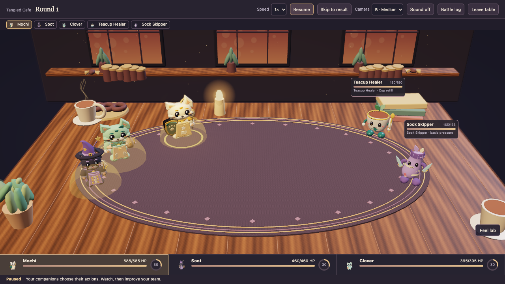
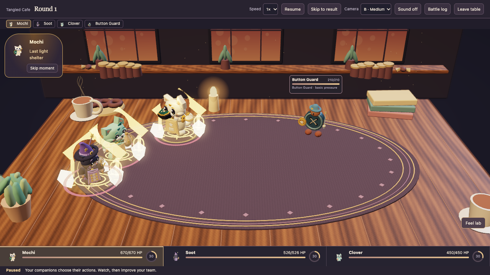
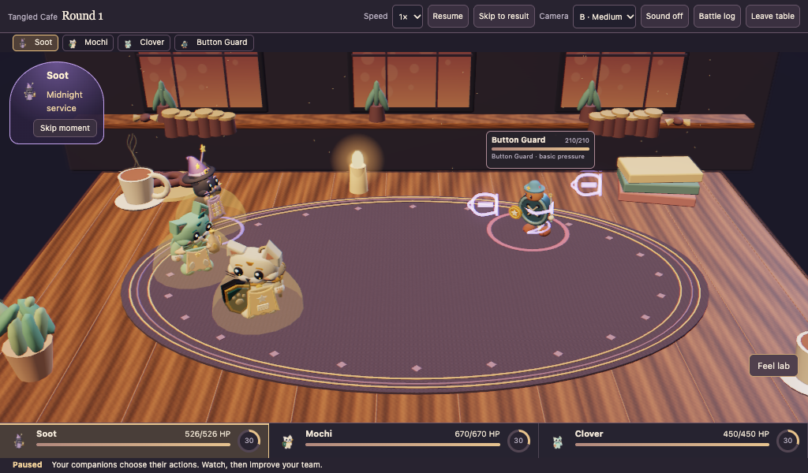

# Bản xem thử Mochi, Soot và Clover
REFERENCE: memory/PROMPT.md, effects/GATES.md, motion/GATES.md, sharpness/GATES.md, auto/GATES.md

Trận đấu đã tự động sau khi bấm Fight. Người chơi xây đội, chọn hàng và trang bị trước trận.
Sân đấu chiếm78,89% chiều cao cửa sổ1280×720.
Ba camera qua3.240 tư thế, không có giao diện đè lên mô hình hoặc thanh máu trong mẫu đo.
Ba mèo khởi đầu có chuyển động riêng, với30/30 cặp quỹ đạo bắt buộc vượt ngưỡng đã công bố.
31 hiệu ứng qua465/465 cặp so sánh ảnh xám, khoảng cách nhỏ nhất0,542308 so với ngưỡng0,16.
Các nút xem thử, tốc độ0,25×, chỉ hiệu ứng, quay lại trận và bỏ qua ultimate đều qua kiểm tra.
Mở trang trên Metal đạt MAX33,3–50 ms. CPU4× còn MAX233,4 ms, vượt ngưỡng100 ms.
Độ sắc nét mới đạt mục tiêu ở2/10 cặp ảnh cắt. Tỉ lệ kích thước nhân vật còn lệch mục tiêu.
Ma trận720 trường hợp đã xong, MAX khi cast33,4 ms và lặp lại16,8 ms. CPU4 mở trang còn MAX266,7 ms.

## Open the slice
REFERENCE: ../../docs/cardrpg3/build.json, ../../tools/cardrpg-big/build.mjs, effects/screens/checks.json

Open `docs/cardrpg3/slice.html` locally. Use **Watch a battle now** on the first screen, or open the route and prepare the team before Fight. During battle, **Feel lab** provides the action selector, camera presets, playback speed, scrubber and effect-only view. **Return to battle** restores the interrupted playback.

This copy is18,562,134 bytes and has SHA-256 `061fe9251a7eb546682a4aac6fba9bfa723ccf5a0f1506c0dc7ff1f8ff52bf03`. The measured source contains48 total hero slots including12 ultimates. The brief's separate48-plus12 count overlaps, so the existing catalogue is preserved. The slice covers the12 Mochi/Soot/Clover slots, including their three ultimates, eight chapter-one enemy signature appearances, eight enemy basic appearances and three passive cues.

## Screenshots and filmstrips
REFERENCE: effects/screens/checks.json, effects/verified/captures.json, motion/variety.json

All three sizes are recorded under `effects/screens`. Motion evidence contains20 eight-frame sheets and the required joint-distance comparisons. The demo embeds those sheets and31 six-frame effect sheets in Before / after. Raw grayscale silhouettes, edge maps and temporal arrays are retained with the effect captures.

## Hitch table
REFERENCE: effects/PERFORMANCE.md, effects/performance/summary.json, effects/performance-cpu4/HITCHES.md

| Cold page and first battle | MAX ms | Frames >25 ms | Frames >50 ms |
| --- | ---: | ---: | ---: |
|1280×720 DPR1, Metal |49.9|3|0|
|1280×720 DPR2, Metal |33.3|3|0|
|1440×900 DPR1, Metal |50.0|3|0|
|1440×900 DPR2, Metal |50.0|3|0|
|1280×720 DPR1, CPU4× |216.7|12|5|
|1280×720 DPR2, CPU4× |233.4|12|5|
|2560×1440 DPR1, Metal |50.0|4|0|

Collection begins before file navigation and includes loading and real clicks. The separate CPU4× trace recordsMAX116.6 ms, with script compilation and scene setup among the overlapping tasks. Raw arrays include every measured loading frame. The720-case matrix and five profiles are complete. First-useMAX33.4 ms, repeat-useMAX16.8 ms, first-use frames above25 ms7, repeat-use0, cast frames above50 ms0. Whole-pageMAX266.7 ms, frames above25 ms4,727 and above50 ms1,374. Raw frame count249,394.

## Honest self-assessment
REFERENCE: baseline/COVERAGE.md, effects/GATES.md, motion/GATES.md, sharpness/GATES.md, layout/README.md

These are the author's visual assessments on a ten-point scale. Numerical gates remain independent.

| User concern | Slice score | Evidence and remaining work |
| --- | ---: | --- |
| Effects and motion |6.5|Distinct starter shapes and gestures pass numerical tests. Wider roster and cinematic polish remain.|
| Sharpness |5|MSAA, textures and portraits improve the pipeline. Only2/10 crop targets pass.|
| Layout and facing |7|Stage78.89%, three-camera3240 poses clear of HUD overlap. Hero scale band remains missed.|
| Turn clarity and lag |5|Automatic playback works. HP timing, impact labels and CPU4 opening hitches remain.|
| Features beyond battle |6|Ten destinations plus Prepare/Result work. Presentation polish remains.|
| Equipment |6|Existing equip, enhance, tailor and salvage paths. Paper doll and comparisons remain.|
| Item organisation |5|Existing types remain scattered across screens. Categorisation remains.|
| Rarity tiers |5|Four tiers exist. Shared card materials and measured tier balance remain.|
| Balance |4|Automatic-controller sims show chapter-one regression. PhaseI must address it.|
| Invitations |5|Earned stamps, odds and pity exist. Ceremony, ten-pull and history polish remain.|
| Collectible limits |6|Local capped effort designs exist. Labels/help and cap review remain.|

## Gate status and continuation
REFERENCE: effects/GATES.md, effects/PERFORMANCE.md, ../cardrpg-big/memory/STATE.md

Final validation passes typecheck, lint, build,1661 web units,903 rules units and421 E2E cases. Rules report2 expected failures and11 skipped tests. High/Medium/Low and SwiftShader Low pass124 runtime cases. Face-aware bloom has zero failures under the declared tolerance after15 retained pilot failures. Peak effect instances36/96 and overdraw16/24 pass.

The starter F4 measurements and five profiles are complete, with the opening-performance miss carried to F6. The next phase will synchronize visible HP/KO with impact, show aggregate result numbers, tighten action gaps and measure real-click responsiveness. Further work covers the existing collection, equipment and invitation screens, balance, the remaining roster, final performance and the final report. The final report will list every remaining gate honestly.
