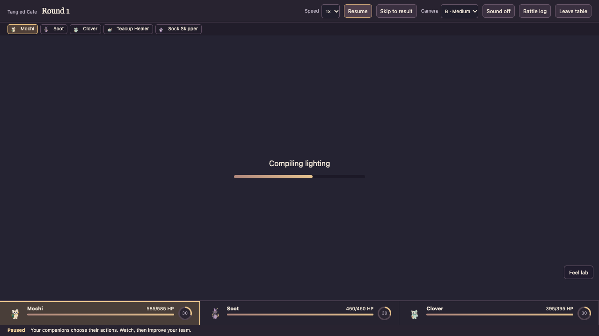
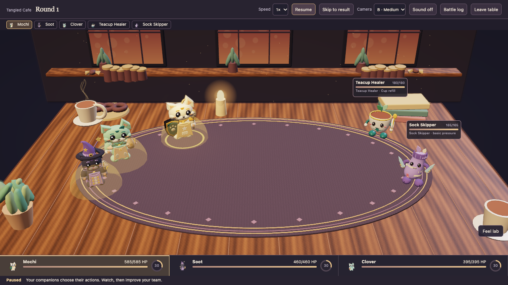

# B1 · loading checkpoint
REFERENCE: tools/cardrpg-big2/measure.mjs; tools/cardrpg-big2/lifecycle.mjs; apps/web/src/game/squad/turn3d/loading.ts

The loading screen now advances while textures, models, shader programs, uniforms and post targets prepare in bounded batches. Original stage textures are baked ahead of time. Natural replay reuses its renderer.

| Own measurement | Before | B1 | Gate |
|---|---:|---:|---|
| Native whole-page MAX |33.4ms|33.4ms|PASS100ms|
| CPU4 whole-page MAX |216.6ms|100.1ms|MISS100ms by0.1ms|
| After first hub interaction, CPU4 MAX |not separated|83.4ms|PASS100ms|
| After scene ready MAX, all7 cold cases |not separated|16.8ms|PASS100ms|
| CPU4 p95 |16.8ms|16.8ms|PASS33ms|
| Hub load-to-interactive |see raw|924–936ms native /1716–1724ms CPU4|reported|
| Battle ready from navigation |see raw|6540–6572ms native /8332–8353ms CPU4|reported|
| Retained heap,20 natural replay transitions |not measured here|+1,088,932bytes|PASS2MiB tolerance|
| Geometry/texture/program growth,20 replays |not measured here|0/0/0|PASS|
| Navigate away during warmup,20 cases |inherited fix|0 errors;20 correct disposal|PASS|
| Screenshot checks |not measured here|3sizes,0overflow/0manual controls|PASS|
| Exhaustive720 skill cases /5 profiles |inherited207calls/93802triangles|complete:33.4/16.8ms first/repeat|PASS casts; opening MISS below|

REFERENCE: baseline/summary.json; baseline-cpu4-profile/HITCHES.md; b1-cold/summary.json; lifecycle/summary.json; navigation/checks.json; screens/checks.json; ../validation/b1-source.json

Cold traces show the remaining maximum before the hub's first interactive frame; post-interactive timings include the entire 3D preparation. This is not a claim that every opening interval meets100ms. The 20-battle sample is a natural recorded encounter replayed atx4, not20different encounters. Garbage collection intervals are marked and retained in raw arrays. Full gallery coverage is recorded below; its larger whole-page maxima supersede the cold-sample bound.

Five source gates passed: typecheck/lint/build,1681web tests,903rules+2expectedfail/11skip,581Supabase,32chain,24auth,16contract,421E2E. No rules or economy files changed. Default flag-off static entry graph has no model URLs or WebGLRenderer markers; see flag-off-startup.json. A runtime flag-off network audit is still needed before the broadest exclusion claim.

REFERENCE: docs/cardrpg3b/build.json; tools/cardrpg-big2/b1-measurements.mjs
Artifact SHA25628da85ec36d0f217a0d0f14b77a446cc2c79a7871479869ad0d1b8652e195344, immutable local input /tmp/cardrpg-big2-b1-index.html. Screenshot and navigation checks are separate from frame-time samples. Original first pilot replaced HTML between cases; retained only as diagnostic.

## Exhaustive B1 matrix, 2026-11-06T18:56:31Z
REFERENCE: b1-skills/summary.json; b1-skills/ranked.json; b1-skills/profiles/summary.json

All720 fresh-page cases completed with zero runtime errors on the same28da85ec artifact. First-use MAX33.4ms, repeatMAX16.8ms,207draws and93,802triangles. Everyconfiguration exceeds99.9814% cast frames≤20ms. Per-case percentages remain in raw data; these configuration aggregates are not a promise about every single cast.
Whole-page MAX150ms native/300msCPU4 misses100ms. Worst per-case CPU4whole-pagep95=33.3ms also misses strict33ms by0.3ms. The seven-case cold values above remain valid observations but are not the exhaustive worst case. First-interactive boundaries were not recorded by this inherited matrix harness, so83.4ms is still only the separate cold7 measurement. Fivecast-offender profiles plus twoexplicit opening-offender reruns preserve traced and untraced observations separately.
