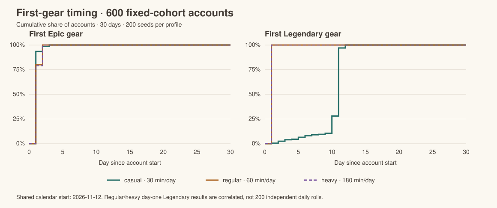

# B4b — final 30-day economy projection

All 600 accounts completed: three declared player policies × 200 seeds (90001–90200) × 30 days. Rules runtime SHA256: `4e68bb5977dfd04657aada154793a2bc1513811b3b48ecd183af9d8dd57f69a1`. Source commit: `34415dd036cab3b9d696c930341630e81db64b07`; run metadata: 2026-11-12T11:47:57.629Z. Raw daily accounts and the immutable runtime remain outside Git in `/Users/bao/Documents/Codex/2026-11-12/files-pasted-by-the-user-paste-9/work/c2/loot-affix`. Compact reproducible results: [ECONOMY.json](ECONOMY.json).

This is a modeled player policy using public transactions and the battle playback clock. The five real 30-minute UI sessions are reported separately in [BALANCE.md](BALANCE.md). Every profile starts on 12 November and shares each daily-route seed. Consequently regular/heavy day-one Legendary results are calendar-correlated; the 200 account seeds do not measure between-date uncertainty.

| Profile | Minutes/day | First Epic median / p90 day | First Legendary median / p90 day | Legendary censored at day30 | Bag final median / p90 / max seen |
|---|---:|---:|---:|---:|---:|
| casual | 30 | 1 / 1 | 11 / 11 | 0 | 48 / 48 / 51 |
| regular | 60 | 1 / 2 | 1 / 1 | 0 | 48 / 48 / 51 |
| heavy | 180 | 1 / 2 | 1 / 1 | 0 | 48 / 48 / 51 |

The casual first-Epic target is day 1–2; the first-Legendary target is day 10–16. Bag size reflects the declared policy that salvages spare low-rarity pieces above 48, while preserving equipment and counting gross creation before salvage; the game's shelf limit is 240. The maximum can temporarily exceed 48 after a transaction. [CDF data](../../docs/cardrpg-c2/economy-rarity.csv) preserve all 30 days and any censoring.

| Profile | Currency | Mean starting balance | Mean earned | Mean spent | Mean ending balance | Out/in | 0.8–1.1 target |
|---|---|---:|---:|---:|---:|---:|---|
| casual | fish | 600.00 | 12600.00 | 13102.02 | 97.97 | 1.040 | PASS |
| casual | threads | 40.00 | 3431.70 | 3293.12 | 178.59 | 0.960 | PASS |
| casual | stamps | 600.00 | 10800.00 | 11368.20 | 31.80 | 1.053 | PASS |
| casual | essence | 0.00 | 179.55 | 155.44 | 24.11 | 0.866 | PASS |
| regular | fish | 600.00 | 12600.00 | 13102.83 | 97.17 | 1.040 | PASS |
| regular | threads | 40.00 | 3409.78 | 3317.50 | 132.28 | 0.973 | PASS |
| regular | stamps | 600.00 | 10800.00 | 11340.00 | 60.00 | 1.050 | PASS |
| regular | essence | 0.00 | 179.88 | 154.87 | 25.01 | 0.861 | PASS |
| heavy | fish | 600.00 | 12600.00 | 13106.23 | 93.78 | 1.040 | PASS |
| heavy | threads | 40.00 | 3433.04 | 3331.82 | 141.22 | 0.971 | PASS |
| heavy | stamps | 600.00 | 10800.00 | 11340.00 | 60.00 | 1.050 | PASS |
| heavy | essence | 0.00 | 180.00 | 155.01 | 24.99 | 0.861 | PASS |

Out/in uses actual earned income, with starting balances shown separately. A ratio above one can consume starting funds. No idle balances were deleted to improve this ratio. Purchases use legal public transactions and prospective mean-roll Power; the policy cannot inspect a future random roll.

| Heavy / casual progress per active hour | Ratio | ≤3× target |
|---|---:|---|
| xpPerHour | 0.167× | PASS |
| gearPerHour | 0.165× | PASS |
| masteryPerHour | 0.167× | PASS |

These are explicit XP, gross gear and mastery-material proxies. Daily caps flatten extra play; they do not imply that every subjective definition of progress has been bounded.

Per-item weekly gross creation and eligible template supply are published in [WEEKLY-SUPPLY.json](WEEKLY-SUPPLY.json) and [OUTBOX.md](OUTBOX.md), using CHAIN's exact READY catalog. Eligible templates are not authoritative mint receipts. Ordinary browser-save campaign issuance remains zero pending trusted player, earning and consumed/sealed records. Star Thread is a separate one-time CHAIN judge entitlement, never recurring campaign supply.

Item-impact evidence stays separate in [DROP-TABLE.md](DROP-TABLE.md): the 6,144-cell/100-paired-seed screen retains four 13pp misses; the four-cell independent 1,000-seed follow-up measures 4.6–11pp, with the Crumbweave interval extending above 12pp. The prior 27-cell holdout measures at most 9.3pp. Do not relabel the failed screen as a pass or infer a universal 12pp bound.

## Acceptance and one return pass

Casual median first Epic: **day 1** (target 1–2); first Legendary: **day 11** (target 10–16). All 12 profile/currency sink ratios meet 0.8–1.1. All three published heavy/casual per-hour proxies meet the 3× cap. Current next-draw rates and the hard cap of 24 remain visible; useful duplicate/shelf-overflow conversion is covered by the final unit/browser suites.

B4b self-score: **7/10**, because the complete item screen still has four 13pp misses and the Crumbweave independent interval extends above 12pp. The requested return pass has already been applied: after the failed item/set screens, source/policy repair and the affix/Riposte table correction were measured again on the full catalog, independent holdouts, five real UI runs, 500 progression seeds and this full monthly cohort. Retain the new values and the unresolved interval; a passing holdout point estimate is not universal acceptance. No fourth B4 enemy-tuning pass was taken.

Export validation (2026-11-12T12:56:18.145352+00:00): exactly 600 unique profile/seed pairs and all 30 daily records; frozen runtime and READY trade hashes match; mean currency ledgers reconcile; each item's five observed-week totals reconcile to its monthly total; all rarity CDFs are monotonic; bags remain within 240; campaign-authoritative issuance is zero.
