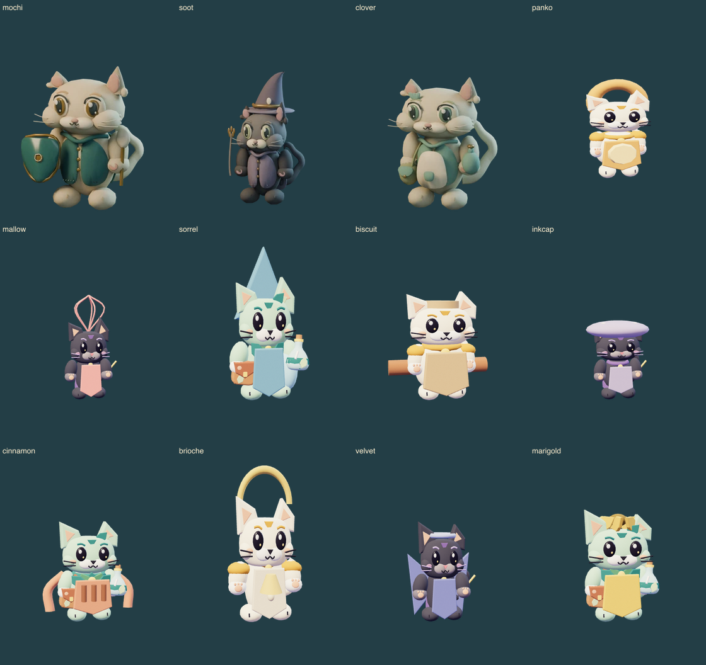
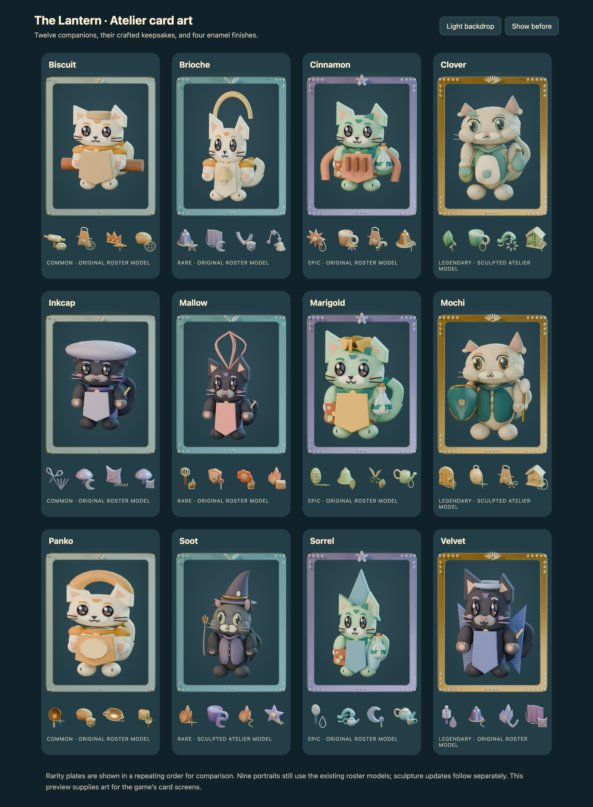

# L6 card-art checkpoint

REFERENCE: docs/cardrpg-look/art.html; docs/cardrpg-look/index.html; apps/web/src/game/cardrpg/look-assets.json
REFERENCE: reports/cardrpg-look/validation/l6/audit.json; reports/cardrpg-look/validation/l6/REVIEW.md

Original Blender renders deliver 12 actual-model portraits, 48 skill miniatures and four static rarity lighting plates at 1x/2x, plus icon/plate atlases. Three hero portraits use the L1 sculpture; nine portraits explicitly use inherited models pending L5. No claim of nine newly sculpted cats or dynamic foil. Lane A still owns icon/plate integration into its card screens.

Runtime source `e71db1d6895e0713f3753fb03c2ae1c7e72d4369`; HTML `4696d62cd47cbf28ede7a30f2f661ef8198c46ac50b11f20b75bfd138f5cbdba`, 26,392,592 bytes, 1844 hashed inputs. Art manifest `100a69780d9b9e3562058b1e87dfc921b523c18935d8aace106c818d9f96222f`; individual delivered images 2,835,396 bytes. Offline gallery `a11f3fb568f70dedda45d48f5a71671d2be89724e8095e41f81ee9725f0f1bd7`. Stacked on published L4 #368; accepted A3 base remains `daba7d7c`, with no A4 rules adoption.

## Visual evidence and review

All original art rounds remain under rounds/art: two rounds for all assets and a third hero/icon refinement. The selected rounds are bound by selection.json/delivery.json. Both backgrounds and the actual 1x twelve-card crop were personally reviewed. Delivered hero height coverage is81.25–84.38% (Soot is slightly smaller than the stored before); rounded cups, paper, bells, cloth and leaves replace generic glyphs. Metrics include alpha borders, bounds, luminance/value fractions, saturation, Laplacian variance and SSIM; changed framing means SSIM is descriptive, not a quality score.

Remaining visual defects: pale whiskers/ear tips lose contrast on light backgrounds; tiny secondary icon details remain weak at 64px; plate structure is repetitive; inherited hats/ears/costumes remain angular. Self-grades: hero portraits7.5/10, inherited portraits6, miniatures7, plates6.5. Four-role review and specific region notes: validation/l6/REVIEW.md.

## Measured checks

| Check | Result |
|---|---|
| Source gates | Typecheck/lint/unit/build pass;1751web tests. E2E420 pass +1 unchanged-source focused retry; **not**421 passing in one run |
| Gallery |72 images at1024/1280/1440; before/after toggle and restored state pass;0overflow/errors/remote requests |
| Actual Collection/Team |3sizes×DPR1/2;180 decoded portraits and24 state-preserving toggles;0errors/remote requests |
| Preview loading |Hub→Collection while warming,4 selected models and2 real Look toggles; allready,0errors/remote |
| First/repeat casts |24 windows MAX16.8ms, p95MAX16.8ms, minimum100.00%≤20ms |
| Cold7 |NativeMAX33.3ms;CPU4MAX133.3ms;0errors |
| Load-to-Hub |Native875.4–901.1ms;CPU42243.2–2256.1ms |
| Battle-ready |Native6047.4–6135.0ms;CPU48581.0–8633.8ms |
| Flag-off |11JS/3,522,593bytes;0Three/model modules or requests;byte delta+93 |
| Size |26,392,592bytes;2,396,630 aboveL4;within32MB with explicit visual justification |

The original Squad timer timeout at0.1s and the failed offline CSP/navigation attempt are preserved. Navigation now resolves against the originating actor's scene snapshot; two regression tests cover named/role loading and cancellation. No test timeout increase or failure-log removal.

Embedded gzip/base64 bytes by class: flipbooks 1,416,492; atelier-models 1,901,124; portraits 6,443,236; atelier-stage 1,998,112; classic-models 2,867,752; textures-and-other 8,042,804; icons 20,280. The main artifact contains portraits; the separate6.52MB gallery demonstrates all delivered icons/plates. Size justification records the full-size portrait gain and the previous23,995,962-byte artifact. No claim that new icons already ship in A's UI.

## Misses and remaining scope

- Original24MB target exceeded; explicit up-to32MB visual justification recorded.
- Exact startup byte parity: +93 bytes.
- Cold-open max 133.29999999999995ms exceeds50ms; inspect phase cold traces.
- Inherited L4 strict uniqueness:1162/2211 numeric pair regressions remain open; no new VFX claim from L6.
- Nine cats and13 opponents still need L5 sculpture. Tiny icon details/light-backdrop contrast need refinement.
- Final25×86×10matrix,20battle lifecycle and CPU4Balanced/Low timings remain unrun until L7.
- A4 event schema and fixtures have been read; optional Battle presentation remains open, preserving legacy OFF behavior and action duration.

Portable inventory includes all art originals/reviews and L6 validation receipts/captures. Failed HTML binaries remain local unchanged and explicitly inventoried; unrelated4.8GB L4 raw frames are not selected. No merge/deploy/shared/protected/rules changes, subagents or generative calls. Native macOS; Docker is not used by this lane.

Raw process logs and the original Playwright error context retain their whitespace; acceptance receipts bind their exact bytes. Whitespace checks apply to authored documentation, not to rewriting those original logs.
