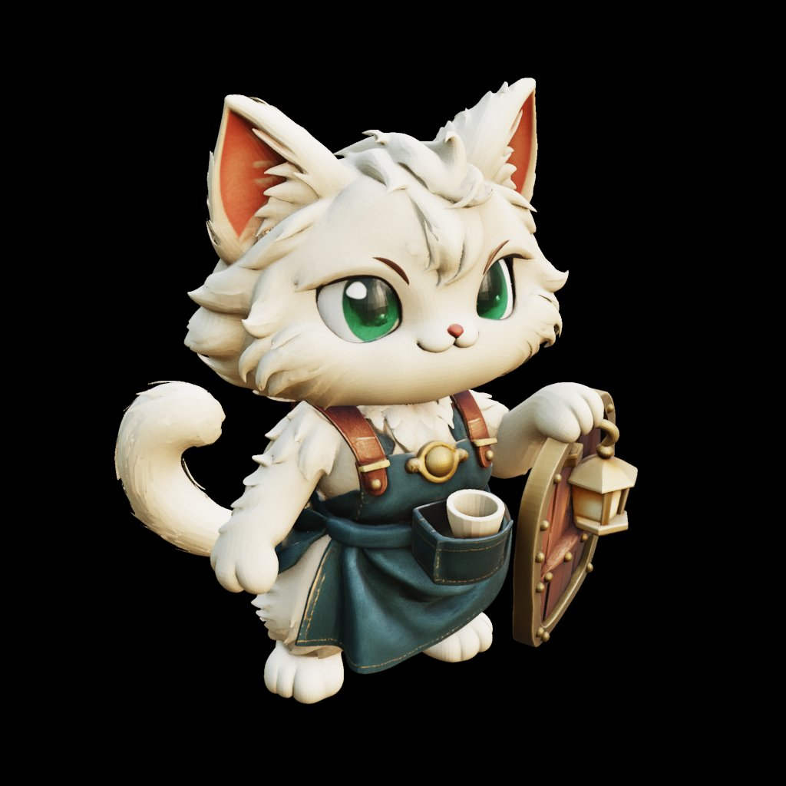
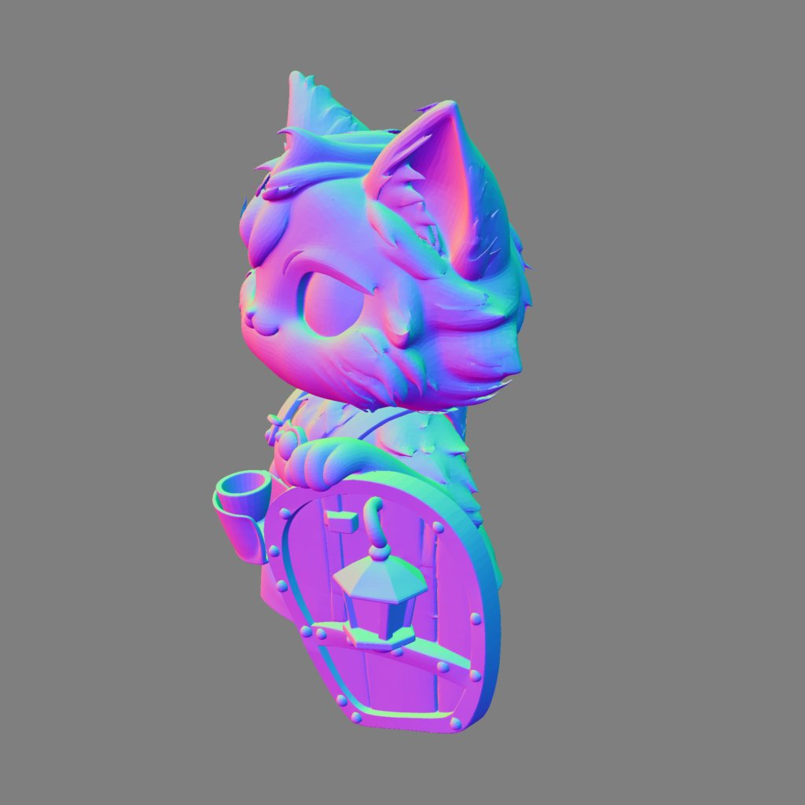

R1 PARTIAL: đã chuyển chính ảnh Mochi thành bản xem 3D, chưa nhận được GLB.
Các góc xem có chiều sâu rõ; ảnh xem không thay cho model có rig trong trận.
TRELLIS.2 chặn bước xuất vì hạn mức GPU; lỗi gốc đã được giữ nguyên.
Bạn đã cho phép dịch vụ ngoài; fal chưa kết nối, cần thao tác ở thẻ plugin.
Chưa chọn pipeline hoặc nhân rộng roster; các mẫu cũ vẫn là phương án chưa đạt.

# R1 checkpoint — 2026-11-09 UTC / 10 Nov local

- Draft [#427](https://github.com/ntbaoheyhey/taskbar-hero/pull/427), branch `codex/cardrpg-art-r1-2026-11-09`.
- Housekeeping already complete: M5 reporting merged at `5aba0bbaa`; #420 link-only `c5712f7c0` verified remote. R0/S6/M5 not repeated. No PR merge or deployment.
- The user rejected stiff, pasted-looking 2.5D and loose primitive approximation; direct reconstruction from the existing generated image is the current next step. Original external-service restriction is overridden for this Mochi workflow by “Cho phép image-to-3D bên ngoài”.
- Attempt1 failed locally on the client argument rename, before upload. Attempt2 sent our original PNG to official `microsoft/TRELLIS.2-4B`: generation reached preview at22:25:57Z; `extract_glb` failed at22:26:12Z. No later inference retry.
- Exact error: `You have exceeded your ZeroGPU quota (120s requested vs. 134s left). Try again in 23:59:02. Authenticate with a Hugging Face token for more quota`.
- [Provider receipt](r1/image-to-3d/receipt.json) and [hashed evidence manifest](r1/image-to-3d/manifest.json) retain six original provider JPEGs. The provider preview HTML remains outside git; its hash is recorded.
- Looked at textured side/front-three-quarter and normal-mode images: cheek/muzzle relief, ears, fur tufts and shield thickness are visible; these preserve the Mochi design better than the earlier procedural trial. No claim about topology, skinning, export fidelity or motion can be made from these images.
- fal connection check: plugin available but `installed:false`; already suggested at22:20Z, so no duplicate suggestion. Official TripoP2 route documentation supports image input and textured/PBR model output, but connector access is unverified. No fal job or purchase submitted.
- [Import plan](r1/IMPORT-PLAN.md) records structural inspection, neutral renders, cleanup/rig, skeleton-safe cloning, clip-cache separation and real battle motion acceptance. Rig not built; game integration not attempted.
- [Tool validation](r1/image-to-3d/validation.json): three Python tools compile; existing v2 GLB inspection passes; malformed input is rejected; all retained evidence hashes match. No Blender render or rig test is claimed.
- No pipeline accepted. R1 score **NOT VERIFIED**; retained R0 weighted baseline **5.9966/10**. The ≥8.5 target and all original gates remain. A provider preview does not replace the four-unit battle bake-off.
- Prior candidate type/lint/unit/build and five-seed parity receipts remain local; they do not validate this reconstruction. New work in this checkpoint is evidence, reports and local inspection tooling. No runtime change is published in this checkpoint.
- R2/R4/R5/R3/R6/R7/R8 remain pending. The next dependency is an exportable mesh from the authorized service. Existing unaccepted runtime candidates are preserved locally, not selected or discarded.

