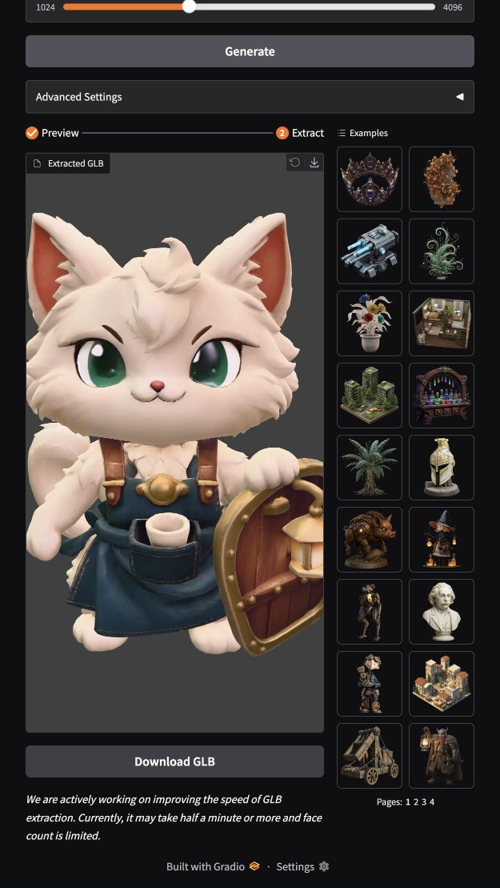

R1 PARTIAL: đã tự động chuyển ảnh Mochi thành mesh 3D và tải GLB về máy.
File 5,37 MB có 96.900 tam giác và hai texture; không phải ảnh billboard.
Bước xuất trên phiên đăng nhập thành công; lỗi quota cũ vẫn được giữ nguyên.
Chưa có xương hay animation; cần kiểm tra hình khối, giảm lưới và rig trước khi chạy trong trận.
Chưa chọn pipeline hoặc nhân rộng roster; không cần kết nối fal để lấy model Mochi này.

# R1 checkpoint — 2026-11-09 UTC / 10 Nov local

- Draft [#427](https://github.com/ntbaoheyhey/taskbar-hero/pull/427), branch `codex/cardrpg-art-r1-2026-11-09`.
- Housekeeping already complete: M5 reporting merged at `5aba0bbaa`; #420 link-only `c5712f7c0` verified remote. R0/S6/M5 not repeated. No PR merge or deployment.
- The user rejected stiff, pasted-looking 2.5D and loose primitive approximation; direct reconstruction from the existing generated image is the current next step. Original external-service restriction is overridden for this Mochi workflow by “Cho phép image-to-3D bên ngoài”.
- Historical attempts: Attempt1 failed locally on the client argument rename, before upload. Attempt2 sent our original PNG to official `microsoft/TRELLIS.2-4B`: generation reached preview at22:25:57Z; `extract_glb` failed at22:26:12Z. The later user-requested browser automation is documented below.
- Exact error: `You have exceeded your ZeroGPU quota (120s requested vs. 134s left). Try again in 23:59:02. Authenticate with a Hugging Face token for more quota`.
- [Provider receipt](r1/image-to-3d/receipt.json) and [hashed evidence manifest](r1/image-to-3d/manifest.json) retain six original provider JPEGs. The provider preview HTML remains outside git; its hash is recorded.
- Looked at textured side/front-three-quarter and normal-mode images: cheek/muzzle relief, ears, fur tufts and shield thickness are visible; these preserve the Mochi design better than the earlier procedural trial. No claim about topology, skinning, export fidelity or motion can be made from these images.
- fal connection check: plugin available but `installed:false`; already suggested at22:20Z, so no duplicate suggestion. Official TripoP2 route documentation supports image input and textured/PBR model output, but connector access is unverified. No fal job or purchase submitted.
- [Import plan](r1/IMPORT-PLAN.md) records structural inspection, neutral renders, cleanup/rig, skeleton-safe cloning, clip-cache separation and real battle motion acceptance. Rig not built; game integration not attempted.
- [Tool validation](r1/image-to-3d/validation.json): three Python tools compile; existing v2 GLB inspection passes; malformed input is rejected; all retained evidence hashes match. No Blender render or rig test is claimed.
- No pipeline accepted. R1 score **NOT VERIFIED**; retained R0 weighted baseline **5.9966/10**. The ≥8.5 target and all original gates remain. A provider preview does not replace the four-unit battle bake-off.
- Prior candidate type/lint/unit/build and five-seed parity receipts remain local; they do not validate this reconstruction. New work in this checkpoint is evidence, reports and local inspection tooling. No runtime change is published in this checkpoint.
- R2/R4/R5/R3/R6/R7/R8 remain pending. The exported Mochi mesh is now available; geometry review and rigging are next. Existing unaccepted runtime candidates are preserved locally, not selected or discarded.

## Automated conversion/export — 2026-11-09 22:52 UTC

- User requested automation of the existing signed-in TRELLIS session. Original PNG upload was resumed without regenerating concept art; one Generate and one Extract completed at seed20261109/resolution1024/target100000faces/texture2048.
- [Original GLB](../../../assets/source/look-v3/image-to3d/mochi-source.glb) is source-only, outside the demo bundle. Correct repository path: `assets/source/look-v3/image-to3d/mochi-source.glb`. SHA256 `eb84d0f8ca114736806432a18c0abd7249f3fb451c642c53fb28a1a85c0912a6`, 5,369,360 bytes.
- [Automation receipt](r1/image-to-3d/browser-automation.json), [download provenance](r1/image-to-3d/browser-download.json), [structural inspection](r1/image-to-3d/browser-structure.json): 96,900 triangles, UVs, two embedded WebP textures, no skin, no animation, no external resources.
- Browser download helpers timed out. The exact download URL visible in the generated result was retrieved successfully through urllib; no browser credentials/cookies read, no payment or plugin install.
- [Topology diagnostic](r1/image-to-3d/browser-topology.json): rounding positions to1e-5 gives43,605 welded positions and29components;42,992positions lie in the largest connected component. This is a fused source mesh, not animation-ready separate body parts. Geometry and skin weights need review.
- [Neutral six-angle Blender review](r1/image-to-3d/browser-review/contact-sheet.webp) completed under the shared timing lock. Front, both sides, back and clay show volumetric head/ears/tail/apron/shield. Source preserves the original silhouette and palette; it is a better modelling starting point than the rejected primitive approximation. No runtime acceptance, beauty score or animation claim.
- Review flaws to address before animation: fused paw/shield and shoulder seam; thick eyelash ridges; rough detached fur islands; simplified back/apron continuation; lantern has no authored emissive/independent light. First priority is clean deformation and shield rigidity.

