# B2 · Readable Battle

Mèo và quái đã lớn hơn; giữ nguyên quán đêm, tông teal/honey và mô hình gốc.
HUD dùng chân dung, biểu tượng hồi chiêu và số nổi đúng trên nhân vật.
Nhà kính Clover có kính/khung mật ong; các tuyệt kỹ thêm nhịp gom sáng và dư sáng.
Demo ngoại tuyến: 29,812,862 byte; bản nhẹ: 21,550,338 byte. Chưa merge hay triển khai.
Các giới hạn còn lại và số đo thực tế được ghi dưới đây; đây là tự đánh giá, chưa phải nghiệm thu của người dùng.

Base closure `0ce18c085`; branch `codex/cardrpg-b2-v6-2026-11-08`. Demo [`b2.html`](../../../docs/cardrpg-look/b2.html), SHA256 `7f4d0fcc694915958c0c38ad54c9722ced944b18b82aadc346cdaede43fe7aae`.
REFERENCE: [prompt](PROMPT.txt), [LOOK-BIBLE](../../../docs/design/cardrpg/LOOK-BIBLE.md), [trace diagnosis](v3/DIAGNOSIS.md), [state](STATE.md), [integration contract](INTEGRATION.md).

| Fixed shot | Before | After | Self-grade / reason |
| --- | --- | --- | --- |
| Round 1 | 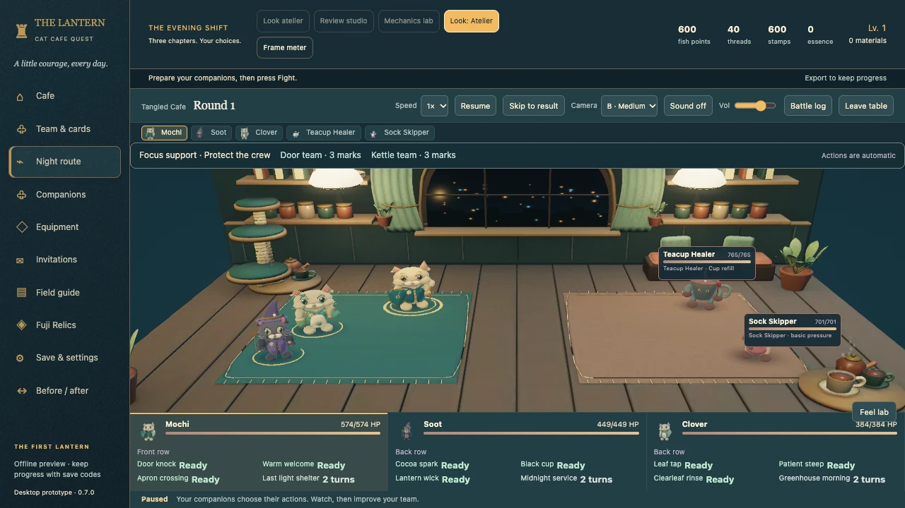 | 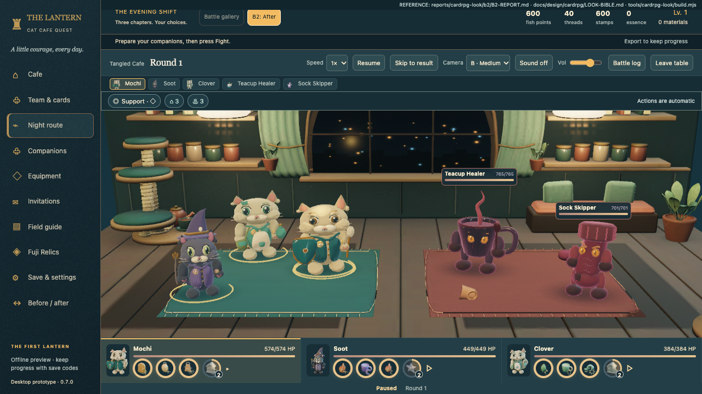 | 6→7.5/10. Larger faces and distinct mats. |
| Mochi impact | 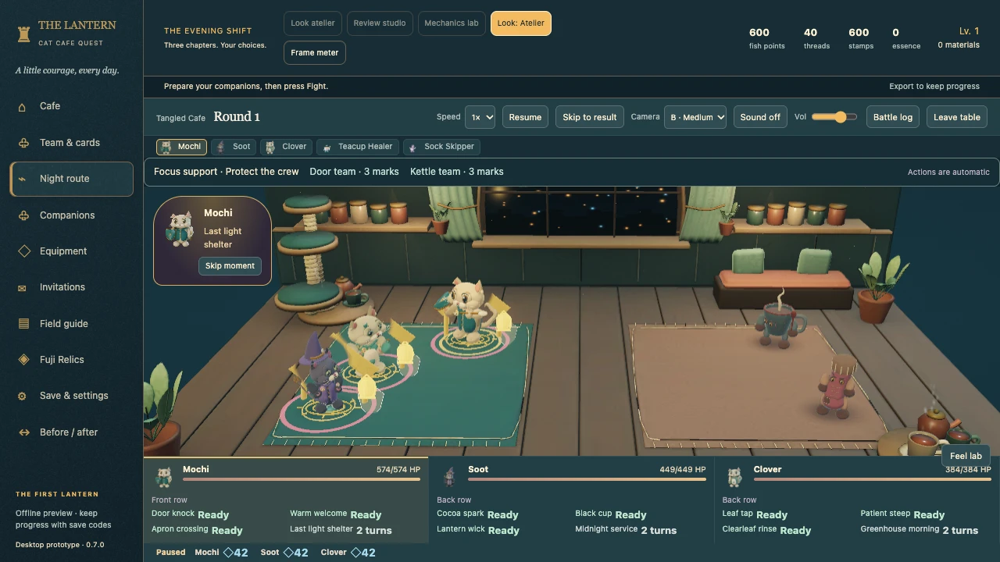 | 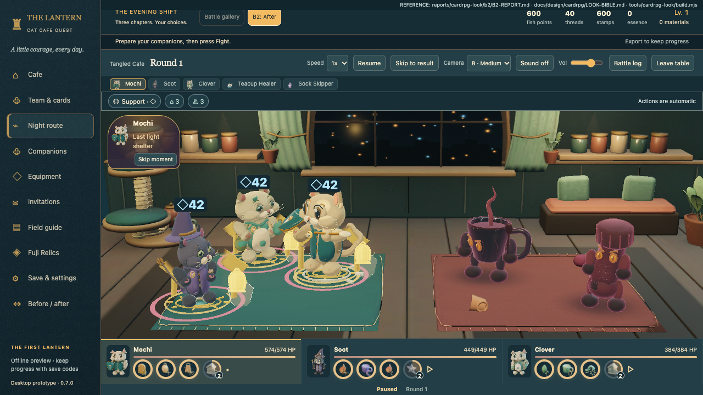 | 6→7.5/10. Readable floor impact and anchored results. |
| Clover greenhouse | 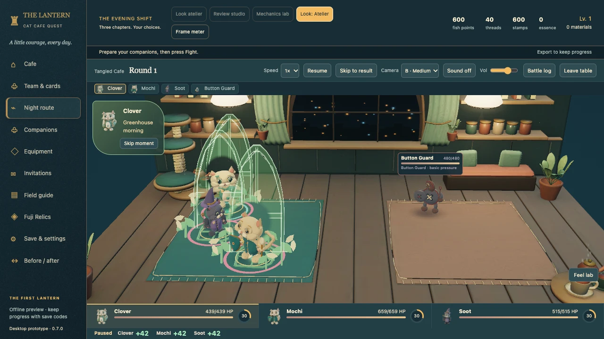 | 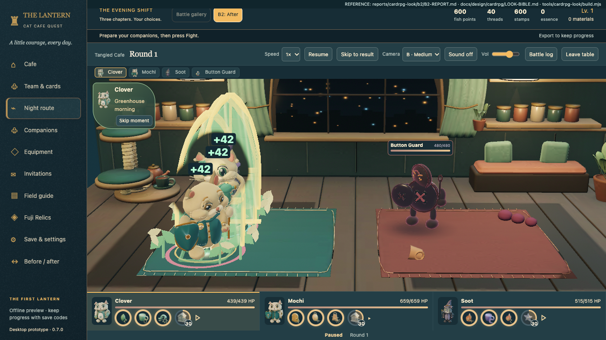 | 5.5→7.5/10. Warm ribs and visible green glass. |
| Three opponents | 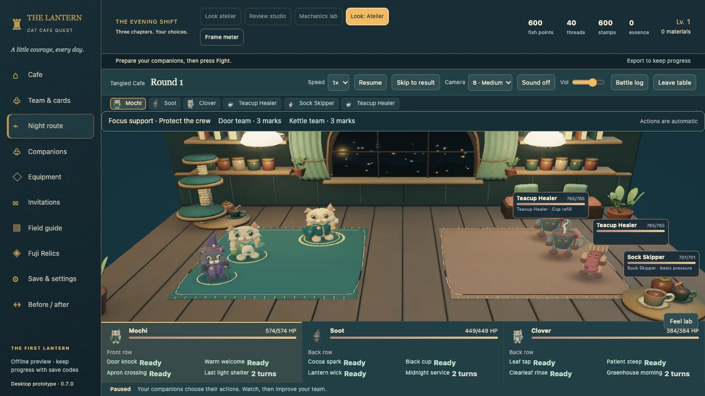 |  | 5.5→7.5/10. Staggered opponents and compact plates. |
| Yarn Giant phase | 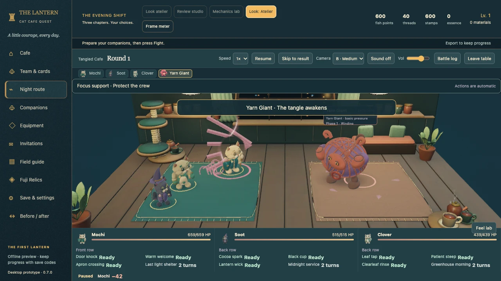 | 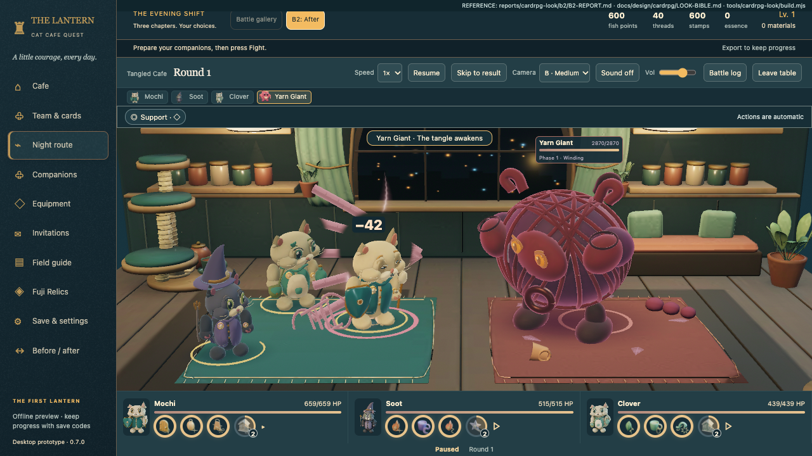 | 6→8/10. Large boss and a slim cue ribbon. |
| Earned Sorrel | 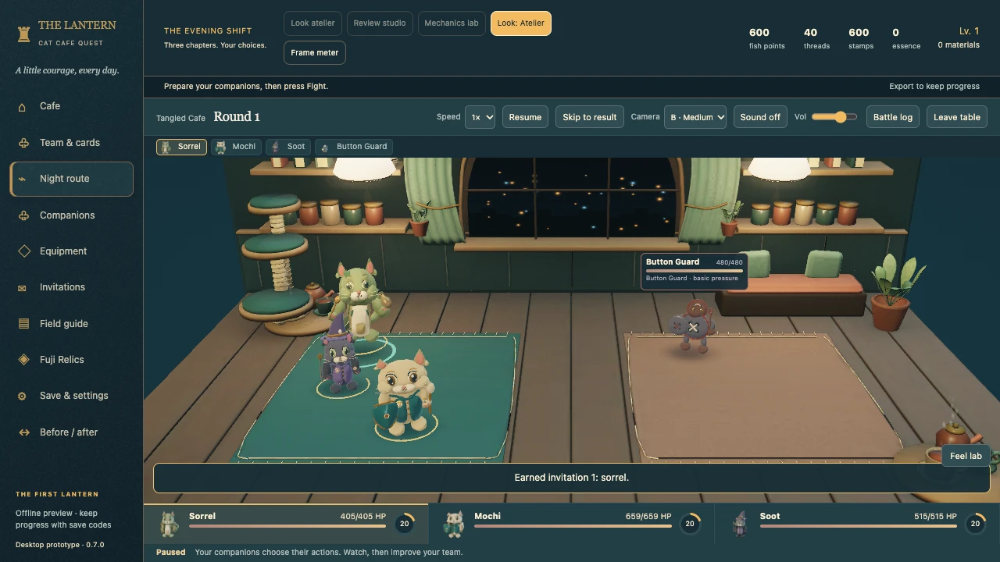 | 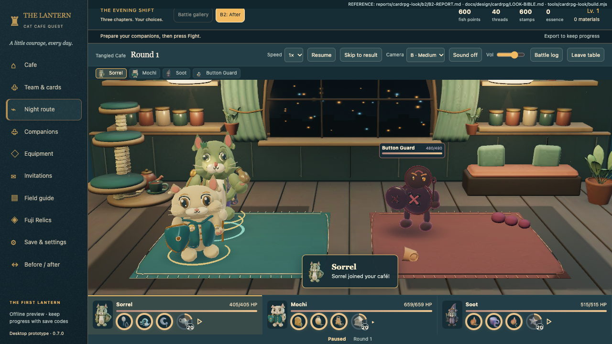 | 5.5→7/10. Named portrait receipt; inherited preview crowding remains. |

Coverage at 1280×720, preset B; actual projected model bounds, first canonical appearance; both denominators retained.

| Unit | Arena height before → after | Page height before → after |
| --- | --- | --- |
| mochi | 20.6% → 35.5% | 9.9% → 20.4% |
| soot | 25.3% → 40.0% | 12.1% → 23.0% |
| clover | 20.9% → 30.8% | 10.0% → 17.8% |
| teacup-healer | 19.1% → 37.4% | 9.2% → 21.5% |
| sock-skipper | 19.6% → 34.8% | 9.4% → 20.0% |
| button-guard | 15.9% → 30.7% | 9.8% → 19.2% |
| yarn-giant | 44.4% → 67.7% | 21.3% → 39.0% |
| sorrel | 25.0% → 42.0% | 15.3% → 26.3% |

| Stutter window / response | Fresh closure | V3 | After V5 |
| --- | --- | --- | --- |
| Native first/repeat casts; cached labels, inherited prewarm | 16.8ms | 16.8ms | 16.8ms |
| CPU4 first/repeat; fixed effect/light pools | 16.8ms (4actions) | 16.8ms | 16.8ms |
| Whole-page cold native; sliced uploads retained | 16.8ms (1run) | 50.0ms (3runs) | 16.8ms (3runs) |
| Whole-page cold CPU4 | 150.0ms (1run) | 166.7ms (3runs) | 166.6ms (3runs) |
| Native after Hub / scene ready | 16.8/16.8ms | 50.0/16.8ms | 16.8/16.8ms |
Load→battle ready native: fresh closure6330.8ms; after6333.6–6356.4ms; worst change+25.6ms (budget+1500).
CPU4 gallery/scene opening after V5 peaks at 250.0 ms; this wider interval is reported separately from cast windows.
Historical 633.3 ms cast / 666.6 ms cold / 400 ms post-ready remain in closure. Traces include GPU upload/flush and macOS presentation backpressure; fresh baseline did not reproduce the cast spike, so no causal cure claim. CPU4 preparation still has program/texture work; all samples retained.

HUD: repeated skill prose → portrait, HP, four focusable icon rings, turns digits; 82px cards at 1280×720; tooltip on hover/focus. Earned v1 +v2 discovery deduplication/clearing checked. Scoped numeric contrast and layout in [UI receipt](v6/ui-gallery-fix/checks.json).
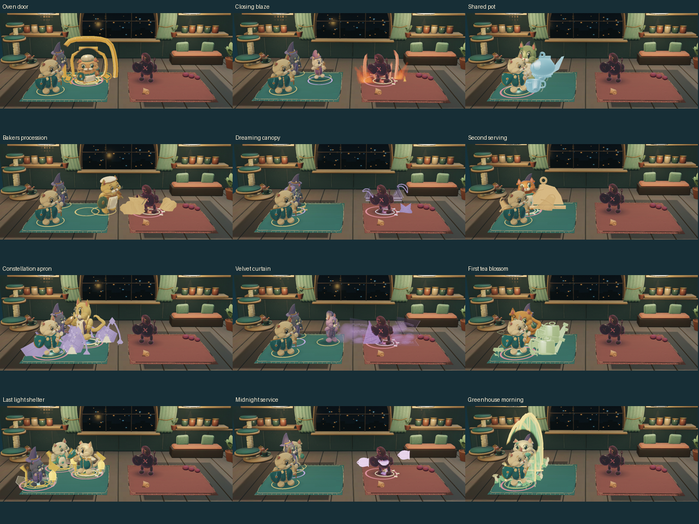
Effect identity reviewed by eye; 288 protected-face samples, 0 threshold offenders. Pooled 200 ms gather /≤650ms afterglow; greenhouse honey ribs/glass/shafts. No action clock change.

| Asset option | HTML bytes | B-owned embedded bytes |
| --- | --- | --- |
| full | 29,812,862 | 23,612,236 |
| lean | 21,550,338 | 15,349,700 |
Per-class accounting: [asset-budget.json](v6/asset-budget.json). [Lean demo](../../../docs/cardrpg-look/b2-lean.html): existing 1x portraits plus recompressed/resized legacy textures; full-frame six-shot SSIM 0.999987–0.999993. Source art unchanged.
Natural 20 s H.264 at 1440×900, x1, identical initial battle: [before](v6/videos/before-20s.mp4) / [after](v6/videos/after-20s.mp4). No cuts; capture overhead is separate from timing probes.

Gates: typecheck/lint/unit/build each phase; V6 web 1773 and E2E 421 pass; five seeds 7/17/71/1808/20261108 full battle/log byte parity. Exact counts in validation/b2-v6/source-gates.json and logs.
OFF startup: 11 scripts/3,522,500bytes, delta0, same per-chunk bytes/modules, zero Three/model modules at startup. Original index.html unchanged; [startup audit](v6/startup/audit.json).
Observed peak 115draws/117,942tris; 144cast windows and 6 cold runs after V5; page errors0. [Results](RESULTS.json).
Five-battle lifecycle growth: heap+653,272bytes, geometries+0, textures+0, programs+0. Forced GC between results; measured observations, not proof of flatness.

MISSES / limits: opponent linear luminance separation 0.009–0.039 <0.18; roster projected boss/ tallest-regular height is 1.52–1.66×, short of 2× (boss page height 34.7–37.9% exceeds 24%); full-page/arena coverage are bounding boxes, not opaque-pixel coverage. Preview Sorrel partly hides Soot; gallery controls overlap the greenhouse tip at1024/1280, with large +42 labels crowding the rear ally at1024. Historical driver stalls not cured/proven. Self-grades are not user review.
Lane A integration: adopt B-owned stack/assets and lookV2 guard; preserve events-v4 version 1, pass exact v1 earned receipt and optional v2 discovery{sequence,id} via SceneView.earnedReveal/playEntrance. Keep A5 App.tsx ?dev=1 gating; B-owned tools already gated. Evaluate lean pack separately. No A5 rebase, rules/meta/auth/contracts/Supabase/package edits, merge/deploy/mainpush.
Evidence budget 59,849,100bytes before this report; raw traces/frames in /tmp/cardrpg-b2-*. Intermediate contact sheets/receipts retained; no 860-case/2,211-pair matrix or 20-replay run.
Per-model triangle counts: [13 shipped opponents](v6/model-budget.json); all regular models ≤12k and bosses ≤22k. Measured runtime/source identity: [source audit](v6/source-audit.json).
Delivery gallery fix: preview controls moved below Pause. Three-size mouse checks repeated; original 144 cast/6 cold samples, video, lifecycle and six-shot hashes remain unchanged. [Exact lineage](v6/gallery-fix-lineage.json) proves delivered JS, assets, gallery imagery and every other CSS rule byte-identical to measured c711dec2; only .look-b2-preview top 107→171 px changes. The delivered CSS-only revision was not profiled again.
Probe continuation: original process ended after CPU4 cold run 0. Its completed sample is retained byte-for-byte; only the two missing samples were collected after resume, with the same immutable artifact. Interrupted unrecorded work is not claimed measured; [registration](v5/perf/resume.json). No completed sample was retried for a pass.
