Đã thêm huy hiệu, số cộng dồn và vòng thời hạn cho đủ 16 trạng thái hiện có.
Dấu trên nhân vật rõ hơn; Mark/Daze không còn bị vùng bảo vệ mặt che mất.
Đòn nhiều mục tiêu lệch nhau 70 ms; Crumb Burst có chữ báo 500 ms, không đổi nhịp luật.
Demo và hai video 20 giây được lưu kèm bằng chứng; chỉ tạo PR nháp, chưa merge hay triển khai.
V0 có kiểm chứng kỹ thuật; khả năng người xem nhận diện trạng thái vẫn CHƯA ĐƯỢC KIỂM CHỨNG.

# V0 · Statuses and visible combinations

Base `598fd8019e62b7203dcfac4033f74bb64ba0dac5`; B2 report checkpoint was `f4cd0da0b`, then a documentation-only handoff tip. Branch `codex/cardrpg-v5look-v0-2026-11-09`.
Demo [v5-v0.html](../../../docs/cardrpg-look/v5-v0.html): 29,130,876 bytes; SHA256 `f801aeda2cda851b42cf95b54f8e68a1430c30446c93294e7c19b8bc6da258e9`. [Integration](INTEGRATION.md).
REFERENCE: [user prompt](PROMPT.txt), [approved spec](SPEC.md), [B2 report](../b2/B2-REPORT.md), [LOOK-BIBLE](../../../docs/design/cardrpg/LOOK-BIBLE.md).

| Fixed shot | Before | After | Self-grade / reason |
| --- | --- | --- | --- |
| Burn | 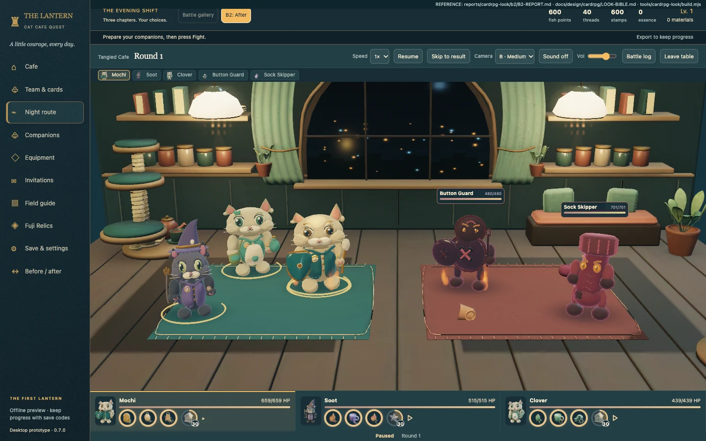 | 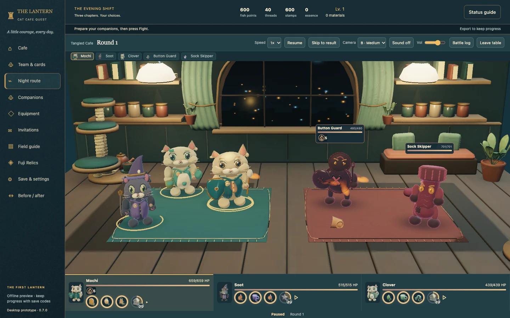 | 5→7/10; shoulder flames plus a numeric badge; rear flames can be occluded. |
| Mark + Daze | 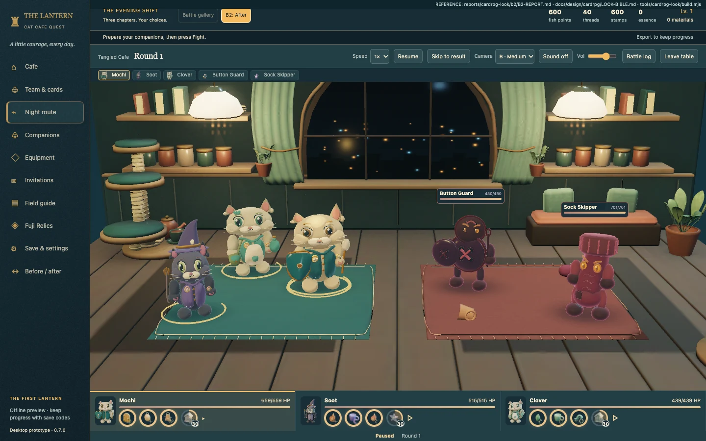 | 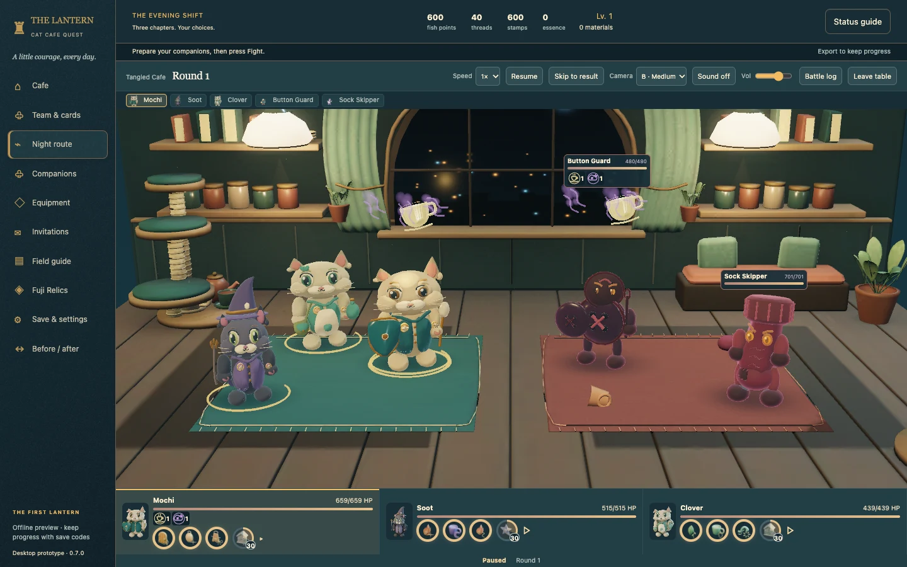 | 3→8/10; cup and clouds are visible above both heads. |
| Regen + Warm |  | 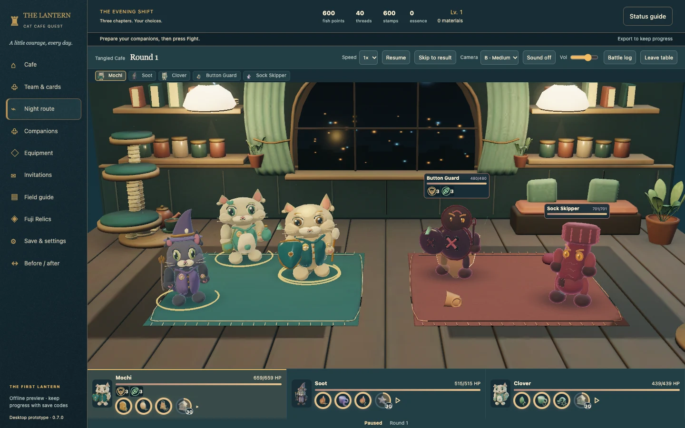 | 4→6.5/10; green leaves and badges help; honey halo remains subtle. |
| All16 / overflow | 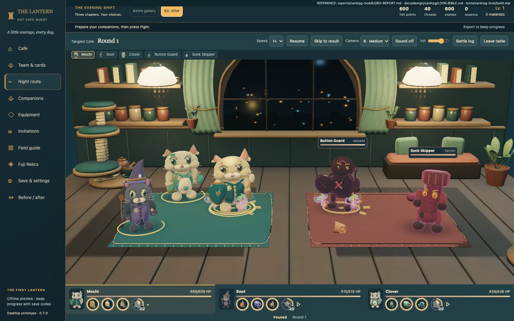 | 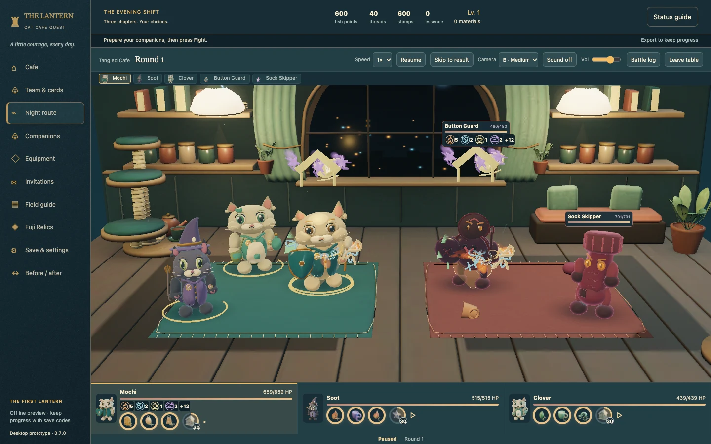 | 3→6.5/10; four badges and focusable +12 expose the vocabulary; simultaneous body marks are busy. |
| Three-target row | 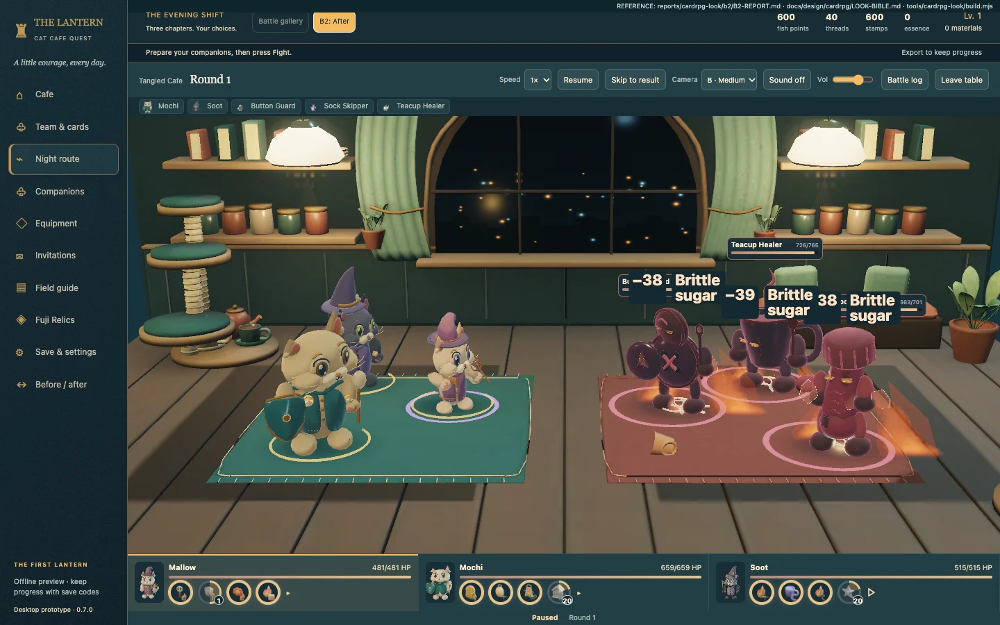 | 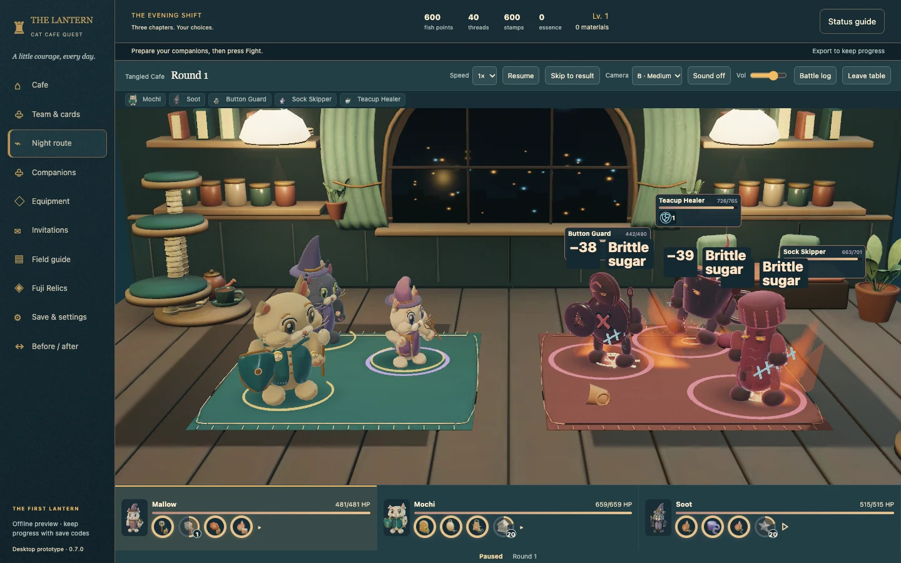 | 6→7.5/10; 0/70/140ms impacts spread; legacy large result text can crowd plates. |
| Three-target Crumb Burst | 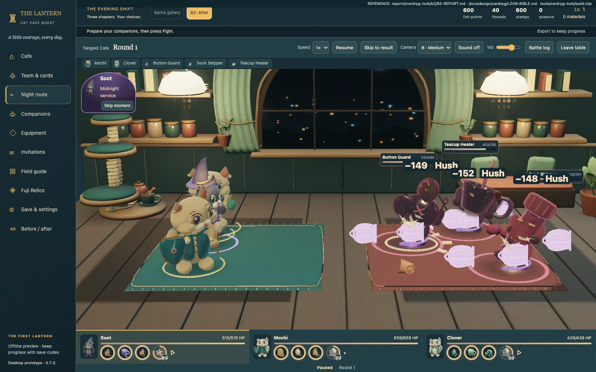 | 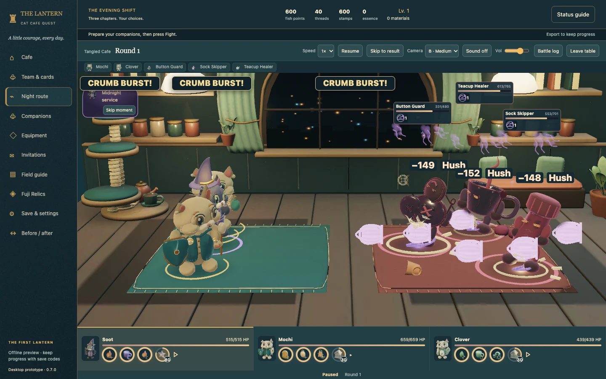 | 5→8/10; distinct words/explosion, arranged away from HP and other words. |

The six DPR1 shots are labelled presentation fixtures (existing R.act resolves row/detonation). Self-grades are not user review. [16×2 contact sheet](status-contact-sheet.webp).

| Measured item | Result |
| --- | --- |
| Five seeds 7,17,71,1808,20261108 | Full battle JSON and log hashes byte-identical; adapters leave plan and battle unmutated. |
| Native cast max | 16.8→16.8ms; 16 first/repeat windows per artifact, four actions at1280/1440. |
| CPU4 cold page max | 266.6→233.4ms (-12.5%); one fresh context per artifact, CPU-only throttle. |
| Observed peak draws / tris | 128 / 175,937; draw budget130. |
| Demo bytes | 29,130,876; B2 delta-681,986, within+1,500,000. |
| Protected faces | 80 samples, 0 threshold offenders; each current status on Mochi and Button Guard. |
| Badge overlaps / contrast | 0 at1440×900,1280×720,1024×600; minimum7.00:1. |
| OFF startup | 11 scripts/3,522,500bytes; per-chunk byte counts/modules unchanged; 8/11 content hashes exact, entry references normalize equal; zero Three/model startup modules. |

[Raw numbers](RESULTS.json) · [source audit](source-audit.json) · [UI](after-browser.json.gz) · [performance](perf-delivery/casts.json) · [cold](perf-delivery/summary.json).
Typecheck/lint/unit (1782 web/1020 rules)/build PASS. E2E:420/421 first run; the one idle-clock test passed an isolated retry on unchanged source. Cause unproven; [first failure](gates/e2e.log.gz) and [recovery](gates/recovery.json) retained.
Keyboard hover/focus tooltip, Escape, +N overflow, static reduced-motion matrices, three-size guide mouse controls and OFF fixed-frame renderer/HUD pixel parity PASS. [Delivery](delivery.json).
Natural chapter-1 x1,1440×900, continuous20s H.264: [before](https://github.com/ntbaoheyhey/taskbar-hero/blob/27aedc9275ed32109ab336f3ea8285a2965349f6/reports/cardrpg-look/skills-v5/videos/before-20s.mp4) / [after](https://github.com/ntbaoheyhey/taskbar-hero/blob/27aedc9275ed32109ab336f3ea8285a2965349f6/reports/cardrpg-look/skills-v5/videos/after-20s.mp4); same initial battle, no cuts or injected actions. [Receipt](videos/checks.json).
New artwork:16 original SVG paths; no textures/dependencies added. All look changes remain behind lookV2; rules/protected paths unchanged; action-clock delta0ms. [Provenance](../../../assets/provenance/look.md).

LIMITS: Human 4/5 status recognition is NOT VERIFIED; the natural20s clips do not cover every status/reaction. Existing warm/glaze marks are subtle; all16 simultaneous marks and legacy large row-hit numbers remain visually busy. OFF pixel check isolates a fixed battle surface from the standalone demos’ differing chrome; startup audit covers the ordinary app route.
Iteration1 native/cold results, earlier overlaps, crown-mask clipping and selector/capture failures are retained, not substituted for delivery results. No causal claim about historical macOS driver stalls; timing coverage is deliberately bounded.
V3 NOT STARTED: no published “skillsV5 events v2 fixture” DONE at this handoff. Lane A REQUEST records the needed schema; stop at V0 per the task contract.
Evidence currently 21,281,201bytes (<25MB); raw PNGs/frames in /tmp/cardrpg-v5look-*. DRAFT only; no merge, deployment, A5 worktree access or rule edits.

[DRAFT409](https://github.com/ntbaoheyhey/taskbar-hero/pull/409), stacked on395; runtime3968da538, evidence41cc9634e.
[Coordination receipt](HANDOFF.json): B-OUTBOX DONE and V3 schema REQUEST pushed; no active B jobs, stop at V0.

## V0.1 · Readability fixes

Đã neo chữ phản ứng theo từng mục tiêu, hạ Mark/Daze sát đầu và tăng độ rõ của lửa.
Huy hiệu có khung màu riêng; khói vụn tan nhanh, Warm/Glaze đạt độ mờ 76%.
Chỉ sửa phần nhìn; năm seed giữ nguyên kết quả. Tiếp tục V3 tự động khi Lane A công bố fixture.

| Fixed DPR1 shot / self-grade | V0 before | V0.1 after |
| --- | --- | --- |
| Burn: 8/10: five side flames countable |  | 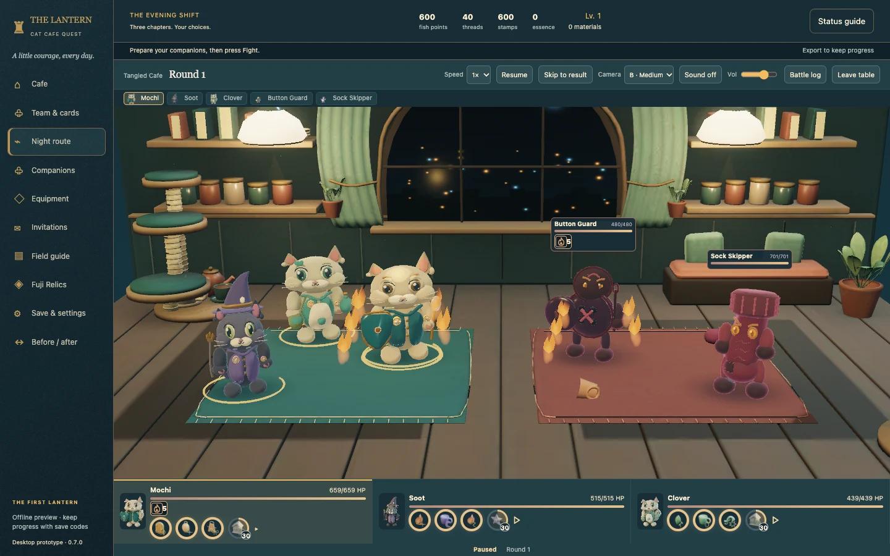 |
| Mark + Daze: 8/10: closer crowns with dark backing |  | 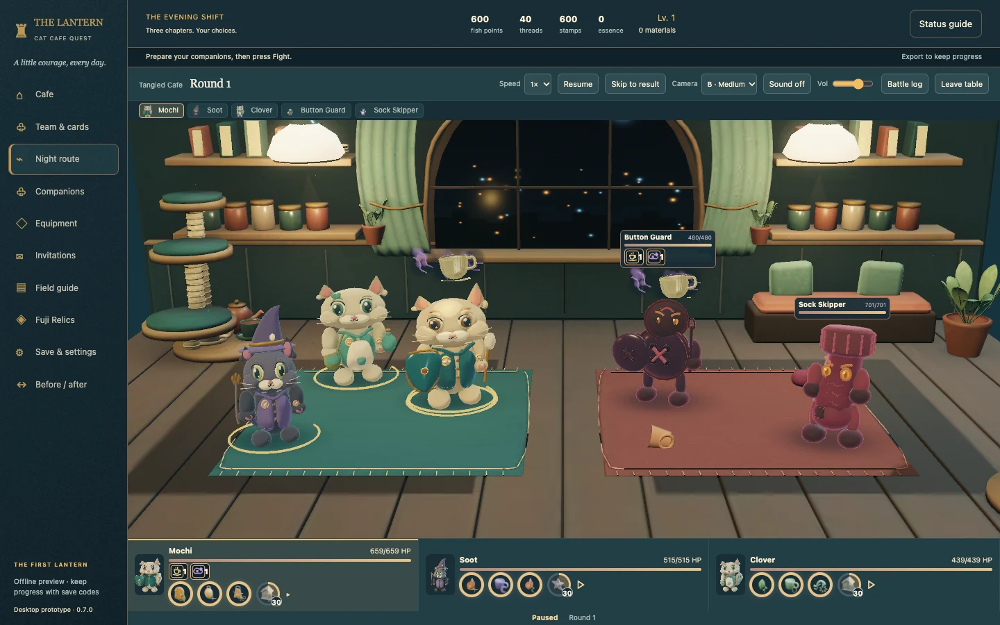 |
| Regen + Warm: 7.5/10: visible honey halo |  |  |
| All16: 7/10: framed badges, dense marks remain busy |  | 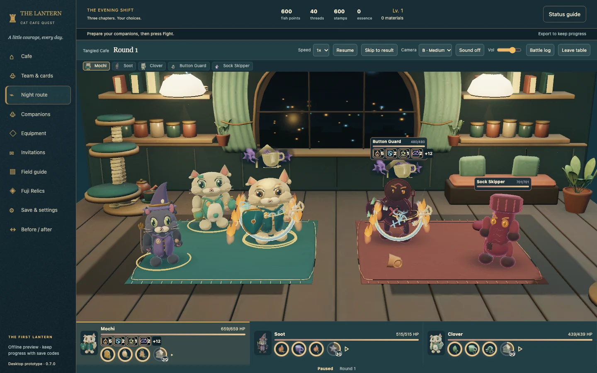 |
| Three-target row: 7.5/10: unchanged stagger, legacy numbers busy |  |  |
| Crumb Burst: 8/10: target-local words, bodies stay visible |  | 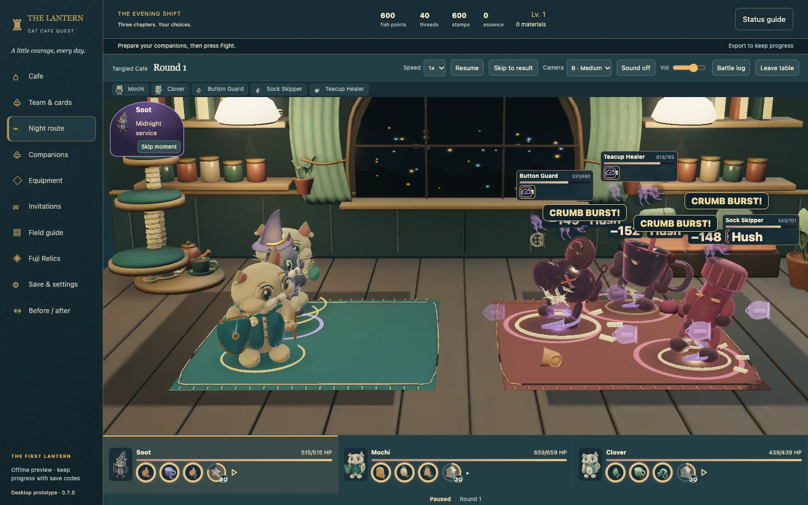 |

Five-seed full battle/log parity PASS; native 16.8ms max (16 windows); peak 128 draws/176,533 tris. CPU4 cold 233.4→199.9ms (-14.4%).
Badge/callout overlaps0 at1024/1280/1440; contrast7.00:1; icons16/20/20px, warm/teal/honey rim colours checked. Words500ms, offsets0/70/140ms; action clock unchanged.
Protected faces0/80; crown mask excludes only empty space above the entire model from the circular margin; on-model face regions unchanged. [Contact sheet](v01/status-contact-sheet.webp).
Typecheck/lint/unit1783web+1020rules/build PASS; E2E 421/421 PASS first run. [Gate receipts](v01/gates/checks.json).
lookV2 OFF fixed-frame canvas/HUD pixels exact; startup11 chunks/3,522,500bytes, unchanged sizes/modules, zero Three/model modules.
Demo [v5-v0.html](../../../docs/cardrpg-look/v5-v0.html):29,132,360bytes, SHA256 `9793d01f0f91964f44e49516ec09ebce97890c31f59cfb4ea8305886901db8d6`. [Natural20s after](https://github.com/ntbaoheyhey/taskbar-hero/blob/27aedc9275ed32109ab336f3ea8285a2965349f6/reports/cardrpg-look/skills-v5/v01/videos/after-20s.mp4),1440×900,x1,no cuts.
[Measurements](v01/RESULTS.json) · [Source audit](v01/source-audit.json). F1–F6 only; no rules/protected changes; prior misses retained. Self-grades are not user review; human recognition NOT VERIFIED.
Video thumbnail export lacked a WebP encoder; recovered from the completed original MP4 without recapture. [Failure/recovery](v01/videos/checks.json); same-initial hash was not recorded for this clip.
V3 follows automatically after published V5A-S4 DONE events v2 fixture; native wait has no timing lease. Draft stacked on409; no merge/deploy.
Evidence: 3,657,439 added bytes (<8MB); total <25MB. Large JSON receipts use lossless gzip; startup images use pixel-exact lossless WebP. [Packing](v01/packing.json).
