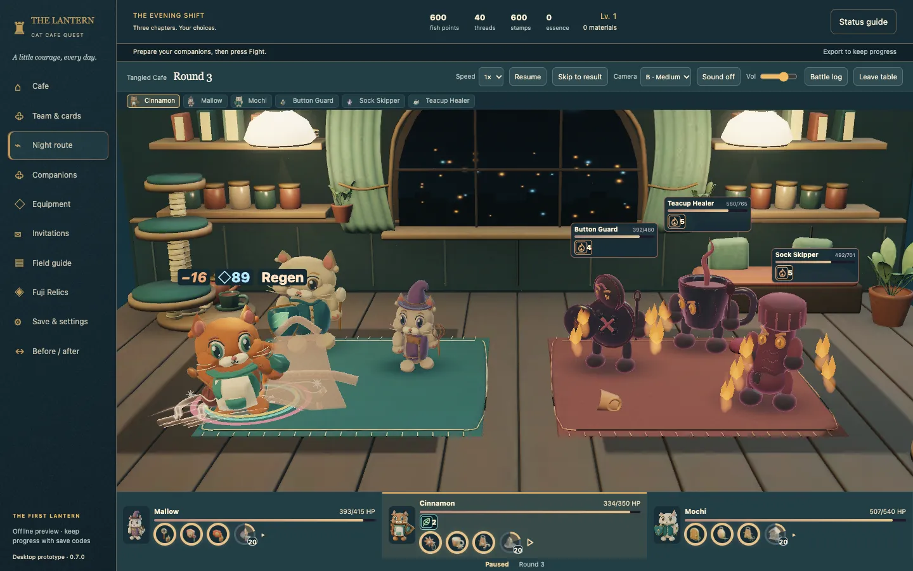
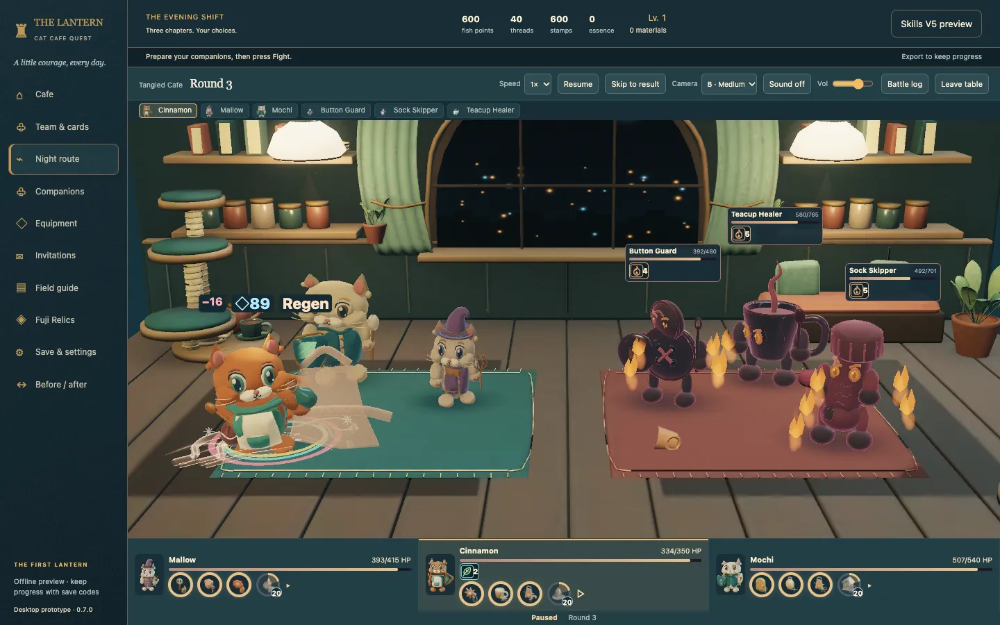
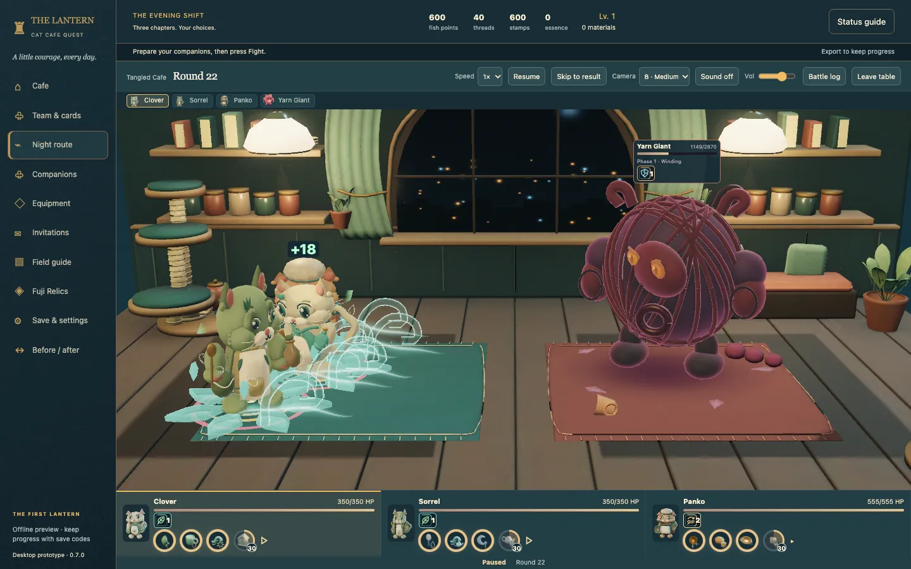
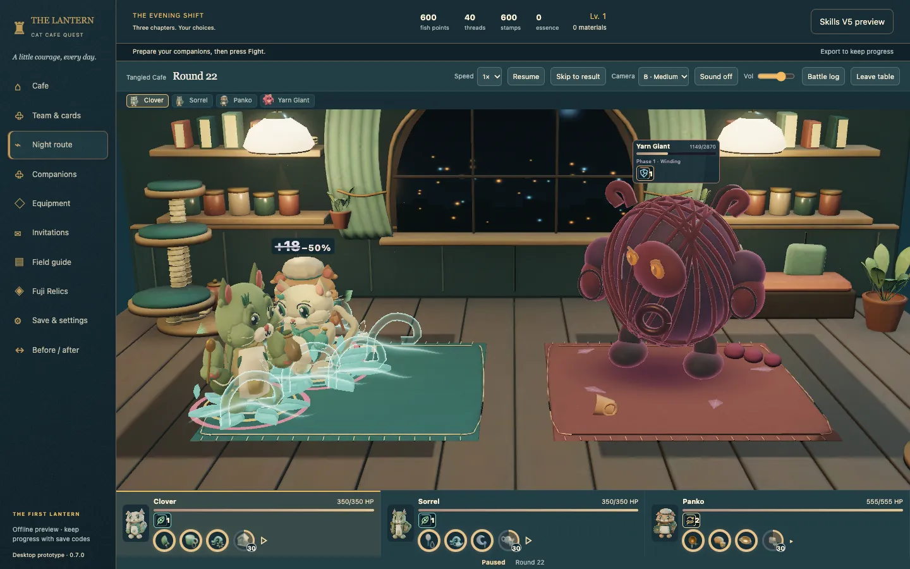
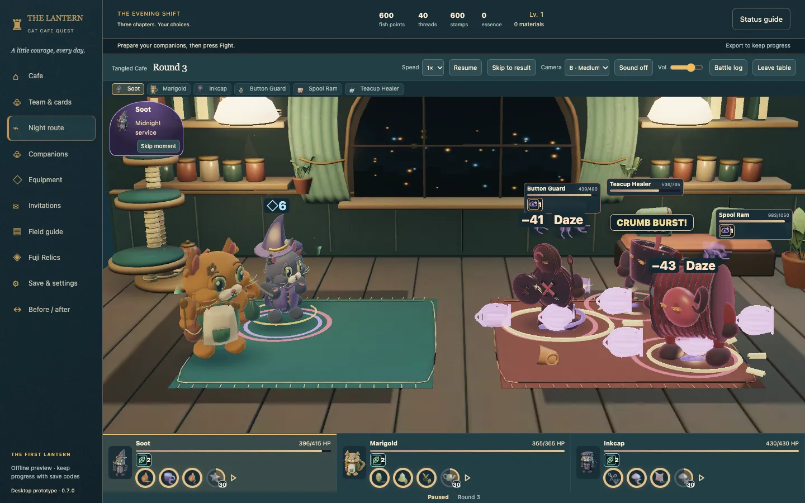
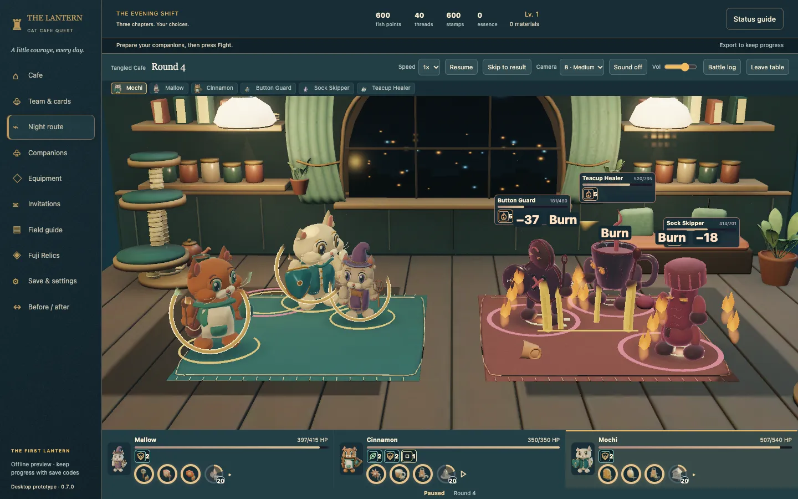
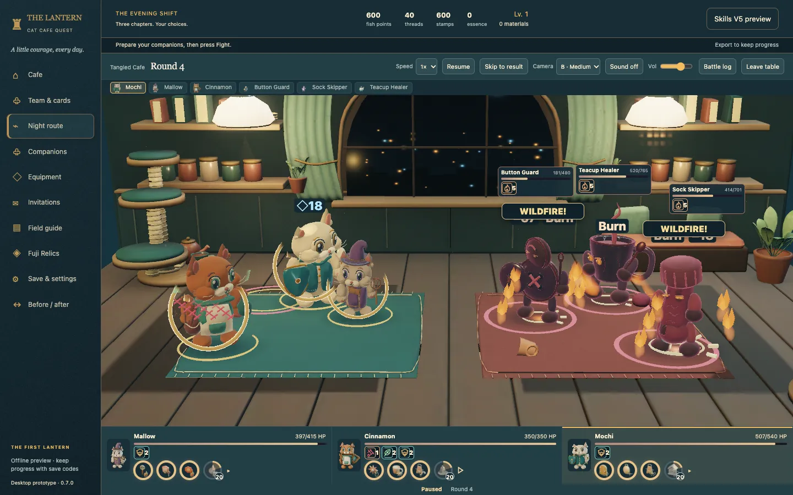
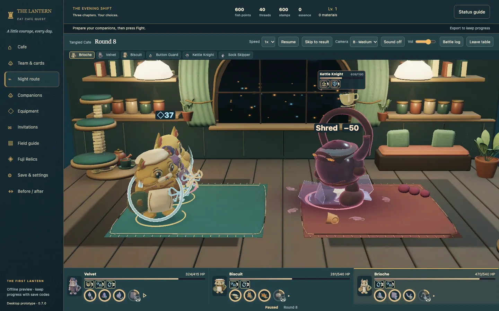
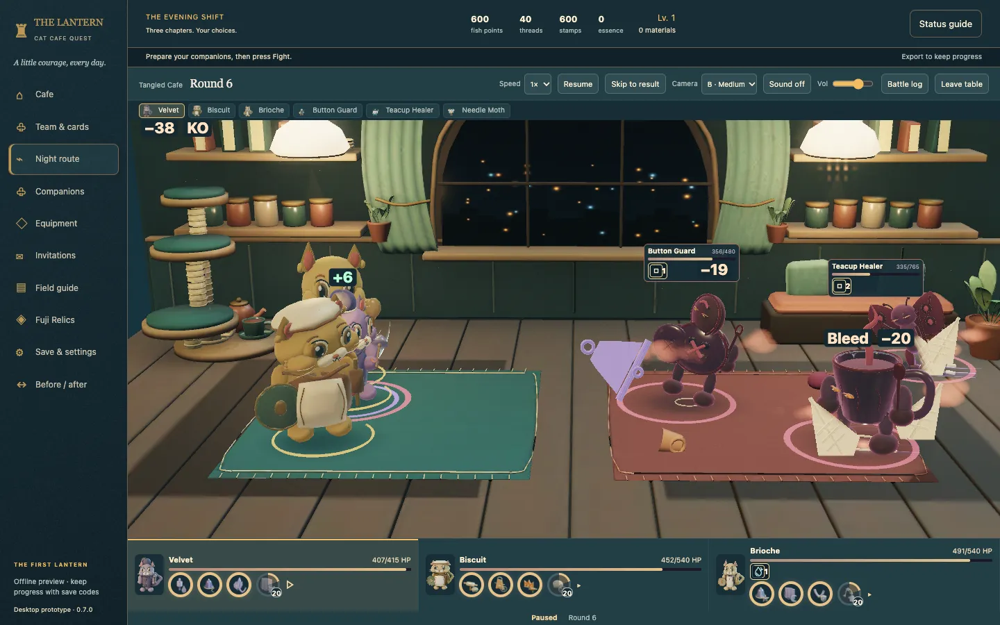
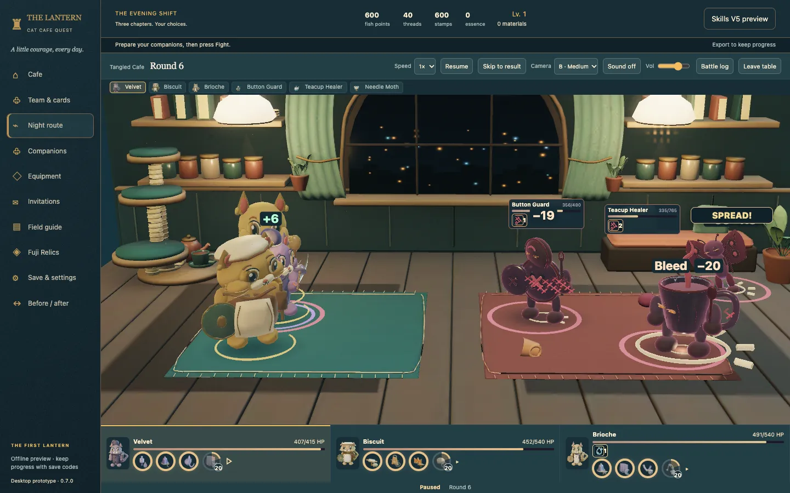

Đã hoàn tất phần trình bày V3 từ fixture S4 của Lane A: Bleed/Bitter, bốn phản ứng và ba kiểu đánh.
Đủ sáu cặp ảnh, bảng trạng thái và hai video 20 giây; chưa tích hợp trận thật với skillsV5 ON.
Năm seed giữ nguyên; 36 cửa sổ tung chiêu đạt tối đa 16,8 ms, 126 draw; không che mặt hay chồng huy hiệu.
E2E lần đầu 418/421; ba ca lỗi đều qua hai lần chạy riêng trên mã không đổi.
Trạng thái PARTIAL: CPU4 cold 483,4 ms, tăng 141,8%; chỉ bàn giao PR nháp, chưa merge hay triển khai.

# V3 · Published fixture presentation · PARTIAL

Base `da77aee08f29510b93656472245f49ce0f331a1d` (draft413); branch `codex/cardrpg-v5look-v3-2026-11-09`.
Demo [v5.html](../../../docs/cardrpg-look/v5.html): 29,208,740 bytes (+76,380 vs V0.1; within B2+1.5MB); SHA256 `e4491ebf3827e1f6e9fa5bc41dbb8ae2feda0e7fa86ceea7aef12e8438f97ec9`.
REFERENCE: [PROMPT](PROMPT.txt), [SPEC](SPEC.md), [V0/V0.1](V0-REPORT.md), [LOOK-BIBLE](../../../docs/design/cardrpg/LOOK-BIBLE.md), [integration](INTEGRATION.md).
A's V5A-S4 DONE was already published when the native wait ran; it exited0 without a timing lease. Read-only branch fetch from draft412; [fixture provenance](v3/FIXTURE.json).
Per-event version2 inside container version1; kind/actionId/stage/logIndex ordering, repeated targets preserved. Reaction targetId anchors the primer; targets[] are destinations. Adaptation published in B-OUTBOX ANSWER.

| Fixed 1440×900 DPR1 shot | V0.1 before | V3 after | Self-grade / reason |
| --- | --- | --- | --- |
| Bleed |  |  | 3→7.5/10; yarn marks and red tick are distinct, support labels still busy. |
| Bitter |  |  | 3→7/10; violet feet and struck healing with −50%, ring partly behind allies. |
| Crumb Burst |  |  | 7→8/10; published reaction word is target-local; monsters remain visible. |
| Wildfire |  |  | 4→8/10; words and fire travel show affected neighbours. |
| Rupture |  |  | 3→7.5/10; named reaction plus thread/drop beat; fast motion needs video. |
| Spread |  |  | 4→7.5/10; named reaction and travelling status shapes; crowded numbers remain. |

Self-grades are not user review. These are published fixture snapshots, not live V5 battles. [Bleed/Bitter on Mochi + Button Guard](v3/status-contact-sheet.webp).
[Splash](v3/shots/after-1440-splash.webp), [multi-hit](v3/shots/after-1440-multi-hit.webp), [bounce](v3/shots/after-1440-bounce.webp): ordered70ms hits, smaller splash neighbours, repeated seeded hits, visible bounce path; no target reroll.

| Measured item | Result |
| --- | --- |
| Seeds7,17,71,1808,20261108 | Full battle/log hashes exact; immutable fixture inputs; action-clock delta0ms. |
| Native cast max | 16.8ms;36 first/repeat windows,9 cues at1280/1440. |
| CPU4 cold | 199.9→483.4ms (+141.8%), MISS >10%; one original sample retained, no replacement. |
| Peak draws / triangles | 126 /143,659. |
| Protected faces | 0 offenders/62 samples; same V0.1 mask/threshold. |
| Badge/callout overlaps / contrast | 0 across27 cue-size cases at1024/1280/1440; minimum4.618:1. |
| OFF startup / pixels | 11 scripts/3,522,500bytes; unchanged sizes/module membership,8 exact content hashes;0 Three/model modules. Battle/HUD pixels exact. |

[Measurements](v3/RESULTS.json) · [source audit](v3/source-audit.json) · [UI](v3/after-browser.json.gz) · [faces](v3/faces.json) · [native](v3/perf/casts.json) · [cold trace analysis](v3/perf/cold-analysis.json).
UI/perf/face evidence binds to artifact44dd8f2ecea0. Delivered e4491ebf3827 changes only viewer entry (public gallery API/scene start); renderer, cue construction and art inputs exact. [Verified lineage](v3/artifact-lineage.json); direct-entry controls, OFF pixels/startup and films checked on delivered artifact.
Typecheck/lint/unit1794web+1020rules/build PASS. E2E418/421: idle-clock timeout, ERR_SOCKET_NOT_CONNECTED, font ECONNRESET. All three passed two isolated runs unchanged; tests not edited. [First run](v3/gates/e2e.log.gz), [recovery](v3/gates/recovery.json), [delivery](v3/finish.json).
Keyboard tooltip/Escape, reduced-motion static marks and three-width preview controls PASS. Unknown/malformed event versions keep legacy presentation; consumed primers clear from published snapshots.
Continuous20s H.2641440×900,x1: [before](https://github.com/ntbaoheyhey/taskbar-hero/blob/27aedc9275ed32109ab336f3ea8285a2965349f6/reports/cardrpg-look/skills-v5/v3/videos/before-20s.mp4) / [after](https://github.com/ntbaoheyhey/taskbar-hero/blob/27aedc9275ed32109ab336f3ea8285a2965349f6/reports/cardrpg-look/skills-v5/v3/videos/after-20s.mp4). Same initial hash,16 ordered actions each, no cuts; natural S4 recording replay, no live V5 resolution. [Receipts](v3/videos/after.json).
Original deterministic snag/bitter SVGs and pooled cues: [provenance](../../../assets/provenance/look.md). Presentation/lookV2 only; protected/rules diff0, no new dependency; earned/phase/finish APIs unchanged.
LIMITS: CPU4 cold gate remainsMISS; pre-ready timer/GPU wait observed but root cause unproven. Human recognition NOT VERIFIED; full simultaneous-stack readability and fast shape recognition need user review. Real skillsV5 ON integration belongs to the later step.
Earlier selector/capture/CSS/preview failures and isolated recoveries retained. Raw PNGs, JPEG frames and cold trace remain in /tmp/cardrpg-v5look-v3; not counted as published evidence.
Evidence below25MB: lossless JSON/log gzip, pixel-exact startup WebP, exact diagnostic-shot deduplication; only old video overview thumbnails resized (original PNGs remain in base git). MP4s and primary fixed shots unchanged. [Packing](v3/delivery-packing.json).
[DRAFT415](https://github.com/ntbaoheyhey/taskbar-hero/pull/415), stacked on413; evidence a952082ef/receipt repair e8becfd09. B-OUTBOX DONE and handoff in [receipt](v3/HANDOFF.json). No merge/deploy/main push; stop at V3d.
