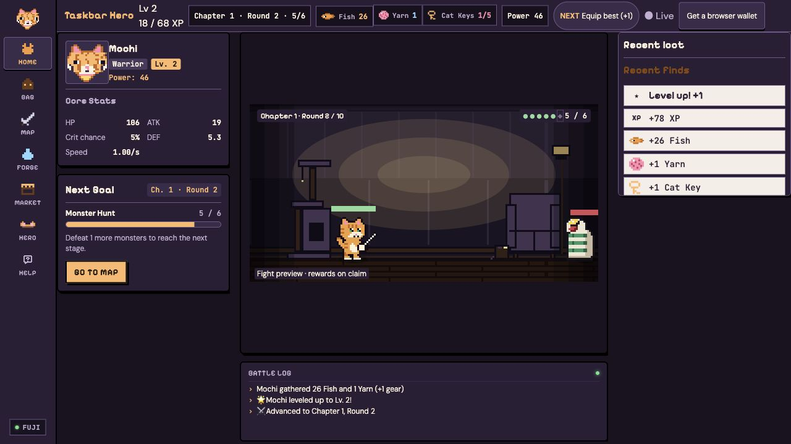
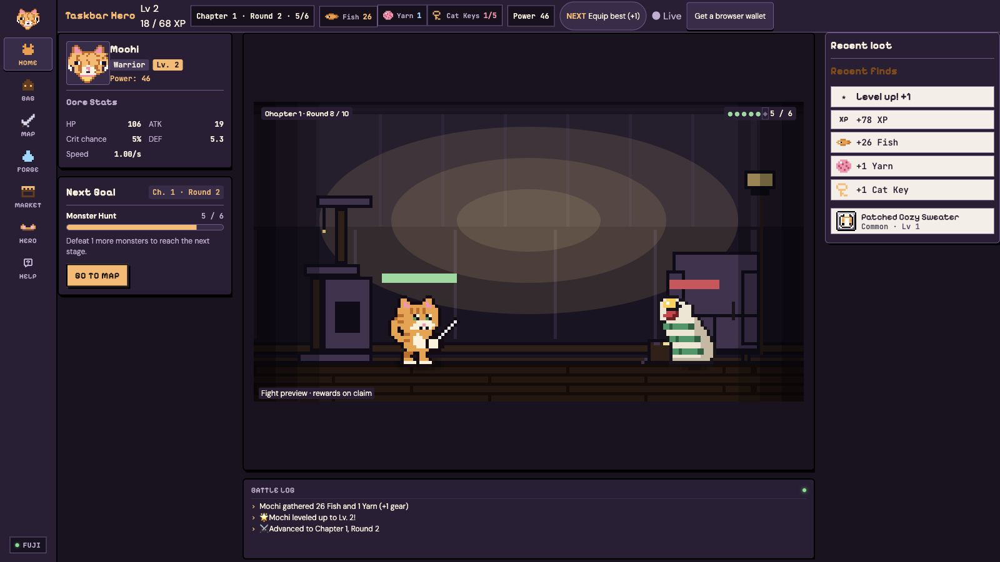

# CXP1 — Pets logic, preview only

Implemented on `ai/codex-cxp1` from latest fetched `origin/main` at `1fb25ed` (2026-11-01, Asia/Ho_Chi_Minh). Used an isolated worktree because the original checkout contained unrelated changes. Git identity was configured first as requested.

**What changed**

- Added typed, immutable `PetDef` registry, pure `petProgress(killCounts, defs)`, and equip validation in `packages/game-rules/src/v2/meta/pets/`.
- Added browser-local `PetsState`/`PetsStore` with versioned storage, safe parsing, v0 migration, immutable snapshots, subscribe/unsubscribe, equip and unequip.
- DEMO_PREVIEW: every unlock count, level step, per-level label value, and equip limit is marked as preview data. Per-level values are `[0.7, 1.3, 2.1]`, purely display labels; each level takes another pet-specific unlock threshold, capped at the length of that array. At the cap, `nextAt = null` and `pct = 100`. No bonus applies to gameplay.
- Existing per-round progress and the existing `claimed` event feed a local aggregate. Single file where the kill counter is read for pets: **`apps/web/src/pets/state.ts`**. It delegates delta arithmetic to the unchanged `apps/web/src/game/stage/progress.ts` helper `claimedKills`.
- There is no existing per-species/lifetime kill counter. All pets therefore target `claimed-idle-kills`; no species or history is inferred. Initial loads/retries, backwards resets, chapter boundaries, boss results and visual defeats do not award preview progress. Progress survives browser reloads and remains browser-local across demo/account switches.
- Tier 2 note: `apps/web/src/game/v2/storeV2.ts` adds one import and one mount line to attach the read-only observer to the existing client loop. No other existing source file changed.
- The registry is intentionally imported by direct package subpath rather than exported through the shared v2 barrel. An initial barrel export exposed a Deno-map requirement during local tests; it was removed. No generated map, dependency, protected configuration, server state, or existing art changed. No new art or pet UI was added.
- Added 25 tests: registry uniqueness/preview labels, every exact unlock threshold, level steps/cap/percentage, custom definitions and invalid inputs, equip rules, corrupt/unavailable storage, v0 migration, selection sanitation, persistence, deduplicated actual loop claims across rounds, and a lint-style runtime source grep guarding power/combat/drop/forge/server isolation.

**Registry — original names and flavour; thresholds are DEMO_PREVIEW**

| Id | Name | DEMO_PREVIEW unlock count |
| --- | --- | ---: |
| pet.hemwhisk | Hemwhisk | 7 |
| pet.sillskip | Sillskip | 13 |
| pet.thimblepurr | Thimblepurr | 19 |
| pet.kettlepaw | Kettlepaw | 31 |
| pet.crumbcurl | Crumbcurl | 43 |
| pet.bristletoe | Bristletoe | 61 |
| pet.puddleplume | Puddleplume | 79 |
| pet.latchlynx | Latchlynx | 103 |
| pet.pocketmew | Pocketmew | 137 |
| pet.hushspool | Hushspool | 173 |
| pet.eavetuft | Eavetuft | 227 |
| pet.dawnknead | Dawnknead | 283 |

**Verification**

Opened `docs/proposals/rune-skill-system/demo/index.html` in the in-app browser and inspected its Pets screen; read `design.md`. Used only the requested structural intent (progress and equip-two). Copied no demo balance table or art into the implementation.

`pnpm test`: exit 0. Workspace totals: 2,307 passed, 3 existing expected failures, 11 existing skipped tests. All 25 new tests pass. The existing Deno-import expected failure remains existing debt, not an acceptance condition.

`pnpm typecheck`: exit 0 before the direct-import refinement; the final `pnpm build` ran TypeScript checks again on all packages and passed. `pnpm build`: exit 0. The build emitted an existing dependency browser-externalization warning for `node:worker_threads` in `ox`; it did not fail.

`git diff --check`: exit 0. `pnpm --version`: `10.28.0`. Installation left no workspace/lockfile modifications to revert. No Actions runs were requested or started; the commit carries `[skip ci]`. Draft PR only; no merge or submission.

**NOT VERIFIED**

- Signed balance and any gameplay effects: intentionally absent. No power, drops, forge, economy, contract, auth, migration or live database changes.
- A rendered Pets screen: this mission adds logic/store only. The screenshots below show the existing v2 game UI, not a new Pets UI.
- Cross-tab synchronization, cloud sync, historical/lifetime and per-species kills: not implemented or claimed.
- Live server/account behavior and deployments: not exercised. Browser inspection used the local mock demo without a wallet.
- Relative ranking/selection of the requested strongest model: not independently verified by this session.

**Desktop screenshots**

Captured the existing local mock v2 game at explicit DOM viewport sizes. Full-page captures are exactly the requested pixel dimensions, checked with `sips` and visually inspected. All art is existing repository art; the screenshots are verification evidence only.





**Commands and output tails**

`CI=true pnpm install --frozen-lockfile`

```text
│                                                                              │
│   Ignored build scripts: bufferutil@4.1.0, keccak@3.0.4,                     │
│   utf-8-validate@5.0.10.                                                     │
│   Run "pnpm approve-builds" to pick which dependencies should be allowed     │
│   to run scripts.                                                            │
│                                                                              │
╰──────────────────────────────────────────────────────────────────────────────╯
Done in 6.7s using pnpm v10.28.0
```

`pnpm test`

```text
supabase/tests test:    Duration  13.32s (tests 84%, import 15%, transform 1%)
supabase/tests test: Done
packages/game-rules test:  Test Files  25 passed | 3 skipped (28)
packages/game-rules test:       Tests  383 passed | 2 expected fail | 11 skipped (396)
packages/game-rules test:    Start at  11:42:52
packages/game-rules test:    Duration  35.27s (tests 97%, import 2%, transform 1%)
packages/game-rules test: Done
packages/api-contract test$ pnpm --filter @taskbar-hero/game-rules exec vitest run --root ../api-contract
packages/api-contract test:  RUN  v5.0.5 /Users/bao/Documents/ChatGPT/taskbar-hero-cxp1/packages/api-contract
packages/api-contract test:  Test Files  1 passed (1)
packages/api-contract test:       Tests  16 passed (16)
packages/api-contract test:    Start at  11:43:28
packages/api-contract test:    Duration  233ms (transform 79%, import 18%, tests 2%, worker 1%)
packages/api-contract test: Done
apps/web test$ vitest run
apps/web test:  RUN  v5.0.5 /Users/bao/Documents/ChatGPT/taskbar-hero-cxp1/apps/web
apps/web test:  Test Files  113 passed (113)
apps/web test:       Tests  1311 passed (1311)
apps/web test:    Start at  11:43:28
apps/web test:    Duration  19.45s (environment 49%, tests 36%, import 10%, transform 4%)
apps/web test: Environment  jsdom was created 113 times · 81.08s total, 49% of tracked time
apps/web test:              create it once per worker with pool: 'vmThreads' (keeps per-file isolation) or isolate: false (shares it across files)
apps/web test:              learn more: https://vitest.dev/guide/improving-performance#test-environments
apps/web test: Done
```

`pnpm typecheck`

```text
packages/chain typecheck: Done
packages/auth typecheck: Done
packages/game-rules typecheck: Done
supabase/tests typecheck: Done
packages/api-contract typecheck$ tsc --noEmit
packages/api-contract typecheck: Done
apps/web typecheck$ tsc --noEmit
apps/web typecheck: Done
```

`pnpm build`

```text
apps/web build: dist/assets/StageScene-BzfrGXCU.js           15.73 kB │ gzip:   5.79 kB
apps/web build: dist/assets/react-KPuNr9iS.js               218.74 kB │ gzip:  68.27 kB
apps/web build: dist/assets/index-CUbzi82K.js               244.17 kB │ gzip:  68.91 kB
apps/web build: dist/assets/web3-BKxr0A5j.js                363.83 kB │ gzip: 108.14 kB
apps/web build: dist/assets/combat-BSGSpOB2.js              900.61 kB │ gzip:  77.42 kB
apps/web build: dist/assets/phaser-CS_hOpYn.js            1,194.43 kB │ gzip: 318.49 kB
apps/web build: ✓ built in 579ms
apps/web build: Done
```

Browser verification server: `VITE_GAME_V2=1 pnpm --filter @taskbar-hero/web dev --host 127.0.0.1 --port 5180`; Vite ready. Reference server: `python3 -m http.server 8731 --bind 127.0.0.1`.

`sips -g pixelWidth -g pixelHeight reports/cxp1/desktop-1280x720.jpg reports/cxp1/desktop-1600x900.jpg`

```text
desktop-1280x720.jpg: pixelWidth 1280, pixelHeight 720
desktop-1600x900.jpg: pixelWidth 1600, pixelHeight 900
```

`git diff --check`: no output, exit 0.
