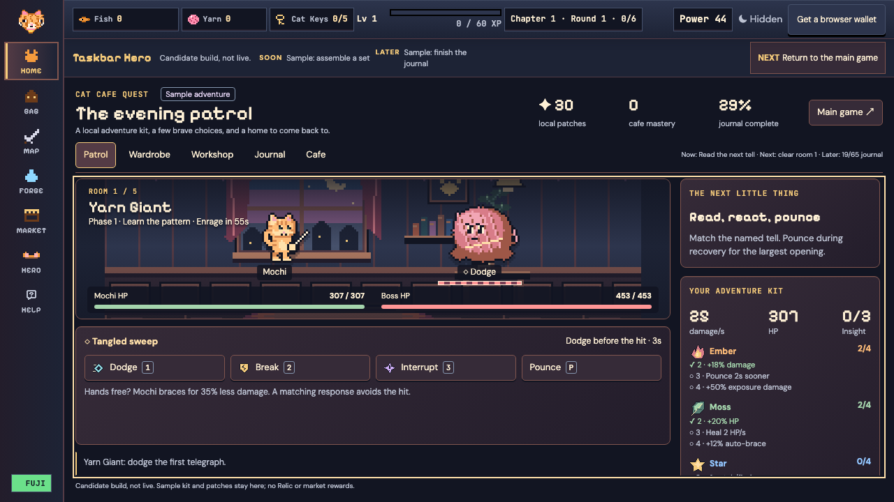
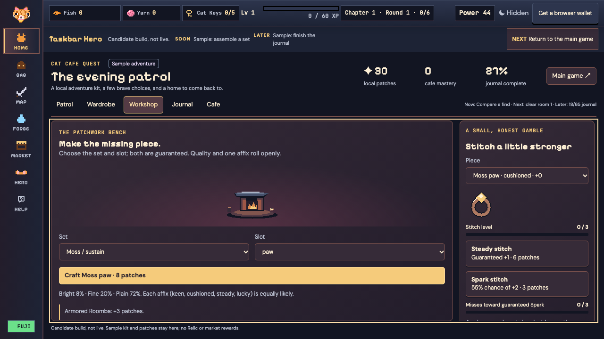

# Gameplay pass 2 — Cat Cafe Quest candidate

2026-11-05 · Candidate build, not live. One agent. **Not merged, not deployed.**

The main guest loop now acknowledges accepted rewards every 18 seconds instead of about 30 seconds. A separate, opt-in local Sample adds encounter choices, interactive bosses, purposeful sets and crafting, collections, mastery, reversible tours and return goals. The delivered demo uses the actual component and rules. The new depth is **not enabled in the verified main game**: its boss wall and replay remain unchanged. The measured pacing target passes; the 9+ quality target does not.

Open `/Users/bao/taskbar-hero-gameplay2/docs/gameplay2/index.html` by double-clicking. This single 3,345,132-byte file embeds 37 assets, fonts, nine timeline rows, live Sample controls, build simulations, screenshots, decisions and provenance. No server or network is needed. [Five-minute review and local commands](https://github.com/ntbaoheyhey/taskbar-hero/blob/codex/gameplay2-proof-2026-11-05/docs/gameplay2/README.md). [Artifact hashes and runtime identity](delivery.json).

## Review and release state

Base is PR #282, `7eb1ee7ef052ec90ee2cbc9e2299b185c8ab11b5`. Final measured runtime is `629aa8b3dd0120f1a3e9556b699d539155202296`; published proof is `0b925536685512a0672a784fcfffe80097a0a821`. The proof commit changes no application source, public art or game rules after the measured runtime. All four new PRs are open drafts, unmerged and mergeable at the final read.

| Layer | Draft PR | Published head | Added / deleted lines | Hosted CI |
|---|---|---|---:|---|
| Rules/config/research | [#283](https://github.com/ntbaoheyhey/taskbar-hero/pull/283) | `0dbfd6a` | 1,238 / 8 | [41942315178](https://github.com/ntbaoheyhey/taskbar-hero/actions/runs/41942315178), green |
| Original art | [#284](https://github.com/ntbaoheyhey/taskbar-hero/pull/284) | `8ccf969` | 380 / 2 | [41942746535](https://github.com/ntbaoheyhey/taskbar-hero/actions/runs/41942746535), green |
| Playable UI | [#285](https://github.com/ntbaoheyhey/taskbar-hero/pull/285) | `ea8080d` | 547 / 5 | [41945861445](https://github.com/ntbaoheyhey/taskbar-hero/actions/runs/41945861445), green |
| Geometry fix, proof/demo | [#286](https://github.com/ntbaoheyhey/taskbar-hero/pull/286) | `0b92553` | 874 / 2 | [41949368025](https://github.com/ntbaoheyhey/taskbar-hero/actions/runs/41949368025), green |

Required order: **#275 → #276 → #277 → #278 → #279 → #280 → #281 → #282 → #283 → #284 → #285 → #286**. Never merge the tip directly. Remote main remains `340f88b`; the unrelated local main at `6144d42` was left untouched. Vercel deployment is disabled for the candidate branches in both configuration roots. No Supabase/contract/DB/migration changes, wallet signing, funds or changes to protected PRs #244/#252/#257. The user paused work at 08:34 Vietnam for travel and resumed at 09:41; the baseline server was stopped during the pause. Final cleanup at 09:50 found the original candidate server still listening on loopback and stopped its task-owned wrapper/child (24197/24219). The earlier handoff incorrectly said it was already stopped. Delivery remains within the original 11:53 wall-clock deadline.

## Before/after pacing and progression

Nine normal-clock ten-minute browser sessions used separate profiles, actual seeded mock economy and visible UI inputs. Main rows count positive accepted claims; Sample rows count new rewards or available decisions. Both start/end gaps are included. The scripts capture every event/action, state samples and errors. They do not measure human enjoyment or judgment.

| Style / seed | Main max reward gap before → after | Main first reward after | Sample max opportunity gap | Sample first reward | Sample changed choices | Sample wins / attempts | Sample final room |
|---|---:|---:|---:|---:|---:|---:|---:|
| Idle / 11 | 30.199 → 18.026s | 10.049s | 11.265s | 8.184s | 5 | 1 / 4 | 2 |
| Active / 29 | 30.012 → 18.018s | 10.075s | 15.822s | 0.847s | 96 | 3 / 4 | 4 |
| Min-max / 47 | 30.163 → 18.013s | 10.049s | 15.948s | 0.837s | 98 | 4 / 4 | 5 |

Main first reward remains configured at 10s; observed median is slightly over 10s, so the strict wall-clock target is not met. Sample active/min-max can choose the initial route immediately; their sub-second first rewards are input-driven, not an idle grant. Main first boss attempts remain around 298s and lose. Sample first attempts occur at 112–120s. Idle receives automatic finds but makes its first actual chosen input at 120s; a visible choice exists immediately, while the literal ≤60s chosen-input target is not demonstrated for idle.

The active Sample has a fight still running at 600s, so 3/4 is wins/attempts, not completed-fight win rate. The main min-max log records three attempts but only one completed boss receipt. Baseline result-dismissal driver failures weaken action-count comparisons; they are retained and excluded from meaningful choices. No invented boredom scores. [MEASUREMENTS.md](MEASUREMENTS.md) contains all nine rows, >8s gaps, action systems touched/untouched, items found and room-entry power curves. [timelines.json](timelines.json) and the individual `before-*`, `after-*`, `sample-*` JSON files preserve the raw inputs and timings.

Five seeds (11/29/47/71/101), three styles and 20 model minutes per style separately test balance. These are deterministic model runs, not additional real-time play:

| Policy | Room-one first-attempt wins | Room-two first-attempt wins | Room-two duration | Final room |
|---|---:|---:|---:|---:|
| Idle starter | 5/5 | 0/5 | 58s, defeats | 2 |
| Active, Moss preference | 5/5 | 5/5 | 50–57s | 5 |
| Min-max, Ember preference | 5/5 | 5/5 | 25–31s | 5 |

An equal room-two Fine kit with one stitch wins hands-free 3/5 for Moss and 0/5 for Ember/Star. All three win 5/5 with counters/Pounce; Ember takes 19–22s, Moss/Star 42–49s. This demonstrates distinct burst/survival choices, not universal human difficulty. Star is a gathering/quality specialization, not a third distinct combat rotation. Full battles, actions and stats: [balance.json](balance.json).

## Gameplay packages and exact decisions

All new gameplay numbers are in `packages/game-rules/src/config.ts`. The [full 137-entry decision table](decisions.md) records before/after/reason; [design](DESIGN.md) and [research](RESEARCH.md) preserve the goal ladders, ranked top-15 problems and source citations. This summary does not replace the exact table.

| Package | Delivered behavior | Key numeric change / constraint |
|---|---|---|
| W1 Dead time | Claims remain server-accepted; cadence anchored after first claim. Sample safely gathers unattended choices. | Main 30,000→18,000ms; first 10,000ms unchanged. Sample first find 8s, encounters 16s, choice window 8s. |
| W3 Bosses | Five household bosses, three phases, named Dodge/Break/Interrupt tells, recovery Pounce, enrage, outcome grade, hint and fair retry. | Phase thresholds 67/34%; tells 3s then 2s; recovery 2s; enrage 55s; limit 90s; retry 3s; no server keys spent. |
| W2 Variety | Rotating scout/swift/armored/splitter/thief/treasure/hazard/cafe bag; safe, study and risk routes with distinct modifiers. | Eight encounter types; lucky bonus capped six per tour. Owned items are never stolen or destroyed. |
| W4 Builds | Four slots, four affixes, three qualities, three 2/3/4-piece sets, comparison deltas and two saved kits. Directed craft, Steady/Spark choice and disclosed item-bound pity. | 48 items, 999 patches, three stitch levels; craft costs eight local patches. No purchases/trades. |
| W6 Goals | Now/Next/Later goals, persistent checklist, 45 creature/boss entries, 12 set entries and eight achievements; home completion. | Once-only small local rewards. No midnight reset or streak loss; not a newly randomized quest list every session. |
| W9 Feedback | Original cue shapes plus text, keyboard 1/2/3/P, readable impact numbers, rarity feedback, calm reduced-motion mode and hidden pause. | Reuses existing feedback limits; stable route/reward geometry tested at 720px. |
| W5 Mastery/tours | Freely selected permanent local perk; preview Keep/Restart and immediate Undo for a new tour. | 40 XP/level, five levels; tour after three clears; 5% damage/tour capped at 15%. |
| W7 Return | Honest capped patches and a dismissible away summary; fights wait at the hidden boundary. | One patch/120s, two-hour credited-time cap and 30-patch cap. No offline combat, items or server grants. |
| W8 Difficulty | Cozy/Spirited/Daring, visible opt-out assist, first-clear quality premium only; locked in combat. | HP ×1/1.25/1.55; damage ×1/1.15/1.35; assist after two losses, HP−10%/damage−15%. |
| W10 Art | Original palette-locked sprites/icons for encounters, sets, journal, achievements and counters. | 16 runtime PNGs, 3,268 bytes; no external art/model inputs. |

These systems are fully wired in the local Sample. They are isolated because they change combat and progression beyond the server replay contract. `features.cafeAdventure=false`; explicit guest `?demo&coach=off&adventure=1` is required. Rune/skill/companion/pet previews remain Sample/default-off. Main-game bosses, Relics and market scope are unchanged.

## Fresh-eyes scores and corrections

Four separate fresh-profile UI capture passes were repeated after fixes. Scores were assigned retrospectively to the retained rounds, on four equally weighted axes (fun/clarity/depth/polish). **Early Sample 8.34 → corrected Sample 8.56**, rounded **8.3 → 8.6**. The prior pass's 8.0→8.7 used nine visual axes; it is not a comparable baseline. [FRESH-EYES.md](FRESH-EYES.md) contains each role, screenshot/timestamp and limitation.

Final judgments: Home/Patrol8.6, boss8.7, Workshop8.6, Wardrobe8.7, journal/mastery/return8.5. **The 9+ target is missed.** The returning/min-max fixture sequences take only ~2s and check UI states, not real multi-session behavior. The skeptical judge receipt spans180s but captures most states in its first18s; waiting is not active play. There is no independent judge or human retention study.

Fresh review fixed Spark promising +2 when only one level remained, a room-advance action below the 720px viewport, recovery copy promising an exposure bonus after a missed counter, missing affix explanations and an arena jump during auto-Gather. Red and passing receipts remain in `logs/fresh-review-*`, `logs/stable-layout-tests.log`, `performance-before-layout-fix.json` and the two screenshot rounds. Remaining depth limits: shared boss verbs, mostly tabular journal content, gathering-focused Star, short-desktop sidebar scrolling and local-only continuity.

## Validation and economy boundary

The full existing #275–#282 stack was built and checked first: 399 E2E,1482 web units and package suites. [BASE-CHECK.md](BASE-CHECK.md) records the initial contention timeout and unchanged isolated rerun. Final local suite: **413/413 E2E**,1498 web units,482 game-rules passes plus the unchanged two expected failures/11 inherited skips. No new skip. Root script tests11/11. Typecheck, lint, build and all art generators pass.

All four exact published heads have green hosted CI. The final proof run completed its full E2E at01:48:52 UTC (08:48:52 Vietnam), while work was paused. Each hosted node job passes the unchanged generated Deno-map drift guard, workspace typecheck/lint/tests/build. Backend mock581, auth24, chain32 and API contract16 pass. These use mocks, not a deployed database. Unchanged contract jobs were skipped by the existing path filter; no new contract validation is claimed.

| Head | Native preflight | Full hosted E2E | Hosted web units | Rules |
|---|---:|---:|---:|---:|
| `0dbfd6a` rules | 6/6 | 399/399 | 1483 | 482 + inherited exceptions |
| `8ccf969` art | 6/6 | 399/399 | 1483 | 482 + inherited exceptions |
| `ea8080d` UI | 6/6 | 412/412 | 1498 | 482 + inherited exceptions |
| `0b92553` proof | 6/6 | **413/413** | **1498** | **482 + inherited exceptions** |

[ci-final.json](ci-final.json) binds head/PR/run/jobs; raw `logs/ci-<run>-{node,e2e}.log` files retain summaries. [receipt-manifest.json](receipt-manifest.json) supplies byte counts and SHA256 for archived evidence.

Economy tests run actual pure guard/compute/apply functions across36 class/seed cohorts with duplicate/early requests and a one-hour credited-time cap, Cat Key/offline caps and deterministic reward equality for the same schedule. Additional five-seed × three-style local Sample play verifies no server currency/Relic fields, bounded local storage/resources and unchanged authoritative replay. These are CI-able `gameplay.economy.test.ts` tests, not a deployed-backend audit. Changing accepted claim cadence can change RNG grouping and drop outcomes; it does not create a grant bypass or promise identical loot to the old schedule.

The original `ui-audit` covers18 main-app views with zero findings. New Sample coverage:30 views across1280×720,1440×900,1920×1080;198 keyboard focus samples; zero axe WCAG A/AA violations, document overflow, offscreen focus, page errors or writes. Main audit uses its inherited1280/1600 viewports; every new screen uses all three requested desktops. Offline demo passes3/3 sizes with zero network requests, page errors, broken image decoding or axe findings. Receipts: `ui-audit/findings.json`, `accessibility*.json`, `screens/`, `demo-check.json`.

## Performance, motion and payload

Identical explicit V2 demo production environments compare baseline705,612 to candidate729,576 gzipJS bytes: **+23,964 bytes**, below150KB. New runtime images total **3,268 bytes**, below2MB. Documentation captures and the self-contained review file are not shipped application assets. Existing large-chunk build warning remains.

Isolated production browser,30s windows, no screenshots in timing: ~60.00FPS, p95≤16.8ms; renderer task time0.82–1.16% at normal motion,0.60% reduced; retained heap falls from~13MB to~11.7MB in these short windows. Global CLS≤0.000154. This is a short renderer measurement, not an OS CPU, battery or long-session leak study. Separate inherited effects test: four normal/reduced cases,59.76–60.00FPS, p95≤16.8ms, CLS0.

Synthetic hidden checks:0 game seconds advanced,0 running animations; renderer task0.53%. Reduced motion:0 running animations. A real headed-window/tab diagnostic could not make this host report hidden; **true OS visibility remains unverified**. Its failing logs and source are preserved under `diagnostics/`. The performance observer itself keeps requesting frames in the synthetic case, so reported60FPS there does not mean the game continues ticking. [performance.json](performance.json), [effects/fps.json](effects/fps.json).

Initial invalidated full E2E (330 pass/79 fail) coincided with a concurrent build deleting its output directories; it is retained, not accepted as evidence. Isolated reruns then passed409,412 and final413 as regressions were added. Initial global CLS~0.0205 led to the reserved-geometry fix and exact arena test. Failed visibility and initial axe/selector/timing receipts remain archived. No failure was converted into a skip.

## Original art, tools and reproduction

[asset-provenance.md](asset-provenance.md) extends the earlier provenance: each path, bytes, dimensions, seed, scale and hash. Original integer-coordinate geometry in `tools/art/gameplay2.py`, Evening Atelier palette-lock pipeline, upper-left light, native24px creatures and16/24px icons, seed0. Exact prompt: **none**, no image model or reference-game asset input. The contact sheet is documentation. Existing Mochi, rooms, gear/boss art and `/relics/{id}.json` resolution retain earlier provenance unchanged.

Installed Codex skills: none recorded for this pass. Used repository Playwright/Vitest/audit/effects tools, Chromium/CDP, Vite, Python procedural art and connected GitHub tools; no subagents, helpers, lanes, schedulers or external deployment. Prior pass's Sites skill usage is not counted again. Research sources were read for design facts; no reference artwork was copied, traced, downloaded or supplied to a generator.

Run `pnpm demo` from `/Users/bao/taskbar-hero-gameplay2`. Fresh guest with onboarding: `http://127.0.0.1:5391/?demo#home`; skip coach: `?demo&coach=off#home`; Sample: `?demo&coach=off&adventure=1#home`. Add `&adventureDebug=1` before the hash for development-only jump/kit/patch/60s controls. Existing saves/dismissals are preserved; use a new guest profile to see onboarding. The launcher binds loopback and empties service credentials. Production has no debug controls. Full commands/dependencies are in the demo README.

## Open issues, backlog and needs the user

Top risks: **(1)** depth remains default-off local Sample and the main boss wall is unchanged; **(2)** quality/retention evidence is single-author and scripted, with9+ missed; **(3)** real OS hidden/battery behavior and any later retargeted release stack need validation. Local saves can be cleared and are not cloud synced. Strict10s wall-clock first reward and idle chosen-input≤60s are not demonstrated. Main after-idle seed11 found no gear in ten minutes; shorter claim gaps do not guarantee item drops.

Backlog, in order: observe human first/return sessions; redesign the remaining main-game boss wall with server/replay agreement; differentiate boss counterplay and Star's combat identity; add more meaningful journal/session goals and mastery branches; verify real OS hidden behavior/power on more hardware; cloud-save design; optional original audio. Mobile remains outside scope. No half-wired mechanic is included in the drafts. Exploratory failing visibility code is archived as diagnostic evidence, not shipped in #286.

Needs the user: review the offline demo's actual feel; choose whether this candidate merits another gameplay pass or an ordered merge/release review. Clearing the existing Vercel cap matters only for a separately authorized deployment; none was attempted. A go/no-go on the full stack and later merge order remain user release decisions.

Self-check: multiple gameplay fronts and playable proof delivered;≤20s gaps pass all three measured styles; all numeric claims point to receipts; draft-only/no merge/no deploy/original-art boundaries maintained. Main first-boss accessibility, strict10s timing, real hidden validation, human retention and9+ quality remain explicitly unmet rather than presented as complete.
