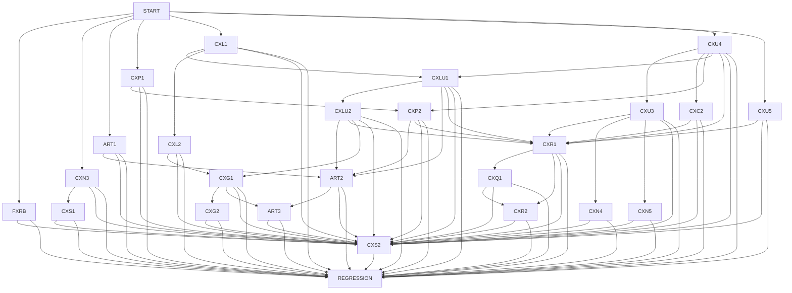

# Mega mission task cards — living draft

Date: 2026-11-01, Asia/Ho_Chi_Minh. Source: [complete mission](mega-mission.md). Base observed: `1fb25ed`. No implementation code was changed before this plan.

## Execution contract

The current user authority supersedes the previous run's no-merge/no-art restrictions. Preserve every pre-existing dirty checkout. Reuse open PRs #240, #241, #243, #244, #245; retain historical merged/closed branches as evidence. No force pushes. One item branch and PR each. Every new commit uses the requested author and ends with ` [skip ci]`. Never invoke Actions. Only the coordinator merges, strictly serially after both independent grades and all G1–G7 gates.

All cards request the strongest available model, highest reasoning and fast service. Official model guidance identifies GPT-6 Astra as the most capable model (https://learn.chatgpt.com/docs/models); the local inventory supports ultra reasoning. All worker roles use gpt-6-astra, ultra, and priority service (Fast). Catalog display priority is not a quality ranking. The current parent session's model cannot be changed by a tool: do not claim otherwise. Native subagent tools are not exposed in this session; isolated non-interactive Codex workers are the fallback, with separate worktrees and separate input contexts. No cheaper/lower-effort fallback. Runtime settings and failures must be recorded honestly.

At most three workers plus coordinator. Builders never grade their own work. Grader A and B receive only repo, item spec, rubric and raw evidence, never builder scores. Each independently re-runs checks and cites every point. A difference above five requires a fresh grader C; lowest grade applies. All three grade roles use the same strongest/highest settings. Any change after scoring invalidates grades and requires the complete gate again.

## Common small cards for each item

1. **P: scope and design** — domain builder reads exact references and current code, lists acceptance lines and intended files, records any decisions in docs/decisions/<id>.md with context/options/choice/why/reversal and links docs/design/decisions.md. Done: no unresolved implementation decision, exact file list, preserved original art.
2. **B: implement** — same domain builder changes only card-owned paths, adds meaningful tests for each behavior, keeps backend additions behind default-OFF flags. Done: implementation and targeted tests, provenance for art, migration rollback where applicable; no PASS claim for unrun checks.
3. **V: verify** — verification worker in a fresh isolated worktree merges current origin/main, installs pnpm 10.28.0 frozen, runs every section 2c command, each acceptance case, repeat checks and at least five deliberate mutants (FXRB three). Save raw logs under reports/scorecard/<id>/logs. UI: screenshot limits, reference comparison, keyboard, contrast and all-screen audits/effects at both sizes. Done: raw outputs, file-tier/integrity/secret/honesty checks; every missing result explicitly NOT VERIFIED.
4. **GA and GB: grade independently** — two fresh grader contexts, neither builder; separate worktrees and ports. Score C1–C8 exactly using mission section 3. Done: cited score, auto-fail list, independently calculated total. Red means fix and repeat the full V/GA/GB cards with fresh graders.
5. **M: serial merge** — coordinator checks exact head/base, score >=92 from both and G1–G7, readies and squash-merges PR with suffix. Re-test clean main fully and affected repeats, confirm deployed commit and live guest path at both sizes. Done only when actual merge, main and live evidence exist. Otherwise continue fixes; no other merge can pass it.

Verification commands: pnpm gen:deno then git diff --exit-code -- supabase/functions; pnpm typecheck; pnpm lint; pnpm test; pnpm build; VITE_GAME_V2=0 pnpm --filter @taskbar-hero/web build; apps/web pnpm test:e2e at 1280x720 and 1600x900; node scripts/check-links.mjs; node scripts/check-bundle.mjs; node scripts/check-deno-imports.mjs; bash scripts/verify-pr.sh <PR-number> without --comment (the actual script requires a number, although brief says branch). Record exact commands and exit codes. Links must not exceed same-day main; every other required check must be green. Existing mobile tests stay enabled; if they block the complete suite, record and repair through an explicitly added prerequisite, never delete or loosen them.

Baseline worktree: /Users/bao/.codex/worktrees/mega-20261101-baseline/taskbar-hero. Baseline ports 4273–4276. Item i uses 4300+10*i through +3; fresh graders use distinct allocated port blocks. Set E2E_PORT_CLASSIC, E2E_PORT_V2, E2E_PORT_SERVER and E2E_PORT_API. Before e2e, inspect owned listeners/cwds and terminate only owned stale previews. Never run tests on another worker's ports. Use empty VITE_SUPABASE_URL/ANON_KEY for test builds. No `.env`, credentials or workflows changed.

## Dependency graph

Independent P/B cards may run in parallel; V jobs are port-isolated and resource-limited; M cards are serial in queue order after prerequisites. CXR1/CXR2 wait until every specified UI prerequisite is merged. Existing premature CXR work is preserved for later reuse. CXG2 also requires all preceding items merged and green.

## 1. FXRB

Branch: `ai/codex-fxrb`. Dependencies: none. P/B owner: Phaser lifecycle and browser-test engineer. V: verification worker. GA/GB: independent strict graders. Effort on every card: highest available. Ports: 4310–4313.

Fix the flaky resize-burst e2e test. Report reports/fxrb.md.
ZONE: apps/web/e2e/layout/resize-burst.spec.ts, apps/web/e2e/layout/resize.spec.ts, apps/web/src/layout/ (stage sizing only, and only if the test exposes a real bug), reports/fxrb/.
Context: reports/AGR0-fix.md and reports/redesign/CXR0/checks/e2e.log describe earlier resize failures (canvas settling, "exactly 1 Phaser canvas"). The 2 deferred mobile HUD fails from CXR0 are out of scope (desktop only).
GOAL: find the real cause (race between resize events and Phaser canvas settle? fixed sleeps? shared state between tests? stale preview server?) and fix the cause. Replace fixed waits with condition waits (expect.poll on canvas count and size). Never skip, quarantine or loosen "exactly 1 canvas settles with the expected logical size".
TESTS: T1 layout/resize specs pass --repeat-each=20 at 1280x720 and 20 at 1600x900 (paste summary lines). T2 root cause in one sentence. T3 full e2e suite green once afterwards. If not reproducible: NOT VERIFIED with 40 green runs and what you hardened.
Why first: every later item's loop trusts e2e; a flaky suite wastes rounds.

Card-specific done condition: all acceptance lines above and mission section 11 where applicable, plus common V/GA/GB/M cards. Evidence path: `reports/scorecard/fxrb/`. Report paths and code zones above are exact; expand globbed zones to individual paths during P before edits.

## 2. CXN3

Branch: `ai/codex-n3-cutover-truth`. Dependencies: none. P/B owner: Supabase/runbook engineer. V: verification worker. GA/GB: independent strict graders. Effort on every card: highest available. Ports: 4320–4323.

Cut-over truth: make the runbook match reality, add read-only live checks. Branch ai/codex-n3-cutover-truth. Report reports/n3-cutover-truth.md.
WHY: reports/C3.md found docs/cutover-v2.md stale: v2 SQL already live, the switch is the Vercel env var VITE_GAME_V2 (not a code flag), the Founder batch draft no longer exists, check-live.mjs does not check v2 routes. The user needs one short, true checklist and a script that says "live is healthy" without any secret.
READ FIRST: reports/C3.md ("Gaps found", "Go / no-go"), docs/cutover-v2.md, docs/go-live.md, docs/runbook.md, docs/deploy.md, scripts/check-live.mjs, apps/web/src/layout/flag.ts, supabase/migrations/ (list), supabase/functions/_shared/v2/http.ts.
PIECE 1 - Rewrite docs/cutover-v2.md (keep the name; short "History" note): reality section (v2 schema live since 26 Oct, integrity migration 27 Oct; VITE_GAME_V2=1 is the switch = Vercel env + redeploy, a USER action; D8 Founder batch DROPPED 31 Oct); pending live migrations table generated from supabase/migrations (every file newer than 20261102000000, in order, "apply by hand in the SQL editor BEFORE deploying functions" and why: the 20261104 limiter fails closed with 503; include CXN1's file); deploy step = exact `supabase functions deploy ... --project-ref qoalewtxflagoprrxrgh` from docs/deploy.md plus "run node scripts/check-deno-imports.mjs first"; go/no-go checklist from C3 updated; rollback (env var to 0 + redeploy, or Promote the previous Vercel deployment; keep v2 rows; SQL rollback supabase-manual/v2-rollback.sql only before real players). Make docs/go-live.md and docs/runbook.md consistent and link cutover-v2.md.
PIECE 2 - docs/proposals/sql/check-live-schema.sql (read-only; the user pastes it): one query, one row per expected object with present true/false: the 6 v2 tables, integrity objects (v2_action_results, v2_craft_once, v2_boss_fight_once, v2_action_result), the siwe_nonces policy, budget tables and v2_take_budgets, game_voucher_cancel_reissue, 'cancelled' in relic_vouchers_status_check, CXN1's function. Only SELECT from pg_catalog / information_schema; no INSERT/UPDATE/DELETE/ALTER/CREATE/DROP/GRANT.
PIECE 3 - scripts/check-live.mjs: add read-only v2 checks behind --v2 (no secret, no sign-in): OPTIONS 2xx with CORS headers; POST without session -> 401 (a 503 prints "budgets migration missing?"); oversized body -> 413 or 400. Only the public anon key the script already uses. Unit-test the classifier with fake responses (no network in tests).
ZONE: docs/cutover-v2.md, docs/go-live.md, docs/runbook.md, docs/deploy.md (link only), docs/proposals/sql/check-live-schema.sql, scripts/check-live.mjs + a test next to it or under supabase/tests/**, reports/n3-*. Never apply SQL anywhere except PGlite.
TESTS: T1 cutover-v2.md mentions no code-flag flip or ai/codex-v29-founder-grant except in History. T2 pending table = exactly the files newer than 20261102000000 on your branch. T3 PGlite all migrations -> every row true; up to 20261102 -> newer objects false; grep test proves no write keyword. T4 classifier: 401 ok, 503 hint, 500 fail, network error fail. T5 `node scripts/check-live.mjs --v2` against live (read-only), output pasted; failures = findings, not your bug. T6 check-links no new failures. T7 install, gen:deno drift, typecheck, lint, test green.
ACCEPTANCE: the user can follow cutover-v2.md top to bottom without asking a question.

Card-specific done condition: all acceptance lines above and mission section 11 where applicable, plus common V/GA/GB/M cards. Evidence path: `reports/scorecard/cxn3/`. Report paths and code zones above are exact; expand globbed zones to individual paths during P before edits.

## 3. ART1

Branch: `ai/codex-art1`. Dependencies: none. P/B owner: pixel-art tooling engineer. V: verification worker. GA/GB: independent strict graders. Effort on every card: highest available. Ports: 4330–4333.

Art pipeline, style bible and provenance. Report reports/art1.md.
READ: existing art under apps/web/src/art and apps/web/public (inventory it: path, size, palette, pixel scale), reports/ui-redesign/BRIEF.md (look), docs/proposals/rune-skill-system/art/ (manifest notes if present).
GOAL: 1. docs/art/STYLE.md: one style that matches the existing art (palette hex list locked to it, pixel scale, outline rule, lighting direction, sizes per asset type: icon 32/48, portrait 96, card 128, background). 2. tools/art/: scripts to pixel-snap (nearest-neighbour downscale to the grid), palette-lock (quantise to the STYLE palette), trim/pad, build sprite sheets + JSON atlases, optimise PNG; deterministic, with tests on small fixtures. 3. docs/art/PROVENANCE.md: one row per asset (path, tool, model/version, full prompt or script, seed, date, post-processing steps, licence "original, made for this project"). Backfill rows for existing art as "existing, provenance from git log <hash>". 4. docs/art/MANIFEST.md: every slot the game needs (pets x12, compendium entries without art, skills, passives, runes, materials, map nodes/decor, UI frames), with id, size, status (existing / placeholder / new).
How to make art: use your image-generation tool if you have one; otherwise draw it procedurally (code that writes pixels, SVG rendered to PNG at the target grid, then snapped). Never use or feed any third-party or reference-game art, screenshots or names as input. Every generated image goes through snap + palette-lock.

Card-specific done condition: all acceptance lines above and mission section 11 where applicable, plus common V/GA/GB/M cards. Evidence path: `reports/scorecard/art1/`. Report paths and code zones above are exact; expand globbed zones to individual paths during P before edits.

## 4. CXP1

Branch: `ai/codex-cxp1`. Dependencies: none. P/B owner: pure-rules and state engineer. V: verification worker. GA/GB: independent strict graders. Effort on every card: highest available. Ports: 4340–4343.

Pets (companions) logic, preview-only. Report reports/cxp1.md. REFERENCE: REF-RUNE (demo "Companions" screen; design.md CompanionDef, "Companions with progress bars, equip 2"). Copy no numbers, no art.
Decision (user): pets are IN. Numbers are NOT signed, so pets must not change power, drops, forge, or any server state.
ZONE: new packages/game-rules/src/v2/meta/pets/ (additive; one export line in packages/game-rules/src/v2/index.ts allowed; run pnpm gen:deno if an Edge Function import map is affected), new apps/web/src/pets/state.ts + tests (localStorage with a versioned key, safe parse).
GOAL: typed PetDef registry of 12 ORIGINAL pets (cat-world theme, our own names; id, name, unlock {target, count}, bonusKey, perLevel[], flavour line); pure petProgress(killCounts, defs) -> per pet {unlocked, level, nextAt, pct}; equip rules (max 2, no duplicates); PetsState store reading kill counts ONLY from data the client already tracks (find it; if none, add a local counter fed by the existing kill event, nothing else). Every number marked DEMO_PREVIEW in code and docs. Export a stable interface (types + store hooks) that CXP2 will import; document it at the top of state.ts.
TESTS: unlock at exact threshold; level steps; equip limit and duplicate rejection; corrupt storage -> empty; migration from version 0; registry ids unique; a grep-style test proving nothing that computes power imports the pets registry.
DONE: pnpm test green; report lists the 12 pets and the single file where kill counts are read.

Card-specific done condition: all acceptance lines above and mission section 11 where applicable, plus common V/GA/GB/M cards. Evidence path: `reports/scorecard/cxp1/`. Report paths and code zones above are exact; expand globbed zones to individual paths during P before edits.

## 5. CXL1

Branch: `ai/codex-cxl1`. Dependencies: none. P/B owner: content registry engineer. V: verification worker. GA/GB: independent strict graders. Effort on every card: highest available. Ports: 4350–4353.

Compendium data adapter + exact odds (read-only). Report reports/cxl1.md. REFERENCE: REF-RUNE (demo "Codex" screen = our Compendium; odds panel). Before starting: if packages/game-rules/src/v2/codex/ already exists on main, mark SKIPPED-merged.
ZONE: new packages/game-rules/src/v2/codex/ (read-only adapter; only one export line in packages/game-rules/src/v2/index.ts), new scripts/gen-codex-json.mjs.
GOAL: typed CompendiumEntry objects (kind: class | monster | boss | gear | material | recipe | relic | chapter; id, name, summary, iconKey, rarity, stats, tags, sources[{kind, ref, chancePct}], unlock, links[{kind, id, rel}]) built FROM existing registries (v2 content, loot, forge). Export odds per chest id with exact percent and oneIn = 1/p. No new content, no new numbers; anything missing is reported, not invented.
TESTS: ids unique; every link resolves; odds per source sum to 100% (+-1e-9) as the registry defines them; snapshot of entry counts per kind; the generator runs offline (node scripts/gen-codex-json.mjs) and its output is NOT committed if large (> 200 KB).

Card-specific done condition: all acceptance lines above and mission section 11 where applicable, plus common V/GA/GB/M cards. Evidence path: `reports/scorecard/cxl1/`. Report paths and code zones above are exact; expand globbed zones to individual paths during P before edits.

## 6. CXU4

Branch: `ai/codex-cxu4`. Dependencies: none. P/B owner: React accessibility engineer. V: verification worker. GA/GB: independent strict graders. Effort on every card: highest available. Ports: 4360–4363.

Hero sheet + Help screen + shared states. Report reports/redesign/CXU4.md + reports/redesign/CXU4/. REFERENCE: REF-UI screens "Character", "Help", "States"; REF-SHELL.
ZONE: apps/web/src/layout/character/, apps/web/src/layout/HelpTab.*, apps/web/src/onboarding/HowToPlay*, apps/web/src/layout/notice/, new apps/web/src/ui/ (Modal, ConfirmModal, Toast + ToastHost, Banner, EmptyState, Tabs if needed, index.ts, css, tests).
GOAL:
 1. Hero sheet: paper-doll equipment slots around the cat (REAL art), stats, power breakdown (gear / level / bonus from REAL state, same numbers as today), progress bar, Change class. Leave a tab strip on the Hero screen ready for "Pets" (CXP2 adds it).
 2. Help: topic list + search + answer pane as a screen (reuse existing help text; no new claims). Leave a tab strip on Help ready for "Compendium", "Odds" and "On-chain proof" (CXLU1, CXC2 add them). Do NOT change the number of rail items (open user question: 7 items or fold Help into the HUD; keep 7).
 3. Shared states in apps/web/src/ui/: confirm modal (focus trap, Esc closes, focus returns to the opener, aria-modal, labelled), toasts (success/warning auto-dismiss; failure stays until closed; aria-live), offline/error banner, empty state. Small, documented API (top of apps/web/src/ui/index.ts) because CXU3, CXC2, CXP2 reuse it. Do not migrate other screens' modals in this item; list them for CXR2.
TESTS: T1 paper-doll shows equipped items and updates after equip. T2 Help search filters topics; existing help content kept (diff of strings). T3 modal traps focus, Esc closes, focus returns. T4 toasts appear/auto-dismiss; failure toast stays. T5 offline banner appears when the API is unreachable (simulate). T6 ui-audit/effects gates at both sizes; DIFF TABLE vs REF-UI. T7 existing art unchanged (git diff --name-only shows no asset). T8 existing character/help/onboarding tests green.

Card-specific done condition: all acceptance lines above and mission section 11 where applicable, plus common V/GA/GB/M cards. Evidence path: `reports/scorecard/cxu4/`. Report paths and code zones above are exact; expand globbed zones to individual paths during P before edits.

## 7. CXU3

Branch: `ai/codex-cxu3`. Dependencies: CXU4. P/B owner: Forge/Market UI engineer. V: verification worker. GA/GB: independent strict graders. Effort on every card: highest available. Ports: 4370–4373.

Forge + Market re-layout. Depends on CXU4 (shared modal/toast) -> STACKING RULE. Report reports/redesign/CXU3.md + reports/redesign/CXU3/. REFERENCE: REF-UI screens "Forge", "Market"; REF-SHELL; screen-manifest ids forge-craft, forge-salvage, forge-relic, market.
ZONE: apps/web/src/forge/, apps/web/src/market/. Odds, costs, listing logic, ABI usage, contract addresses and wallet calls UNCHANGED (this is a re-skin and re-layout).
GOAL: Forge: left gear picker, centre preview with the result reveal in place (short flash, no modal), right materials and a plain chances table READ from game-rules (never hard-coded). Market: filter chips, sortable Relic table (Relic, rarity pill, power, seller, price in AVAX), right panel with token id, contract, price, Buy and "View on Routescan", plus "Your listings" with an empty state. Relics only. Confirmations use the shared ConfirmModal from apps/web/src/ui/.
Risk notes (think before editing): the wallet/market hooks are the riskiest code here. Move JSX, not logic; keep the same hook calls, arguments and order. Before and after, list every wagmi/viem call in the zone (grep) and prove the list is identical in the report.
TESTS: T1 chances come from game-rules and costs equal today's (test reads both). T2 reveal plays and respects prefers-reduced-motion. T3 Market sort and filter on sample data. T4 Buy and List open the existing wallet flow with a mocked connector; NO transaction is ever sent. T5 empty listings state. T6 gates at both sizes + DIFF TABLE. T7 art unchanged. T8 existing forge/market tests green. T9 wagmi/viem call list identical before/after.

Card-specific done condition: all acceptance lines above and mission section 11 where applicable, plus common V/GA/GB/M cards. Evidence path: `reports/scorecard/cxu3/`. Report paths and code zones above are exact; expand globbed zones to individual paths during P before edits.

## 8. CXU5

Branch: `ai/codex-cxu5`. Dependencies: none. P/B owner: Map/Boss UI engineer. V: verification worker. GA/GB: independent strict graders. Effort on every card: highest available. Ports: 4380–4383.

Map (boss) screen. Report reports/redesign/CXU5.md + reports/redesign/CXU5/. REFERENCE: REF-UI screen "Map"; REF-SHELL; reports of #226 (Boss compact) in git log.
ZONE: apps/web/src/map/, apps/web/src/boss/, apps/web/src/layout/boss/, bossPresentation.ts.
GOAL: chapter path with done / current / locked / boss nodes (real chapter art and names), right fight card (boss name, recommended power vs your power, daily attempts, rewards, Fight), past runs list. No nested scrolling anywhere. Boss replay/result screens keep their behaviour and match the shell. Fight limits and rules unchanged. Keep the #226 compact-panel fix.
TESTS: T1 select node -> fight card updates. T2 locked nodes cannot start a fight. T3 daily limit shown and enforced as before. T4 replay and result screens still work. T5 no nested scroll at both sizes (ui-audit). T6 effects-test passes + DIFF TABLE. T7 art unchanged.

Card-specific done condition: all acceptance lines above and mission section 11 where applicable, plus common V/GA/GB/M cards. Evidence path: `reports/scorecard/cxu5/`. Report paths and code zones above are exact; expand globbed zones to individual paths during P before edits.

## 9. CXC2

Branch: `ai/codex-cxc2`. Dependencies: CXU4. P/B owner: read-only chain UI engineer. V: verification worker. GA/GB: independent strict graders. Effort on every card: highest available. Ports: 4390–4393.

"On-chain proof" panel (read-only). Depends on CXU4 (Help tab host) -> STACKING RULE. Report reports/cxc2.md + reports/cxc2/. REFERENCE: REF-UI "Help" + tokens; REF-CHAIN (reports/chain-proof.md and scripts/fuji-proof.mjs show the reads CXC1 already proved).
ZONE: new apps/web/src/chainproof/ (component, hook, css, tests) + ONE tab entry in the Help screen tab strip from CXU4.
GOAL: compact read-only panel "On-chain proof": network badge (Avalanche Fuji, chain id 43113), RelicNFT and RelicMarket addresses (copy button + explorer link), total Relics minted, market listings count, the connected wallet's Relic count when a wallet is connected, last 5 events with tx links. States: loading, offline, RPC error, wrong network (one clear line, no crash), demo/wallet-free (public data only). One batched read (multicall or Promise.all over the existing wagmi/viem public client), in-memory cache, no polling faster than 30 s, lazy-loaded, never blocks the game loop. Forbidden: wallet connect flow changes, signing, any write.
Risk notes: RPC log queries can hit range limits; bound the block range and handle "range too large" as the RPC-error state, not a crash. Verify the read set against scripts/fuji-proof.mjs so numbers match.
TESTS: component test per state with a mocked client; keyboard focus order; contrast tests green; ui-audit no scroll/overlap at both sizes; screenshots of all five states; optional live read against public Fuji RPC (read-only) pasted, else NOT VERIFIED.

Card-specific done condition: all acceptance lines above and mission section 11 where applicable, plus common V/GA/GB/M cards. Evidence path: `reports/scorecard/cxc2/`. Report paths and code zones above are exact; expand globbed zones to individual paths during P before edits.

## 10. CXP2

Branch: `ai/codex-cxp2`. Dependencies: CXP1, CXU4. P/B owner: pet UI engineer. V: verification worker. GA/GB: independent strict graders. Effort on every card: highest available. Ports: 4400–4403.

Pets tab in Hero on the CXP1 state. Depends on CXP1 + CXU4 -> STACKING RULE (if CXP1 missing: local adapter with the SAME interface, TODO(CXP1)). Report reports/cxp2.md + reports/cxp2/. REFERENCE: REF-RUNE demo "Companions" screen; REF-UI "Character".
ZONE: new apps/web/src/pets/ui/ (PetsScreen, PetCard, EquipSlots, css, tests) + one tab entry in the Hero screen tab strip. No eighth rail item.
GOAL: grid of pet cards (neutral CSS placeholder tile + lock state, name, progress bar to unlock, level pips), two equip slots on top (click to equip/unequip), a short "what it will do" line marked "Preview, not active yet". Home shows the equipped pet names as text only. States: empty (no kills), partial, all unlocked, corrupt state recovered. Keyboard navigable, aria labels, reduced motion respected. Pet art slots go into docs/art/MANIFEST.md (ART2 fills them).
TESTS: equip limit; locked card cannot be equipped; persisted equip survives reload; ui-audit zero scroll/overlap at both sizes; screenshots empty / partial / full; DIFF TABLE vs REF-RUNE.

Card-specific done condition: all acceptance lines above and mission section 11 where applicable, plus common V/GA/GB/M cards. Evidence path: `reports/scorecard/cxp2/`. Report paths and code zones above are exact; expand globbed zones to individual paths during P before edits.

## 11. CXLU1

Branch: `ai/codex-cxlu1`. Dependencies: CXL1, CXU4. P/B owner: Compendium UI engineer. V: verification worker. GA/GB: independent strict graders. Effort on every card: highest available. Ports: 4410–4413.

Compendium + Odds tabs in Help. Depends on CXL1 (data) and CXU4 (tab host) -> STACKING RULE. Report reports/cxlu1.md + reports/cxlu1/. REFERENCE: REF-RUNE demo "Codex" screen (= Compendium) and its odds panel; REF-UI tokens.
ZONE: new apps/web/src/layout/compendium/ + tab entries in the Help screen tab strip. No eighth rail item.
GOAL: Compendium: search box, kind chips, rarity filter, list left, detail right, linked-entry buttons, entry count. Odds panel: exact % and "1 in N" per rarity for the selected chest (from CXL1, never hard-coded). "Stats and caps" page reading existing constants. Accessibility: focus rings, keyboard navigation, rarity = frame colour + shape marker + text pill, tooltips on tags also on focus, reduced motion. Existing item icons from apps/web/src/art; neutral placeholder where no art exists until ART2 (add the slots to docs/art/MANIFEST.md).
TESTS: search + filters; link buttons navigate; odds shown equal CXL1 values; keyboard-only walk; gates at both sizes + DIFF TABLE vs REF-RUNE.

Card-specific done condition: all acceptance lines above and mission section 11 where applicable, plus common V/GA/GB/M cards. Evidence path: `reports/scorecard/cxlu1/`. Report paths and code zones above are exact; expand globbed zones to individual paths during P before edits.

## 12. CXLU2

Branch: `ai/codex-cxlu2`. Dependencies: CXLU1. P/B owner: lab UI engineer. V: verification worker. GA/GB: independent strict graders. Effort on every card: highest available. Ports: 4420–4423.

Lab previews on MOCK data, dev-only. Depends on CXLU1 -> STACKING RULE. Report reports/cxlu2.md + reports/cxlu2/. REFERENCE: REF-RUNE demo screens Skills, Passives, Runes, Planner + design.md.
ZONE: new apps/web/src/layout/lab/, visible only with ?dev=lab (prove with a production-bundle test that the lab code path is unreachable without the flag; reuse the guard pattern from PR #220's bundle test).
GOAL: port the demo screens Skills, Passives, Runes, Planner using apps/web/src/layout/lab/demo-numbers.ts with a visible banner "Demo numbers, not game rules". No server calls; only local component state. Skill effect previews reuse the demo's SVG effects as placeholders; leave image slots keyed by ids in docs/art/MANIFEST.md (ART2 fills them).
TESTS: tier gating and refund keep gates valid; upgrade odds sum to 1; planner DPS equals the printed formula for 3 hand-calculated cases; flag-off test; gates at both sizes with ?dev=lab.

Card-specific done condition: all acceptance lines above and mission section 11 where applicable, plus common V/GA/GB/M cards. Evidence path: `reports/scorecard/cxlu2/`. Report paths and code zones above are exact; expand globbed zones to individual paths during P before edits.

## 13. ART2

Branch: `ai/codex-art2`. Dependencies: ART1, CXP2, CXLU1, CXLU2. P/B owner: original pixel artist. V: verification worker. GA/GB: independent strict graders. Effort on every card: highest available. Ports: 4430–4433.

Generate and wire the missing art. Report reports/art2.md + reports/art2/ (contact sheets). Uses ART1 pipeline and MANIFEST.
GOAL: produce every MANIFEST slot with status placeholder: 12 pet portraits (+ locked silhouettes), compendium icons, skill/passive/rune icons and effect sprites (replace the demo SVG placeholders), materials, map nodes/decor. Wire them in place of CSS placeholders. Keep existing art unless the new one is in the same slot AND clearly better (then keep the old file in git history only and note old -> new in PROVENANCE).
CHECKS: a test that every MANIFEST id resolves to a file; all new PNGs on palette (script check) and on the pixel grid; contact sheet per category in reports/art2/; screenshots of every screen at both sizes; bundle budget respected (atlas where it helps); full gate.

Card-specific done condition: all acceptance lines above and mission section 11 where applicable, plus common V/GA/GB/M cards. Evidence path: `reports/scorecard/art2/`. Report paths and code zones above are exact; expand globbed zones to individual paths during P before edits.

## 14. CXR1

Branch: `ai/codex-redesign-cxr1`. Dependencies: CXU3, CXU4, CXU5, CXC2, CXP2, CXLU1, CXLU2. P/B owner: independent UI test engineer. V: verification worker. GA/GB: independent strict graders. Effort on every card: highest available. Ports: 4440–4443.

Tests that lock the redesign in. Branch ai/codex-redesign-cxr1. Report reports/redesign/CXR1.md + reports/redesign/CXR1/. Depends on CXU3, CXU4, CXU5 (and CXC2, CXP2, CXLU1 if DONE) -> base on origin/main if merged, otherwise on a LOCAL throwaway merge of those branches for running, and push only your test files on a branch from origin/main (tests for unmerged screens go in a clearly named folder and the PR says "merge after <IDs>").
REFERENCE: REF-UI, REF-SHELL (screen-manifest.json, shell-smoke.ts).
ZONE: apps/web/src/**/*.test.tsx and apps/web/e2e/ (new/updated tests), apps/web/tools/screen-manifest.json, reports/redesign/. Component code only for a one-line data-testid (Tier 2 note).
GOAL: 1. Component tests: Rail, Hud, ScreenFrame, Bag grid/filter/detail, Forge chances table, Market table sort, Hero sheet, Help search, Modal/Toast. 2. Activate the CXR0 smoke against the real shell and add one flow per screen: guest start -> class -> home -> bag equip -> map select -> forge preview -> market filter -> hero (+pets tab) -> help search (+compendium, on-chain proof tabs if present). 3. Registry test: every screen in nav/screens.ts has a rail item or is landing/class; every TabName used by onboarding still resolves; manifest and registry agree. 4. Contrast: extend theme.contrast.test.ts for the new tokens (WCAG AA text on every surface). 5. Bug list with file:line; fix only cosmetic one-liners.
TESTS: T1 new component tests pass. T2 e2e flow passes at 1280x720 and 1600x900. T3 registry test. T4 contrast for all new token pairs (list failures). T5 whole suite green. T6 bug list delivered (may be empty) in reports/redesign/CXR1-bugs.json (fields: id, screen, severity blocker/major/minor/cosmetic, what, expected, file guess, screenshot).

Card-specific done condition: all acceptance lines above and mission section 11 where applicable, plus common V/GA/GB/M cards. Evidence path: `reports/scorecard/cxr1/`. Report paths and code zones above are exact; expand globbed zones to individual paths during P before edits.

## 15. CXQ1

Branch: `ai/codex-cxq1`. Dependencies: CXR1. P/B owner: journey QA engineer. V: verification worker. GA/GB: independent strict graders. Effort on every card: highest available. Ports: 4450–4453.

Judge play-through without a wallet. Report reports/p1-live-qa.md + reports/p1-live-qa/ (same path CXR2 and CXS2 read). REFERENCE: docs/judge-walkthrough.md, docs/demo-script-v2.md, reports/t3-demo-media.md, reports/s3-qa (findings format).
NO wallet, NO sign-in, NO transaction, NO test wallet: the live-wallet walkthrough (mint, list, buy, wrong-wallet guard, 429 burst on live) is a user-hands step: write it into reports/NEEDS-USER.md.
ZONE: reports/p1-live-qa*, docs/demo-script-v2.md (timings only). No source changes: list bugs, do not fix them.
PIECE 1 - Local, on latest origin/main plus (throwaway, not pushed) checkout of latest main (all UI items merged): play 20 minutes like a stranger in wallet-free demo mode with Playwright: landing, choose class, idle, hide tab 6 minutes (or fake timers) and return, claim, equip best, craft, salvage, lock, boss (win and lose), forge preview, market browse/filter, hero, pets, help search, compendium, on-chain proof panel, error screens (simulate offline, 429 and 503 with route mocks). Per step: result line, time click->result, console errors verbatim, screenshot.
PIECE 2 - Live site read-only: open https://taskbarhero-eight.vercel.app WITHOUT connecting a wallet; landing, demo/guest paths that need no sign-in, console errors, load timings, screenshot. Anything requiring sign-in = "NOT VERIFIED - user wallet test".
PIECE 3 - Sizes 1280x720, 1600x900 (and 1440x900 for the judge laptop): no page scroll in normal play, every action reachable, nothing clipped.
PIECE 4 - reports/p1-live-qa/findings.json in the reports/s3-qa format (id, step, severity, what happened, expected, screenshot, file guess); validate with node -e "JSON.parse(require('fs').readFileSync('reports/p1-live-qa/findings.json','utf8'))".
TESTS: T1 every step has a result line and a time. T2 console errors verbatim (or "none"). T3 size table filled. T4 findings.json parses, every finding has all fields. T5 no key, seed phrase or full JWT in any file (say you checked with grep).

Card-specific done condition: all acceptance lines above and mission section 11 where applicable, plus common V/GA/GB/M cards. Evidence path: `reports/scorecard/cxq1/`. Report paths and code zones above are exact; expand globbed zones to individual paths during P before edits.

## 16. CXR2

Branch: `ai/codex-redesign-cxr2`. Dependencies: CXR1, CXQ1. P/B owner: UI polish engineer. V: verification worker. GA/GB: independent strict graders. Effort on every card: highest available. Ports: 4460–4463.

Fixes + polish pass. Branch ai/codex-redesign-cxr2. Report reports/redesign/CXR2.md + reports/redesign/CXR2/. Depends on CXR1 + CXQ1 (bug lists) -> STACKING RULE. A repeatable pass, not the end of the redesign.
REFERENCE: REF-UI, REF-RUNE, reports/redesign/CXR1-bugs.json, reports/p1-live-qa/findings.json, all CXU*/CXC2/CXP2/CXLU* reports.
ZONE: files named by the bug lists plus apps/web/src/**/*.css. No user-hands steps, no new screens or features (bigger things = proposals in the report).
GOAL: fix every blocker/major/minor/cosmetic finding that is that needs no user-hands step; migrate remaining ad-hoc modals to apps/web/src/ui/ConfirmModal where CXU4 listed them; run ui-audit + effects-test for every screen at both sizes; check-bundle (state numbers, note increases).
TESTS: T1 ui-audit findings empty at both sizes for every screen in screen-manifest.json. T2 check-bundle within budget. T3 keyboard-only walk through every screen. T4 whole suite green. T5 table: finding id -> FIXED (commit) / PROPOSAL / NOT A BUG (why). T6 DIFF TABLE re-run for all screens vs REF-UI.

Card-specific done condition: all acceptance lines above and mission section 11 where applicable, plus common V/GA/GB/M cards. Evidence path: `reports/scorecard/cxr2/`. Report paths and code zones above are exact; expand globbed zones to individual paths during P before edits.

## 17. CXN4

Branch: `ai/codex-cxn4`. Dependencies: CXU3. P/B owner: seeded forge rules engineer. V: verification worker. GA/GB: independent strict graders. Effort on every card: highest available. Ports: 4470–4473.

Forge "Great craft!" moment. Report reports/cxn4.md. READ: docs/proposals/forge-great-success.md, packages/game-rules/src/v2/forge/craft.ts, packages/game-rules/src/v2/config.ts, packages/game-rules/src/v2/content/stats.ts, supabase/functions/_shared/v2/**, apps/web/src/forge/ForgeReveal.tsx, docs/mechanics-v2.md + packages/game-rules/src/v2/content/mechanics-doc.test.ts.
DECIDE the chances per rarity and the extra-line rule yourself (design note in docs/design/decisions.md; keep it rare and fair, cap 4 lines).
Rules: draw the great-success trial from the SAME seeded RNG AFTER all existing draws, so every existing roll for a seed is unchanged; store greatSuccess inside the existing item JSON (a new column = migration + NEEDS-USER + flag). Server uses the rules function (no client trust), pnpm gen:deno. ForgeReveal shows "Great craft! Extra bonus line"; reduced motion = no movement. Docs + drift test match config. PRODUCTION SAFETY: behind a rules version + flag OFF until the user redeploys functions (NEEDS-USER entry).
TESTS: same seed -> identical old rolls; great-success frequency over 100k seeded crafts within 2*sqrt(n p (1-p)); server and client agree for both rules versions; UI states; full gate.

Card-specific done condition: all acceptance lines above and mission section 11 where applicable, plus common V/GA/GB/M cards. Evidence path: `reports/scorecard/cxn4/`. Report paths and code zones above are exact; expand globbed zones to individual paths during P before edits.

## 18. CXN5

Branch: `ai/codex-cxn5`. Dependencies: CXU3. P/B owner: stat distribution engineer. V: verification worker. GA/GB: independent strict graders. Effort on every card: highest available. Ports: 4480–4483.

Stepped bonus lines ("+3.5% crit", not "+3.74129%"). Report reports/cxn5.md. READ: docs/proposals/stepped-bonus-lines.md, packages/game-rules/src/v2/content/stats.ts, packages/game-rules/src/v2/forge/craft.ts, every roll site (grep the roll helper: drops, chests), the web item formatter.
DECIDE the step per stat (design note). Min and max stay as on main. One shared helper: k = rng.int(0, K), value = min + k*step, K = round((max-min)/step), used by craft, drops and chests. Stored items are never rewritten; old floats still display correctly. Edge Functions use the same helper (pnpm gen:deno). Fixtures that encode old rolls are regenerated with the repo's documented UPDATE_* flag (old -> new counts in report). Same PRODUCTION SAFETY versioning as CXN4.
TESTS: every rolled value is on a step; averages within tolerance of before; old items render; client/server agree per version; full gate.

Card-specific done condition: all acceptance lines above and mission section 11 where applicable, plus common V/GA/GB/M cards. Evidence path: `reports/scorecard/cxn5/`. Report paths and code zones above are exact; expand globbed zones to individual paths during P before edits.

## 19. CXL2

Branch: `ai/codex-cxl2`. Dependencies: CXL1. P/B owner: balance systems engineer. V: verification worker. GA/GB: independent strict graders. Effort on every card: highest available. Ports: 4490–4493.

Rune / skill / passive / workshop registries + balance sims. Report reports/cxl2.md. REFERENCE: REF-RUNE (design.md section 3 structure; demo screens). The demo numbers are a STARTING POINT only: DECIDE the real numbers yourself with a balance rationale (design note), original names only.
ZONE: packages/game-rules/src/v2/skills, runes, workshop, meta (new). Typed tables; tests (weights positive, caps respected, costs non-negative, gates monotonic); docs generator output under docs/; sim script rolling 100k kills per drop source compared to published odds within 2*sqrt(n p (1-p)); a power-curve sim showing time-to-chapter before/after stays within your stated target. Not wired into combat yet (CXG1 does that). Replace the lab's demo-numbers.ts with these registries.

Card-specific done condition: all acceptance lines above and mission section 11 where applicable, plus common V/GA/GB/M cards. Evidence path: `reports/scorecard/cxl2/`. Report paths and code zones above are exact; expand globbed zones to individual paths during P before edits.

## 20. CXG1

Branch: `ai/codex-cxg1`. Dependencies: CXL2, CXLU2. P/B owner: server-authority gameplay engineer. V: verification worker. GA/GB: independent strict graders. Effort on every card: highest available. Ports: 4500–4503.

Make runes, skills, passives and pets real gameplay, server-authoritative. Report reports/cxg1.md. REFERENCE: REF-RUNE demo + design.md + plan.md (Phase 4), CXL2 registries, docs/proposals/v2-state-integrity.md.
GOAL: equip/socket/upgrade actions validated server-side (Edge Function source + rules), drops of runes/materials from the loot tables you defined, pets' bonuses applied in the power calculation, skills/passives in combat sim; client shows real state; lab screens graduate into the real nav (Hero tabs or Forge sub-tabs; keep 7 rail items unless you document a better nav in a design note). Any new tables = new migration file(s) + NEEDS-USER apply steps; everything behind a flag OFF until the user applies migrations and deploys functions; the guest/demo mode can run it locally with the flag ON for testing and screenshots.
TESTS: rules unit tests, server action tests (local Supabase tests / PGlite as the repo does), idempotency (requestId), anti-cheat (client cannot grant itself runes), e2e flow with flag ON in demo mode at both sizes, flag OFF = old behaviour; full gate.

Card-specific done condition: all acceptance lines above and mission section 11 where applicable, plus common V/GA/GB/M cards. Evidence path: `reports/scorecard/cxg1/`. Report paths and code zones above are exact; expand globbed zones to individual paths during P before edits.

## 21. CXG2

Branch: `ai/codex-cxg2`. Dependencies: CXG1. P/B owner: quests engineer. V: verification worker. GA/GB: independent strict graders. Effort on every card: highest available. Ports: 4510–4513.

Quests / daily events, only if items 1-20 are merged and main is green. Report reports/cxg2.md. Design it yourself (design note): small daily goals that drive the core loop and the on-chain Relic moment, rewards inside the existing economy limits, server-authoritative, flag OFF until NEEDS-USER deploy done. Tests + full gate.

Card-specific done condition: all acceptance lines above and mission section 11 where applicable, plus common V/GA/GB/M cards. Evidence path: `reports/scorecard/cxg2/`. Report paths and code zones above are exact; expand globbed zones to individual paths during P before edits.

## 22. ART3

Branch: `ai/codex-art3`. Dependencies: ART2, CXG1. P/B owner: original art reviewer. V: verification worker. GA/GB: independent strict graders. Effort on every card: highest available. Ports: 4520–4523.

Art upgrade pass. Report reports/art3.md. After CXG1, review all screens at both sizes as a judge would (UI/UX+Demo is scored). Replace or add art only where it clearly improves the look (landing poster, class portraits, chapter backgrounds, Relic cards, effects); same pipeline, provenance and checks as ART2. List what you changed with before/after screenshots.

Card-specific done condition: all acceptance lines above and mission section 11 where applicable, plus common V/GA/GB/M cards. Evidence path: `reports/scorecard/art3/`. Report paths and code zones above are exact; expand globbed zones to individual paths during P before edits.

## 23. CXS1

Branch: `ai/codex-s1-security-docs`. Dependencies: CXN3. P/B owner: security documentation engineer. V: verification worker. GA/GB: independent strict graders. Effort on every card: highest available. Ports: 4530–4533.

Security overview for judges + security docs refresh (docs only). Branch ai/codex-s1-security-docs. Report reports/n2-security-docs.md. Depends on CXN3 (check-live-schema.sql path) -> if not DONE, reference the path and mark it "after CXN3".
WHY: a judge has ~5 minutes per repo; they should find in one place what we protect, how, the test that proves it, and the honest gaps.
READ FIRST: docs/security-test-matrix.md (source of truth for test names; read only), docs/security-review-2026-10.md, docs/auth.md, docs/abuse-controls.md, docs/security-contracts.md, docs/security-web.md, docs/judge-walkthrough.md, docs/avalanche-integration.md, docs/proposals/{auth-hardening-v2,rate-limit-v2,relic-recovery}.md, reports/n1-*.md, reports/n2-*.md, git log --oneline -40.
PIECE 1 - new docs/security-overview.md (under 1,200 words): wallet sign-in (SIWE single-use nonce, domain/chain binding, prod refuses mock sign-in #212), server authority (gold/gear/shards server side), RLS default deny + siwe_nonces policy (#213), per-player request budgets (#215, 429 + Retry-After, fails closed 503), idempotent actions (requestId), voucher signing (EIP-712, nonce, expiry, signer), contract checks (NotVoucherPlayer, used nonce, cancelNonce), paid-but-unminted recovery (#216 + CXN1), no secrets in the bundle (check-bundle.mjs), Deno import guard, CXN2 hardening tests. Honest gaps: Supabase policies applied by hand (user runs docs/proposals/sql/check-live-schema.sql), testnet only, per-IP limits not before contest. Status column uses NOT VERIFIED where the repo cannot prove it. Never invent a test name.
PIECE 2 - small edits: docs/auth.md and docs/abuse-controls.md (remove "no rate limiter", link budgets), results section of docs/security-review-2026-10.md (what changed: #212, #213, #215, #216, CXN1, CXN2); each gets a one-line link to security-overview.md at the top.
PIECE 3 - docs/judge-walkthrough.md: one block "Security in 2 minutes" (max 5 bullets) linking security-overview.md; keep other blocks.
ZONE: those files + reports/n2-*. No code.
TESTS: T1 check-links no new failures (both counts). T2 every cited test name has a grep hit (paste). T3 no file still calls rate limiting / U-1 / U-2 / U-4 a GAP (only per-IP may remain). T4 wc -w under 1,200. T5 docs-only checks.

Card-specific done condition: all acceptance lines above and mission section 11 where applicable, plus common V/GA/GB/M cards. Evidence path: `reports/scorecard/cxs1/`. Report paths and code zones above are exact; expand globbed zones to individual paths during P before edits.

## 24. CXS2

Branch: `ai/codex-s2-submission`. Dependencies: FXRB, CXN3, ART1, CXP1, CXL1, CXU4, CXU3, CXU5, CXC2, CXP2, CXLU1, CXLU2, ART2, CXR1, CXQ1, CXR2, CXN4, CXN5, CXL2, CXG1, CXG2, ART3, CXS1. P/B owner: submission editor. V: verification worker. GA/GB: independent strict graders. Effort on every card: highest available. Ports: 4540–4543.

Submission pack TEXT (docs only). Branch ai/codex-s2-submission. Report reports/n4-submission.md. You prepare words; the USER records the video and submits. Never submit, never change repo visibility.
Depends on CXS1 (+ CXQ1 screenshots if merged; else use existing screenshots and add "TODO: refresh after CXQ1").
CONTEST: UniHack, Avalanche Fuji. Submission = GitHub repo + slides + 2-3 min demo video. Online round: Technical Implementation 25 + Avalanche Integration 25. Final: Creativity 15, Impact 15, Pitch 10, UI/UX+Demo 10.
READ FIRST: README.md, docs/submission.md, docs/judge-walkthrough.md, docs/avalanche-integration.md, docs/security-overview.md, docs/mechanics-v2.md, docs/pitch-outline.md, reports/pitch-v2.md, docs/demo-script-v2.md, reports/p1-live-qa.md, docs/release-notes.md, docs/licenses-v2.md.
PIECE 1 - README.md top: one-line pitch; live link; 3 screenshots (existing repo PNGs only); "For judges" box (judge walkthrough, Avalanche proof `node scripts/fuji-proof.mjs`, security overview, release notes); stack line; Fuji addresses with Routescan links; run locally in 4 commands. Keep the rest, trim stale text.
PIECE 2 - docs/pitch-slides.md: 8-10 slides (title, max 5 bullets, speaker note, suggested image path): problem, game, how it plays, on-chain Relics (mint + market on Fuji), architecture, security, tests/quality numbers, demo, roadmap after the contest (mainnet only after the contest), team (TODO-OWNER).
PIECE 3 - docs/video-script.md: max 150 s, table: time | on screen | voice-over (Vietnamese line AND English subtitle) | clip/screenshot. Must show wallet sign-in, idle progress, forge, mint on Fuji, Routescan proof, market, one security beat (429 notice or wrong-wallet guard). Wallet shots are recorded by the USER.
PIECE 4 - docs/submission.md: every fact you can verify from the repo (links, addresses, test counts with source); TODO-OWNER lines for what only the user knows (deadline confirmation, team, student IDs). Builder Pass side-quest checklist (5 tasks; met-from-repo-evidence or TODO-OWNER).
PIECE 5 - docs/licenses-v2.md: every third-party asset with its license (grep asset folders; missing license = finding, do not delete). Fix broken links in docs you touch.
ZONE: README.md, docs/submission.md, docs/pitch-slides.md, docs/video-script.md, docs/licenses-v2.md, docs/judge-walkthrough.md (links only), reports/n4-*.
TESTS: T1 every number (tests, contracts, addresses) has a source line in the report. T2 check-links before/after (no new failures; target 0 in touched files). T3 video total <= 150 s (sum shown). T4 8-10 slides, each <= 5 bullets. T5 grep for secrets/private keys/personal IDs pasted, none found. T6 docs-only checks. Report lists every TODO-OWNER line.
Never claim a feature, number or test count that the repo or a report does not show. Nothing copied from the commercial game this project was inspired by.

Card-specific done condition: all acceptance lines above and mission section 11 where applicable, plus common V/GA/GB/M cards. Evidence path: `reports/scorecard/cxs2/`. Report paths and code zones above are exact; expand globbed zones to individual paths during P before edits.

## 25. REGRESSION

Branch: `ai/codex-mega-regression`. Dependencies: FXRB, CXN3, ART1, CXP1, CXL1, CXU4, CXU3, CXU5, CXC2, CXP2, CXLU1, CXLU2, ART2, CXR1, CXQ1, CXR2, CXN4, CXN5, CXL2, CXG1, CXG2, ART3, CXS1, CXS2. P/B owner: release verification engineer. V: verification worker. GA/GB: independent strict graders. Effort on every card: highest available. Ports: 4550–4553.

Run the complete regression in mission section 10, including all-screen audits, both sizes and projects, 20-minute flags-ON and flags-OFF journeys and throwaway testnet/local-chain flow. Write reports/MEGA-FINAL-REPORT.md and record evidence for every queued item.

Card-specific done condition: all acceptance lines above and mission section 11 where applicable, plus common V/GA/GB/M cards. Evidence path: `reports/scorecard/regression/`. Report paths and code zones above are exact; expand globbed zones to individual paths during P before edits.

## Already merged verification cards

AGR0 #233, AGR1 #237, AGR2 #236, CXR0 #230, CXN1 #225, CXN2 #238, CXC1 #235, AGN1 #224 each get the full verification and independent scoring cards. Historical merge status is not a current PASS. Rebuild only observed failures, with a separately gated prerequisite PR.

## Added prerequisite DENO0: complete explicit-index import maps

Reason: fresh main guard reproduces unresolved `./index` edges in forge and bag. This blocks G3 for every item. Run before FXRB's merge; preserve runtime behavior and auth mappings. Branch ai/codex-mega-deno0. Owner: coordinator builder; separate fresh GA/GB graders, Astra Ultra. Paths: scripts/gen-deno-json.mjs, scripts/gen-deno-json.test.mjs, generated supabase/functions/*/deno.json, reports/scorecard/deno0/, reports/deno0.md. Adjacent package.json only if necessary to execute script tests in the normal test command. No auth source, dependency version or deployment changes.

P/B: reproduce missing explicit index edges; generate exact aliases for every non-test module including index while retaining directory aliases. Add fixture tests for root/nested index, ordinary modules, test exclusions and deterministic generation. Verify actual repository guard and no gen drift; mutation-test at least five behaviors in scratch copies. Full V/GA/GB/M cards apply, no exception. Done: all Deno edges resolve and outputs are stable, complete unchanged suite passes, two grades >=92, serial gated PR and post-merge main/live proof.

## Added BASE0: restore a green main prerequisite

DENO0 is now a component card of BASE0, delivered through ai/codex-mega-deno0 to avoid duplicate work. Initial exact failures: Deno guard 80 unresolved edges; stage-redraw reduced-motion canvas count becomes zero; legacy HUD height exceeds 88px at existing narrow test sizes. Source: reports/baseline/2026-11-01-main-1fb25ed/.

P/B owner coordinator (Astra Ultra), independent GA/GB graders required. Paths: DENO0 paths, apps/web/src/game/stage/StageScene.ts and StageScene.test.ts (reuse the minimal readiness fix under FXRB), apps/web/src/shell/shell.css and Hud.tsx only if the measured layout root cause requires it, targeted existing-assertion regression tests. Keep all main test assertions and limits. No mobile design/features: restore existing behavior while keeping desktop layout unchanged. Record compatibility interpretation in docs/decisions/mission-baseline-compatibility.md and link docs/design/decisions.md.

Tests: Deno explicit-index regressions and six killed mutants; original stage-redraw in both motion modes and exact-size resize checks; unchanged HUD cases at every existing size; complete original suite; UI audits/effects and screenshots at the two mission sizes to prove desktop equivalence. Five meaningful mutations minimum. Full V/GA/GB/M required. Do not merge an incomplete component on its own.

BASE0 verification-side-effect repair: the first complete run found legacy F3/error screenshot writers and performance-metric writers overwriting historical tracked reports without opt-in. Preserve every assertion, but hold image buffers in memory for byte-budget assertions unless SCREENSHOTS=1; permit explicit output overrides; keep JSON diagnostics in Playwright output when no report request exists. Files: apps/web/e2e/ui/f3-art.spec.ts, apps/web/e2e/v2/errors-notice.spec.ts, apps/web/e2e/ui/g1-perf.spec.ts, apps/web/e2e/ui/g3-combat.spec.ts. These are Tier 2 harness changes required by section 8; all affected specs get repeat checks. No screenshot golden or number is changed.
