# Task V19a: Loot Presentation Components

## 1. Gate Check

- **Command**:
  ```bash
  git fetch origin +main:refs/remotes/origin/main
  ls -la apps/web/src/api/GameApiV2.ts apps/web/src/layout/itemView.ts
  ```
- **Output**:
  ```
  -rw-r--r--  1 bao  staff  9123 Oct 24 20:03 apps/web/src/api/GameApiV2.ts
  -rw-r--r--  1 bao  staff  3269 Oct 25 00:31 apps/web/src/layout/itemView.ts
  ```
- **Result**: Passed. Both required files exist on `origin/main`.

---

## 2. Exported Props & Interfaces

### `lootLines.ts`
```ts
export interface LootLineV2 {
  id: 'fish' | 'yarn' | 'keys' | OtherMaterialId;
  label: string;
  amount: number;
}

export function lootLines(loot: Pick<LootV2, 'fish' | 'yarn' | 'keys' | 'materials'>): LootLineV2[];
export function isEmptyLoot(loot: LootV2 | GainsV2): boolean;
export function formatAmount(n: number): string;
```

### `LootSummary.tsx`
```ts
export interface LootSummaryProps {
  loot: LootV2 | GainsV2;
  heading: string;
  headingLevel?: 2 | 3;
}
```

### `ChestReveal.tsx`
```ts
export interface ChestRevealProps {
  chest: LootV2;
  firstClear: boolean;
  onDone: () => void;
}
```

### `WelcomeBack.tsx`
```ts
export interface WelcomeBackProps {
  gains: GainsV2;
  awaySeconds: number;
  onClose: () => void;
}

export function formatAwayTime(awaySeconds: number, capSeconds?: number): string;
```

---

## 3. How V16 / V19 Should Use Them

- **`WelcomeBack`**: Render after the first claim of a session when `awaySeconds >= 300` and gains are non-empty.
- **`ChestReveal`**: Render after a won `fightBoss` with `result.chest`.
- **`LootSummary`**: Render in the claim toast, idle gains panel, or salvage result view.

---

## 4. Files Created

- `apps/web/src/layout/loot/lootLines.ts`: Pure helpers for canonical ordering, label resolution from `v2.MATERIALS`, filtering non-positive amounts, `isEmptyLoot`, and `formatAmount`.
- `apps/web/src/layout/loot/lootLines.test.ts`: 100% pure unit test coverage for `lootLines`, `isEmptyLoot`, and `formatAmount`.
- `apps/web/src/layout/loot/LootSummary.tsx`: Heading-level configurable `<section aria-labelledby>` displaying currencies, XP, level up notices, gear item tiles, auto-salvage notes, and empty loot state.
- `apps/web/src/layout/loot/LootSummary.test.tsx`: Component tests for line formatting, item tile resolution, singular/plural auto-salvage notes, level-up display, and accessibility.
- `apps/web/src/layout/loot/ChestReveal.tsx`: Accessible dialog (`role="dialog"`, `aria-modal="true"`) animating chest opening and staggered (150 ms) reveal of loot rewards, keyboard trap, Escape handling, and reduced motion override.
- `apps/web/src/layout/loot/ChestReveal.test.tsx`: Fake timer tests for sequential reveal, Skip to finish, Collect / Escape trigger `onDone`, reduced motion, chest art progression, and Tab focus cycling.
- `apps/web/src/layout/loot/WelcomeBack.tsx`: Offline gains welcome modal showing away duration (under 1 hr -> "N min", over 8 hr -> "8 h (the most a claim counts)", else "H h M min") with `LootSummary` and OK/Escape dismissal.
- `apps/web/src/layout/loot/WelcomeBack.test.tsx`: Unit tests verifying time thresholds, cap formatting from `CONFIG.idle.offlineCapSeconds`, empty loot suppression, and dismiss callbacks.
- `apps/web/src/layout/loot/loot.css`: Styling for summaries, lines, item tiles with rarity borders, modal dialogs, entrance keyframes, and reduced-motion / light-mode support.
- `apps/web/src/layout/loot/index.ts`: Public module exports.

---

## 5. Verification Commands and Outputs

### 5.1 `pnpm install --frozen-lockfile`
```
Scope: all 7 workspace projects
Lockfile is up to date, resolution step is skipped
Already up to date
Done in 402ms using pnpm v10.28.0
```

### 5.2 `pnpm --filter @taskbar-hero/web test -- layout/loot`
```
> @taskbar-hero/web@0.0.0 test /Users/bao/taskbar-hero/apps/web
> vitest run layout/loot

 RUN  v5.0.5 /Users/bao/taskbar-hero/apps/web

 ✓ src/layout/loot/lootLines.test.ts (10 tests) 12ms
 ✓ src/layout/loot/LootSummary.test.tsx (7 tests) 91ms
 ✓ src/layout/loot/WelcomeBack.test.tsx (6 tests) 103ms
 ✓ src/layout/loot/ChestReveal.test.tsx (7 tests) 141ms

 Test Files  4 passed (4)
      Tests  30 passed (30)
   Start at  01:27:26
   Duration  669ms (environment 65%, tests 19%, import 13%, transform 2%, worker 1%)
```

### 5.3 `pnpm gen:deno && git diff --exit-code -- supabase/functions`
```
> taskbar-hero@0.0.0 gen:deno /Users/bao/taskbar-hero
> node scripts/gen-deno-json.mjs

wrote 9 Edge Function import maps
(clean exit 0)
```

### 5.4 `pnpm typecheck`
```
> taskbar-hero@0.0.0 typecheck /Users/bao/taskbar-hero
> pnpm -r typecheck

Scope: 6 of 7 workspace projects
packages/auth typecheck$ tsc --noEmit
packages/chain typecheck$ tsc --noEmit
packages/game-rules typecheck$ tsc --noEmit
supabase/tests typecheck$ tsc --noEmit
packages/api-contract typecheck$ tsc --noEmit
apps/web typecheck$ tsc --noEmit
(all 6 packages passed in 3.9s)
```

### 5.5 `pnpm lint`
```
> taskbar-hero@0.0.0 lint /Users/bao/taskbar-hero
> pnpm -r lint

Scope: 6 of 7 workspace projects
packages/auth lint$ tsc --noEmit
packages/game-rules lint$ tsc --noEmit
supabase/tests lint$ tsc --noEmit
packages/chain lint$ tsc --noEmit
packages/api-contract lint$ tsc --noEmit
apps/web lint$ tsc --noEmit
(all 6 packages passed in 3.6s)
```

### 5.6 `pnpm test`
```
> taskbar-hero@0.0.0 test /Users/bao/taskbar-hero
> pnpm -r test

Scope: 6 of 7 workspace projects
packages/auth test: 5 passed (5)
packages/chain test: 7 passed (7)
packages/game-rules test: 265 passed, 2 expected fail (267)
supabase/tests test: 38 passed (38)
packages/api-contract test: 17 passed (17)
apps/web test: 532 passed (532)

Total: 50 test files passed across web, all packages passing.
```

### 5.7 `pnpm build`
```
> taskbar-hero@0.0.0 build /Users/bao/taskbar-hero
> pnpm -r build

Scope: 6 of 7 workspace projects
packages/auth build$ tsc --noEmit
packages/chain build$ tsc --noEmit
packages/game-rules build$ tsc --noEmit
supabase/tests build$ tsc --noEmit
packages/api-contract build$ tsc --noEmit
apps/web build$ tsc --noEmit && vite build
✓ 1715 modules transformed.
dist/index.html                               2.05 kB │ gzip:   0.75 kB
dist/assets/index-C0PSJB46.css               38.76 kB │ gzip:   7.94 kB
dist/assets/rolldown-runtime-XKyaHtl9.js      0.72 kB │ gzip:   0.42 kB
dist/assets/createGame-CYG5tCgZ.js            8.45 kB │ gzip:   3.48 kB
dist/assets/index-DRCa5LIp.js               126.72 kB │ gzip:  36.87 kB
dist/assets/react-KPuNr9iS.js               218.74 kB │ gzip:  68.23 kB
dist/assets/web3-BKxr0A5j.js                363.83 kB │ gzip: 108.14 kB
dist/assets/phaser-CS_hOpYn.js            1,194.43 kB │ gzip: 318.49 kB
✓ built in 343ms
```

---

## 6. Screenshots

### Comprehensive Overview Sheet
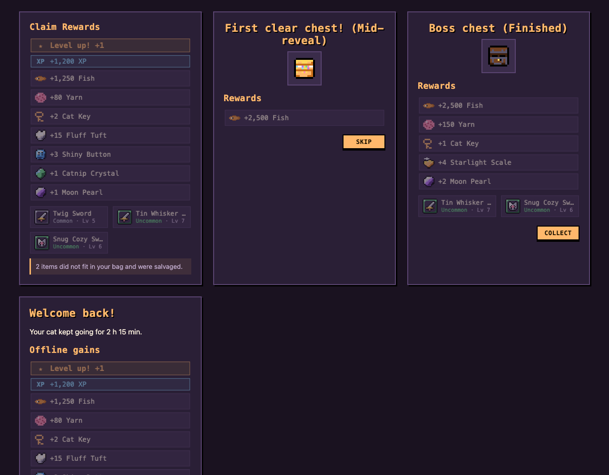
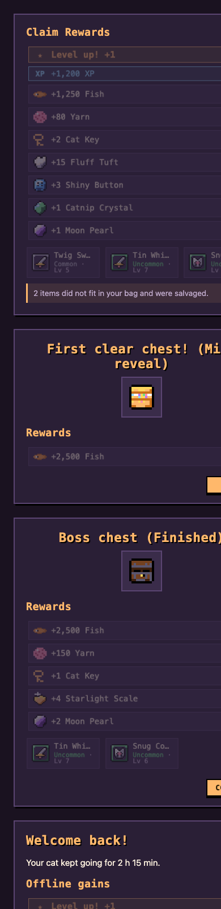

### LootSummary
| 1280px Dark | 1280px Light |
|---|---|
| 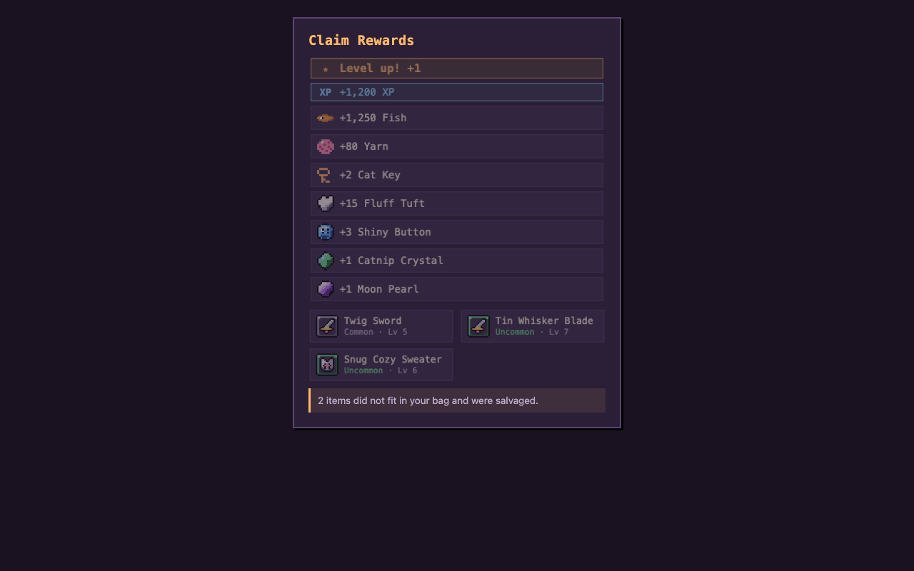 | 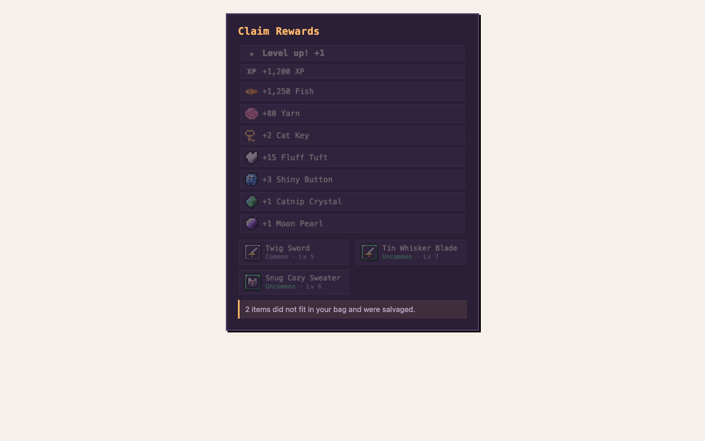 |

| 390px Dark | 390px Light |
|---|---|
| 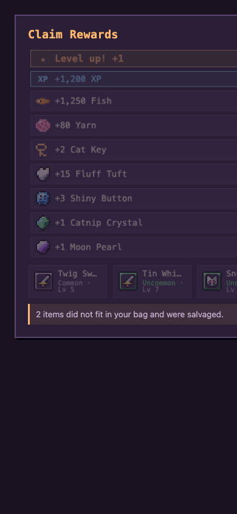 | 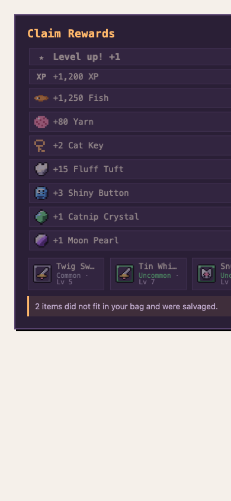 |

### ChestReveal (Mid-Reveal)
| 1280px Dark | 1280px Light |
|---|---|
| 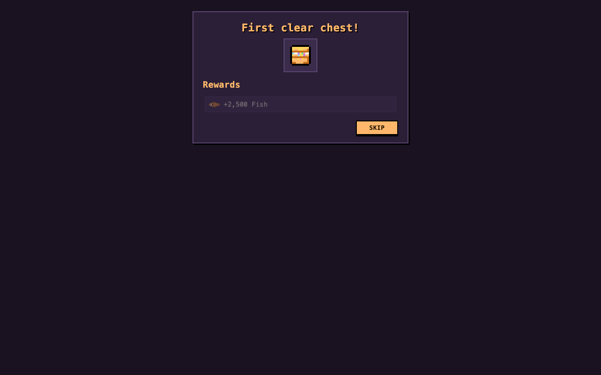 | 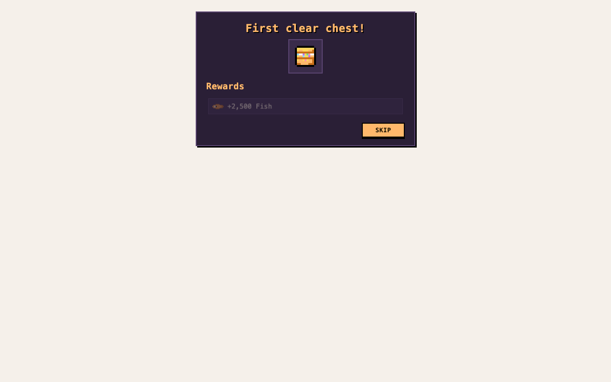 |

| 390px Dark | 390px Light |
|---|---|
| 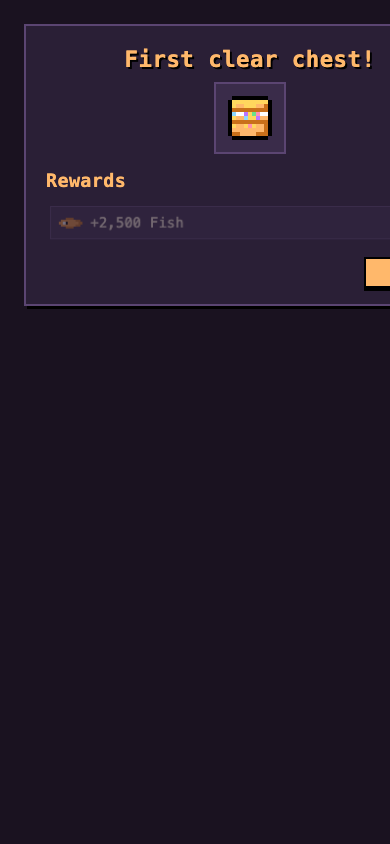 | 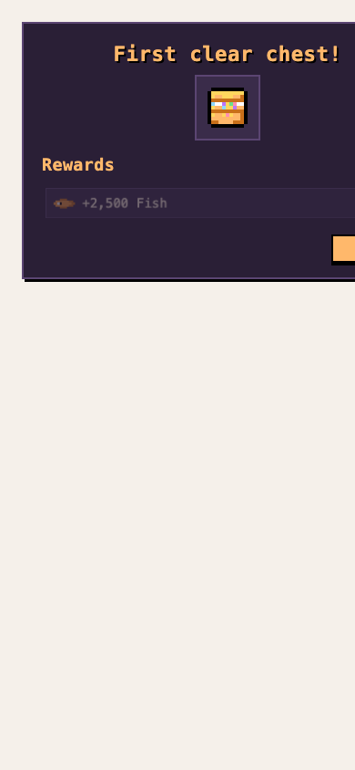 |

### ChestReveal (Finished)
| 1280px Dark | 1280px Light |
|---|---|
| 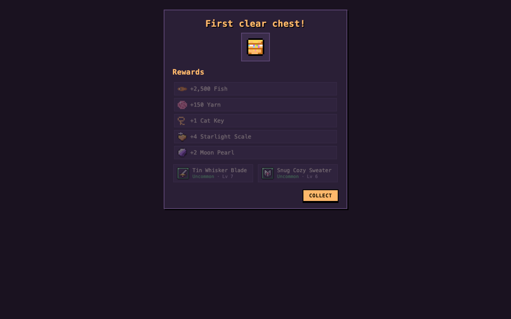 | 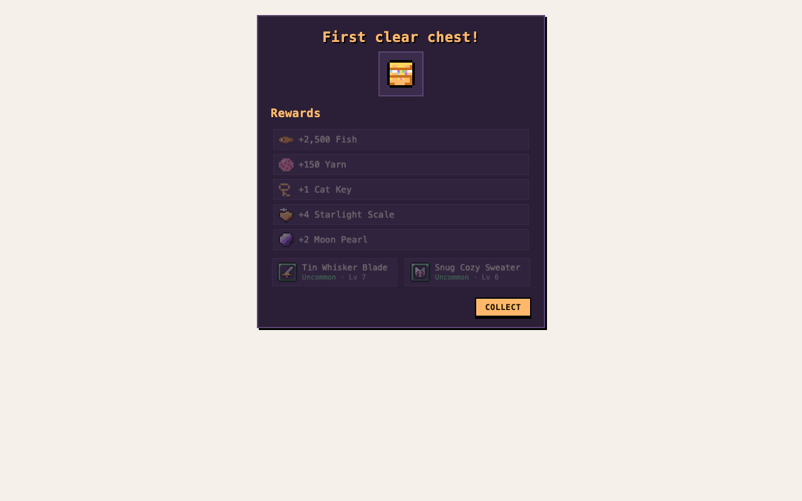 |

| 390px Dark | 390px Light |
|---|---|
| 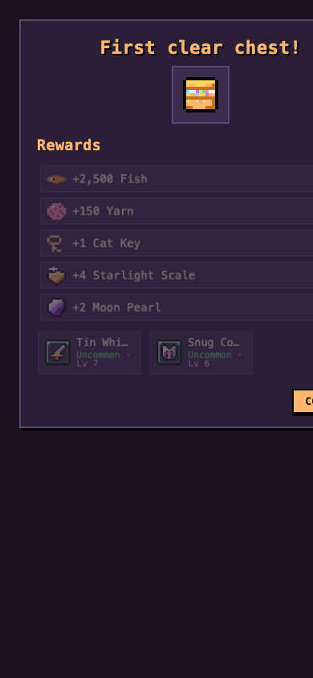 | 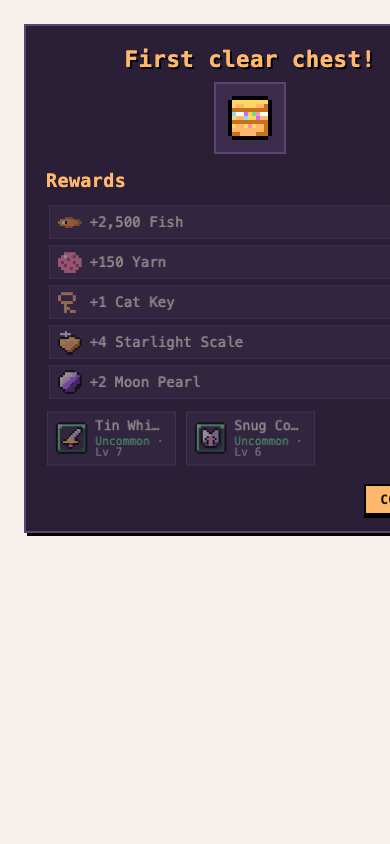 |

### WelcomeBack Dialog
| 1280px Dark | 1280px Light |
|---|---|
| 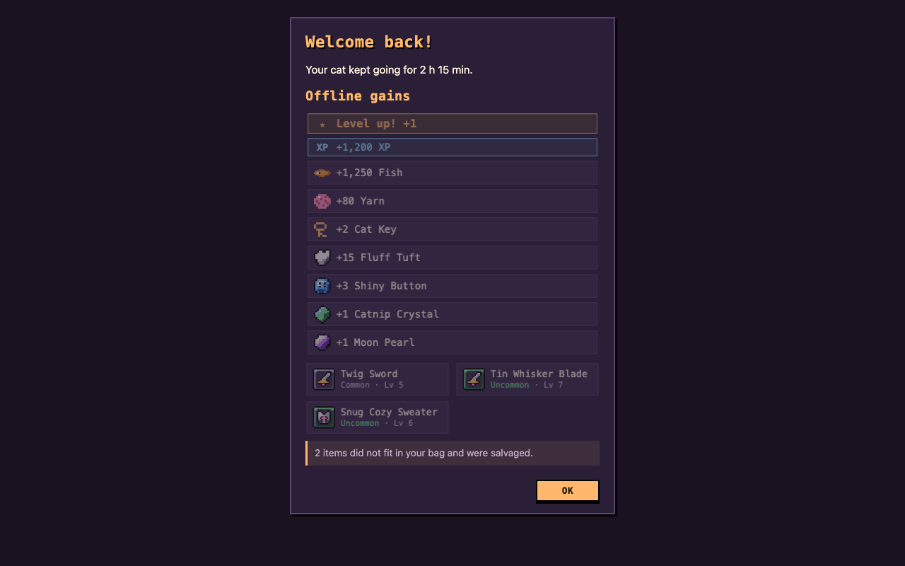 | 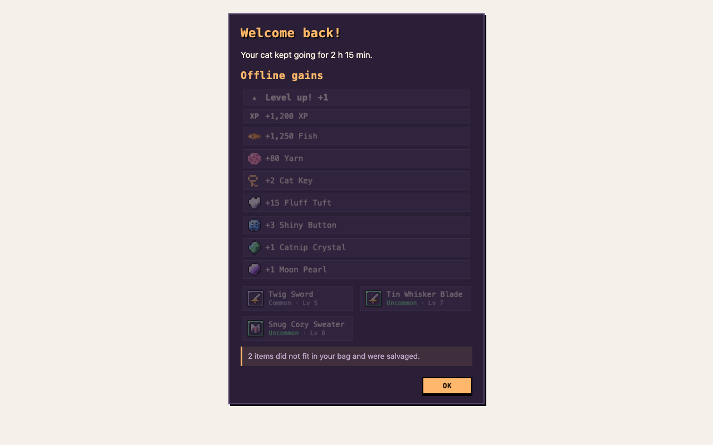 |

| 390px Dark | 390px Light |
|---|---|
| 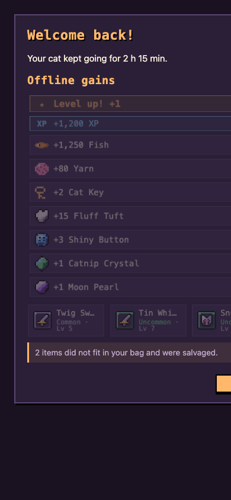 | 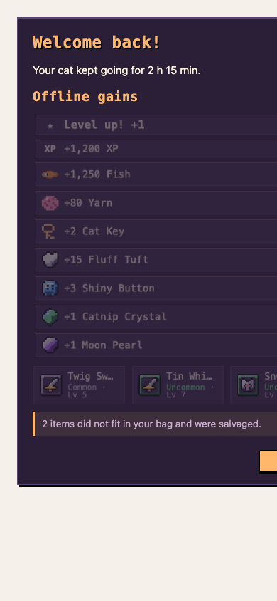 |

---

## 7. Anything Unsure

Everything specified in Task V19a has been implemented, tested, and visually validated. No external dependencies were added, no existing files outside the allowed list were modified, and all checks pass cleanly.
