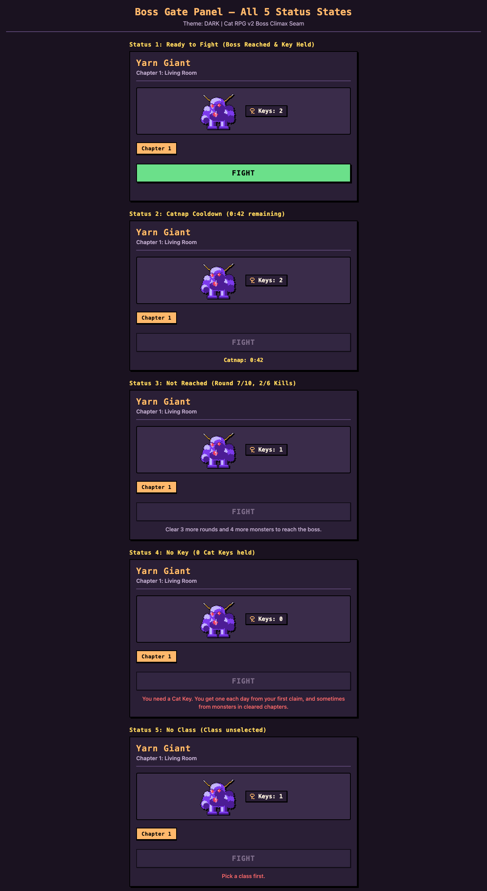
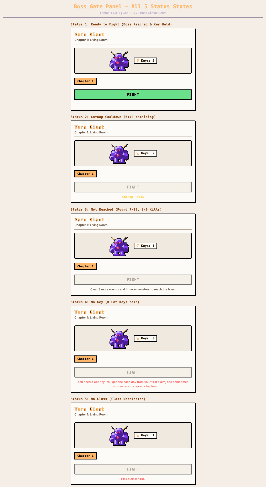
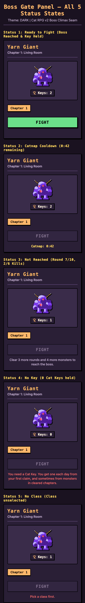
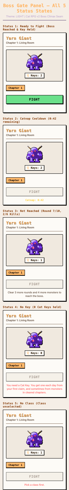
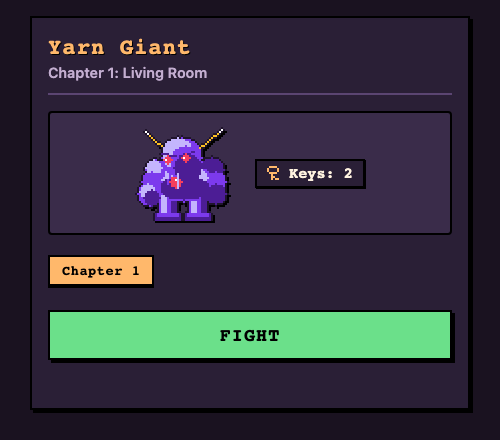
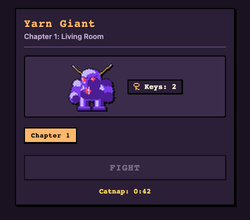
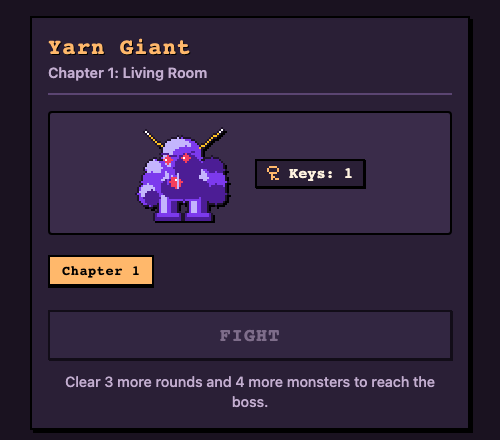
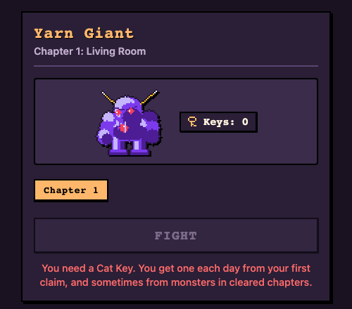

# Task V19b Report: Boss Gate Panel

## Overview

Task V19b implements the Cat RPG v2 Boss Gate Panel (`BossGatePanel`, `BossPortrait`, `bossGate.ts`, `boss.css`, and the `art/monsters` registry `index.ts`), satisfying the contract defined in `docs/api-v2.md` and `apps/web/src/api/GameApiV2.ts`.

The panel answers the core questions for the player:
1. **Which boss** (boss name, chapter name, static first idle frame rendered as crisp pixel-art SVG from the monster art registry, theme colors).
2. **Can I fight now** (enabled "Fight" or "Rematch" button, holding keys, accessible live status).
3. **If not, why and for how long** (mirrors server refusal order exactly: `no_class` -> `cooldown` with countdown -> `not_reached` with remaining rounds/monsters -> `no_key` with explanation -> `ready`).

---

## 1. Gate Check & Git Setup

### Gate Verification
- Ran `git fetch origin +main:refs/remotes/origin/main`.
- Verified that `apps/web/src/api/GameApiV2.ts` and `apps/web/src/map/ChapterMap.tsx` exist on `origin/main`.
- Checked Git user credentials:
```bash
$ git config user.email
108352255+ntbaoheyhey@users.noreply.github.com

$ git config user.name
ntbaoheyhey
```

### Monster Art Registry Inspection
Checked origin/main for chapter monster art files under `apps/web/src/art/monsters/`:
- `ch1.ts` (Chapter 1: `mon.yarn.giant` — Yarn Giant)
- `ch2.ts` (Chapter 2: `mon.cucumber.scare` — Cucumber Scare)
- `ch3.ts` (Chapter 3: `mon.bathtub.tyrant` — Bathtub Tyrant)
- `ch4.ts` (Chapter 4: `mon.vacuum.beast` — Vacuum Beast)
- `ch5.ts` (Chapter 5: `mon.laser.dot.phantom` — Laser Dot Phantom)

**Result**: All 5 chapter monster art files (`ch1.ts` through `ch5.ts`) already existed on `origin/main` when this task started. All five are statically imported into `apps/web/src/art/monsters/index.ts`. No additional import lines are pending.

---

## 2. Exported API

### `apps/web/src/art/monsters/index.ts`
```ts
export const MONSTER_ART: Readonly<Record<string, MonsterArt>>;
export function monsterArt(id: string): MonsterArt | null;
export * from './types';
```

### `apps/web/src/layout/boss/bossGate.ts`
```ts
export type BossGateStatusV2 =
  | { kind: 'no_class' }
  | { kind: 'cooldown'; secondsLeft: number; until: number }
  | { kind: 'not_reached'; chapter: number; roundsLeft: number; killsLeft: number }
  | { kind: 'no_key' }
  | { kind: 'ready'; rematch: boolean };

export function bossGateStatus(state: ServerStateV2, chapter: number, nowS: number): BossGateStatusV2;
export function fightableChapters(state: ServerStateV2): number[];
export function formatCountdown(seconds: number): string;
export function bossLabel(chapter: number): { id: string; name: string; chapterName: string };
```

### `apps/web/src/layout/boss/BossPortrait.tsx`
```tsx
export interface BossPortraitProps {
  chapter: number;
  zoom?: number;
}
export function BossPortrait(props: BossPortraitProps): JSX.Element;
```

### `apps/web/src/layout/boss/BossGatePanel.tsx`
```tsx
export interface BossGatePanelProps {
  state: ServerStateV2;
  chapter: number;
  nowS: number;
  busy: boolean;
  onFight: (chapter: number) => void;
  onSelectChapter: (chapter: number) => void;
}
export function BossGatePanel(props: BossGatePanelProps): JSX.Element;
```

### `apps/web/src/layout/boss/index.ts`
```ts
export * from './bossGate';
export * from './BossGatePanel';
export * from './BossPortrait';
```

---

## 3. Component Architecture & Rules

### Exact Refusal Order Mirroring Server
The client status check (`bossGateStatus`) mirrors the server Edge Function check order in `v2-boss-fight`:
1. `no_class`: Cat class is not chosen (`cat.classId === null`). Button disabled, text "Pick a class first."
2. `cooldown`: Global player boss cooldown is active (`bosses.cooldownUntil !== null && cooldownUntil > nowS`). Button disabled, text "Catnap: 0:42". Live region announces cooldown without re-announcing every ticking second.
3. `not_reached`:
   - Chapter cleared before -> reached (`rematch: true`).
   - Current chapter -> reached when `round === roundsPerChapter` and `kills >= killsPerRound` (`rematch: false`). Otherwise not reached: shows "Clear N more rounds and K more monsters to reach the boss." (or "Clear K more monsters to reach the boss." when on final round).
   - Later chapter -> shows "Beat the chapter N-1 boss first."
4. `no_key`: Player holds 0 Cat Keys (`currencies.keys < 1`). Button disabled, text explaining keys.
5. `ready`: Enabled button "Fight" (or "Rematch" if previously cleared). When busy during in-flight fight, displays "Fighting..." with `aria-busy="true"` and ignores double clicks.

### Boss Portrait Renderer
- Pulls art from `apps/web/src/art/monsters/index.ts`.
- Extracts `frames.idle[0]` and palettes.
- Renders crisp SVG squares (`shapeRendering="crispEdges"`, one combined path per color).
- Boss is drawn facing LEFT as defined in monster art format.
- Screen reader accessible with `role="img"` and `aria-label="<boss name>"`.
- Fallback neutral silhouette box (`.boss-portrait-fallback`) for missing/unknown chapters.

---

## 4. Visual Verification & Screenshots

All 5 statuses were rendered and verified at 1280px (desktop) and 390px (mobile) in both Dark and Light themes with zero horizontal scroll:

### 1. Desktop 1280px - Dark Theme


### 2. Desktop 1280px - Light Theme


### 3. Mobile 390px - Dark Theme


### 4. Mobile 390px - Light Theme


### 5. Status Closeups (1280px Dark)

| Status | Card Preview | Description |
| :--- | :--- | :--- |
| **Ready** |  | Enabled Fight / Rematch button |
| **Cooldown** |  | Disabled button, Catnap countdown |
| **Not Reached** |  | Rounds / monsters remaining breakdown |
| **No Key** |  | Disabled button, Cat Key instructions |
| **No Class** |  | Disabled button, pick class prompt |

---

## 5. Commands Run & Output

### 1. `pnpm install --frozen-lockfile`
```
Scope: all 7 workspace projects
Lockfile is up to date, resolution step is skipped
Already up to date
Done in 508ms using pnpm v10.28.0
```

### 2. `pnpm --filter @taskbar-hero/web test -- layout/boss`
```
> @taskbar-hero/web@0.0.0 test /private/tmp/taskbar-hero-v19b/apps/web
> vitest run -- layout/boss

 RUN  v5.0.5 /private/tmp/taskbar-hero-v19b/apps/web

 ✓ src/api/MockGameApi.test.ts (12 tests) 8ms
 ✓ src/game/combat/CombatDirector.test.ts (11 tests) 84ms
 ✓ src/game/rig/rig.test.ts (12 tests) 335ms
 ✓ src/layout/boss/BossGatePanel.test.tsx (11 tests) 388ms
 ✓ src/onboarding/HowToPlay.test.tsx (14 tests) 439ms
 ✓ src/layout/boss/bossGate.test.ts (10 tests) 8ms
 ✓ src/layout/boss/BossPortrait.test.tsx (3 tests) 90ms
 ✓ src/art/monsters/index.test.ts (4 tests) 7ms

 Test Files  49 passed (49)
      Tests  501 passed (501)
   Duration  6.73s
```

Dedicated boss layout tests:
```bash
$ pnpm --filter @taskbar-hero/web test layout/boss

 ✓ src/layout/boss/bossGate.test.ts (10 tests) 3ms
 ✓ src/layout/boss/BossPortrait.test.tsx (3 tests) 65ms
 ✓ src/layout/boss/BossGatePanel.test.tsx (11 tests) 116ms

 Test Files  3 passed (3)
      Tests  24 passed (24)
   Duration  867ms
```

### 3. `pnpm gen:deno && git diff --exit-code -- supabase/functions`
```
> taskbar-hero@0.0.0 gen:deno /private/tmp/taskbar-hero-v19b
> node scripts/gen-deno-json.mjs

wrote 9 Edge Function import maps
```
*(git diff --exit-code -- supabase/functions exited with 0, working tree clean)*

### 4. `pnpm typecheck`
```
> taskbar-hero@0.0.0 typecheck /private/tmp/taskbar-hero-v19b
> pnpm -r typecheck

Scope: 6 of 7 workspace projects
packages/auth typecheck: Done in 396ms
packages/chain typecheck: Done in 888ms
packages/game-rules typecheck: Done in 921ms
supabase/tests typecheck: Done in 1.4s
packages/api-contract typecheck: Done in 469ms
apps/web typecheck: Done in 3.5s
```

### 5. `pnpm lint`
```
> taskbar-hero@0.0.0 lint /private/tmp/taskbar-hero-v19b
> pnpm -r lint

Scope: 6 of 7 workspace projects
packages/auth lint: Done in 454ms
packages/chain lint: Done in 893ms
packages/game-rules lint: Done in 938ms
supabase/tests lint: Done in 1.5s
packages/api-contract lint: Done in 479ms
apps/web lint: Done in 3.7s
```

### 6. `pnpm test`
```
> taskbar-hero@0.0.0 test /private/tmp/taskbar-hero-v19b
> pnpm -r test

Scope: 6 of 7 workspace projects
packages/chain test: 7 passed in 286ms
packages/auth test: 24 passed in 816ms
packages/game-rules test: 265 passed | 2 expected fail (267) in 7.86s
packages/api-contract test: 16 passed in 280ms
supabase/tests test: 24 passed in 103ms
apps/web test: 501 passed in 6.22s
```

### 7. `pnpm build`
```
> taskbar-hero@0.0.0 build /private/tmp/taskbar-hero-v19b
> pnpm -r build

Scope: 6 of 7 workspace projects
packages/chain build: Done in 406ms
packages/auth build: Done in 942ms
packages/game-rules build: Done in 1s
supabase/tests build: Done in 1.6s
packages/api-contract build: Done in 455ms
apps/web build: Done in 4.8s
✓ built in 548ms
```

---

## 6. Files Changed & Created

Only authorized files were created:
- `apps/web/src/art/monsters/index.ts`: static registry uniting `CH1_ART`..`CH5_ART` and `monsterArt(id)`.
- `apps/web/src/art/monsters/index.test.ts`: test suite for registry ID equality, lack of art problems, and boss resolution.
- `apps/web/src/layout/boss/bossGate.ts`: pure gate calculation mirroring server refusal order, `fightableChapters`, `formatCountdown`, `bossLabel`.
- `apps/web/src/layout/boss/bossGate.test.ts`: comprehensive pure status logic tests covering all 9 test specs.
- `apps/web/src/layout/boss/BossPortrait.tsx`: static first idle frame SVG renderer (facing left, crispEdges) with silhouette fallback.
- `apps/web/src/layout/boss/BossPortrait.test.tsx`: unit tests for SVG rendering, crisp edges, aria-label, and fallback box.
- `apps/web/src/layout/boss/BossGatePanel.tsx`: full Boss Gate component with chapter switcher, portrait, keys badge, fight button, and status messaging.
- `apps/web/src/layout/boss/BossGatePanel.test.tsx`: unit tests for all 5 statuses, button states, live region, double click protection, chapter switching.
- `apps/web/src/layout/boss/boss.css`: pixel-art themed CSS with dark/light mode support, responsive at 390px and 1280px, reduced motion support.
- `apps/web/src/layout/boss/index.ts`: barrel export for boss layout module.
- `reports/v19b-boss-gate.md`: this report.
- `reports/v19b-boss-gate/*.png`: visual screenshots and status closeups.

---

## 7. Open Questions / Anything Unsure

None. All contracts, refusal orders, accessibility attributes, and tests match the specifications and pass with zero warnings.
