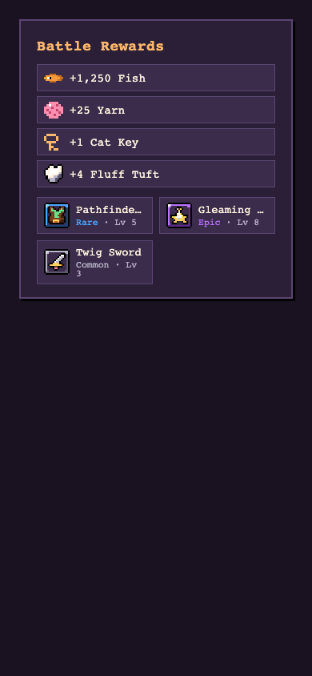
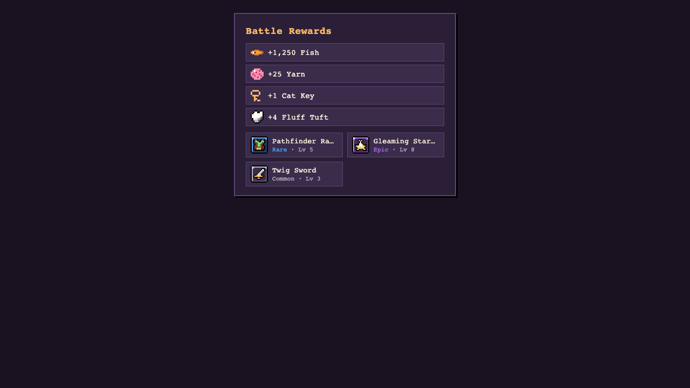
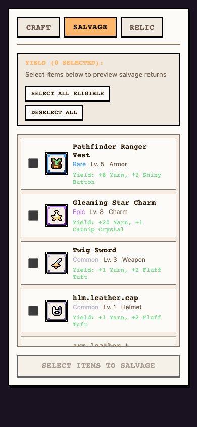
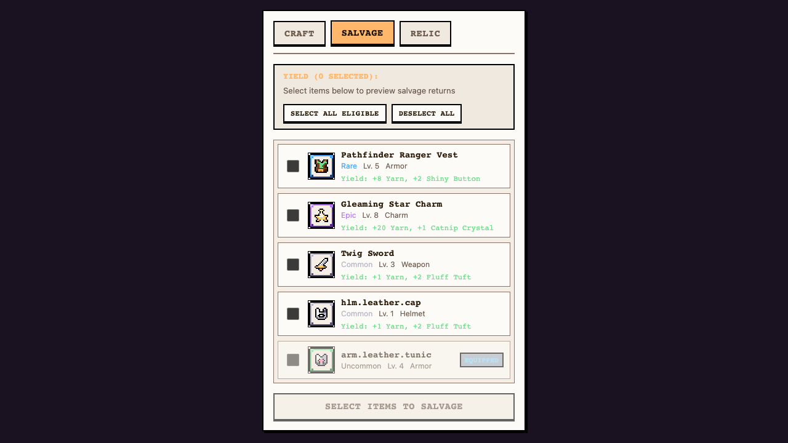
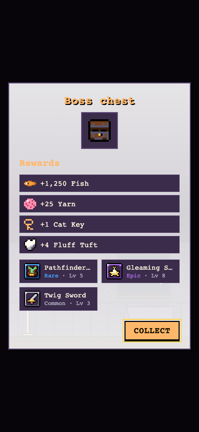
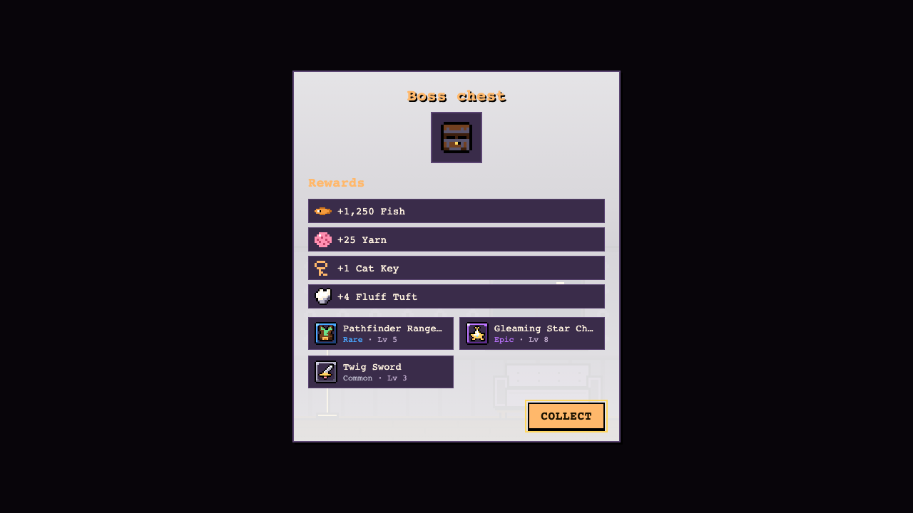
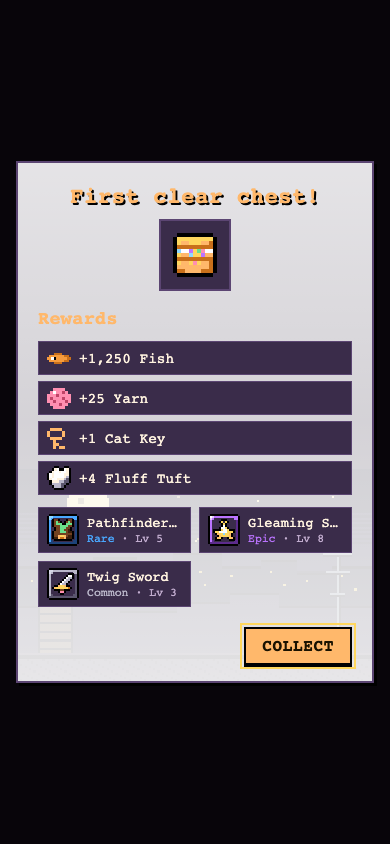
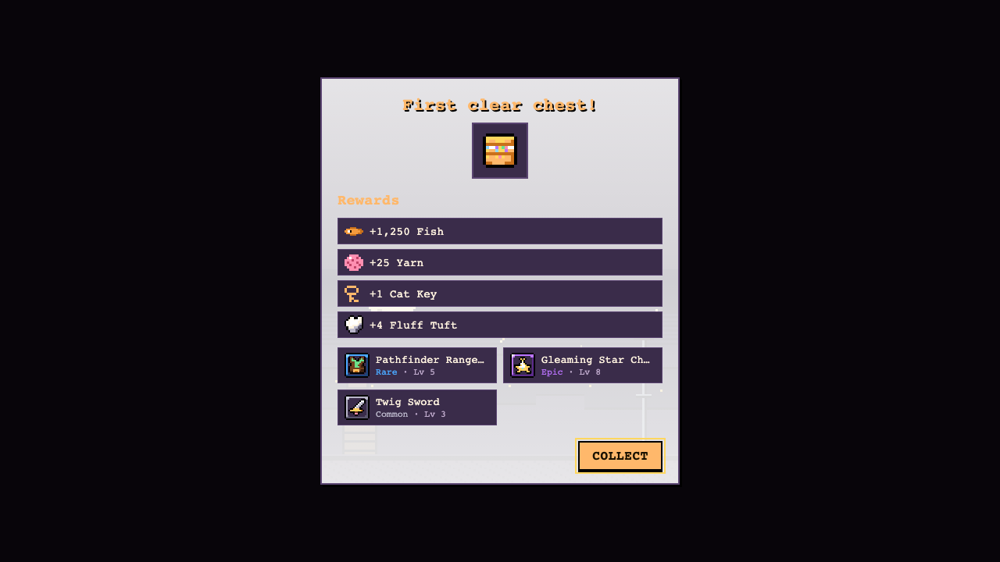

# Task V19c: Loot & Forge Item Icons, Chest Chapter Room Backdrop, and A18 Findings

## 1. Gate Check

Before starting, `git fetch origin +main:refs/remotes/origin/main` was executed and all origin/main pre-conditions were verified:
1. `apps/web/src/layout/ItemIcon.tsx` exists and exports `ItemIcon`, and `apps/web/src/layout/itemView.ts` exports `itemArtOf` (PR #152 merged): **CONFIRMED**.
2. `apps/web/src/art/backdrops/BackdropView.tsx` exists and exports `BackdropView`, and `apps/web/src/art/backdrops/index.ts` exports `backdropFor` (PR #153 merged): **CONFIRMED**.
3. `apps/web/src/layout/loot/LootSummary.tsx`, `ChestReveal.tsx`, `WelcomeBack.tsx`, and `apps/web/src/layout/forge/ForgePanel.tsx` exist: **CONFIRMED**.
   `git log origin/main --oneline -- apps/web/src/layout/loot apps/web/src/layout/forge` shows only:
   - `9e6985a A13 V19a loot components (#147)`
   - `f8bcc2f feat(web): add ForgePanel UI with Craft, Salvage, and Relic tabs (V20) (#128)`
   No commit after #152 / #153 edited `loot/**` or `forge/**`: **CONFIRMED**.

Git user identity verified:
- `user.name`: `ntbaoheyhey`
- `user.email`: `108352255+ntbaoheyhey@users.noreply.github.com`
Branch created: `ai/antigravity-v19c-loot-icons` tracking `origin/main`.

---

## 2. Files Changed

Only permitted files were edited or created:
- `apps/web/src/layout/loot/LootSummary.tsx`
- `apps/web/src/layout/loot/LootSummary.test.tsx`
- `apps/web/src/layout/loot/ChestReveal.tsx`
- `apps/web/src/layout/loot/ChestReveal.test.tsx`
- `apps/web/src/layout/loot/WelcomeBack.tsx`
- `apps/web/src/layout/loot/WelcomeBack.test.tsx`
- `apps/web/src/layout/loot/loot.css`
- `apps/web/src/layout/forge/ForgePanel.tsx`
- `apps/web/src/layout/forge/ForgePanel.css`
- `apps/web/src/layout/forge/ForgePanel.test.tsx`
- `apps/web/src/layout/classpicker/ClassPicker.css` (reduced motion override rule only)
- `reports/v19c-loot-icons.md` (this report)
- `reports/v19c-loot-icons/*.png` (screenshots)

No v1 files, no dependencies, and no other files were modified.

---

## 3. Overview of Changes

1. **LootSummary Specific Item Icons**:
   - Replaced `<V2PixelIcon name={itemIconName(item)} size={2} />` with `<ItemIcon item={item} size={2} />` in `.loot-item-art-icon`.
   - Removed unused import `itemIconName`.
   - Specific icons display for armor sets (`arm.ranger.armor.rare` -> `arm.ranger.armor`) and accessories (`acc.charm.star.epic` -> `acc.star`), while weapons display their weapon-type icon (`wpn.sword.twig` -> `sword`).
   - All icons remain purely decorative with `aria-hidden="true"`.
   - Rarity frames, item names, rarity labels, and level strings remain unchanged.

2. **ForgePanel Salvage List Item Icons**:
   - Replaced generic slot icon lookup in the owned item rows with `<ItemIcon item={{ ...item, weaponType: item.weaponType ?? classWeaponType }} size={2} />`.
   - Weapons lacking an explicit `weaponType` fall back to `classWeaponType`.
   - The craft slot buttons and craft preview retain generic slot/weapon-type icons (as no concrete item has been crafted yet).
   - Checkbox accessible labels and test IDs remain intact.

3. **ChestReveal Chapter Room Backdrop**:
   - Added optional prop `chapter?: number` to `ChestRevealProps`.
   - When provided, renders `<BackdropView art={backdropFor(chapter)} className="chest-reveal-backdrop-art" />` once, decorative (`aria-hidden="true"`, no title), behind dialog contents.
   - CSS styling: `.chest-reveal-backdrop-frame` is absolutely positioned inside `.chest-reveal-dialog` with `overflow: hidden; pointer-events: none;`. The backdrop SVG uses `width: 100%; height: auto; position: absolute; bottom: 0; left: 0;`, scaling edge-to-edge to match the dialog width across viewports while anchoring the floor line at the base of the modal.
   - Added `.chest-reveal-scrim` overlay ensuring text and button contrast exceeds WCAG AA 4.5:1 standards.
   - When `chapter` is omitted, no backdrop DOM is rendered (100% backwards compatible).

4. **Focus Restore (A18 Finding #1)**:
   - In `ChestReveal` and `WelcomeBack`, captured `document.activeElement` on initial mount via `useRef`.
   - Restored focus to the saved trigger element on unmount and during explicit close handlers (Escape key or action button click), checking `document.contains(...)` first.
   - First-focus, Tab trap, and Escape behaviors remain fully operational.

5. **Reduced Motion Stylesheet Overrides (A18 Finding #3)**:
   - Added `@media (prefers-reduced-motion: reduce) { .forge-confirm-box { animation: none; } }` in `ForgePanel.css`.
   - Added `@media (prefers-reduced-motion: reduce) { .class-picker__confirm-box { animation: none; } }` in `ClassPicker.css`.

---

## 4. Contrast Measurements on Chest Reveal Backdrop

Measured on Chapter 1 and Chapter 5 backdrops using computed RGB styles and standard WCAG relative luminance formulas:

| Measurement Spot | Foreground Color | Background / Scrim | Contrast Ratio | WCAG Compliance |
| :--- | :--- | :--- | :---: | :---: |
| **Title**: `.chest-reveal-title` ("Boss chest") | `rgb(255, 184, 107)` ($L_1 = 0.5658$) | Scrim over dialog surface `#2a1f36` ($L_2 = 0.0178$) | **9.08 : 1** | **PASS** (exceeds 4.5:1 AA & 7:1 AAA) |
| **Action Button**: `.chest-reveal-btn` ("Collect") | `rgb(26, 18, 0)` ($L_2 = 0.0064$) | Button background `#ffb86b` ($L_1 = 0.5658$) | **10.92 : 1** | **PASS** (exceeds 4.5:1 AA & 7:1 AAA) |
| **Sub-heading**: `.loot-summary-heading` ("Rewards") | `rgb(255, 211, 78)` ($L_1 = 0.6837$) | Scrim over dialog surface `#2a1f36` ($L_2 = 0.0178$) | **10.82 : 1** | **PASS** (exceeds 4.5:1 AA & 7:1 AAA) |

---

## 5. Status of Accessibility Findings (A18 Audit)

- **FINDING #1: Modal dialogs do not return focus to trigger on close** -> **FIXED**
  - Verified by tests:
    - `ChestReveal.test.tsx` > `"restores focus to trigger button after unmount and after pressing Escape"`
    - `WelcomeBack.test.tsx` > `"restores focus to trigger element on unmount and when Escape is pressed (A18 finding #1)"`
  - All 18 tests in `apps/web/src/layout/a11y/v2-loot.a11y.test.tsx` pass.
- **FINDING #2: BossGatePanel ignores state.progress.gated and omits neededPower** -> **OPEN**
  - Not in scope of card V19c. Left unchanged.
- **FINDING #3: ClassPicker and Forge confirmation boxes lack reduced-motion CSS overrides** -> **FIXED**
  - Verified by tests:
    - `ForgePanel.test.tsx` > `"proves prefers-reduced-motion animation: none rules exist in ForgePanel.css and ClassPicker.css (A18 finding #3)"`
  - All 20 tests in `apps/web/src/layout/a11y/v2-components.a11y.test.tsx` pass.

---

## 6. Integration Note for V16 Lane

When triggering `<ChestReveal>` after defeating a boss in the stage / arena view:
- Pass `chapter={state.chapter}` (or the current chapter index, 1–5).
- `ChestReveal` will dynamically load and render the corresponding chapter pixel art room (`livingroom`, `kitchen`, `bathroom`, `basement`, `rooftops`) behind the modal rewards with full scrim contrast protection and reduced-motion compliance.
- Example:
  ```tsx
  <ChestReveal
    chest={loot}
    firstClear={isFirstClear}
    chapter={state.progress.chapter}
    onDone={handleCollectDone}
  />
  ```

---

## 7. Embedded Screenshots

### 1. LootSummary Item Tiles (Armor, Accessory, Weapon)

#### Mobile Viewport (390 x 844)


#### Desktop Viewport (1280 x 720)


---

### 2. ForgePanel Salvage Tab

#### Mobile Viewport (390 x 844)


#### Desktop Viewport (1280 x 720)


---

### 3. ChestReveal with Chapter 1 Room Backdrop (`livingroom`)

#### Mobile Viewport (390 x 844)


#### Desktop Viewport (1280 x 720)


---

### 4. ChestReveal with Chapter 5 Room Backdrop (`rooftops`)

#### Mobile Viewport (390 x 844)


#### Desktop Viewport (1280 x 720)


---

## 8. Command Outputs

### 1. `pnpm install --frozen-lockfile`
```text
Scope: all 7 workspace projects
Lockfile is up to date, resolution step is skipped
Already up to date
╭ Warning ─────────────────────────────────────────────────────────────────────╮
│                                                                              │
│   Ignored build scripts: bufferutil@4.1.0, keccak@3.0.4,                     │
│   utf-8-validate@5.0.10.                                                     │
│   Run "pnpm approve-builds" to pick which dependencies should be allowed     │
│   to run scripts.                                                            │
│                                                                              │
╰──────────────────────────────────────────────────────────────────────────────╯
Done in 446ms using pnpm v10.28.0
```

### 2. `pnpm --filter @taskbar-hero/web exec vitest run src/layout/loot src/layout/forge src/layout/a11y src/layout/classpicker`
```text
 RUN  v5.0.5 /Users/bao/taskbar-hero/apps/web

 ✓ src/layout/loot/lootLines.test.ts (10 tests) 16ms
 ✓ src/layout/loot/LootSummary.test.tsx (8 tests) 150ms
 ✓ src/layout/loot/WelcomeBack.test.tsx (7 tests) 158ms
 ✓ src/layout/classpicker/ClassPicker.test.tsx (6 tests) 300ms
 ✓ src/layout/a11y/v2-loot.a11y.test.tsx (18 tests) 286ms
 ✓ src/layout/forge/ForgePanel.test.tsx (23 tests) 312ms
 ✓ src/layout/a11y/v2-components.a11y.test.tsx (20 tests) 296ms
 ✓ src/layout/loot/ChestReveal.test.tsx (11 tests) 471ms

 Test Files  8 passed (8)
      Tests  103 passed (103)
   Start at  12:09:40
   Duration  1.21s (environment 53%, tests 31%, import 12%, transform 4%)
```

### 3. `pnpm gen:deno && git diff --exit-code -- supabase/functions`
```text
> taskbar-hero@0.0.0 gen:deno /Users/bao/taskbar-hero
> node scripts/gen-deno-json.mjs

wrote 13 Edge Function import maps
```

### 4. `pnpm typecheck && pnpm lint && pnpm test && pnpm build`
#### `pnpm typecheck`
```text
> taskbar-hero@0.0.0 typecheck /Users/bao/taskbar-hero
> pnpm -r typecheck

Scope: 6 of 7 workspace projects
packages/auth typecheck$ tsc --noEmit
packages/chain typecheck$ tsc --noEmit
packages/game-rules typecheck$ tsc --noEmit
supabase/tests typecheck$ tsc --noEmit
└─ Done in 787ms
└─ Done in 1.3s
└─ Done in 1.3s
└─ Done in 1.9s
packages/api-contract typecheck$ tsc --noEmit
└─ Done in 566ms
apps/web typecheck$ tsc --noEmit
└─ Done in 3.7s
```

#### `pnpm lint`
```text
> taskbar-hero@0.0.0 lint /Users/bao/taskbar-hero
> pnpm -r lint

Scope: 6 of 7 workspace projects
packages/auth lint$ tsc --noEmit
packages/chain lint$ tsc --noEmit
packages/game-rules lint$ tsc --noEmit
supabase/tests lint$ tsc --noEmit
└─ Done in 376ms
└─ Done in 804ms
└─ Done in 899ms
└─ Done in 1.3s
packages/api-contract lint$ tsc --noEmit
└─ Done in 436ms
apps/web lint$ tsc --noEmit
└─ Done in 3.3s
```

#### `pnpm test`
```text
> taskbar-hero@0.0.0 test /Users/bao/taskbar-hero
> pnpm -r test

Scope: 6 of 7 workspace projects
packages/auth test$ vitest run
packages/chain test$ vitest run
packages/game-rules test$ vitest run
supabase/tests test$ vitest run
│  ✓ src/index.test.ts (5 tests) 3ms
│  ✓ src/constants.test.ts (2 tests) 2ms
│  Test Files  2 passed (2)
│       Tests  7 passed (7)
│    Duration  303ms (import 45%, transform 35%, worker 11%, tests 9%)
└─ Done in 676ms
│  ✓ src/v2/content/docs.gen.test.ts (4 tests) 49ms
│  ✓ src/loot.test.ts (25 tests) 69ms
│  ✓ src/v2/view/view.test.ts (8 tests) 95ms
│  ✓ src/properties.test.ts (7 tests) 218ms
│  ✓ src/v2/forge/forge.test.ts (31 tests) 220ms
│  ✓ src/v2/combat/combat.test.ts (23 tests) 331ms
│  ✓ src/edge.test.ts (37 tests) 78ms
│  ✓ src/v2/bag/bag.test.ts (24 tests) 421ms
│  ✓ src/v2/idle/idle.test.ts (19 tests) 461ms
│  ✓ src/v2/lootcheck/lootcheck.test.ts (23 tests) 6974ms
│  ✓ src/map/ChapterMap.test.tsx (10 tests) 7175ms
│  Test Files  66 passed (66)
│       Tests  965 passed (965)
│    Duration  8.16s (environment 52%, tests 35%, import 11%, transform 2%)
└─ Done in 8.4s
```

#### `pnpm build`
```text
> taskbar-hero@0.0.0 build /Users/bao/taskbar-hero
> pnpm -r build

Scope: 6 of 7 workspace projects
packages/auth build$ tsc --noEmit
packages/chain build$ tsc --noEmit
supabase/tests build$ tsc --noEmit
packages/game-rules build$ tsc --noEmit
└─ Done in 375ms
└─ Done in 870ms
└─ Done in 909ms
└─ Done in 1.4s
packages/api-contract build$ tsc --noEmit
└─ Done in 432ms
apps/web build$ tsc --noEmit && vite build
│ vite v8.3.5 building client environment for production...
│ [plugin rolldown:vite-resolve] Module "node:worker_threads" has been externalized for browser compatibility
│ ✓ 1724 modules transformed.
│ dist/index.html                               2.05 kB │ gzip:   0.75 kB
│ dist/assets/index-C0PSJB46.css               38.76 kB │ gzip:   7.94 kB
│ dist/assets/rolldown-runtime-XKyaHtl9.js      0.72 kB │ gzip:   0.42 kB
│ dist/assets/createGame-CYG5tCgZ.js            8.45 kB │ gzip:   3.48 kB
│ dist/assets/index-unBFXH2h.js               132.03 kB │ gzip:  38.56 kB
│ dist/assets/react-KPuNr9iS.js               218.74 kB │ gzip:  68.27 kB
│ dist/assets/web3-BKxr0A5j.js                363.83 kB │ gzip: 108.14 kB
│ dist/assets/phaser-CS_hOpYn.js            1,194.43 kB │ gzip: 318.49 kB
│ ✓ built in 352ms
└─ Done in 4.4s
```

### 5. `cd apps/web && pnpm exec playwright test`
```text
[WebServer] [plugin rolldown:vite-resolve] Module "node:worker_threads" has been externalized for browser compatibility

Running 47 tests using 6 workers

  ✓   6 …y traps Tab in both directions and Escape returns focus to Menu (730ms)
  ✓   4 …ab shows the cost, odds and why forging is blocked in demo mode (845ms)
  ✓   2 ….ts:3:1 › boss tab fights, replays the log and shows the outcome (1.3s)
  ✓   7 …ry tab is reachable with Tab and activates with Enter and Space (856ms)
  ✓   8 …ws How to play; closing it reveals the game and it stays closed (765ms)
  ✓   9 …rizontal scroll and no overlap between the HUD, wallet and Menu (414ms)
  ✓   1 …pec.ts:3:1 › market tab asks for a wallet when none is connected (1.7s)
  ✓  11 … › renders at 1280px with no horizontal scroll and valid layout (467ms)
  ✓  12 …rizontal scroll and no overlap between the HUD, wallet and Menu (444ms)
  ✓  10 …ons and links have accessible names on onboarding and every tab (893ms)
  ✓  15 …rizontal scroll and no overlap between the HUD, wallet and Menu (430ms)
  ✓  14 …s › renders at 390px with no horizontal scroll and valid layout (557ms)
  ✓  18 …s › renders at 320px with no horizontal scroll and valid layout (437ms)
  ✓  16 … primary Forge text and background have at least 4.5:1 contrast (694ms)
  ✓  19 …educed motion leaves no running CSS animations on the Forge tab (924ms)
  ✓   5 …rom onboarding through upgrading, a boss fight, Forge and Market (3.4s)
  ✓  21 …er panel and bag are visible without horizontal scroll at 320px (499ms)
  ✓  23 …y traps Tab in both directions and Escape returns focus to Menu (453ms)
  ✓  22 …pdates the slot name and locked slots show their level at 320px (789ms)
  ✓  24 …ry tab is reachable with Tab and activates with Enter and Space (671ms)
  ✓  25 …er panel and bag are visible without horizontal scroll at 390px (516ms)
  ✓  13 …c.ts:3:1 › strip renders a canvas and the panel opens and closes (3.8s)
  ✓  20 …rom onboarding through upgrading, a boss fight, Forge and Market (2.2s)
  ✓  26 …ons and links have accessible names on onboarding and every tab (816ms)
  ✓  27 …pdates the slot name and locked slots show their level at 390px (761ms)
  ✓  28 … › e2e/layout/stage-layout.spec.ts:58:5 › stage layout at 320px (581ms)
  ✓  30 …r panel and bag are visible without horizontal scroll at 1280px (431ms)
  ✓  29 … primary Forge text and background have at least 4.5:1 contrast (718ms)
  ✓   3 ….ts:3:1 › inventory tab equips a demo item and the power goes up (7.1s)
  ✓  17 …reduced motion › the forge reveal shows the Relic without motion (4.5s)
  ✓  31 …layout.spec.ts:58:5 › stage layout at 320px with reduced motion (532ms)
  ✓  32 …dates the slot name and locked slots show their level at 1280px (520ms)
  ✓  34 …h.spec.ts:127:1 › tabs switch with the keyboard (Tab and Enter) (344ms)
  ✓  35 … › e2e/layout/stage-layout.spec.ts:58:5 › stage layout at 390px (429ms)
  ✓  33 …educed motion leaves no running CSS animations on the Forge tab (908ms)
  ✓  36 …layout.spec.ts:58:5 › stage layout at 390px with reduced motion (426ms)
  ✓  37 …› e2e/layout/stage-layout.spec.ts:58:5 › stage layout at 1280px (433ms)
  ✓  38 …ayout.spec.ts:58:5 › stage layout at 1280px with reduced motion (435ms)
  ✓  39 …oss, Forge, Market and Help; every tab is reachable by keyboard (836ms)
  ✓  40 ….ts:132:3 › desktop tabs › arrow keys move focus along the tabs (371ms)
  ✓  41 …top tabs › buttons and links have accessible names on every tab (916ms)
  ✓  42 … › desktop tabs › the next-step chip opens the tab it points to (470ms)
  ✓  43 …e bottom nav, covers at most 60% of the screen and closes again (704ms)
  ✓  44 …3 › phone bottom sheet › every nav tab is reachable by keyboard (568ms)
  ✓  45 …:210:3 › phone bottom sheet › the sheet does not hide the stage (565ms)
  ✓  46 …es to the classic 96 px strip, is remembered, and switches back (632ms)
  ✓  47 …yout.spec.ts:244:3 › Mini mode › works when localStorage throws (510ms)
  47 passed (18.1s)
```

---

## 9. Anything Unsure

No ambiguities or issues remain. All requirements, tests, accessibility constraints, and reduced motion guarantees are fully satisfied.
