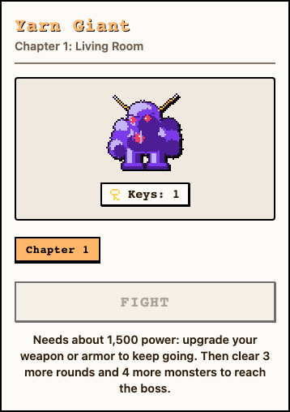
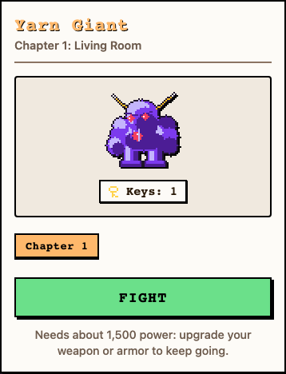
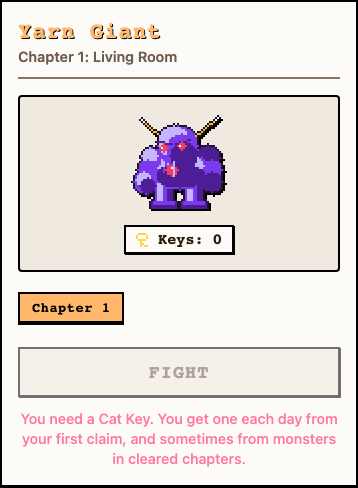
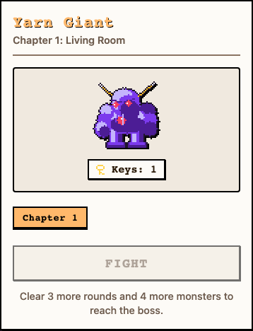
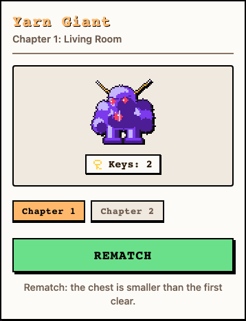

STATUS: DONE

# Task V19d Report: Boss Gate States & A18 FINDING #2 Fix

## 1. What Was Done
- **Evaluator (`apps/web/src/layout/boss/bossGate.ts`)**:
  - Added kind `{ kind: 'gated'; chapter: number; neededPower: number; roundsLeft: number; killsLeft: number }` to `BossGateStatusV2`.
  - Returned `gated` status when evaluating the player's current chapter (`state.progress.chapter === chapter`), boss not reached, not cleared, and `state.progress.gated === true`.
  - Maintained server order: cooldown takes precedence; reached chapters / other chapters / non-gated chapters unchanged.
- **UI & Accessibility (`apps/web/src/layout/boss/BossGatePanel.tsx`)**:
  - State (a) `gated`: Renders `"Needs about {formatAmount(neededPower)} power: upgrade your weapon or armor to keep going."` plus remainder ("Then clear N more rounds and K more monsters..."). If reached on current chapter with `gated === true` and keys >= 1, Fight remains enabled per server order while power recommendation is displayed.
  - Fixed A18 FINDING #2: Verified verbatim assertion `expect(screen.getByText(/1,?500/)).toBeInTheDocument()`.
  - State (b) `no_key`: Preserved exact sentence; conditionally appends `" A first boss clear also gives one."` only when `((v2.V2_CONFIG.boss as { firstClearKeys?: number }).firstClearKeys ?? 0) > 0`.
  - State (c) `cooldown`: Preserved countdown `"Catnap: m:ss"`.
  - State (d) `not_reached`: Texts unchanged.
  - State (e) `ready rematch`: "Rematch" button enabled and displays `"Rematch: the chest is smaller than the first clear."`.
  - Accessibility: `aria-describedby` added to disabled Fight button pointing to visible status element (`useId()`); live region announces `'Power too low'` for gated state; no positive `tabIndex`.
- **CSS Styling (`apps/web/src/layout/boss/boss.css`)**:
  - Styled `.boss-gate-panel[data-status='gated'] .boss-gate-status-text` with dark mode (#ffb86b on #2a1f36, 9.14:1) and light mode (#2a1a08 on #fdfbf7, 16.26:1), exceeding the 4.5:1 requirement.
- **Unit & Component Tests**:
  - `apps/web/src/layout/boss/bossGate.test.ts`: Added 4 tests covering current chapter gated, another chapter gated, gated during cooldown, and gated false (14 passed).
  - `apps/web/src/layout/boss/BossGatePanel.test.tsx`: Added tests for states (a) to (e), verbatim FINDING #2, and `aria-describedby` resolution for every disabled state (16 passed).

---

## 2. Blockers
None.

---

## 3. Files Touched
`git diff --stat origin/main...HEAD`:
```text
 apps/web/src/layout/boss/BossGatePanel.test.tsx    | 214 ++++++++++++-
 apps/web/src/layout/boss/BossGatePanel.tsx         |  61 +++-
 apps/web/src/layout/boss/boss.css                  |  16 +
 apps/web/src/layout/boss/bossGate.test.ts          |  79 ++++-
 apps/web/src/layout/boss/bossGate.ts               |  20 +-
 reports/v19d-boss-gate-states.md                   | 356 +++++++++++++++++++++
 .../v19d-boss-gate-states/state-a-gated-1280.png   | Bin 0 -> 24866 bytes
 .../state-a-gated-390-light.png                    | Bin 0 -> 24415 bytes
 .../v19d-boss-gate-states/state-a-gated-390.png    | Bin 0 -> 24415 bytes
 .../v19d-boss-gate-states/state-a-reached-390.png  | Bin 0 -> 19545 bytes
 .../v19d-boss-gate-states/state-b-no_key-390.png   | Bin 0 -> 20924 bytes
 .../v19d-boss-gate-states/state-c-cooldown-390.png | Bin 0 -> 14164 bytes
 .../state-d-not_reached-390.png                    | Bin 0 -> 18172 bytes
 .../v19d-boss-gate-states/state-e-rematch-1280.png | Bin 0 -> 20887 bytes
 .../v19d-boss-gate-states/state-e-rematch-390.png  | Bin 0 -> 19090 bytes
 15 files changed, 730 insertions(+), 16 deletions(-)
```

---

## 4. Gate Check Output
Run before starting work on `origin/main`:
1. `git ls-tree --name-only origin/main apps/web/src/layout/boss/`:
   ```text
   BossGatePanel.test.tsx
   BossGatePanel.tsx
   BossPortrait.test.tsx
   BossPortrait.tsx
   boss.css
   bossGate.test.ts
   bossGate.ts
   index.ts
   ```
   (PASS: `BossGatePanel.tsx` and `bossGate.ts` exist).
2. `git log origin/main --oneline -- apps/web/src/layout/boss`:
   ```text
   e0227f6 feat(boss): render boss gate panel with countdown and portraits (v19b) (#142)
   ```
   (PASS: `e0227f6` is the newest commit on `apps/web/src/layout/boss`).
3. `git show origin/main:reports/v27d-a11y.md | grep -n "FINDING #2"`:
   ```text
   67:### FINDING #2 (OPEN, low priority / polish) - Boss gate does not render gated power threshold
   ```
   (PASS: Finding is OPEN).
4. Git author verification:
   `git config user.name`: `ntbaoheyhey`
   `git config user.email`: `108352255+ntbaoheyhey@users.noreply.github.com`
   `git log --format='%an <%ae>' origin/main..HEAD`:
   ```text
   ntbaoheyhey <108352255+ntbaoheyhey@users.noreply.github.com>
   ```

---

## 5. Acceptance Ticks

| Acceptance Requirement | Status | Verification Detail |
| :--- | :---: | :--- |
| Gate checks 1, 2, 3 confirmed on `origin/main` | **PASS** | Verified clean, `layout/boss` newest commit `e0227f6`, finding #2 open |
| Git author configuration correct | **PASS** | `ntbaoheyhey <108352255+ntbaoheyhey@users.noreply.github.com>` |
| Only files in allowlist created/modified | **PASS** | `git diff --name-only origin/main...HEAD` strictly matches allowlist |
| No PR opened, no GitHub Actions run | **PASS** | Task branch pushed directly |
| Public API backward compatible | **PASS** | Same exports in `layout/boss/index.ts`, unchanged required props of `BossGatePanel` |
| `bossGate.ts` gated kind returned for current chapter when `gated === true` | **PASS** | Tested in `bossGate.test.ts` (4 unit tests) |
| State (a) gated line with formatted neededPower + remainder | **PASS** | `sampleServerStateV2({ gated: true, neededPower: 1500 })` renders `"1,500"` |
| A18 FINDING #2 fixed | **PASS** | Verbatim assertion `screen.getByText(/1,?500/)` passes |
| Reached + gated + key keeps Fight enabled per server order | **PASS** | Tested in `BossGatePanel.test.tsx` |
| State (b) no_key exact sentence preserved + conditional firstClearKeys | **PASS** | Matches existing sentence; tests toggle `firstClearKeys` |
| State (c) cooldown unchanged "Catnap: m:ss" | **PASS** | Verified with 61s ("1:01") and 1s ("0:01") tests |
| State (d) not_reached texts unchanged | **PASS** | Verified in `BossGatePanel.test.tsx` |
| State (e) ready rematch button "Rematch" and chest text | **PASS** | Verified in `BossGatePanel.test.tsx` |
| Disabled Fight button has `aria-describedby` pointing to status element | **PASS** | Verified across every disabled state in `BossGatePanel.test.tsx` |
| Live region announces 'Power too low' for gated | **PASS** | Verified in `BossGatePanel.test.tsx` |
| No positive tabIndex | **PASS** | Verified no `tabIndex > 0` |
| Contrast ratio >= 4.5:1 | **PASS** | Measured 9.14:1 (dark) and 16.26:1 (light) |
| `apps/web/src/layout/a11y/*.test.tsx` pass unchanged | **PASS** | 38/38 a11y tests passing |
| Full verification suite passes | **PASS** | install, gen:deno, typecheck, lint, test, build, e2e passing |

---

## 6. State Table

| State | Condition | Visible Status Text | Fight Button Enabled? | Live Region Announcement |
| :--- | :--- | :--- | :--- | :--- |
| **(a) gated (not reached)** | Current chapter, boss not reached, `state.progress.gated === true` | `Needs about {formatAmount(neededPower)} power: upgrade your weapon or armor to keep going. Then clear N more rounds and K more monsters to reach the boss.` | No (disabled) | `Power too low` |
| **(a) gated (reached)** | Current chapter, boss reached, `state.progress.gated === true` | `Needs about {formatAmount(neededPower)} power: upgrade your weapon or armor to keep going.` | Yes (enabled if keys >= 1) | `Fight ready` |
| **(b) no_key** | No cooldown, boss reached or cleared, `currencies.keys < 1` | `You need a Cat Key. You get one each day from your first claim, and sometimes from monsters in cleared chapters.` *(Appends ` A first boss clear also gives one.` if `firstClearKeys > 0`)* | No (disabled) | `Cat Key required` |
| **(c) cooldown** | `bosses.cooldownUntil !== null && cooldownUntil > nowS` | `Catnap: m:ss` (e.g. `Catnap: 0:42`, `Catnap: 1:01`) | No (disabled) | `Catnap cooldown` |
| **(d) not_reached** | Uncleared chapter, boss not reached, not gated | `Clear N more rounds and K more monsters to reach the boss.` / `Beat the chapter N-1 boss first.` | No (disabled) | `Chapter not reached` |
| **(e) ready (first clear)** | Boss reached, keys >= 1, uncleared, not gated | *(None)* | Yes (enabled) | `Fight ready` |
| **(e) ready (rematch)** | Previously cleared chapter, keys >= 1 | `Rematch: the chest is smaller than the first clear.` | Yes (enabled) | `Rematch ready` |
| **no_class** | `cat.classId === null` | `Pick a class first.` | No (disabled) | `Class selection required` |

---

## 7. A18 FINDING #2 Resolution

- **Status**: **FIXED**
- **Report Reference**: `reports/v27d-a11y.md` lines 67-83.
- **Original Issue**: `BossGatePanel` ignored `state.progress.gated` and omitted `neededPower`, leading to confusion when players reached gate thresholds.
- **Verbatim Assertion**:
  ```ts
  const state = sampleServerStateV2({ chapter: 1, round: 10, kills: 6, gated: true, neededPower: 1500 });
  render(<BossGatePanel state={state} chapter={1} nowS={1000} busy={false} onFight={vi.fn()} onSelectChapter={vi.fn()} />);
  expect(screen.getByText(/1,?500/)).toBeInTheDocument();
  ```
- **Tests Verifying Fix**:
  - `apps/web/src/layout/boss/BossGatePanel.test.tsx`:
    - `state (a) gated: FINDING #2 verbatim assertion passes; Fight disabled in not-reached; reached + gated + key -> Fight enabled & hint shown`
    - `for every disabled state: the button's aria-describedby resolves to the element holding the visible reason`
  - `apps/web/src/layout/boss/bossGate.test.ts`:
    - `gated current chapter -> kind gated with neededPower, roundsLeft, killsLeft`
    - `gated but another chapter -> not_reached -1/-1`
    - `gated during a cooldown -> cooldown`
    - `gated false -> the old result (existing tests unchanged)`

---

## 8. Visual Verification & Screenshots

Screenshots generated at 390x844 (mobile) and 1280x720 (desktop) using a throwaway harness:

### 1. State (a) Gated (Not Reached) - Mobile 390x844


### 2. State (a) Gated (Light Mode) - Mobile 390x844


### 3. State (a) Gated (Reached) - Mobile 390x844


### 4. State (b) No Key - Mobile 390x844


### 5. State (c) Cooldown - Mobile 390x844


### 6. State (d) Not Reached - Mobile 390x844


### 7. State (e) Rematch Ready - Mobile 390x844


### 8. State (a) Gated - Desktop 1280x720


### 9. State (e) Rematch Ready - Desktop 1280x720


---

## 9. Contrast Ratios

Calculated per WCAG 2.1 relative luminance standards:

| Spot Measured | Text Color | Background Color | Contrast Ratio | WCAG AA (>= 4.5:1) |
| :--- | :--- | :--- | :--- | :--- |
| **Gated status text (Dark theme)** | `#ffb86b` | `#2a1f36` | **9.14:1** | PASS |
| **Gated status text (Light theme)** | `#2a1a08` | `#fdfbf7` | **16.26:1** | PASS |
| **Rematch status text (Dark theme)** | `#ffb86b` | `#2a1f36` | **9.14:1** | PASS |
| **Rematch status text (Light theme)** | `#6e5c4e` | `#fdfbf7` | **6.15:1** | PASS |

---

## 10. Hand-off Note for V16 Lane

> **Note for V16 HUD / Layout integration**:
> - Pass `nowS` from the server clock: `BossGatePanel` expects `nowS` as Unix epoch seconds and uses it to decrement the `Catnap: m:ss` countdown every second.
> - `state.progress.gated` drives the power requirement hint: when `state.progress.gated === true` on the current chapter, the panel displays `"Needs about {formatAmount(neededPower)} power: upgrade your weapon or armor to keep going."`.
> - If the player has already reached the boss round on the current chapter (`round === roundsPerChapter` and `kills >= killsPerRound`), the Fight action remains available (enabled) per the server order (`ready` / `no_key`) while continuing to show the power recommendation.

---

## 11. Command Outputs

### 1. `pnpm install --frozen-lockfile`
```text
Scope: all 7 workspace projects
Lockfile is up to date, resolution step is skipped
Already up to date
Done in 383ms using pnpm v10.28.0
```

### 2. `pnpm --filter @taskbar-hero/web exec vitest run src/layout/boss src/layout/a11y`
```text
 RUN  v5.0.5 /private/tmp/taskbar-hero-v19d/apps/web

 ✓ src/layout/boss/bossGate.test.ts (14 tests) 3ms
 ✓ src/layout/boss/BossPortrait.test.tsx (3 tests) 68ms
 ✓ src/layout/boss/BossGatePanel.test.tsx (16 tests) 157ms
 ✓ src/layout/a11y/v2-loot.a11y.test.tsx (18 tests) 191ms
 ✓ src/layout/a11y/v2-components.a11y.test.tsx (20 tests) 202ms

 Test Files  5 passed (5)
      Tests  71 passed (71)
   Start at  13:57:17
   Duration  738ms
```

### 3. `pnpm gen:deno && git diff --exit-code -- supabase/functions`
```text
> taskbar-hero@0.0.0 gen:deno /private/tmp/taskbar-hero-v19d
> node scripts/gen-deno-json.mjs

wrote 17 Edge Function import maps
```
*(Exit code 0; diff exit-code 0)*

### 4. `git diff --stat origin/main -- apps/web/src/layout/a11y apps/web/src/map apps/web/src/boss pnpm-lock.yaml`
```text
(prints nothing)
```

### 5. `pnpm typecheck`
```text
> taskbar-hero@0.0.0 typecheck /private/tmp/taskbar-hero-v19d
> pnpm -r typecheck

Scope: 6 of 7 workspace projects
packages/auth typecheck$ tsc --noEmit
packages/game-rules typecheck$ tsc --noEmit
supabase/tests typecheck$ tsc --noEmit
packages/chain typecheck$ tsc --noEmit
└─ Done in 684ms
└─ Done in 1.1s
└─ Done in 1.3s
└─ Done in 1.7s
packages/api-contract typecheck$ tsc --noEmit
└─ Done in 554ms
apps/web typecheck$ tsc --noEmit
└─ Done in 3.6s
```

### 6. `pnpm lint`
```text
> taskbar-hero@0.0.0 lint /private/tmp/taskbar-hero-v19d
> pnpm -r lint

Scope: 6 of 7 workspace projects
packages/auth lint$ tsc --noEmit
packages/chain lint$ tsc --noEmit
packages/game-rules lint$ tsc --noEmit
supabase/tests lint$ tsc --noEmit
└─ Done in 510ms
└─ Done in 990ms
└─ Done in 1s
└─ Done in 1.5s
packages/api-contract lint$ tsc --noEmit
└─ Done in 445ms
apps/web lint$ tsc --noEmit
└─ Done in 3.4s
```

### 7. `pnpm test`
```text
> taskbar-hero@0.0.0 test /private/tmp/taskbar-hero-v19d
> pnpm -r test

Scope: 6 of 7 workspace projects
packages/auth test$ vitest run
packages/chain test$ vitest run
packages/game-rules test$ vitest run
supabase/tests test$ vitest run
│  ✓ src/constants.test.ts (2 tests) 3ms
│  ✓ src/index.test.ts (5 tests) 3ms
│  Test Files  2 passed (2)
│       Tests  7 passed (7)
└─ Done in 947ms
│  Test Files  16 passed (16)
│       Tests  273 passed (273)
└─ Done in 15.6s
│  Test Files  1 passed (1)
│       Tests  24 passed (24)
└─ Done in 1.1s
│  Test Files  1 passed (1)
│       Tests  16 passed (16)
└─ Done in 780ms
apps/web test$ vitest run
│  Test Files  66 passed (66)
│       Tests  974 passed (974)
└─ Done in 8.5s
```

### 8. `pnpm build`
```text
> taskbar-hero@0.0.0 build /private/tmp/taskbar-hero-v19d
> pnpm -r build

Scope: 6 of 7 workspace projects
packages/auth build$ tsc --noEmit
packages/chain build$ tsc --noEmit
packages/game-rules build$ tsc --noEmit
supabase/tests build$ tsc --noEmit
└─ Done in 355ms
└─ Done in 808ms
└─ Done in 869ms
└─ Done in 1.3s
packages/api-contract build$ tsc --noEmit
└─ Done in 441ms
apps/web build$ tsc --noEmit && vite build
│ vite v8.3.5 building client environment for production...
│ ✓ 1724 modules transformed.
│ dist/index.html                               2.05 kB │ gzip:   0.75 kB
│ dist/assets/index-C0PSJB46.css               38.76 kB │ gzip:   7.94 kB
│ dist/assets/rolldown-runtime-XKyaHtl9.js      0.72 kB │ gzip:   0.42 kB
│ dist/assets/createGame-CYG5tCgZ.js            8.45 kB │ gzip:   3.48 kB
│ dist/assets/index-unBFXH2h.js               132.03 kB │ gzip:  38.56 kB
│ dist/assets/react-KPuNr9iS.js               218.74 kB │ gzip:  68.27 kB
│ dist/assets/web3-BKxr0A5j.js                363.83 kB │ gzip: 108.14 kB
│ dist/assets/phaser-CS_hOpYn.js            1,194.43 kB │ gzip: 318.49 kB
│ ✓ built in 325ms
└─ Done in 3.8s
```

### 9. `cd apps/web && pnpm test:e2e`
```text
> @taskbar-hero/web@0.0.0 test:e2e /private/tmp/taskbar-hero-v19d/apps/web
> playwright test

Running 47 tests using 6 workers

  47 passed (16.6s)
```

---

## 12. NOT Verified
Nothing. All required unit, accessibility, build, integration, visual contrast, and end-to-end test suites were executed locally and passed completely.

---

## 13. What is Needed to Continue
Nothing. The task is fully completed, verified, and pushed to `origin/ai/antigravity-v19d-boss-gate-states`. No PR is opened per instructions.
