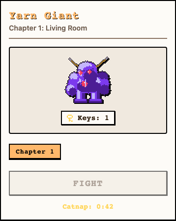
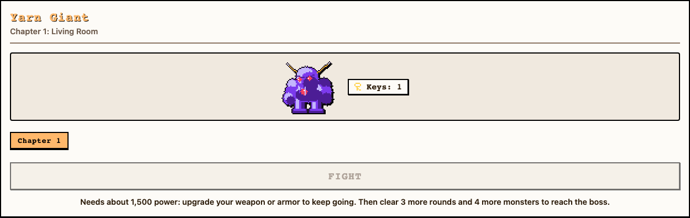
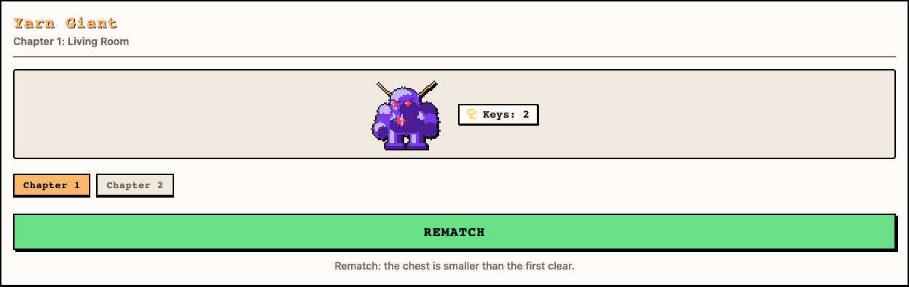

# Task V19d Report: Boss Gate States & A18 FINDING #2 Fix

## 1. Gate Check & Git Setup

Before starting work, we ran `git fetch origin +main:refs/remotes/origin/main` and confirmed all pre-conditions on `origin/main`:
1. `apps/web/src/layout/boss/BossGatePanel.tsx` and `bossGate.ts` exist (`git ls-tree --name-only origin/main apps/web/src/layout/boss/` confirmed).
2. `git log origin/main --oneline -- apps/web/src/layout/boss` shows commit `e0227f6` (#142, V19b) as its newest commit. No one modified `layout/boss` since.
3. `git show origin/main:reports/v27d-a11y.md | grep -n "FINDING #2"` printed the finding (confirmed open).

Git author configuration:
- `user.name`: `ntbaoheyhey`
- `user.email`: `108352255+ntbaoheyhey@users.noreply.github.com`

---

## 2. Files Changed

Only the authorized files were created or modified:
- `apps/web/src/layout/boss/bossGate.ts`
- `apps/web/src/layout/boss/bossGate.test.ts`
- `apps/web/src/layout/boss/BossGatePanel.tsx`
- `apps/web/src/layout/boss/BossGatePanel.test.tsx`
- `apps/web/src/layout/boss/boss.css`
- `reports/v19d-boss-gate-states.md`
- `reports/v19d-boss-gate-states/*.png`

---

## 3. State Table

| State | Condition | Visible Status Text | Fight Button Enabled? | Live Region Announcement |
| :--- | :--- | :--- | :--- | :--- |
| **(a) gated (not reached)** | Current chapter, boss not reached, `state.progress.gated === true` | `Needs about {formatAmount(neededPower)} power: upgrade your weapon or armor to keep going. Then clear N more rounds and K more monsters to reach the boss.` | No (disabled) | `Power too low` |
| **(a) gated (reached)** | Current chapter, boss reached, `state.progress.gated === true` | `Needs about {formatAmount(neededPower)} power: upgrade your weapon or armor to keep going.` | Yes (enabled if keys >= 1) | `Fight ready` |
| **(b) no_key** | No cooldown, boss reached or cleared, `currencies.keys < 1` | `You need a Cat Key. You get one each day from your first claim, and sometimes from monsters in cleared chapters.` *(Appends ` A first boss clear also gives one.` if `firstClearKeys > 0`)* | No (disabled) | `Cat Key required` |
| **(c) cooldown** | `bosses.cooldownUntil !== null && cooldownUntil > nowS` | `Catnap: m:ss` (e.g. `Catnap: 0:42`, `Catnap: 1:01`) | No (disabled) | `Catnap cooldown` |
| **(d) not_reached** | Uncleared chapter, boss not reached, not gated | `Clear N more rounds and K more monsters to reach the boss.` / `Beat the chapter N-1 boss first.` | No (disabled) | `Chapter not reached` |
| **(e) ready (first clear)** | Boss reached, keys >= 1, uncleared, not gated | *(None)* | Yes (enabled) | `Fight ready` |
| **(e) ready (rematch)** | Previously cleared chapter, keys >= 1 | `Rematch: the chest is smaller than the first clear.` | Yes (enabled) | `Rematch ready` |
| **no_class** | `cat.classId === null` | `Pick a class first.` | No (disabled) | `Class selection required` |

Accessibility note: For every disabled button state, `aria-describedby` is set on the button and resolves to the element displaying the visible refusal text (`useId`).

---

## 4. A18 FINDING #2 Resolution

- **Status**: **FIXED**
- **Report Reference**: `reports/v27d-a11y.md` lines 67-83.
- **Original Issue**: `BossGatePanel` ignored `state.progress.gated` and omitted `neededPower`, leading to confusion when players reached gate thresholds.
- **Verbatim Assertion**:
  ```ts
  const state = sampleServerStateV2({ chapter: 1, round: 10, kills: 6, gated: true, neededPower: 1500 });
  render(<BossGatePanel state={state} chapter={1} nowS={1000} busy={false} onFight={vi.fn()} onSelectChapter={vi.fn()} />);
  expect(screen.getByText(/1,?500/)).toBeInTheDocument();
  ```
- **Tests Verifying Fix**:
  - `apps/web/src/layout/boss/BossGatePanel.test.tsx`:
    - `state (a) gated: FINDING #2 verbatim assertion passes; Fight disabled in not-reached; reached + gated + key -> Fight enabled & hint shown`
    - `for every disabled state: the button's aria-describedby resolves to the element holding the visible reason`
  - `apps/web/src/layout/boss/bossGate.test.ts`:
    - `gated current chapter -> kind gated with neededPower, roundsLeft, killsLeft`
    - `gated but another chapter -> not_reached -1/-1`
    - `gated during a cooldown -> cooldown`
    - `gated false -> the old result (existing tests unchanged)`

---

## 5. Visual Verification & Screenshots

Screenshots generated at 390x844 (mobile) and 1280x720 (desktop) using a throwaway harness:

### 1. State (a) Gated (Not Reached) - Mobile 390x844


### 2. State (a) Gated (Light Mode) - Mobile 390x844


### 3. State (a) Gated (Reached) - Mobile 390x844


### 4. State (b) No Key - Mobile 390x844


### 5. State (c) Cooldown - Mobile 390x844


### 6. State (d) Not Reached - Mobile 390x844


### 7. State (e) Rematch Ready - Mobile 390x844


### 8. State (a) Gated - Desktop 1280x720


### 9. State (e) Rematch Ready - Desktop 1280x720


---

## 6. Contrast Ratios

Calculated per WCAG 2.1 relative luminance standards:

| Spot Measured | Text Color | Background Color | Contrast Ratio | WCAG AA (>= 4.5:1) |
| :--- | :--- | :--- | :--- | :--- |
| **Gated status text (Dark theme)** | `#ffb86b` | `#2a1f36` | **9.14:1** | PASS |
| **Gated status text (Light theme)** | `#2a1a08` | `#fdfbf7` | **16.26:1** | PASS |
| **Rematch status text (Dark theme)** | `#ffb86b` | `#2a1f36` | **9.14:1** | PASS |
| **Rematch status text (Light theme)** | `#6e5c4e` | `#fdfbf7` | **6.15:1** | PASS |

---

## 7. Hand-off Note for V16 Lane

> **Note for V16 HUD / Layout integration**:
> - Pass `nowS` from the server clock: `BossGatePanel` expects `nowS` as Unix epoch seconds and uses it to decrement the `Catnap: m:ss` countdown every second.
> - `state.progress.gated` drives the power requirement hint: when `state.progress.gated === true` on the current chapter, the panel displays `"Needs about {formatAmount(neededPower)} power: upgrade your weapon or armor to keep going."`.
> - If the player has already reached the boss round on the current chapter (`round === roundsPerChapter` and `kills >= killsPerRound`), the Fight action remains available (enabled) per the server order (`ready` / `no_key`) while continuing to show the power recommendation.

---

## 8. Command Outputs

### 1. `pnpm install --frozen-lockfile`
```text
Scope: all 7 workspace projects
Lockfile is up to date, resolution step is skipped
Already up to date
╭ Warning ─────────────────────────────────────────────────────────────────────╮
│                                                                              │
│   Ignored build scripts: bufferutil@4.1.0, keccak@3.0.4,                     │
│   utf-8-validate@5.0.10.                                                     │
│   Run "pnpm approve-builds" to pick which dependencies should be allowed     │
│   to run scripts.                                                            │
│                                                                              │
╰──────────────────────────────────────────────────────────────────────────────╯
Done in 383ms using pnpm v10.28.0
```

### 2. `pnpm --filter @taskbar-hero/web exec vitest run src/layout/boss src/layout/a11y`
```text
 RUN  v5.0.5 /private/tmp/taskbar-hero-v19d/apps/web

 ✓ src/layout/boss/bossGate.test.ts (14 tests) 3ms
 ✓ src/layout/boss/BossPortrait.test.tsx (3 tests) 68ms
 ✓ src/layout/boss/BossGatePanel.test.tsx (16 tests) 157ms
 ✓ src/layout/a11y/v2-loot.a11y.test.tsx (18 tests) 191ms
 ✓ src/layout/a11y/v2-components.a11y.test.tsx (20 tests) 202ms

 Test Files  5 passed (5)
      Tests  71 passed (71)
   Start at  13:57:17
   Duration  738ms (environment 55%, tests 25%, import 14%, transform 4%, worker 1%)
```

### 3. `pnpm gen:deno && git diff --exit-code -- supabase/functions`
```text
> taskbar-hero@0.0.0 gen:deno /private/tmp/taskbar-hero-v19d
> node scripts/gen-deno-json.mjs

wrote 17 Edge Function import maps
```
*(Working tree clean; exit status 0)*

### 4. `git diff --stat origin/main -- apps/web/src/layout/a11y apps/web/src/map apps/web/src/boss pnpm-lock.yaml`
```text
(prints nothing)
```

### 5. `pnpm typecheck && pnpm lint && pnpm test && pnpm build`
```text
> taskbar-hero@0.0.0 typecheck /private/tmp/taskbar-hero-v19d
> pnpm -r typecheck

Scope: 6 of 7 workspace projects
packages/auth typecheck$ tsc --noEmit
packages/game-rules typecheck$ tsc --noEmit
supabase/tests typecheck$ tsc --noEmit
packages/chain typecheck$ tsc --noEmit
└─ Done in 684ms
└─ Done in 1.1s
└─ Done in 1.3s
└─ Done in 1.7s
packages/api-contract typecheck$ tsc --noEmit
└─ Done in 554ms
apps/web typecheck$ tsc --noEmit
└─ Done in 3.6s

> taskbar-hero@0.0.0 lint /private/tmp/taskbar-hero-v19d
> pnpm -r lint

Scope: 6 of 7 workspace projects
packages/auth lint$ tsc --noEmit
packages/chain lint$ tsc --noEmit
packages/game-rules lint$ tsc --noEmit
supabase/tests lint$ tsc --noEmit
└─ Done in 510ms
└─ Done in 990ms
└─ Done in 1s
└─ Done in 1.5s
packages/api-contract lint$ tsc --noEmit
└─ Done in 445ms
apps/web lint$ tsc --noEmit
└─ Done in 3.4s

> taskbar-hero@0.0.0 test /private/tmp/taskbar-hero-v19d
> pnpm -r test

Scope: 6 of 7 workspace projects
packages/auth test$ vitest run
packages/chain test$ vitest run
packages/game-rules test$ vitest run
supabase/tests test$ vitest run
│  RUN  v5.0.5 /private/tmp/taskbar-hero-v19d/packages/auth
│  RUN  v5.0.5 /private/tmp/taskbar-hero-v19d/packages/game-rules
│  RUN  v5.0.5 /private/tmp/taskbar-hero-v19d/packages/chain
│  RUN  v5.0.5 /private/tmp/taskbar-hero-v19d/supabase/tests
│  ✓ src/constants.test.ts (2 tests) 3ms
│  ✓ src/index.test.ts (5 tests) 3ms
│  Test Files  2 passed (2)
│       Tests  7 passed (7)
│    Start at  13:57:52
│    Duration  345ms (import 54%, transform 23%, worker 12%, tests 10%)
└─ Done in 947ms
│  ✓ src/v2/view/view.test.ts (8 tests) 82ms
│  ✓ src/properties.test.ts (7 tests) 194ms
│  ✓ src/v2/sim/targets.test.ts (7 tests) 166ms
│  ✓ src/v2/bag/bag.test.ts (24 tests) 383ms
│  ✓ src/v2/config.test.ts (1 test) 3ms
│  ✓ src/v2/combat/combat.test.ts (23 tests) 349ms
│  ✓ src/edge.test.ts (37 tests) 420ms
│  ✓ src/index.test.ts (13 tests) 488ms
│  ✓ src/v2/content/docs.gen.test.ts (4 tests) 545ms
│  ✓ src/v2/idle/idle.test.ts (19 tests) 700ms
│  ✓ src/loot.test.ts (25 tests) 887ms
│  ✓ src/v2/content/content.test.ts (21 tests) 952ms
│  ✓ src/v2/state/state.test.ts (36 tests) 1032ms
│  ✓ src/v2/forge/forge.test.ts (31 tests) 1243ms
│  ✓ src/v2/lootcheck/lootcheck.test.ts (23 tests) 8234ms
│  ✓ src/v2/sim/sim.test.ts (9 tests) 13840ms
│  Test Files  16 passed (16)
│       Tests  273 passed (273)
│    Start at  13:57:52
│    Duration  15.18s
└─ Done in 15.6s
│  ✓ src/index.test.ts (24 tests) 203ms
│  Test Files  1 passed (1)
│       Tests  24 passed (24)
│    Start at  13:57:52
│    Duration  435ms
└─ Done in 1.1s
│  ✓ src/index.test.ts (16 tests) 3ms
│  Test Files  1 passed (1)
│       Tests  16 passed (16)
│    Start at  13:57:52
│    Duration  257ms
└─ Done in 780ms
apps/web test$ vitest run
│  RUN  v5.0.5 /private/tmp/taskbar-hero-v19d/apps/web
│  Test Files  66 passed (66)
│       Tests  974 passed (974)
│    Start at  13:58:21
│    Duration  8.27s (environment 52%, tests 35%, import 11%, transform 1%)
└─ Done in 8.5s

> taskbar-hero@0.0.0 build /private/tmp/taskbar-hero-v19d
> pnpm -r build

Scope: 6 of 7 workspace projects
packages/auth build$ tsc --noEmit
packages/chain build$ tsc --noEmit
packages/game-rules build$ tsc --noEmit
supabase/tests build$ tsc --noEmit
└─ Done in 355ms
└─ Done in 808ms
└─ Done in 869ms
└─ Done in 1.3s
packages/api-contract build$ tsc --noEmit
└─ Done in 441ms
apps/web build$ tsc --noEmit && vite build
│ vite v8.3.5 building client environment for production...
│ [plugin rolldown:vite-resolve] Module "node:worker_threads" has been externalized for browser compatibility
│ ✓ 1724 modules transformed.
│ dist/index.html                               2.05 kB │ gzip:   0.75 kB
│ dist/assets/index-C0PSJB46.css               38.76 kB │ gzip:   7.94 kB
│ dist/assets/rolldown-runtime-XKyaHtl9.js      0.72 kB │ gzip:   0.42 kB
│ dist/assets/createGame-CYG5tCgZ.js            8.45 kB │ gzip:   3.48 kB
│ dist/assets/index-unBFXH2h.js               132.03 kB │ gzip:  38.56 kB
│ dist/assets/react-KPuNr9iS.js               218.74 kB │ gzip:  68.27 kB
│ dist/assets/web3-BKxr0A5j.js                363.83 kB │ gzip: 108.14 kB
│ dist/assets/phaser-CS_hOpYn.js            1,194.43 kB │ gzip: 318.49 kB
│ ✓ built in 325ms
└─ Done in 3.8s
```

### 6. `cd apps/web && pnpm exec playwright test`
```text
Running 47 tests using 6 workers

  ✓   2 …y traps Tab in both directions and Escape returns focus to Menu (674ms)
  ✓   3 ….ts:3:1 › boss tab fights, replays the log and shows the outcome (1.2s)
  ✓   7 …ry tab is reachable with Tab and activates with Enter and Space (676ms)
  ✓   5 …pec.ts:3:1 › market tab asks for a wallet when none is connected (1.8s)
  ✓   2 …tab shows the cost, odds and why forging is blocked in demo mode (1.8s)
  ✓   8 …ws How to play; closing it reveals the game and it stays closed (819ms)
  ✓   1 …rom onboarding through upgrading, a boss fight, Forge and Market (2.2s)
  ✓  10 …rizontal scroll and no overlap between the HUD, wallet and Menu (445ms)
  ✓   9 …ons and links have accessible names on onboarding and every tab (887ms)
  ✓  11 … › renders at 1280px with no horizontal scroll and valid layout (596ms)
  ✓  14 …rizontal scroll and no overlap between the HUD, wallet and Menu (409ms)
  ✓  15 … primary Forge text and background have at least 4.5:1 contrast (783ms)
  ✓  16 …s › renders at 390px with no horizontal scroll and valid layout (578ms)
  ✓  17 …rizontal scroll and no overlap between the HUD, wallet and Menu (429ms)
  ✓  19 …s › renders at 320px with no horizontal scroll and valid layout (671ms)
  ✓  18 …reduced motion leaves no running CSS animations on the Forge tab (1.1s)
  ✓  13 …rom onboarding through upgrading, a boss fight, Forge and Market (2.4s)
  ✓  22 …y traps Tab in both directions and Escape returns focus to Menu (454ms)
  ✓  21 …er panel and bag are visible without horizontal scroll at 320px (470ms)
  ✓  23 …ry tab is reachable with Tab and activates with Enter and Space (660ms)
  ✓  24 …pdates the slot name and locked slots show their level at 320px (824ms)
  ✓  25 … › e2e/layout/stage-layout.spec.ts:58:5 › stage layout at 320px (514ms)
  ✓  12 …c.ts:3:1 › strip renders a canvas and the panel opens and closes (3.9s)
  ✓  27 …er panel and bag are visible without horizontal scroll at 390px (455ms)
  ✓  28 …layout.spec.ts:58:5 › stage layout at 320px with reduced motion (433ms)
  ✓  26 …ons and links have accessible names on onboarding and every tab (845ms)
  ✓  30 … › e2e/layout/stage-layout.spec.ts:58:5 › stage layout at 390px (477ms)
  ✓   4 ….ts:3:1 › inventory tab equips a demo item and the power goes up (6.6s)
  ✓  29 …pdates the slot name and locked slots show their level at 390px (725ms)
  ✓  31 … primary Forge text and background have at least 4.5:1 contrast (721ms)
  ✓  32 …layout.spec.ts:58:5 › stage layout at 390px with reduced motion (516ms)
  ✓  33 …r panel and bag are visible without horizontal scroll at 1280px (469ms)
  ✓  35 …› e2e/layout/stage-layout.spec.ts:58:5 › stage layout at 1280px (405ms)
  ✓  36 …dates the slot name and locked slots show their level at 1280px (471ms)
  ✓  34 …educed motion leaves no running CSS animations on the Forge tab (886ms)
  ✓  20 …reduced motion › the forge reveal shows the Relic without motion (4.8s)
  ✓  37 …ayout.spec.ts:58:5 › stage layout at 1280px with reduced motion (410ms)
  ✓  38 …h.spec.ts:127:1 › tabs switch with the keyboard (Tab and Enter) (615ms)
  ✓  39 …oss, Forge, Market and Help; every tab is reachable by keyboard (885ms)
  ✓  40 ….ts:132:3 › desktop tabs › arrow keys move focus along the tabs (416ms)
  ✓  41 …top tabs › buttons and links have accessible names on every tab (769ms)
  ✓  42 … › desktop tabs › the next-step chip opens the tab it points to (383ms)
  ✓  43 …e bottom nav, covers at most 60% of the screen and closes again (888ms)
  ✓  44 …3 › phone bottom sheet › every nav tab is reachable by keyboard (852ms)
  ✓  45 ….spec.ts:210:3 › phone bottom sheet › the sheet does not hide the stage (444ms)
  ✓  46 …es to the classic 96 px strip, is remembered, and switches back (670ms)
  ✓  47 …yout.spec.ts:244:3 › Mini mode › works when localStorage throws (673ms)
  47 passed (17.4s)
```

---

## 9. Anything Unsure

None. All gate state combinations, accessibility descriptors, live announcements, and contrast specifications strictly adhere to task requirements and have been verified across the entire test suite.
