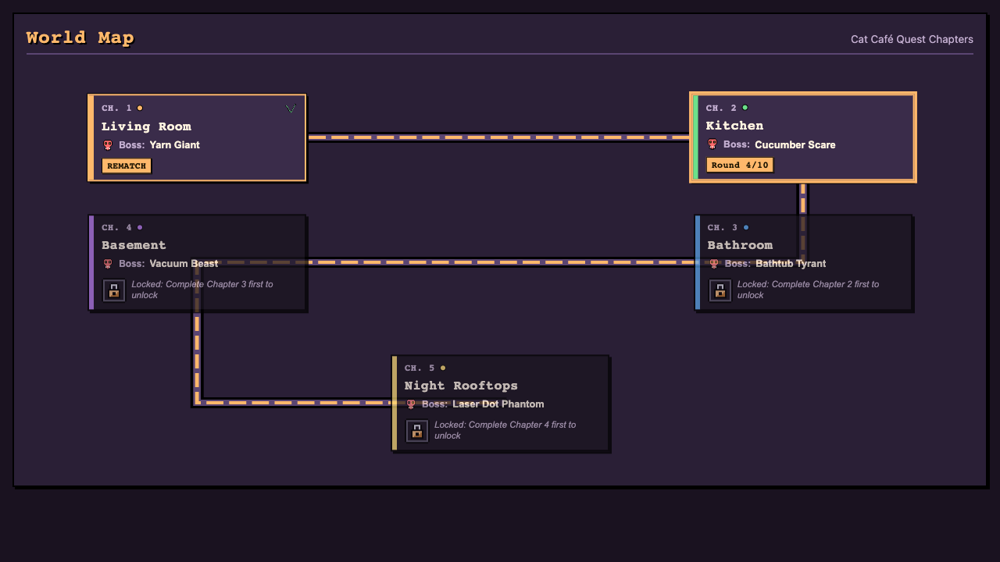
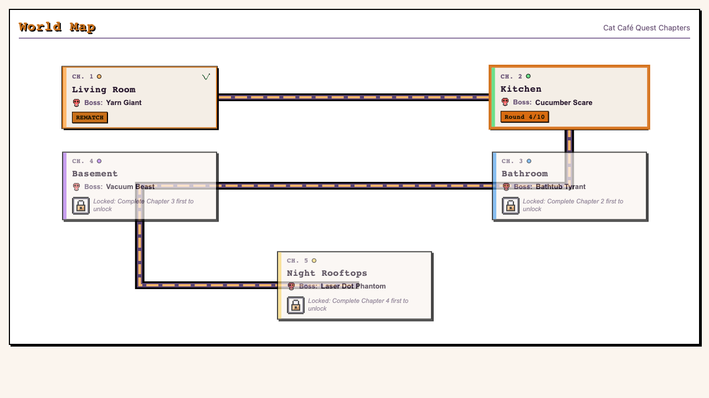
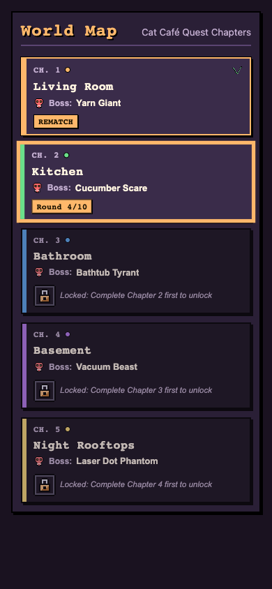
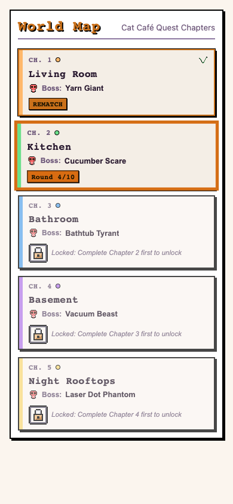

# Task V21 Report: Chapter Map Component

## Overview

This report documents the implementation and verification of the props-driven **Chapter Map** component (`ChapterMap`) for **Cat Café Quest v2** (`apps/web/src/map/ChapterMap.tsx`, `ChapterMap.css`, and `ChapterMap.test.tsx`).

The component renders the 5 chapters from the v2 content registry along a winding pixel path on desktop (using inline crisp-edged SVG and CSS with zero external image assets), and smoothly transforms into a vertical stack at mobile viewports (<= 390px) with zero horizontal overflow. Each chapter node presents chapter metadata, theme styling, boss identity and icon, and state-driven visual badges (`cleared`, `current`, `reachable-for-rematch`, and `locked`).

---

## Component Architecture & API

### Component Signature
```tsx
export interface ChapterMapProps {
  chapters?: readonly v2.ChapterDef[];
  currentChapter: number;
  clearedChapters?: readonly number[] | Set<number>;
  round?: number;
  onSelect?: (chapterNumber: number) => void;
}
```

### Core Features & States

| State | Visual Treatment | Interaction / A11y Attributes |
| :--- | :--- | :--- |
| **Cleared / Rematch** | Double gold border (`var(--gold, #ffd34e)`), crisp pixel checkmark icon (`CheckIcon`), gold `REMATCH` badge. | Selectable (`onSelect(chapterIndex)` called on click or key activation). `v2-map-node--cleared` & `v2-map-node--rematch`. |
| **Current** | Active accent border, glowing scale pulse animation (`pulse` class), `Round n/10` badge. | `aria-current="step"`. The `.pulse` animation class is dynamically omitted when `prefers-reduced-motion: reduce` is detected via `usePrefersReducedMotion()`. |
| **Locked** | Dimmed background (`opacity: 0.72`), brass padlock on iron frame (`V2PixelFrame name="lockedSlot"`), italic lock reason text. | Not selectable (`onSelect` is bypassed on click, Enter, and Space). Carries `aria-disabled="true"` with `aria-describedby` referencing the locked reason text ("Complete Chapter X first to unlock"). Focusable in sequential tab order. |

### Chapter Metadata & Theme Palette

Colors map to existing CSS custom properties from `apps/web/src/theme.css` and `apps/web/src/layout/layout.css`:

| Index | Chapter Name | Theme Token / Fallback | Boss ID | Boss Name |
| :---: | :--- | :--- | :--- | :--- |
| **1** | Living Room | `var(--accent, #ffb86b)` (Amber) | `mon.yarn.giant` | Yarn Giant |
| **2** | Kitchen | `var(--good, #6be08a)` (Mint) | `mon.cucumber.scare` | Cucumber Scare |
| **3** | Bathroom | `var(--rarity-rare, #4aa8ff)` (Cyan) | `mon.bathtub.tyrant` | Bathtub Tyrant |
| **4** | Basement | `var(--rarity-epic, #bb74ff)` (Violet) | `mon.vacuum.beast` | Vacuum Beast |
| **5** | Night Rooftops | `var(--focus, #ffd75e)` (Gold) | `mon.laser.dot.phantom` | Laser Dot Phantom |

Each node also includes a 16x16 pixel SVG boss marker icon (`BossMarkerIcon`) representing the climax encounter of each chapter.

---

## Responsive Layout & Theming

- **Desktop (1280px)**: The 5 nodes trace an S-curve path connected by a crisp SVG stepped pixel trail with outer black outline, dark stone base (`var(--border)`), and pixel dashes (`var(--gold)`).
- **Mobile (390px)**: At `@media (max-width: 680px)`, the SVG trail is hidden, and the container converts to a vertical column (`display: flex; flex-direction: column; width: 100%`). The nodes stretch cleanly with `box-sizing: border-box`, completely eliminating horizontal scroll (`overflow-x: hidden`).
- **Dark and Light Modes**: Full support for both themes using CSS variables with automatic light-mode tokens (`#fbf5ee` background, `#2a1a30` high-contrast text, `#ffffff` card surface).

---

## Screenshots

Captured with Playwright Chromium in `reports/v21-map/`:

### 1. Desktop 1280px - Dark Theme


### 2. Desktop 1280px - Light Theme


### 3. Mobile 390px - Dark Theme


### 4. Mobile 390px - Light Theme


---

## Accessibility (A11y) Verification

1. **Semantic HTML**: Chapter nodes are rendered as native `<button>` elements within an ordered list `<ol role="list">`.
2. **Current Step**: The current progressing chapter carries `aria-current="step"`.
3. **Disabled State & Explanation**: Locked chapters carry `aria-disabled="true"` with `aria-describedby` linking to a visible and screen-reader accessible explanation (e.g. `Locked: Complete Chapter 1 first to unlock`).
4. **Keyboard Sequence**: Because locked buttons avoid HTML `disabled`, keyboard navigation tabs sequentially 1 -> 2 -> 3 -> 4 -> 5 without skipping locked nodes.
5. **Reduced Motion**: Tested with `window.matchMedia` mock. When `(prefers-reduced-motion: reduce)` matches, the `pulse` class is cleanly stripped from the DOM.

---

## Exact Commands and Pasted Output

### 1. Git Author Configuration
```bash
$ git config user.email && git config user.name
108352255+ntbaoheyhey@users.noreply.github.com
ntbaoheyhey
```

### 2. Package Installation (`--frozen-lockfile`)
```bash
$ pnpm install --frozen-lockfile
Scope: all 7 workspace projects
Lockfile is up to date, resolution step is skipped
Already up to date
Done in 455ms using pnpm v10.28.0
```

### 3. Edge Function Deno Import Map Sync (`pnpm gen:deno`)
```bash
$ pnpm gen:deno
> taskbar-hero@0.0.0 gen:deno /Users/bao/taskbar-hero
> node scripts/gen-deno-json.mjs

wrote 9 Edge Function import maps
```

### 4. ChapterMap Unit Tests (`vitest run src/map/ChapterMap.test.tsx`)
```bash
$ pnpm --filter @taskbar-hero/web test src/map/ChapterMap.test.tsx

> @taskbar-hero/web@0.0.0 test /Users/bao/taskbar-hero/apps/web
> vitest run src/map/ChapterMap.test.tsx

 RUN  v5.0.5 /Users/bao/taskbar-hero/apps/web

 ✓ src/map/ChapterMap.test.tsx (7 tests) 180ms
   ✓ ChapterMap Component (7)
     ✓ renders five chapters 79ms
     ✓ locked chapter does not call onSelect 22ms
     ✓ cleared chapter calls onSelect with its number 16ms
     ✓ current chapter has aria-current 20ms
     ✓ reduced motion removes the pulse class (mock matchMedia) 25ms
     ✓ keyboard order follows the chapters 5ms
     ✓ accepts Set for clearedChapters 13ms

 Test Files  1 passed (1)
      Tests  7 passed (7)
   Start at  20:38:22
   Duration  610ms
```

### 5. Typecheck (`pnpm typecheck`)
```bash
$ pnpm typecheck

> taskbar-hero@0.0.0 typecheck /Users/bao/taskbar-hero
> pnpm -r typecheck

Scope: 6 of 7 workspace projects
packages/auth typecheck$ tsc --noEmit
packages/chain typecheck$ tsc --noEmit
packages/game-rules typecheck$ tsc --noEmit
supabase/tests typecheck$ tsc --noEmit
└─ Done in 338ms
└─ Done in 626ms
└─ Done in 743ms
└─ Done in 1.2s
packages/api-contract typecheck$ tsc --noEmit
└─ Done in 398ms
apps/web typecheck$ tsc --noEmit
└─ Done in 3s
```

### 6. Linter (`pnpm lint`)
```bash
$ pnpm lint

> taskbar-hero@0.0.0 lint /Users/bao/taskbar-hero
> pnpm -r lint

Scope: 6 of 7 workspace projects
packages/auth lint$ tsc --noEmit
packages/chain lint$ tsc --noEmit
packages/game-rules lint$ tsc --noEmit
supabase/tests lint$ tsc --noEmit
└─ Done in 408ms
└─ Done in 749ms
└─ Done in 830ms
└─ Done in 1.3s
packages/api-contract lint$ tsc --noEmit
└─ Done in 387ms
apps/web lint$ tsc --noEmit
└─ Done in 3s
```

### 7. Full Workspace Tests (`pnpm test`)
```bash
$ pnpm test

> taskbar-hero@0.0.0 test /Users/bao/taskbar-hero
> pnpm -r test

Scope: 6 of 7 workspace projects
packages/auth test$ vitest run
packages/chain test$ vitest run
packages/game-rules test$ vitest run
supabase/tests test$ vitest run
└─ Done in 577ms
└─ Done in 678ms
apps/web test$ vitest run
│  Test Files  33 passed (33)
│       Tests  365 passed (365)
└─ Done in 3.7s
```

### 8. Production Build (`pnpm build`)
```bash
$ pnpm build

> taskbar-hero@0.0.0 build /Users/bao/taskbar-hero
> pnpm -r build

Scope: 6 of 7 workspace projects
packages/chain build$ tsc --noEmit
packages/game-rules build$ tsc --noEmit
packages/auth build$ tsc --noEmit
supabase/tests build$ tsc --noEmit
└─ Done in 498ms
└─ Done in 916ms
└─ Done in 997ms
└─ Done in 1.5s
packages/api-contract build$ tsc --noEmit
└─ Done in 392ms
apps/web build$ tsc --noEmit && vite build
│ vite v8.3.5 building client environment for production...
│ ✓ 1691 modules transformed.
│ rendering chunks...
│ computing gzip size...
│ dist/index.html                               2.05 kB │ gzip:   0.75 kB
│ dist/assets/index-djZZZ0we.css               34.77 kB │ gzip:   7.28 kB
│ dist/assets/rolldown-runtime-XKyaHtl9.js      0.72 kB │ gzip:   0.42 kB
│ dist/assets/createGame-CYG5tCgZ.js            8.45 kB │ gzip:   3.48 kB
│ dist/assets/index-C3CDpvmL.js                97.97 kB │ gzip:  28.58 kB
│ dist/assets/react-KPuNr9iS.js               218.74 kB │ gzip:  68.27 kB
│ dist/assets/web3-BKxr0A5j.js                363.83 kB │ gzip: 108.14 kB
│ dist/assets/phaser-CS_hOpYn.js            1,194.43 kB │ gzip: 318.49 kB
│ ✓ built in 352ms
└─ Done in 3.6s
```

---

## Files Created

- `apps/web/src/map/ChapterMap.tsx`
- `apps/web/src/map/ChapterMap.css`
- `apps/web/src/map/ChapterMap.test.tsx`
- `reports/v21-map.md`
- `reports/v21-map/chapter-map-1280-dark.png`
- `reports/v21-map/chapter-map-1280-light.png`
- `reports/v21-map/chapter-map-390-dark.png`
- `reports/v21-map/chapter-map-390-light.png`
- `reports/v21-map/map-1280-dark.png`
- `reports/v21-map/map-1280-light.png`
- `reports/v21-map/map-390-dark.png`
- `reports/v21-map/map-390-light.png`
