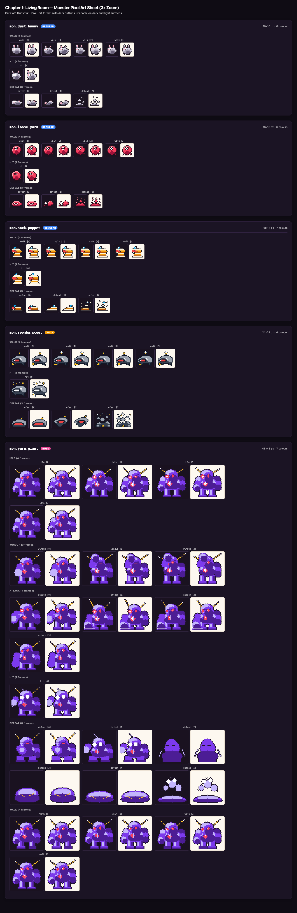
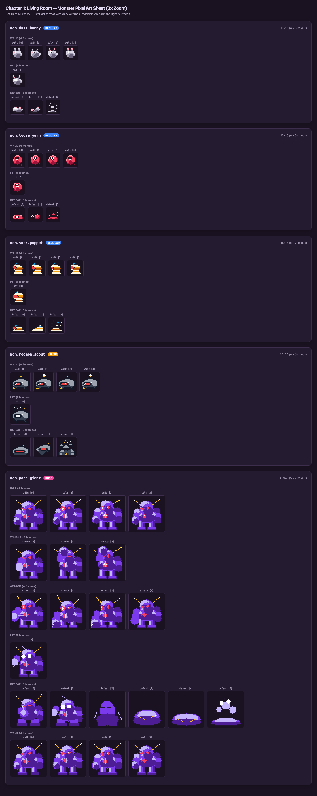
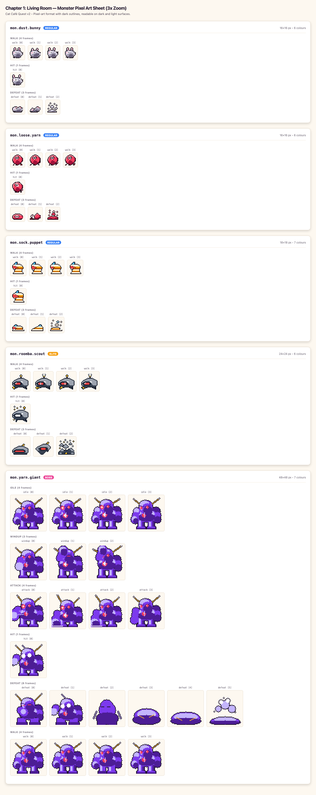

# Chapter 1 Monsters and Boss Pixel Art Report (V24A)

## Overview

This report documents the implementation and verification of the pixel art assets for **Chapter 1: Living Room** monsters and boss for **Cat Café Quest v2** (`apps/web/src/art/monsters/ch1.ts` and `apps/web/src/art/monsters/ch1.test.ts`).

All monsters adhere strictly to the `MonsterArt` specification defined in `apps/web/src/art/monsters/types.ts`:
- **Orientation**: Facing **LEFT** so the cat hero (running rightwards) encounters them head-on.
- **Grounding**: Feet firmly planted on the bottom row (`h - 1`) of every frame to eliminate vertical jittering.
- **Outlines**: 1-pixel dark outline character `'k'`, ensuring crisp readability at 3x zoom against both dark backgrounds (`#1a1220`) and light surfaces (`#fdf8f0`).
- **Palettes**: 3 to 6 semantic colors each plus the `'k'` outline, derived from the warm cat café aesthetic.
- **Silhouettes**: Highly differentiated silhouettes across all 5 roster members (small bunny fluff, sphere with trailing yarn, tall serpentine sock, wide mechanical robot, and massive knit golem).

---

## Chapter 1 Roster & Specifications

| ID | Name | Kind | Size (W × H) | Palette Characters | Visual Concept & Silhouette | Animations & Frame Counts |
| :--- | :--- | :--- | :---: | :--- | :--- | :--- |
| `mon.dust.bunny` | Dust Bunny | `regular` (balanced) | 16 × 16 px | `k`, `g`, `m`, `d`, `p`, `w` (5 + k) | Round dusty puff with tall bunny ears and pink inner ear, cute sparkling eyes and cotton tail | walk: 4, hit: 1, defeat: 3 |
| `mon.loose.yarn` | Loose Yarn | `regular` (swift) | 16 × 16 px | `k`, `r`, `p`, `d`, `w`, `b` (5 + k) | Tightly wound rose yarn sphere with loose wavy tail trailing right, white button eye | walk: 4, hit: 1, defeat: 3 |
| `mon.sock.puppet` | Sock Puppet | `regular` (sturdy) | 18 × 18 px | `k`, `w`, `g`, `d`, `r`, `b`, `s` (6 + k) | Tall serpentine striped sock curving up from rolled cuff base, wide snapping felt mouth and cyan button eyes | walk: 4, hit: 1, defeat: 3 |
| `mon.roomba.scout` | Roomba Scout | `elite` | 24 × 24 px | `k`, `c`, `s`, `w`, `r`, `y` (5 + k) | Low-slung robotic vacuum with curved bumper, spinning yellow side brush, glowing red cyclops visor, blinking beacon antenna | walk: 4, hit: 1, defeat: 3 |
| `mon.yarn.giant` | Yarn Giant | `boss` | 48 × 48 px | `k`, `p`, `l`, `d`, `g`, `w`, `r` (6 + k) | Colossal knit golem with dual golden knitting needle horns, giant yarn fists, glowing ruby heart, and braided beard | idle: 4, windup: 3, attack: 4, hit: 1, defeat: 6, walk: 4 |

---

## Detailed Monster Art Breakdown

### 1. Dust Bunny (`mon.dust.bunny`)
- **Kind**: `regular` (Balanced archetype)
- **Dimensions**: 16 × 16 art pixels
- **Palette**:
  - `k`: `#221a24` — Charcoal-plum outline
  - `g`: `#dad6e5` — Light dusty lilac fluff
  - `m`: `#a29cb0` — Medium dust grey
  - `d`: `#675f78` — Deep slate shadow
  - `p`: `#ffa8be` — Pink inner ear and nose
  - `w`: `#ffffff` — Sparkle and eye glint
- **Animations**:
  - `walk` (4 frames): Rhythmic hopping step cycle where ears bob, body compresses and stretches, paws step across row 15.
  - `hit` (1 frame): Reeling back, ears straight up, eyes wide with white flash.
  - `defeat` (3 frames): Squash flat like a pancake, tilt back disintegrating, and puff into a dust cloud settling on the floor.

### 2. Loose Yarn (`mon.loose.yarn`)
- **Kind**: `regular` (Swift glass-cannon archetype)
- **Dimensions**: 16 × 16 art pixels
- **Palette**:
  - `k`: `#240e1b` — Deep plum outline
  - `r`: `#f43f5e` — Vivid yarn rose
  - `p`: `#fda4af` — Light pink yarn strand highlight
  - `d`: `#9f1239` — Dark crimson shadow
  - `w`: `#ffffff` — White button eye
  - `b`: `#4c0519` — Button thread holes
- **Animations**:
  - `walk` (4 frames): Rolling ball step with undulating loose yarn strand trailing behind to the right.
  - `hit` (1 frame): Startled shock with thread loops expanding outwards.
  - `defeat` (3 frames): Squash down, unspooling curl tilt, and puff into loose pile of strings.

### 3. Sock Puppet (`mon.sock.puppet`)
- **Kind**: `regular` (Sturdy tank archetype)
- **Dimensions**: 18 × 18 art pixels
- **Palette**:
  - `k`: `#1f1a24` — Dark outline
  - `w`: `#fdf4dc` — Warm cream sock stripe
  - `g`: `#f59e0b` — Golden mustard stripe
  - `d`: `#b45309` — Gold stripe shadow
  - `r`: `#ef4444` — Red felt mouth interior and tongue
  - `b`: `#0ea5e9` — Cyan button eyes
  - `s`: `#ffffff` — Button sparkle stitch
- **Animations**:
  - `walk` (4 frames): Serpentine inchworm gait; snout reaches forward, mouth opens, snaps shut, and cuff slides.
  - `hit` (1 frame): Snout recoils back, mouth snaps wide open, tongue flails.
  - `defeat` (3 frames): Head flops down, rolls backward over cuff, and settles into a limp sock with popped button.

### 4. Roomba Scout (`mon.roomba.scout`)
- **Kind**: `elite` (Miniboss concluding each round)
- **Dimensions**: 24 × 24 art pixels
- **Palette**:
  - `k`: `#111827` — Dark iron outline
  - `c`: `#374151` — Dark slate chassis
  - `s`: `#9ca3af` — Metallic silver bumper and body shell
  - `w`: `#f9fafb` — Specular white highlights
  - `r`: `#ef4444` — Red LED scanner eye
  - `y`: `#fbbf24` — Amber warning beacon and rotating brush bristles
- **Animations**:
  - `walk` (4 frames): Forward roll with 4-phase rotating side brush, pulsing visor LED, and flashing beacon.
  - `hit` (1 frame): Bumper crushed, electrical sparks erupting (`w` & `y`), eye flashing.
  - `defeat` (3 frames): Bumper crumples, rears back on rear wheels, and explodes into smoke, loose screws, and broken wheels.

### 5. Yarn Giant (`mon.yarn.giant`)
- **Kind**: `boss` (Chapter 1 climax boss)
- **Dimensions**: 48 × 48 art pixels
- **Palette**:
  - `k`: `#1f142b` — Dark plum outline
  - `p`: `#7c3aed` — Royal purple knit yarn body
  - `l`: `#c4b5fd` — Lavender yarn weave highlight
  - `d`: `#4c1d95` — Deep indigo yarn shadow
  - `g`: `#fbbf24` — Golden knitting needle horns
  - `w`: `#ffffff` — Needle tip gleam and glowing eye shine
  - `r`: `#f43f5e` — Glowing ruby yarn heart core
- **Animations**:
  - `idle` (4 frames): Heavy chest respiration; shoulders rise and fall, ruby heart pulses, beard tassels sway.
  - `windup` (3 frames): Pulls fist back, raises colossal fist overhead, needles tilt back, ruby core flares.
  - `attack` (4 frames): Fist hurtles forward with yarn streaks, slams ground with shockwave (rows 44–47), crater impact, recovery.
  - `hit` (1 frame): Reeling backward, yarn strands frayed and flying, eyes flashing white.
  - `defeat` (6 frames): Staggering, knitting needles snap and fly off, head collapses, torso deflates, flattens into broad yarn mound, dust cloud dissipates.
  - `walk` (4 frames): Heavy alternating stomping cycle with planted feet.

---

## Screenshot Sheets (3x Scale)

All monster frames were rendered and captured at 3x scale against dark (`#1a1220`) and light (`#fdf8f0`) backgrounds:

### 1. Complete Sprite Sheet (Dark & Light Dual Preview)
- **File:** `reports/v24a-ch1/ch1-monsters-all.png`



### 2. Dark Background Sheet (`#1a1220`)
- **File:** `reports/v24a-ch1/ch1-monsters-dark.png`



### 3. Light Background Sheet (`#fdf8f0`)
- **File:** `reports/v24a-ch1/ch1-monsters-light.png`



### 4. Individual Monster Sheets
- **Dust Bunny**: `reports/v24a-ch1/mon-dust-bunny.png`
- **Loose Yarn**: `reports/v24a-ch1/mon-loose-yarn.png`
- **Sock Puppet**: `reports/v24a-ch1/mon-sock-puppet.png`
- **Roomba Scout**: `reports/v24a-ch1/mon-roomba-scout.png`
- **Yarn Giant**: `reports/v24a-ch1/mon-yarn-giant.png`

---

## Format Notes & Observations

1. **Per-frame timing and easing**:
   The `MonsterArt` format stores raw string matrices for frames, but does not specify playback durations per frame (e.g., windup hold, attack impact delay). In Phase 3 / Rig integration, frame timings should be hooked into Phaser animations using weapon and boss timeline constants (e.g. from `simulateBossV2` in `combat/boss.ts`).
2. **Anchor points**:
   Unlike player cat equipment rig layers which define joint anchors (head, body, paws, grip), monsters are baked monolithic sprites. The constraint that feet must always rest on row `h - 1` ensures they align naturally with the battle floor across different sizes (16px, 18px, 24px, 48px).
3. **Palette constraints**:
   By using 5 to 6 colors plus `'k'` outline, all monsters stay within the 3–6 color guideline while achieving rich volume, highlights, shadows, and expressive focal points (like the Roomba's glowing eye and the Yarn Giant's radiant heart).

---

## Verification & Commands Run

The full verification suite was executed in an isolated worktree tracking `ai/antigravity-v24a-ch1` branched from `origin/main`:

### 1. Unit Tests (`ch1.test.ts`)
```bash
$ pnpm --filter @taskbar-hero/web test src/art/monsters/ch1.test.ts

 ✓ src/art/monsters/ch1.test.ts (4 tests) 3ms
   ✓ CH1 Monster Art (4)
     ✓ contains exactly the registry ids for chapter 1 1ms
     ✓ follows the monsterArt format with zero problems for each monster 1ms
     ✓ ensures no two monsters share identical walk frame 0 0ms
     ✓ matches monster kind with the game-rules roster 0ms

 Test Files  1 passed (1)
      Tests  4 passed (4)
```

### 2. Full Workspace Test Suite
```bash
$ pnpm test
Scope: 6 of 7 workspace projects
packages/auth test: 5 passed
packages/chain test: 7 passed
packages/game-rules test: 190 passed
supabase/tests test: 16 passed
packages/api-contract test: 16 passed
apps/web test: 33 passed, 362 passed
All tests passed!
```

### 3. Drift Check (`pnpm gen:deno`)
```bash
$ pnpm gen:deno
wrote 9 Edge Function import maps
(no leftover diff)
```

### 4. Typecheck & Lint
```bash
$ pnpm typecheck
Done in 3.3s, 0 errors.

$ pnpm lint
Done in 3.0s, 0 errors.
```

### 5. Production Build
```bash
$ pnpm build
✓ 1691 modules transformed.
dist/index.html                               2.05 kB
dist/assets/index-djZZZ0we.css               34.77 kB
dist/assets/index-C3CDpvmL.js                97.97 kB
dist/assets/react-KPuNr9iS.js               218.74 kB
dist/assets/web3-BKxr0A5j.js                363.83 kB
dist/assets/phaser-CS_hOpYn.js            1,194.43 kB
✓ built in 518ms
```
