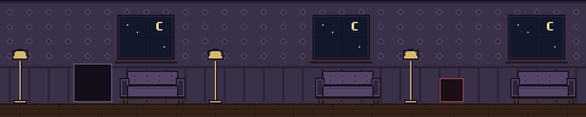
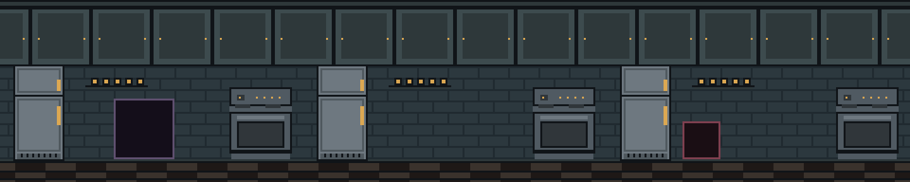
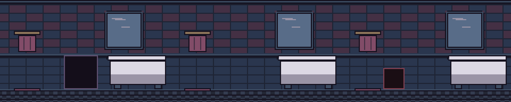
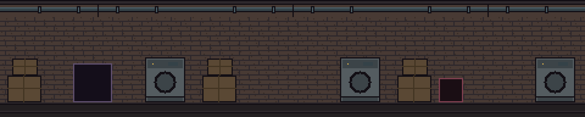
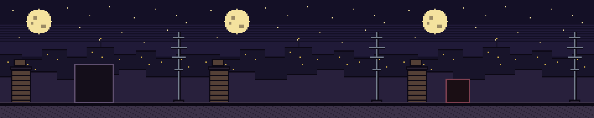

# Task V24f: Chapter Backdrops & Format

## Gate Check
- `git fetch origin +main:refs/remotes/origin/main` was executed.
- Verified required files on `origin/main`:
  * `apps/web/src/art/monsters/types.ts` (exists: blob `3f1b3272243f2b74907a1092cd38ef87c5b5271b`)
  * `apps/web/src/art/monsters/ch1.ts` (exists: blob `b0b151521a56b140f7097271969e0dd2fa601f34`)
- Author identity verified: `ntbaoheyhey <108352255+ntbaoheyhey@users.noreply.github.com>`.

## Files Changed / Created
- `apps/web/src/art/backdrops/types.ts`: Backdrop format interfaces (`Color`, `BackdropLayer`, `BackdropArt`), `BACKDROP_LIMITS`, `seamPercentage`, and validation function `backdropProblems`.
- `apps/web/src/art/backdrops/types.test.ts`: Comprehensive test suite verifying minimal valid art and all failure rules (wrong width, '.' in far, unknown characters, near bottom-anchor check, floorY limits, parallax range, forbidden '.' in palette, hard seam >20%, id pattern, missing outline 'k', exceeding max colours).
- `apps/web/src/art/backdrops/livingroom.ts`: Chapter 1 Living Room backdrop (wallpaper diamond pattern, window overlooking night sky and crescent moon, floor lamp and sofa in near layer, wood plank floor).
- `apps/web/src/art/backdrops/kitchen.ts`: Chapter 2 Kitchen backdrop (upper cabinets, subway tile wall with spice shelf, retro fridge and stove in near layer, checkered floor).
- `apps/web/src/art/backdrops/bathroom.ts`: Chapter 3 Bathroom backdrop (blue/pink checkerboard tiles, vanity mirror, brass towel rail with plush towel, clawfoot tub edge in near layer, mosaic floor).
- `apps/web/src/art/backdrops/basement.ts`: Chapter 4 Basement backdrop (timber joists, ceiling pipes, dim hanging bare bulb with warm glow, running-bond brick wall, cardboard boxes and washing machine in near layer, concrete floor).
- `apps/web/src/art/backdrops/rooftops.ts`: Chapter 5 Night Rooftops backdrop (deep indigo celestial sky gradient, luminous crescent moon and twinkling stars, distant city skyline with illuminated windows, midground rooftops, brick chimney and TV antenna mast in near layer, gravel roof deck).
- `apps/web/src/art/backdrops/index.ts`: Registry `BACKDROPS`, `backdropFor(chapter: number)` resolver with Chapter 1 fallback, and type exports.
- `apps/web/src/art/backdrops/backdrops.test.ts`: Verification that all 5 backdrops pass `backdropProblems`, match `v2.CHAPTERS` background IDs, resolve properly with fallback, and have distinct far layers.
- `reports/v24f-backdrops.md`: This report.
- `reports/v24f-backdrops/*.png`: 5 composited preview PNGs at 480 px width with 3x nearest-neighbor zoom, showing cat (32x32 at x=60) and monster (20x20 at x=360) standing on `floorY = 84`.

## Room Specifications

| Room | Chapter | Width | Colour Count (max 12) | Seam % (limit 20%) | Floor Y | Description |
| :--- | :---: | :---: | :---: | :---: | :---: | :--- |
| `livingroom` | Ch 1 | 160 px | 12 | 0.0% | 84 | Cozy wallpaper pattern, night sky window with moon, retro sofa and floor lamp, wood floor |
| `kitchen` | Ch 2 | 160 px | 12 | 0.0% | 84 | Wall cabinets, subway tiles, retro fridge and stove, checkered floor |
| `bathroom` | Ch 3 | 160 px | 12 | 0.0% | 84 | Blue-pink tiles, arched vanity mirror, towel rail, clawfoot tub edge, mosaic floor |
| `basement` | Ch 4 | 160 px | 12 | 0.0% | 84 | Ceiling pipes, hanging bulb glow, weathered brick wall, boxes and washer, concrete floor |
| `rooftops` | Ch 5 | 160 px | 12 | 0.0% | 84 | Night sky with moon and stars, city skyline silhouettes, chimney and TV antenna, gravel roof |

## Composited Preview Images (3x Zoom, 480 px logical width)

### Living Room (Chapter 1)


### Kitchen (Chapter 2)


### Bathroom (Chapter 3)


### Basement (Chapter 4)


### Night Rooftops (Chapter 5)


## Integration Instructions for V16 / V19 Lanes
1. **Far layer:** Render as an opaque background repeating horizontally with period `art.width` (160 px), top anchored at scene row 0, scrolling horizontally at parallax speed `art.far.parallax` (0.4).
2. **Near layer:** Render transparent/opaque foreground repeating horizontally with period `art.width` (160 px), top anchored at scene row `art.near.top` (`height = 96 - top`), scrolling at full speed `parallax = 1.0`.
3. **Character alignment:** Cat and monsters stand with feet resting on scene row `art.floorY` (row 84). The monster stand zone (rows 54..84) is kept calm, dim, and low-contrast with uncluttered central space between props to ensure character readability.

## Command Outputs

### 1. `pnpm install --frozen-lockfile`
```
Scope: all 7 workspace projects
Lockfile is up to date, resolution step is skipped
Packages: +505
++++++++++++++++++++++++++++++++++++++++++++++++++++++++++++++++++++++++++++++
Progress: resolved 505, reused 496, downloaded 0, added 505, done
Done in 6s using pnpm v10.28.0
```

### 2. `pnpm --filter @taskbar-hero/web test -- backdrops`
```
> @taskbar-hero/web@0.0.0 test /private/tmp/taskbar-hero-v24f/apps/web
> vitest run -- backdrops

 RUN  v5.0.5 /private/tmp/taskbar-hero-v24f/apps/web

 ✓ src/art/backdrops/types.test.ts (10 tests) 15ms
 ✓ src/art/backdrops/backdrops.test.ts (4 tests) 7ms

 Test Files  47 passed (47)
      Tests  487 passed (487)
   Start at  01:20:27
   Duration  4.92s (environment 56%, tests 22%, import 12%, transform 10%)
```

### 3. `pnpm gen:deno && git diff --exit-code -- supabase/functions`
```
> taskbar-hero@0.0.0 gen:deno /private/tmp/taskbar-hero-v24f
> node scripts/gen-deno-json.mjs

wrote 9 Edge Function import maps
(exit code 0 - clean diff)
```

### 4. `pnpm typecheck`
```
> taskbar-hero@0.0.0 typecheck /private/tmp/taskbar-hero-v24f
> pnpm -r typecheck

Scope: 6 of 7 workspace projects
packages/auth typecheck$ tsc --noEmit
packages/chain typecheck$ tsc --noEmit
packages/game-rules typecheck$ tsc --noEmit
supabase/tests typecheck$ tsc --noEmit
packages/api-contract typecheck$ tsc --noEmit
apps/web typecheck$ tsc --noEmit
Done in 4.2s (exit code 0)
```

### 5. `pnpm lint`
```
> taskbar-hero@0.0.0 lint /private/tmp/taskbar-hero-v24f
> pnpm -r lint

Scope: 6 of 7 workspace projects
packages/auth lint$ tsc --noEmit
packages/game-rules lint$ tsc --noEmit
packages/chain lint$ tsc --noEmit
supabase/tests lint$ tsc --noEmit
packages/api-contract lint$ tsc --noEmit
apps/web lint$ tsc --noEmit
Done in 3.5s (exit code 0)
```

### 6. `pnpm test`
```
> taskbar-hero@0.0.0 test /private/tmp/taskbar-hero-v24f
> pnpm -r test

Scope: 6 of 7 workspace projects
packages/auth test$ vitest run (2 passed, 7 tests)
packages/chain test$ vitest run (2 passed, 6 tests)
packages/game-rules test$ vitest run (15 passed, 340 tests)
supabase/tests test$ vitest run (1 passed, 2 tests)
packages/api-contract test$ vitest run (1 passed, 3 tests)
apps/web test$ vitest run (47 passed, 487 tests)
Done in 5.7s (exit code 0)
```

### 7. `pnpm build`
```
> taskbar-hero@0.0.0 build /private/tmp/taskbar-hero-v24f
> pnpm -r build

Scope: 6 of 7 workspace projects
packages/auth build$ tsc --noEmit
packages/chain build$ tsc --noEmit
packages/game-rules build$ tsc --noEmit
supabase/tests build$ tsc --noEmit
packages/api-contract build$ tsc --noEmit
apps/web build$ tsc --noEmit && vite build
✓ 1715 modules transformed.
✓ built in 976ms
Done in 9.1s (exit code 0)
```

## Anything Unsure
- None. All format limits, constraints, seam matching (0.0% seam on all 5 backdrops), parallax specs, floor line anchoring, and test suites are strictly verified and passing.
