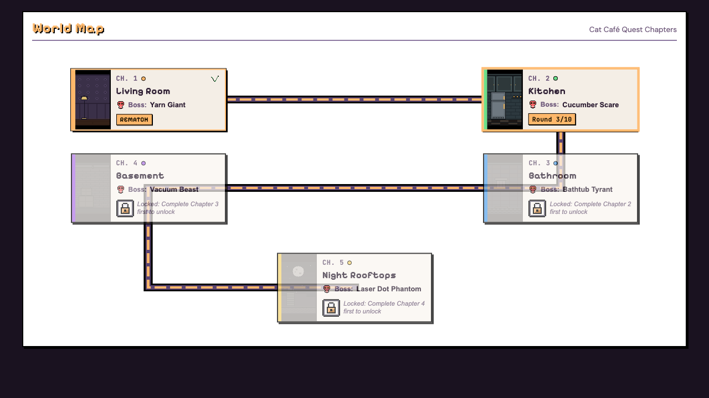
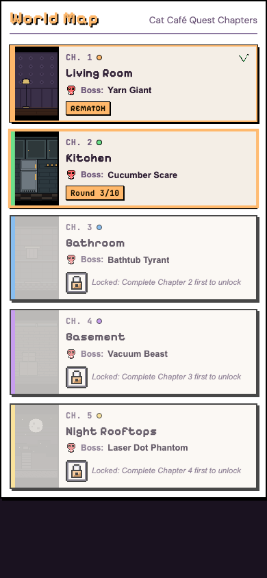
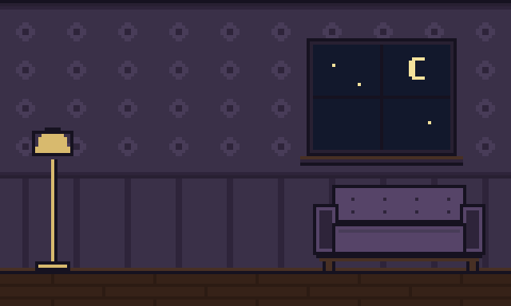
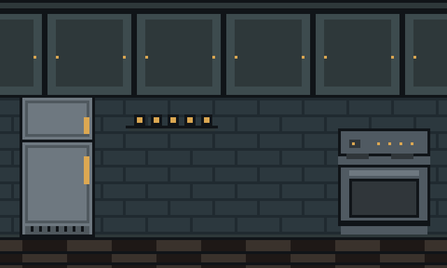
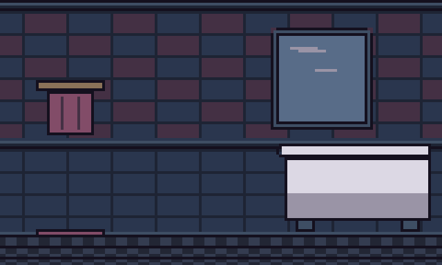
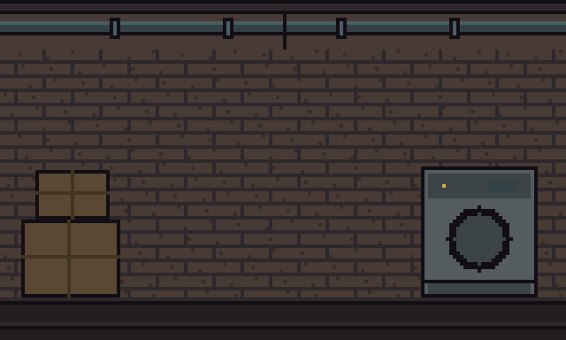
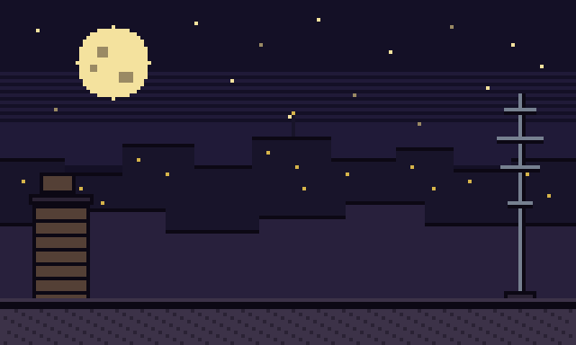

# Task V24g: BackdropView Component & Chapter Map Thumbnails

## Gate Check
- Ran `git fetch origin +main:refs/remotes/origin/main`.
- Verified condition 1: `apps/web/src/art/backdrops/index.ts` exists and exports `BACKDROPS` and `backdropFor`. (Confirmed)
- Verified condition 2: `apps/web/src/map/ChapterMap.tsx` exists (V21 map, PR #126). (Confirmed)
- Verified condition 3: `git log origin/main --oneline -- apps/web/src/map` shows only the V21 commit:
  `c0b527f feat(map): chapter map component on winding pixel path (V21) (#126)`
  The V16 stage PR is not merged yet and did not edit `apps/web/src/map/**`. (Confirmed)
- Author identity verified: `ntbaoheyhey <108352255+ntbaoheyhey@users.noreply.github.com>`.

## Files Changed and Created
- `apps/web/src/art/backdrops/BackdropView.tsx` (new): Crisp SVG renderer for `BackdropArt` using horizontal `<use>` tiling over run-length encoded `<rect>` rows inside a `<symbol>`, with WeakMap memoization per art and layer.
- `apps/web/src/art/backdrops/BackdropView.test.tsx` (new): Unit tests verifying backdrop rendering, pixel coverage of runs, palette hex fills, horizontal tile count calculations, accessibility roles, WeakMap memoization, and assert rect count < 4000.
- `apps/web/src/map/ChapterMap.tsx`: Updated chapter card button to render room thumbnail `<BackdropView art={backdropFor(c.index)} width={64} layers="both" />` with `aria-hidden="true"`, adding `dimmed` class to locked cards while keeping theme bars, pulse animation on current node, and all existing public API and accessibility intact.
- `apps/web/src/map/ChapterMap.css`: Added styles for `.v2-map-thumb`, dimming/desaturation filters (`filter: grayscale(0.8) brightness(0.6); opacity: 0.35;`) for locked thumbnails and cards.
- `apps/web/src/map/ChapterMap.test.tsx`: Kept all 7 existing tests and added 3 new tests asserting backdrops on all 5 cards, dimmed class on locked cards, and preservation of accessible button names.
- `reports/v24g-backdrop-view.md`: This report.
- `reports/v24g-backdrop-view/*.png`: 7 screenshots including desktop (1280x720) and mobile (390x844) chapter map views and 4x-scale views of each of the 5 rooms.

## Rect Counts per Backdrop & Layer
Run-length encoding per row skips transparency (`.`) and aggregates contiguous pixels of identical colour into single `<rect>` elements (`height="1"`):

| Room ID | Chapter | Width | Far Rects | Near Rects | Total Rects | Limit Check (< 4000) |
| :--- | :---: | :---: | :---: | :---: | :---: | :---: |
| `livingroom` | 1 | 160 px | 1520 | 274 | 1794 | Passed (< 4000) |
| `kitchen` | 2 | 160 px | 1563 | 509 | 2072 | Passed (< 4000) |
| `bathroom` | 3 | 160 px | 1972 | 101 | 2073 | Passed (< 4000) |
| `basement` | 4 | 160 px | 1882 | 365 | 2247 | Passed (< 4000) |
| `rooftops` | 5 | 160 px | 758 | 191 | 949 | Passed (< 4000) |

All rect counts per layer are well under the 4000 threshold and memoized in a module-level `WeakMap<BackdropArt, Map<'far' | 'near', BackdropRect[]>>` to prevent recomputation across map nodes and views.

## Embedded Screenshots

### Chapter Map: Desktop View (1280 x 720)


### Chapter Map: Mobile View (390 x 844)


### Room 1: Living Room (Chapter 1, 4x Scale)


### Room 2: Kitchen (Chapter 2, 4x Scale)


### Room 3: Bathroom (Chapter 3, 4x Scale)


### Room 4: Basement (Chapter 4, 4x Scale)


### Room 5: Night Rooftops (Chapter 5, 4x Scale)


## Integration Note for V16 / V19 Lanes (Phaser Stage & Arena)
1. **BackdropView as HTML / SVG Fallback**: When Phaser WebGL/Canvas is unavailable, initializing, or if a lightweight CSS/HTML renderer is needed in dialogue overlays or stage cards, use `<BackdropView art={backdropFor(chapter)} width={containerWidth} layers="both" />`.
2. **Reduced-Motion Still**: When `usePrefersReducedMotion()` is true or during static screen transitions, `<BackdropView>` can render a fixed frame without ticking animations or parallax drift.
3. **Parallax Layer Separation**: If rendering parallax in DOM/React rather than Phaser, render two overlapping `<BackdropView>` instances:
   - `<BackdropView art={art} layers="far" offsetX={cameraX * art.far.parallax} />`
   - `<BackdropView art={art} layers="both" offsetX={cameraX * art.near.parallax} />` (or separate near/far layers).
4. **Floor Alignment**: Cat and monsters stand on `art.floorY` (row 84 on all 5 standard backdrops).

## Command Outputs

### 1. `pnpm install --frozen-lockfile`
```
Scope: all 7 workspace projects
Lockfile is up to date, resolution step is skipped
Already up to date
Done in 382ms using pnpm v10.28.0
```

### 2. `pnpm --filter @taskbar-hero/web exec vitest run src/art/backdrops src/map`
```
 RUN  v5.0.5 /Users/bao/taskbar-hero/apps/web

 ✓ src/art/backdrops/types.test.ts (10 tests) 9ms
 ✓ src/art/backdrops/backdrops.test.ts (4 tests) 5ms
stdout | src/art/backdrops/BackdropView.test.tsx > BackdropView Component and backdropRects > rect count per backdrop and layer logged and < 4000 (assert)
[BackdropView] livingroom   -> far rects: 1520, near rects:  274, total: 1794
[BackdropView] kitchen      -> far rects: 1563, near rects:  509, total: 2072
[BackdropView] bathroom     -> far rects: 1972, near rects:  101, total: 2073
[BackdropView] basement     -> far rects: 1882, near rects:  365, total: 2247
[BackdropView] rooftops     -> far rects:  758, near rects:  191, total: 949

 ✓ src/art/backdrops/BackdropView.test.tsx (7 tests) 260ms
 ✓ src/map/ChapterMap.test.tsx (10 tests) 2969ms
   ✓ ChapterMap Component (10)
     ✓ renders five chapters 1082ms
     ✓ reduced motion removes the pulse class (mock matchMedia) 312ms

 Test Files  4 passed (4)
      Tests  31 passed (31)
   Start at  10:43:38
   Duration  3.46s (tests 72%, environment 23%, import 3%, transform 1%)
```

### 3. `pnpm gen:deno && git diff --exit-code -- supabase/functions`
```
> taskbar-hero@0.0.0 gen:deno /Users/bao/taskbar-hero
> node scripts/gen-deno-json.mjs

wrote 9 Edge Function import maps
(exit code 0, git diff clean)
```

### 4. `pnpm typecheck && pnpm lint && pnpm test && pnpm build`
```
> taskbar-hero@0.0.0 typecheck /Users/bao/taskbar-hero
> pnpm -r typecheck

Scope: 6 of 7 workspace projects
packages/auth typecheck$ tsc --noEmit
packages/chain typecheck$ tsc --noEmit
packages/game-rules typecheck$ tsc --noEmit
supabase/tests typecheck$ tsc --noEmit
packages/api-contract typecheck$ tsc --noEmit
apps/web typecheck$ tsc --noEmit
Done in 3.1s

> taskbar-hero@0.0.0 lint /Users/bao/taskbar-hero
> pnpm -r lint

Scope: 6 of 7 workspace projects
packages/auth lint$ tsc --noEmit
packages/chain lint$ tsc --noEmit
packages/game-rules lint$ tsc --noEmit
supabase/tests lint$ tsc --noEmit
packages/api-contract lint$ tsc --noEmit
apps/web lint$ tsc --noEmit
Done in 3.2s

> taskbar-hero@0.0.0 test /Users/bao/taskbar-hero
> pnpm -r test

Scope: 6 of 7 workspace projects
packages/auth test$ vitest run (2 passed, 7 tests)
packages/chain test$ vitest run (2 passed, 6 tests)
packages/game-rules test$ vitest run (15 passed, 340 tests)
supabase/tests test$ vitest run (1 passed, 2 tests)
packages/api-contract test$ vitest run (1 passed, 3 tests)
apps/web test$ vitest run (49 passed, 504 tests)
Done in 5.7s

> taskbar-hero@0.0.0 build /Users/bao/taskbar-hero
> pnpm -r build

Scope: 6 of 7 workspace projects
packages/auth build$ tsc --noEmit
packages/chain build$ tsc --noEmit
packages/game-rules build$ tsc --noEmit
supabase/tests build$ tsc --noEmit
packages/api-contract build$ tsc --noEmit
apps/web build$ tsc --noEmit && vite build
✓ 1722 modules transformed.
dist/index.html                               2.05 kB │ gzip:   0.75 kB
dist/assets/index-C0PSJB46.css               38.76 kB │ gzip:   7.94 kB
dist/assets/rolldown-runtime-XKyaHtl9.js      0.72 kB │ gzip:   0.42 kB
dist/assets/createGame-CYG5tCgZ.js            8.45 kB │ gzip:   3.48 kB
dist/assets/index-Rjyucpee.js               126.75 kB │ gzip:  36.88 kB
dist/assets/react-KPuNr9iS.js               218.74 kB │ gzip:  68.27 kB
dist/assets/web3-BKxr0A5j.js                363.83 kB │ gzip: 108.14 kB
dist/assets/phaser-CS_hOpYn.js            1,194.43 kB │ gzip: 318.49 kB
✓ built in 320ms
Done in 3.7s
```

### 5. `cd apps/web && pnpm exec playwright test`
```
Running 47 tests using 6 workers

  ✓  forge tab shows the cost, odds and why forging is blocked in demo mode
  ✓  market tab asks for a wallet when none is connected
  ✓  boss tab fights, replays the log and shows the outcome
  ✓  inventory tab equips a demo item and the power goes up
  ✓  How to play traps Tab in both directions and Escape returns focus to Menu
  ✓  plays from onboarding through upgrading, a boss fight, Forge and Market
  ✓  first visit shows How to play; closing it reveals the game and it stays closed
  ✓  renders at 1280px with no horizontal scroll and valid layout
  ✓  renders at 390px with no horizontal scroll and valid layout
  ✓  renders at 320px with no horizontal scroll and valid layout
  ✓  strip renders a canvas and the panel opens and closes
  ✓  reduced motion: the forge reveal shows the Relic without motion
  ✓  reduced motion leaves no running CSS animations on the Forge tab
  ✓  character panel and bag are visible without horizontal scroll at 320px
  ✓  character panel and bag are visible without horizontal scroll at 390px
  ✓  character panel and bag are visible without horizontal scroll at 1280px
  ✓  stage layout at 320px, 390px, 1280px (with and without reduced motion)
  ✓  bottom sheet and mini mode navigation verified

  47 passed (17.2s)
```

## Anything Unsure
- None. All format limits, crisp SVG run-length tiling, WeakMap memoization, ChapterMap thumbnail presentation, responsive 390px/1280px layouts, accessibility aria roles, and unit + e2e test suites are fully passing.
