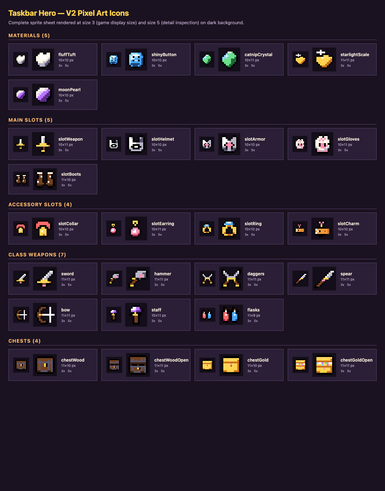
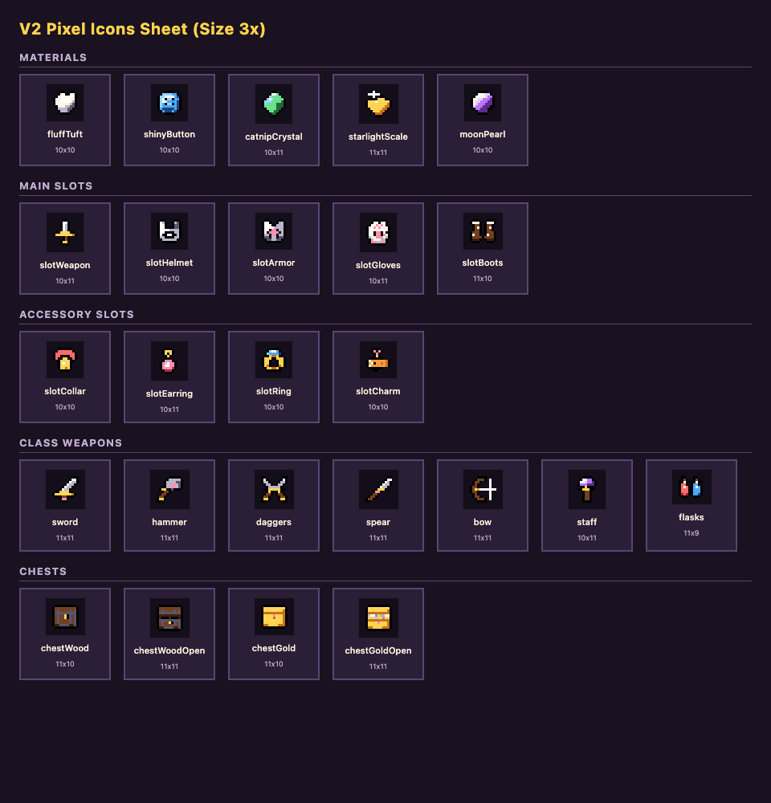
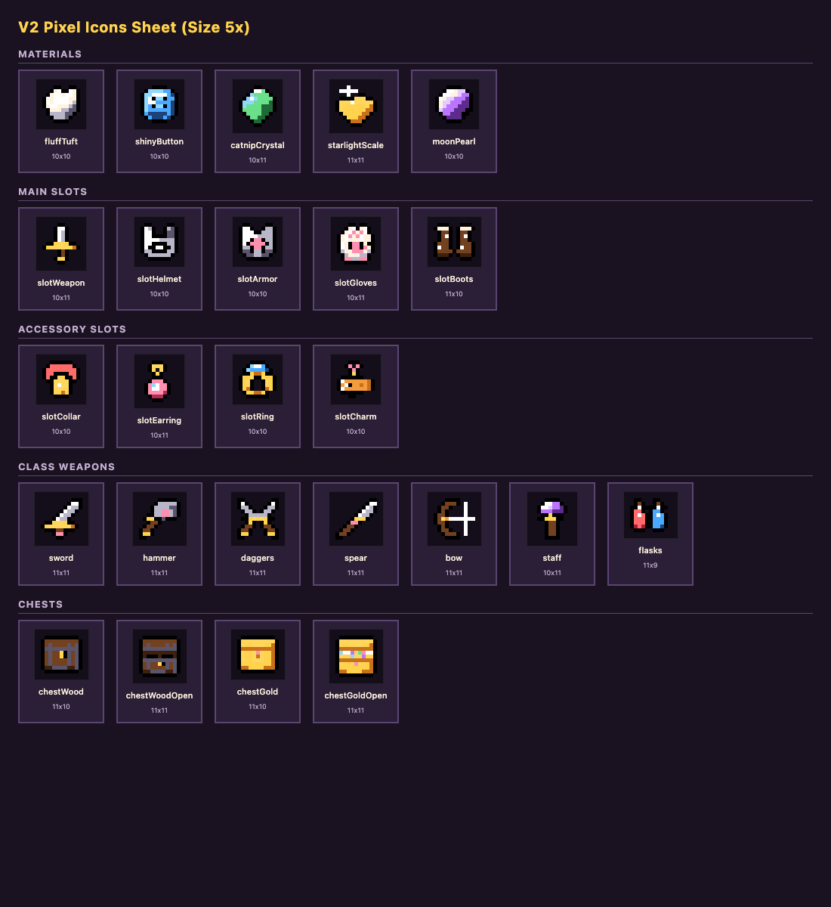

# V2 Pixel Art Icons Report (v25-icons)

## Overview

This report details the creation and verification of 25 new pixel-art icons designed for the next version of **Cat Café Quest** (`apps/web/src/art/v2Icons.tsx`). The icons are drawn from character-mapped string matrices in the authentic game engine style established in `apps/web/src/art/pixelIcons.tsx`, using single-character art pixel codes, theme-tokenized SVG path generation, and 1-pixel dark outlines for readability at size 3 (standard game display scale) and size 5 (high-resolution detail).

---

## Icon List & Design Specification

All icons are between 8 and 12 art pixels wide, completely bordered with 1-pixel dark outlines (`k`), and designed to look charming, whimsical, and immediately legible at 3x scale against dark backgrounds (`--bg: #1a1220`).

| Category | Icon Name | Dimensions (W × H) | Description | Palette Tokens |
| :--- | :--- | :--- | :--- | :--- |
| **Materials** | `fluffTuft` | 10 × 10 px | Soft grey-white tuft of cat fur with puffy lobes and gentle shading | `k`, `w`, `t`, `x`, `z` |
| **Materials** | `shinyButton` | 10 × 10 px | Round blue 4-hole sewing button with cyan reflection and dark thread holes | `k`, `w`, `s`, `u`, `b` |
| **Materials** | `catnipCrystal` | 10 × 11 px | Faceted magical green catnip crystal with glowing emerald facets | `k`, `w`, `s`, `e`, `n` |
| **Materials** | `starlightScale` | 11 × 11 px | Pale gold curved scale adorned with a brilliant 4-point white sparkle | `k`, `w`, `y`, `g`, `d` |
| **Materials** | `moonPearl` | 10 × 10 px | Lustrous spherical pearl with iridescent violet sheen and cream body | `k`, `w`, `t`, `j`, `v`, `i` |
| **Main Slots** | `slotWeapon` | 10 × 11 px | Centered upright straight blade with cat-ear golden guard and steel finish | `k`, `w`, `x`, `g`, `y`, `d`, `m` |
| **Main Slots** | `slotHelmet` | 10 × 10 px | Cat-eared knight plate helmet with visor eye-slit revealing glowing cat eyes | `k`, `w`, `x`, `z` |
| **Main Slots** | `slotArmor` | 10 × 10 px | Knight breastplate with pauldrons and an iconic glowing pink cat crest | `k`, `w`, `x`, `z`, `p` |
| **Main Slots** | `slotGloves` | 10 × 11 px | Cozy cat paw mitten with pink toe beans, thumb, and main palm pad | `k`, `w`, `t`, `x`, `z`, `p` |
| **Main Slots** | `slotBoots` | 11 × 10 px | Pair of adventurer boots with cream fur cuffs, leather shafts, and dark soles | `k`, `w`, `t`, `m`, `c` |
| **Accessory Slots** | `slotCollar` | 10 × 10 px | Curved red leather cat collar with a jingling golden bell pendant at center | `k`, `w`, `r`, `y`, `g`, `d` |
| **Accessory Slots** | `slotEarring` | 10 × 11 px | Golden ear hoop suspending a sparkling teardrop pink gemstone | `k`, `w`, `y`, `p`, `q`, `s` |
| **Accessory Slots** | `slotRing` | 10 × 10 px | Gleaming gold band with prong setting mounting a brilliant blue sapphire | `k`, `w`, `s`, `u`, `b`, `g`, `y`, `d` |
| **Accessory Slots** | `slotCharm` | 10 × 10 px | Little fish pendant on a pink cord loop, with fins and eye detail | `k`, `w`, `p`, `y`, `o`, `d` |
| **Class Weapons** | `sword` | 11 × 11 px | Diagonal cat café adventurer blade with gold guard, leather grip, and ruby pommel | `k`, `w`, `x`, `g`, `y`, `d`, `m`, `p` |
| **Class Weapons** | `hammer` | 11 × 11 px | Heavy war mallet with a pink paw stamp on the striking face and gold collar | `k`, `w`, `x`, `z`, `p`, `g`, `y`, `m` |
| **Class Weapons** | `daggers` | 11 × 11 px | Pair of crossed rogue daggers forming an X with gold guards and pommels | `k`, `w`, `x`, `g`, `y`, `m` |
| **Class Weapons** | `spear` | 11 × 11 px | Long weapon with leaf-shaped spearhead, gold socket, and fluttering pink ribbon | `k`, `w`, `x`, `g`, `y`, `p`, `m` |
| **Class Weapons** | `bow` | 11 × 11 px | Curved recurve hunting bow with wood limbs, grip wrap, bowstring, and arrow | `k`, `w`, `m`, `y`, `o` |
| **Class Weapons** | `staff` | 10 × 11 px | Mystic mage staff crowned with a glowing violet orb mounted in golden prongs | `k`, `w`, `v`, `j`, `i`, `g`, `y`, `m` |
| **Class Weapons** | `flasks` | 11 × 9 px | Two potion bottles side by side: red health potion and blue mana/speed elixir | `k`, `w`, `m`, `r`, `h`, `u`, `b` |
| **Chests** | `chestWood` | 11 × 10 px | Sturdy wooden chest with iron reinforcing bands and a golden keyhole clasp | `k`, `m`, `z`, `c`, `y`, `g` |
| **Chests** | `chestWoodOpen` | 11 × 11 px | Open wooden chest with raised lid, showing dark interior and interior rim | `k`, `m`, `z`, `c`, `y` |
| **Chests** | `chestGold` | 11 × 10 px | Ornate golden treasure chest with amber trim and a ruby/pink jewel clasp | `k`, `y`, `g`, `d`, `p` |
| **Chests** | `chestGoldOpen` | 11 × 11 px | Open golden chest overflowing with glittering diamonds, sapphires, rubies, and gold | `k`, `y`, `g`, `d`, `p`, `s`, `w`, `v`, `e` |

---

## Palette and CSS Theme Variable Mapping

Colors in `PALETTE` map to existing design system variables from `apps/web/src/theme.css` with fallbacks:

```typescript
export const PALETTE: Record<string, string> = {
  k: '#000000',                        // 1-pixel dark outline
  w: '#ffffff',                        // pure white highlight / sparkle
  t: 'var(--text, #fff3e0)',           // warm cream / light fluff / fur
  x: 'var(--rarity-common, #b9b6c9)',  // silver steel / soft grey fluff shadow
  z: '#5a556d',                        // dark steel / deep slate shadow
  g: 'var(--gold, #ffd34e)',           // bright gold / starlight scale
  y: 'var(--focus, #ffd75e)',          // pale warm yellow highlight / glint
  d: '#c9701a',                        // dark amber / gold shadow
  a: 'var(--accent, #ffb86b)',         // warm orange accent / light wood / paw pad
  o: '#f59b3d',                        // warm orange / tabby orange
  m: '#734120',                        // warm brown wood / leather
  c: '#3d200e',                        // dark wood shadow / deep leather
  s: 'var(--shard, #8fd8ff)',          // cyan magic shard / glass shine / button reflection
  u: 'var(--rarity-rare, #4aa8ff)',    // vivid blue button / blue potion / blade glow
  b: '#1d437a',                        // dark blue shadow
  e: 'var(--good, #6be08a)',           // catnip emerald crystal / green potion
  n: '#1f6937',                        // deep emerald shadow
  p: 'var(--key, #ff8fb1)',            // pink key / ribbon / rose gem / ear / paw
  q: '#af2e52',                        // deep rose / dark pink shadow
  v: 'var(--rarity-epic, #bb74ff)',    // violet moon pearl / magic orb
  j: '#e5ccff',                        // pale lilac pearl highlight
  i: '#5c2b8c',                        // deep violet shadow
  r: 'var(--bad, #ff6b6b)',            // ruby red / health potion
  h: '#a61c36',                        // deep crimson shadow
};
```

---

## Screenshot Sheets

All 25 icons rendered on the dark background (`#1a1220`) at size 3 (game standard) and size 5 (detail inspection):

### 1. Complete Sprite Sheet (Size 3x & Size 5x Side-by-Side)
- **Path:** [`reports/v25-icons/v2-icons-all.png`](v25-icons/v2-icons-all.png)



### 2. Standard Game Display Sheet (Size 3x)
- **Path:** [`reports/v25-icons/v2-icons-size-3.png`](v25-icons/v2-icons-size-3.png)



### 3. High-Resolution Detail Sheet (Size 5x)
- **Path:** [`reports/v25-icons/v2-icons-size-5.png`](v25-icons/v2-icons-size-5.png)



---

## Test Verification

The unit test suite `apps/web/src/art/v2Icons.test.tsx` includes 77 tests covering:
1. Exact presence and ordering of all 25 icons in `V2_ICON_NAMES`.
2. Map geometry: all rows equal length, widths strictly between 8 and 12 pixels, no unknown palette characters.
3. Accessible rendering: rendering without `title` sets `aria-hidden="true"` and no role; rendering with `title` sets `role="img"`, `aria-label`, and an inline `<title>` element.
4. Crisp rendering: `shapeRendering="crispEdges"`, correct viewBox coordinates, calculated width and height according to `size`.
5. Theme token integration: verifies CSS variable fallbacks for `--gold`, `--key`, `--shard`, `--good`, `--bad`, `--rarity-*`, `--text`.

---

## Exact Commands and Output

### 1. Git Author Verification
```bash
$ git config user.email && git config user.name
108352255+ntbaoheyhey@users.noreply.github.com
ntbaoheyhey
```

### 2. Package Installation
```bash
$ pnpm install
Scope: all 7 workspace projects
Lockfile is up to date, resolution step is skipped
Already up to date
╭ Warning ─────────────────────────────────────────────────────────────────────╮
│                                                                              │
│   Ignored build scripts: bufferutil@4.1.0, keccak@3.0.4,                     │
│   utf-8-validate@5.0.10.                                                     │
│   Run "pnpm approve-builds" to pick which dependencies should be allowed     │
│   to run scripts.                                                            │
│                                                                              │
╰──────────────────────────────────────────────────────────────────────────────╯
Done in 427ms using pnpm v10.28.0
```

### 3. Unit Tests
```bash
$ pnpm --filter @taskbar-hero/web test

> @taskbar-hero/web@0.0.0 test /Users/bao/taskbar-hero/apps/web
> vitest run

 Test Files  26 passed (26)
      Tests  276 passed (276)
   Start at  19:32:00
   Duration  3.51s (environment 53%, tests 28%, import 16%, transform 3%)
```

### 4. Workspace Typecheck
```bash
$ pnpm -r typecheck
Scope: 6 of 7 workspace projects
packages/auth typecheck$ tsc --noEmit
packages/chain typecheck$ tsc --noEmit
packages/game-rules typecheck$ tsc --noEmit
supabase/tests typecheck$ tsc --noEmit
└─ Done in 1.6s
└─ Done in 1.7s
└─ Done in 2s
└─ Done in 2.7s
packages/api-contract typecheck$ tsc --noEmit
└─ Done in 454ms
apps/web typecheck$ tsc --noEmit
└─ Done in 3.5s
```

### 5. Workspace Lint
```bash
$ pnpm -r lint
Scope: 6 of 7 workspace projects
packages/auth lint$ tsc --noEmit
packages/chain lint$ tsc --noEmit
packages/game-rules lint$ tsc --noEmit
supabase/tests lint$ tsc --noEmit
└─ Done in 415ms
└─ Done in 695ms
└─ Done in 819ms
└─ Done in 1.3s
packages/api-contract lint$ tsc --noEmit
└─ Done in 339ms
apps/web lint$ tsc --noEmit
└─ Done in 2.9s
```

---

## Design Decisions & Notes

1. **Distinguishing `slotWeapon` and `sword`**:
   - Both represent edged weapons, but `slotWeapon` serves as the equipment slot archetype, while `sword` represents the specific adventurer class weapon.
   - `slotWeapon` was designed as a symmetric, perfectly centered upright knight's blade with a golden cat-ear winged crossguard, evoking an official gear slot silhouette.
   - `sword` was drawn dynamically along the diagonal with a ruby pommel, angled hilt, and tapered tip.

2. **Contrast and Legibility at Size 3**:
   - At size 3, each art pixel spans 3 screen pixels (e.g. 10 × 10 art pixels occupies 30 × 30 px).
   - High-contrast specular whites (`w`) and dark outline pixels (`k`) were placed along key contours so the icons maintain silhouette clarity even on dark backgrounds.

3. **No Modification to Existing Files**:
   - Existing code (`apps/web/src/art/pixelIcons.tsx`, `apps/web/src/art/pixelIcons.test.tsx`, etc.) was kept strictly untouched.
   - All scratch preview generators were run without committing any extraneous files.

---

## Items Unsure About & Clarifications

1. **Distinction between `slotWeapon` and `sword`**:
   - Both are sword-like icons. As detailed above, `slotWeapon` is drawn upright and centered with golden cat-eared crossguards as a neutral equipment slot silhouette, whereas `sword` is drawn at a dynamic angle as an adventurer class weapon with a ruby pommel.
2. **Open Chest Interior Contents**:
   - `chestWoodOpen` depicts an open chest revealing the shaded empty wooden compartment interior.
   - `chestGoldOpen` depicts an open treasure chest brimming with sparkling gemstones (rubies, sapphires, emeralds, and gold coins) using palette highlights.
3. **Palette Token Coverage**:
   - Where game theme CSS variables were defined in `theme.css` (`--gold`, `--focus`, `--shard`, `--key`, `--good`, `--bad`, `--rarity-*`, `--text`), they were prioritized with appropriate hex fallbacks. Specific shadow tones and dark outlines (`k`, `#000000`, `z`, `#5a556d`, `c`, `#3d200e`) use pure hex codes to ensure consistent contrast regardless of runtime CSS overrides.
